# Kinedu AQ API enumeration

Collected on **2026-11-02** using the public first-party [assessment endpoint](https://webpromo.kinedu.com/api/assessment) and saved [client source](logs/phase2-source-contract.md). No browser was opened.

## Findings

- **408 unique IDs with English text recovered from the API**: 373 appear in initial questions; 35 additional IDs appear only in observed report inventories. The union exactly matches all 408 IDs in both saved Spanish and Portuguese client dictionaries; no dictionary ID is missing and no extra API ID was found.
- **49 distinct ordered initial lists**, one per returned age 0–48 months. All adjacent ages overlap (16–35 shared IDs). Initial lists contain 22–39 questions.
- The initial flow is one shared bank with age-specific overlapping lists. It is not one identical list for every age, and it is not a collection of disjoint age buckets. The API can add an answer-dependent extension; age alone does not determine the full assessment path.
- The supported upper boundary is **48 returned months inclusive**. Returned ages 49, 50, and 51 all give HTTP 422 `age_range`.

## Method and reproducibility

1. Inspected the saved page JavaScript before calling the API: `input type="date"` and explicit year/month/day concatenation establish `YYYY-MM-DD`. The exact start body contains only `action`, `birthdate`, and `gestationalWeeks`; see [source evidence](logs/phase2-source-contract.md).
2. Confirmed start with `2026-05-02`, null gestation: HTTP 200, age 6, uncorrected. It was initially saved to `start_age06_gw-null.json`, then copied byte-for-byte to [smoke_start_age06_gw-null.json](raw/api/smoke_start_age06_gw-null.json) before the sweep reused the requested filename.
3. Swept nominal offsets N=0…52 with DOB = November 2026 minus N calendar months, day 15, and null gestation. Stopped after three consecutive `age_range` responses. Every nominal response remains at the requested `start_ageNN_gw-null.json` path.
4. For actual chronological ages 0,1,2,3,4,6,9,12,18,24, collected gestation 28,32,36,37 plus a paired null baseline. These use day 2, matching today's day, to obtain the actual requested completed-month age and a valid newborn DOB. Their files are `start_ageNN_gwWW.json`; paired baselines are `sample_ageNN_gw-null.json`.
5. Added focused correction/cutoff probes, all-one/all-zero `result` profiles at all 49 ages, and one age-6 `extended:true` result to inspect report inventories. Numeric answers are exactly `y:0` or `y:1`, as in the client. Only `/api/assessment` was called; no leads, tracking, email, or checkout requests were sent.
6. Saved every raw body, HTTP headers, request body, status, curl exit code, and SHA-256. Collector calls have UTC request-start timestamps; the initial manual smoke records only the response Date header, with request-start timestamp explicitly unknown. There were 229 requests: 223 HTTP 200, 4 HTTP 422, and 2 HTTP 400; no transport failures. [requests.jsonl](raw/api/requests.jsonl) is the authoritative request-to-file manifest.
7. Calls ran sequentially with a 0.5-second sleep before every subsequent request, realistic User-Agent, JSON Content-Type, Origin and Referer. No cookies or authorization header were needed. [Collector](scripts/enumerate_api.py), [focused probes](scripts/probe_api.py), and [offline report builder](scripts/build_enumeration.py) preserve the method. Collectors refuse to overwrite existing raw response paths.

Exact first curl command (the archived smoke response is linked above):

```sh
curl --request POST 'https://webpromo.kinedu.com/api/assessment' \
  --user-agent 'Mozilla/5.0 (X11; Linux x86_64) AppleWebKit/537.36 (KHTML, like Gecko) Chrome/130.0.0.0 Safari/537.36' \
  --header 'Content-Type: application/json' \
  --header 'Origin: https://webpromo.kinedu.com' \
  --header 'Referer: https://webpromo.kinedu.com/aq-assessment' \
  --data-raw '{"action":"start","birthdate":"2026-05-02","gestationalWeeks":null}' \
  --connect-timeout 20 --max-time 60 --silent --show-error \
  --dump-header raw/api/start_age06_gw-null.headers.txt \
  --output raw/api/start_age06_gw-null.json \
  --write-out 'HTTP %{http_code}\n'
sleep 0.5
```

The sweep uses the same curl headers/options, changes the payload/output stem, and emits the numeric HTTP status into the manifest. Rebuild the derived artifacts without network calls using `python3 scripts/build_enumeration.py`.

## Date labels and boundary

The requested day-15 convention does not align nominal filenames with completed ages on November 2: `start_age00_gw-null.json` requests 2026-11-15, a future DOB, and returns HTTP 422 `invalid_birthdate`. `start_age01_gw-null.json` requests 2026-10-15 and returns age 0; `start_age06_gw-null.json` requests 2026-05-15 and returns age 5. The initial May 2 smoke call returns age 6. No failure was discarded or silently relabeled.

| Nominal filename age | DOB | Returned ageMonths | HTTP / result |
| --- | --- | ---: | --- |
| 0 | 2026-11-15 | — | 422 invalid_birthdate |
| 1 | 2026-10-15 | 0 | 200 |
| 49 | 2022-10-15 | 48 | 200; last supported age |
| 50 | 2022-09-15 | 49 | 422 age_range |
| 51 | 2022-08-15 | 50 | 422 age_range |
| 52 | 2022-07-15 | 51 | 422 age_range; stop |

[age-map.md](age-map.md) therefore indexes by the API's returned age. All 49 integer ages 0–48 are covered despite the invalid nominal age-zero request.

## Corrected age

Let C be the paired null-gestation API age. In the observed integer-week UI range 24–36, the exact empirical rule is:

```text
d(g) = 4 months for g = 24
       3 months for g = 25…29
       2 months for g = 30…33
       1 month  for g = 34…36
       0 months for g = 37 or null (controls)
if C < 24 and g is 24…36:
    ageMonths = max(0, C - d(g))
    corrected = true
else:
    ageMonths = C
    corrected = false
```

This is consistent with rounding `(40 - gestationalWeeks) × 7 / 30.44` to whole months and subtracting that integer from the uncorrected completed-month age. The server source is unavailable: the precise days-per-month constant is an inference, not an observed implementation. The table above states what was directly established for every integer week accepted by the client slider. No claim is made for fractional weeks or weeks outside the tested UI/control range.

Rounding is material: gestation 30 corrects 6 → 4 (two months), not three months. The May 30 null/GW30 pair returns 5 → 3, which rules out simply flooring continuous day age after subtracting 70 days with a 30.44-day month (that would give 2 at collection time). At chronological age 0, preterm responses still set `corrected:true` while age remains clamped to 0.

Table cells are `ageMonths / corrected`; each row has a paired null baseline equal to the chronological age:

| Chronological API age | GW 28 | GW 32 | GW 36 | GW 37 control |
| --- | --- | --- | --- | --- |
| 0 | 0 / true | 0 / true | 0 / true | 0 / false |
| 1 | 0 / true | 0 / true | 0 / true | 1 / false |
| 2 | 0 / true | 0 / true | 1 / true | 2 / false |
| 3 | 0 / true | 1 / true | 2 / true | 3 / false |
| 4 | 1 / true | 2 / true | 3 / true | 4 / false |
| 6 | 3 / true | 4 / true | 5 / true | 6 / false |
| 9 | 6 / true | 7 / true | 8 / true | 9 / false |
| 12 | 9 / true | 10 / true | 11 / true | 12 / false |
| 18 | 15 / true | 16 / true | 17 / true | 18 / false |
| 24 | 24 / false | 24 / false | 24 / false | 24 / false |

Correction stops at **chronological C=24**, not corrected age 24. With GW28: DOB 2024-11-03 gives C=23 → 20/true, while DOB 2024-11-02 gives C=24 → 24/false; DOB 2024-11-01 also gives 24/false. Thus the observed threshold is the completed 24th month. The age-24 sample returns 24/false for all four requested gestations.

All repeated start responses with the same returned age were identical after removing only `corrected`, including their order and raw item fields. In these samples, gestation changes the list by changing effective age; it does not create a separate preterm bank.

## Language

Skipped language API variations because no assessment request in the saved client has a `lang`, `language`, or locale field. The client reads URL `lang`, chooses English/Spanish/Portuguese, and translates question IDs and area headings locally; API question `title` is the English fallback. This establishes the client contract, not whether the server accepts arbitrary unobserved fields. Some result activity titles do contain server-provided `en`/`es`/`pt` maps.

## Bank, CSV semantics, and completeness

[questions.csv](questions.csv) has one row per ID (408 data rows), with the requested columns plus every raw per-item field observed: `area, id, rate, skill, status, title`. It includes 373 initial IDs, 77 extension IDs (all already in the initial union), and 382 report IDs. Exactly 35 IDs occur only in observed report inventories.

- `age_months_min/max` and exact `age_months` cover every observed API occurrence, including report inventories. They are bounds, not an assertion that an ID appears at every age between them. Use `start_age_months_min/max` and exact `start_age_months` for the initial question-selection range. Report-only rows have empty initial bounds and `start_age_months=[]`; `extension_age_months` and `report_age_months` keep other contexts explicit.
- `source_phases` identifies `start`, `extension`, and/or `report`. `kind` lists observed question roles separated by `|` when an ID changes role. Extension and report inventory entries are `item`; report presence is not evidence that a question was asked in that assessment.
- The API supplies no section ID or section title field. `section_id` is empty. `section_title` uses the domain heading (`area`) from the item or enclosing report skill. `displayed_under` preserves actual start section placement; calibration can be cross-domain. `report_skill` stores enclosing report skill labels separately from the raw question `skill`.
- Raw columns retain scalar values when constant, JSON arrays when values differ, and empty cells when absent. `rate_by_age_months` preserves age-dependent rates. `raw_observations` preserves every distinct raw item with age, phase, kind, domain, display section and report-skill context; `sources` links all original bodies. A missing raw `rate` or `skill` for a report-only item is not invented.
- This inventory is complete relative to all 408 IDs in both saved client translation dictionaries. It is not proof that the server contains no unreferenced, untranslated, historical, or otherwise unreachable IDs. All initial integer ages are enumerated; all possible extension answer combinations are not.

Report-only IDs: `21, 38, 43, 71, 124, 131, 136, 138, 140, 144, 149, 150, 193, 201, 207, 216, 230, 236, 289, 295, 357, 378, 382, 396, 399, 521, 600, 615, 631, 632, 635, 640, 712, 1027, 1152`.

## Response structure and scoring clues

- Start top-level keys are exactly `ageMonths`, `corrected`, `sections`, `calibration`. Section keys are `area`, `anchor`, `items`; `anchor` may be null. Initial/extension question keys are exactly `id`, `area`, `skill`, `title`, `rate`. No `difficulty`, `weight`, or `domain` key was returned on those items.
- `rate` ranges from 0 to 0.98 across observed initial/extension items. 299 IDs have multiple rate values across contexts/ages; do not flatten one ID to a single rate. 120 initial IDs change role among anchor/item/calibration. For example ID 285 has rate 0.92 at age 0, 0.96 at age 1, and 0.98 when returned at age 5. Area/skill/rate and report curves suggest age-based calibration; the field's exact statistical meaning and scoring weights are not exposed.
- There are four domain sections at every supported age, but item distribution and anchor availability vary. Age 0 has 11 Physical items and 5 Language items; age 6 has 8 items per section. Calibration has three entries at ages 0–36 and zero at 37–48. Ages 0–36 have 39 initial questions; 37–44 have 36; 45 has 33; 46 has 27; 47 has 24; 48 has 22. At age 45 only Social-Emotional retains an anchor; ages 46–48 have no anchors.
- Numeric all-one results return eight extension items at each age 0–41, and complete at ages 42–48. All-zero completes as `below_floor` at 48 ages. **Unexpectedly, age 1 with all 39 numeric answers zero returns `state:"ok"`, `band:"on_pace"`, `devAge:1`, `capped:false`**, including a Physical area age of 2 and Language `not_enough`. A repeat returned the identical JSON body; see [original](raw/api/result_age01_all_no_numeric.json) and [repeat](raw/api/result_age01_all_no_repeat.json). This is a scoring anomaly to investigate, not evidence of a particular hidden formula. The 42 observed extension lists contain 77 unique IDs, all present in the initial union. This confirms answer-dependent server behavior; it does not disclose the extension selection algorithm for mixed answers.
- A successful complete result can expose `basic`, `detail`, `skills`, `activity`; below-floor results expose `basic`, `detail`, `floorActivities`. Observed report flags include `band`, `devAge`, `capped`, `tier`, `areasLocked`, `teaserArea`, `areasDefaultHidden`, and per-area `atLeast`. Skill groups expose `from`, `to`, `total`, `reached`, `focus`, `childPct`, and `curve:[{age,pct,lo,hi}]`; their inventory items expose `id`, `title`, `status` (`not_yet`, `open`, `typical`, `yes` observed). These report fields are not raw question weights.
- For the age-6 all-one `extended:true` probe, `basic` returns `devAge:31`, `capped:true`, `band:"well_ahead"`; this bypassed extension solely to inspect the inventory, not to model a real child or validate scoring.

## Saved failures

The future-DOB failure and three range failures were expected from the sweep. Two exploratory `result` requests incorrectly used JSON booleans for `y` and returned HTTP 400 `invalid_body`. Both were preserved, then repeated successfully using numeric zero/one. No request failure is represented as a successful enumeration.

| Raw body | HTTP | Error | ageMonths |
| --- | ---: | --- | --- |
| [start_age00_gw-null.json](raw/api/start_age00_gw-null.json) | 422 | `invalid_birthdate` | — |
| [start_age50_gw-null.json](raw/api/start_age50_gw-null.json) | 422 | `age_range` | 49 |
| [start_age51_gw-null.json](raw/api/start_age51_gw-null.json) | 422 | `age_range` | 50 |
| [start_age52_gw-null.json](raw/api/start_age52_gw-null.json) | 422 | `age_range` | 51 |
| [result_age06_all_yes.json](raw/api/result_age06_all_yes.json) | 400 | `invalid_body` | — |
| [result_age06_all_no.json](raw/api/result_age06_all_no.json) | 400 | `invalid_body` | — |

## Age → set diagram

Each node uses returned effective age. Gestation maps chronological age to one of these effective ages as described above. See [age-map.md](age-map.md) for exact ordered IDs and extension lists.

```mermaid
flowchart LR
  A00["0 months"] --> S00["S00: 39 questions"]
  A01["1 months"] --> S01["S01: 39 questions"]
  A02["2 months"] --> S02["S02: 39 questions"]
  A03["3 months"] --> S03["S03: 39 questions"]
  A04["4 months"] --> S04["S04: 39 questions"]
  A05["5 months"] --> S05["S05: 39 questions"]
  A06["6 months"] --> S06["S06: 39 questions"]
  A07["7 months"] --> S07["S07: 39 questions"]
  A08["8 months"] --> S08["S08: 39 questions"]
  A09["9 months"] --> S09["S09: 39 questions"]
  A10["10 months"] --> S10["S10: 39 questions"]
  A11["11 months"] --> S11["S11: 39 questions"]
  A12["12 months"] --> S12["S12: 39 questions"]
  A13["13 months"] --> S13["S13: 39 questions"]
  A14["14 months"] --> S14["S14: 39 questions"]
  A15["15 months"] --> S15["S15: 39 questions"]
  A16["16 months"] --> S16["S16: 39 questions"]
  A17["17 months"] --> S17["S17: 39 questions"]
  A18["18 months"] --> S18["S18: 39 questions"]
  A19["19 months"] --> S19["S19: 39 questions"]
  A20["20 months"] --> S20["S20: 39 questions"]
  A21["21 months"] --> S21["S21: 39 questions"]
  A22["22 months"] --> S22["S22: 39 questions"]
  A23["23 months"] --> S23["S23: 39 questions"]
  A24["24 months"] --> S24["S24: 39 questions"]
  A25["25 months"] --> S25["S25: 39 questions"]
  A26["26 months"] --> S26["S26: 39 questions"]
  A27["27 months"] --> S27["S27: 39 questions"]
  A28["28 months"] --> S28["S28: 39 questions"]
  A29["29 months"] --> S29["S29: 39 questions"]
  A30["30 months"] --> S30["S30: 39 questions"]
  A31["31 months"] --> S31["S31: 39 questions"]
  A32["32 months"] --> S32["S32: 39 questions"]
  A33["33 months"] --> S33["S33: 39 questions"]
  A34["34 months"] --> S34["S34: 39 questions"]
  A35["35 months"] --> S35["S35: 39 questions"]
  A36["36 months"] --> S36["S36: 39 questions"]
  A37["37 months"] --> S37["S37: 36 questions"]
  A38["38 months"] --> S38["S38: 36 questions"]
  A39["39 months"] --> S39["S39: 36 questions"]
  A40["40 months"] --> S40["S40: 36 questions"]
  A41["41 months"] --> S41["S41: 36 questions"]
  A42["42 months"] --> S42["S42: 36 questions"]
  A43["43 months"] --> S43["S43: 36 questions"]
  A44["44 months"] --> S44["S44: 36 questions"]
  A45["45 months"] --> S45["S45: 33 questions"]
  A46["46 months"] --> S46["S46: 27 questions"]
  A47["47 months"] --> S47["S47: 24 questions"]
  A48["48 months"] --> S48["S48: 22 questions"]
```



## Validation

The offline builder checks response SHA-256s, HTTP header statuses, transport success, recorded request-start spacing, all 49 initial ages, unique IDs within every initial list, paired correction samples, integer-week probes, identical payloads for equal effective ages, CSV ID uniqueness, and equality of the recovered bank with both independent translation dictionaries. All checks passed. Raw HTTP errors remain evidence, not failed validation.
