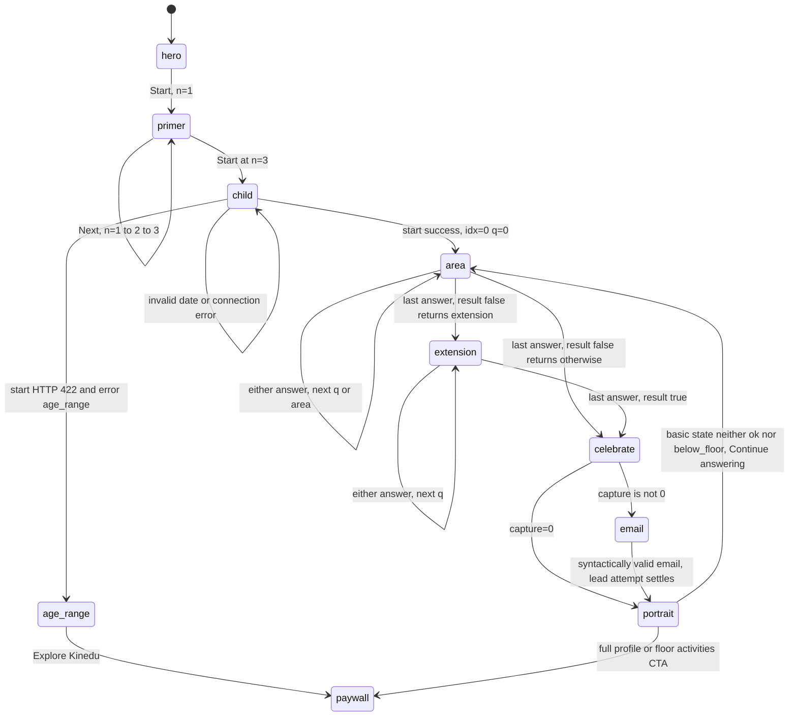
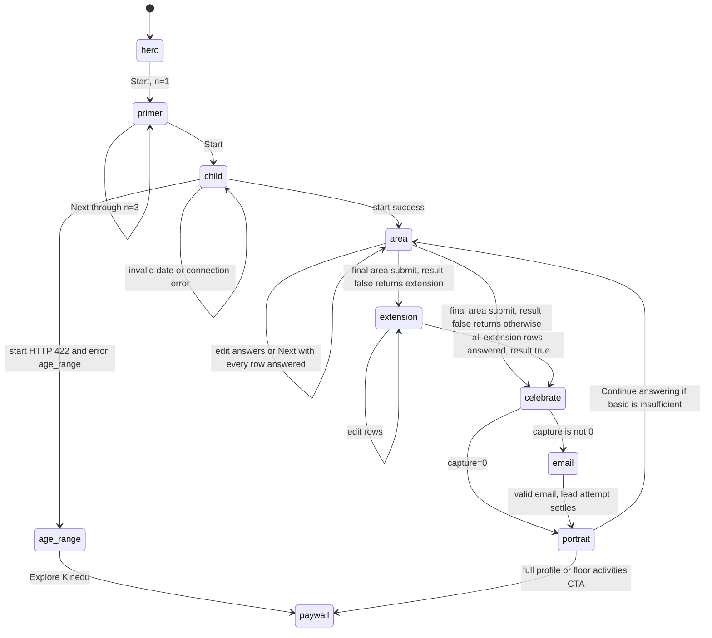
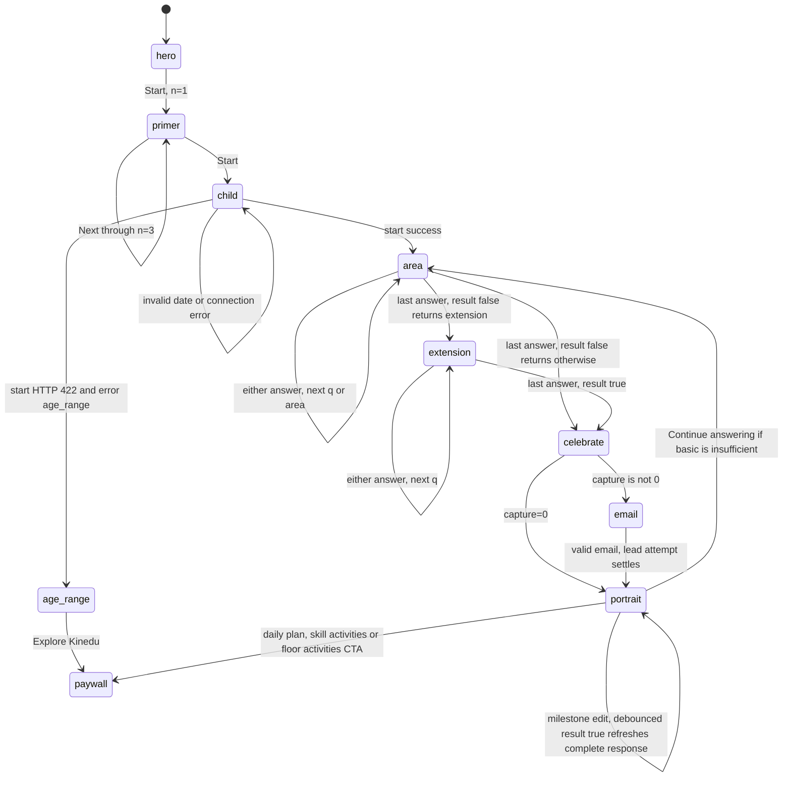
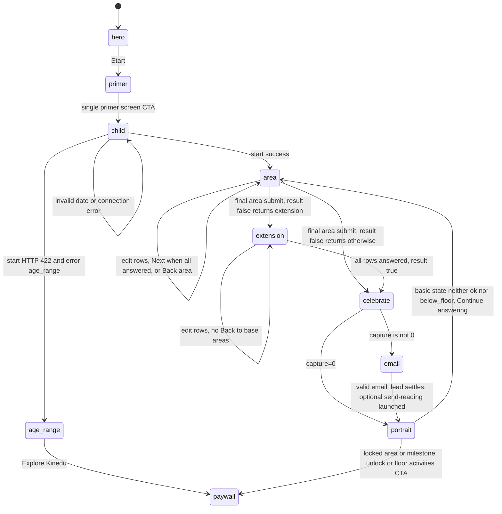
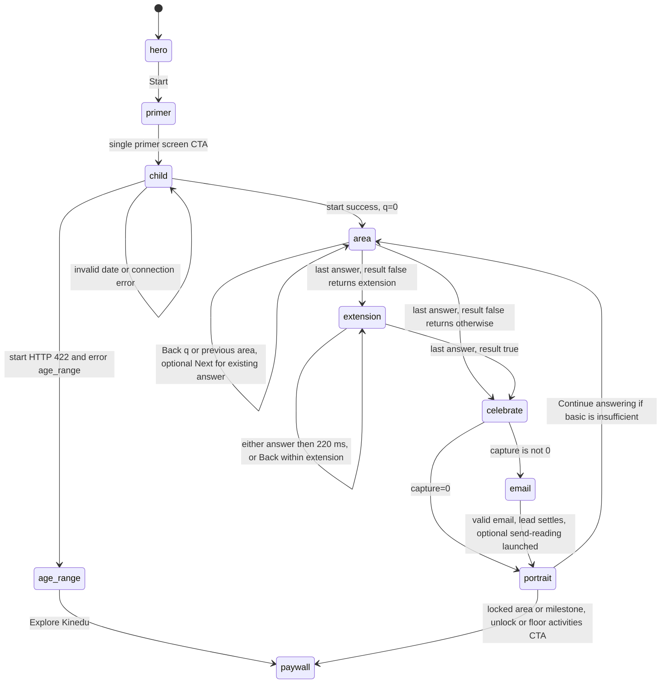
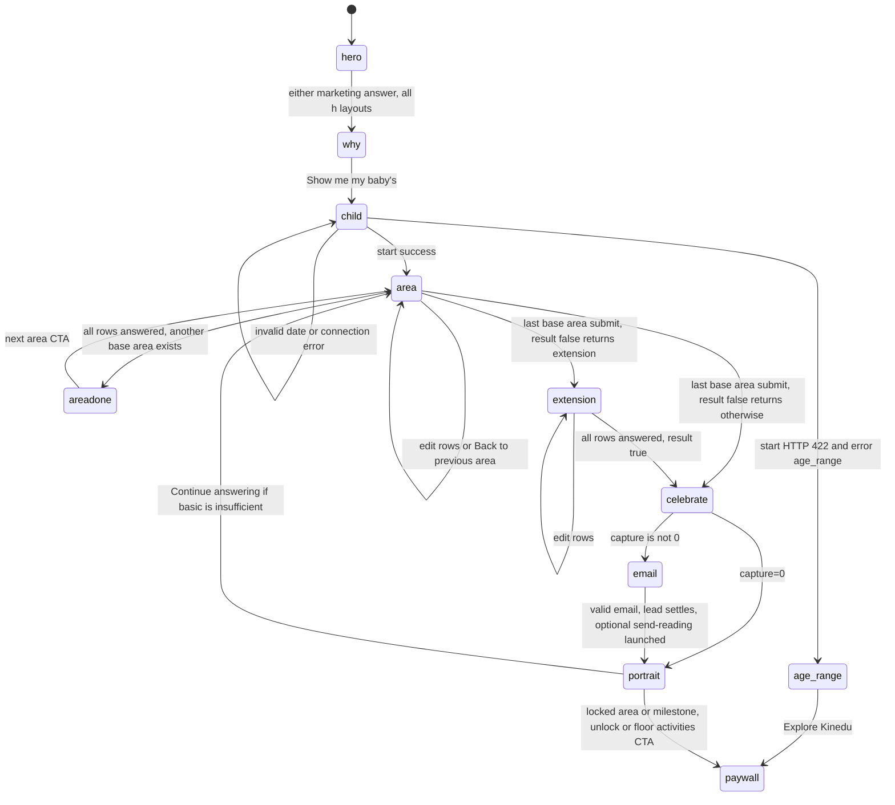

# Kinedu AQ assessment — Phase 1 static analysis

Scope: only the five supplied files under `raw/js/`; no browser, live-site request, or API request was made. The curl commands below are examples for a later phase and were **not executed**. No findings from `raw/api/`, screenshots, or Phase 2 logs are used.

**Observed:** six URL-selectable UI modes share the same assessment request shapes. The front end preserves the question order returned by the API and does not skip questions based on yes/no answers. The server can return an additional question set after a result request. Developmental ages, classifications, and skill data come from the API; their scoring algorithm is absent. Some report graphics and concealed values are deliberately cosmetic.

**Inference boundary:** this establishes the client’s behavior, not how many server-side question sets exist, whether the server adapts its extension to answers, whether scoring is scientifically valid, or whether persistence/email delivery works. Those require separate API evidence.

## Evidence and reproducibility

All line references below refer to these fixed, beautified copies; numbered code blocks reproduce their actual lines:

- **P** = [page-5f182d70f1f24a3d.js](raw/js/beautified/page-5f182d70f1f24a3d.js), module `178`.
- **S** = [562-f8a0c4482aa81c7b.js](raw/js/beautified/562-f8a0c4482aa81c7b.js), including modules `5562`, `9845`, `6125`, `5668`, `7578`.
- **H** = [aq-assessment.html](raw/js/beautified/aq-assessment.html).
- Small chunks: [3-0b860339fe270cd0.js](raw/js/beautified/3-0b860339fe270cd0.js), [layout-6b1bd9eaf77c0993.js](raw/js/beautified/layout-6b1bd9eaf77c0993.js).

Beautification used `js-beautify@2.0.3`, ultimately through its JavaScript API with `{indent_size:2, indent_with_tabs:false}`, and its HTML formatter. An initial glob invocation rewrote the four JS inputs; all four were recovered byte-for-byte against SHA-256 hashes recorded **before** that invocation. Final integrity is checked by `sha256sum -c raw/js/beautified/SOURCE-SHA256SUMS`: all five originals match. The originals’ final bytes are unchanged. The SHA-256 manifest is retained.

The shared chunk is not merely helpers: `5562` exports the hook quiz component (S 4–9); `9845` contains pixel/attribution helpers (S 2396–2437); `6125` contains en/es/pt feedback copy (S 2439–2440); `5668`/`7578` contain **408 Spanish and 408 Portuguese question-title translations, with identical ID sets** (S 2442–2446). These dictionaries contain no age assignment, item difficulty, section membership, skill mapping, or scoring weights. The two empty modules at S 2448–2452 do not supply data. The small chunks implement Next.js script/head handling and layout bootstrapping, not quiz questions or scoring. H 12–15 loads the relevant chunks, H 35 identifies page module `178`, and H 38 contains layout scripts for Clarity/Facebook and a page with empty props; it does not embed a start/result response.

For readable inspection, the three `JSON.parse` constants were decoded into `feedback.json`, `esQuestions.json`, and `ptQuestions.json` in `raw/js/beautified/`; area/classic/hook copy constants are also extracted there. [extract-static-data.cjs](raw/js/beautified/extract-static-data.cjs) evaluates only isolated data literals, never application modules. Appendix A includes every copy-table value and both question dictionaries, with source attribution. This avoids hiding hundreds of strings behind “localisation exists.”

## 1. URL parameters

### Parameters actually read

The exact code for the primary selector, internal layouts, paywall path, language resolver, and attribution reads is quoted immediately below the table. Values are case-sensitive except `lang`, which is lowercased and prefix-matched.

| Parameter | Observed effect and exact code | Evidence |
|---|---|---|
| `ui` | Rendering selector: `t(e.get("ui") || e.get("v") || "")`; takes precedence over `v`. Internal `_` layout also uses `e.get("ui") || e.get("v")`. | P 311–312, 3672–3678 |
| `v` | Rendering fallback to `ui`; **opposite precedence in analytics**, `(o.get("v") || o.get("ui") || "assessment").slice(0, 20)`, or default `"classic"` in classic/hook. Does not directly choose a question set. | P 239, 2174; S 844 |
| `paywall` | `(e.get("paywall") || "").trim()`; must match `/^[a-z0-9][a-z0-9-]{0,31}$/`, else `"trial3"`; navigates to `/aq-paywall-<value>/index.html`, carrying the query and setting `from=assessment`. | P 64–79, 1904–1919; S 545–560 |
| `capture` | Exact string `"0"` bypasses the `email` state after `celebrate`, in every mode. Other values/absence keep email capture enabled. | P 312, 944–948, 2151, 3130–3134; S 821, 1860–1864 |
| `lang` | `(new URLSearchParams(location.search).get("lang") || "").toLowerCase()`; `startsWith("es") → es`, `startsWith("pt") → pt`, otherwise en. Used only by classic/classic-steps/hook. Default/list/skills hard-code English. Not sent to `/api/assessment`. | P 1500–1511, 2149; S 811–818; P 264, 293 |
| `env` | `"qa" === o.get("env") || "webpromo.kinedu.com" !== location.hostname ? "qa" : "prod"`. Metadata on track/lead only. `env=prod` cannot override the nonproduction-host check. This does not change the assessment endpoint. | P 234, 263, 292, 2169; S 839 |
| `test_id` | `(o.get("test_id") || "aq-assessment").slice(0, 80)`; attribution on track/lead only. | P 238, 265, 294, 2173; S 843 |
| `utm_source` | `utm_source: o.get("utm_source")`; track and lead. | P 240, 268, 297, 2175; S 845 |
| `utm_medium` | `utm_medium: o.get("utm_medium")`; track and lead. | P 241, 269, 298, 2176; S 846 |
| `utm_campaign` | `utm_campaign: o.get("utm_campaign")`; track and lead. | P 242, 270, 299, 2177; S 847 |
| `utm_content` | `utm_content: o.get("utm_content")`; track only. | P 243, 271, 2178; S 848 |
| `utm_term` | `utm_term: o.get("utm_term")`; track only. | P 244, 272, 2179; S 849 |
| `fbclid` | `fbclid: o.get("fbclid")`; track only. | P 245, 273, 2180; S 850 |
| `gclid` | `gclid: o.get("gclid")`; track only. | P 246, 274, 2181; S 851 |
| `ttclid` | Additional click attribution: `ttclid: o.get("ttclid")`; track only. | P 247, 275, 2182; S 852 |
| `q` | **Hook only**: `new URLSearchParams(location.search).get("q") || ""`; accepts walking/talking/crawling/rolling, selecting `"hook_q_" + e`; otherwise `"hook_query"`. Changes the fake search prompt in hero layout 1, not the assessment request. | S 795–802, 1184 |
| `h` | **Hook only**: `new URLSearchParams(location.search).get("h")`; exact `"2"`/`"3"` select those hero layouts, otherwise `"1"`. Does not change question selection/scoring. | S 803–810, 1154–1196 |

`URLSearchParams.get` returns `null` for absent attribution fields; those become explicit JSON `null` after the metadata effect initializes. Only the five named `utm_*` keys above are read; there is no wildcard extraction of other `utm_` keys.

**Absent from the supplied code:** `offer`, `newusers`, `placement`, `vid`. There is no parameter read or direct behavior to quote for any of these; whole-source searches find no occurrence. Their query strings can still appear in `landing_url` and survive the paywall query forwarding. The behavior of a later paywall page is outside these files. `from` is **written**, not read here. `dpl` in H 7–15 is a static asset deployment query, not a quiz option.

Exact selector and internal-layout reads:

P, lines 3665–3678:

```js
3665 |       var $ = a(5562);
3666 | 
3667 |       function X() {
3668 |         let [e, t] = (0, l.useState)(null);
3669 |         return ((0, l.useEffect)(() => {
3670 |           try {
3671 |             let e = new URLSearchParams(location.search);
3672 |             t(e.get("ui") || e.get("v") || "")
3673 |           } catch (e) {
3674 |             t("")
3675 |           }
3676 |         }, []), null === e) ? null : "hook" === e ? (0, s.jsx)($.default, {}) : "classic" === e ? (0, s.jsx)(Q, {}) : "classic-steps" === e ? (0, s.jsx)(Q, {
3677 |           steps: !0
3678 |         }) : (0, s.jsx)(_, {})
```

P, lines 305–314:

```js
305 |         }(), [a, n] = (0, l.useState)({
306 |           s: "hero"
307 |         }), [_, v] = (0, l.useState)("steps"), [j, w] = (0, l.useState)(!1);
308 |         (0, l.useEffect)(() => {
309 |           try {
310 |             let e = new URLSearchParams(location.search),
311 |               t = e.get("ui") || e.get("v");
312 |             "list" === t && v("list"), "skills" === t && v("skills"), "0" === e.get("capture") && w(!0)
313 |           } catch (e) {}
314 |         }, []);
```

Exact paywall handling:

P, lines 64–79:

```js
64 |       function p(e) {
65 |         e("quiz_answer", "paywall_handoff"), (0, r.iA)("InitiateCheckout", {
66 |           content_category: "acquisition",
67 |           content_name: "assessment"
68 |         }), location.href = function() {
69 |           let e;
70 |           try {
71 |             e = new URLSearchParams(location.search)
72 |           } catch (t) {
73 |             e = new URLSearchParams
74 |           }
75 |           let t = (e.get("paywall") || "").trim();
76 |           /^[a-z0-9][a-z0-9-]{0,31}$/.test(t) || (t = "trial3"), e.set("from", "assessment");
77 |           let a = e.toString();
78 |           return "/aq-paywall-".concat(t, "/index.html").concat(a ? "?".concat(a) : "")
79 |         }()
```

Language resolution:

P, lines 1500–1511:

```js
1500 |       function D() {
1501 |         try {
1502 |           let e = (new URLSearchParams(location.search).get("lang") || "").toLowerCase();
1503 |           if (e.startsWith("es")) return "es";
1504 |           if (e.startsWith("pt")) return "pt"
1505 |         } catch (e) {}
1506 |         return "en"
1507 |       }
1508 | 
1509 |       function F(e, t) {
1510 |         var a, s;
1511 |         return "es" === t ? null !== (a = v[String(e.id)]) && void 0 !== a ? a : e.title : "pt" === t && null !== (s = j[String(e.id)]) && void 0 !== s ? s : e.title
```

All attribution parameter reads, one complete implementation (the duplicate versions are catalogued in §3):

P, lines 234–250:

```js
234 |             let d = "qa" === o.get("env") || "webpromo.kinedu.com" !== location.hostname ? "qa" : "prod";
235 |             e.current = {
236 |               session_id: i,
237 |               environment: d,
238 |               test_id: (o.get("test_id") || "aq-assessment").slice(0, 80),
239 |               variant: (o.get("v") || o.get("ui") || "assessment").slice(0, 20),
240 |               utm_source: o.get("utm_source"),
241 |               utm_medium: o.get("utm_medium"),
242 |               utm_campaign: o.get("utm_campaign"),
243 |               utm_content: o.get("utm_content"),
244 |               utm_term: o.get("utm_term"),
245 |               fbclid: o.get("fbclid"),
246 |               gclid: o.get("gclid"),
247 |               ttclid: o.get("ttclid"),
248 |               landing_url: location.href,
249 |               referrer: document.referrer || null
250 |             }
```

Hook-only reads:

S, lines 795–824:

```js
795 |         } = arguments.length > 0 && void 0 !== arguments[0] ? arguments[0] : {}, [U, O] = (0, r.useState)(null), [V] = (0, r.useState)(() => {
796 |           if (B) return B.hookQKey;
797 |           try {
798 |             let e = new URLSearchParams(location.search).get("q") || "";
799 |             return ["walking", "talking", "crawling", "rolling"].includes(e) ? "hook_q_" + e : "hook_query"
800 |           } catch (e) {
801 |             return "hook_query"
802 |           }
803 |         }), [J] = (0, r.useState)(() => {
804 |           if (B) return B.heroVar;
805 |           try {
806 |             let e = new URLSearchParams(location.search).get("h");
807 |             return "2" === e || "3" === e ? e : "1"
808 |           } catch (e) {
809 |             return "1"
810 |           }
811 |         }), [G] = (0, r.useState)(() => B ? B.lang : function() {
812 |           try {
813 |             let e = (new URLSearchParams(location.search).get("lang") || "").toLowerCase();
814 |             if (e.startsWith("es")) return "es";
815 |             if (e.startsWith("pt")) return "pt"
816 |           } catch (e) {}
817 |           return "en"
818 |         }()), [W] = (0, r.useState)(() => {
819 |           if (B) return B.noCapture;
820 |           try {
821 |             return "0" === new URLSearchParams(location.search).get("capture")
822 |           } catch (e) {
823 |             return !1
824 |           }
```

A first-touch helper also reads those same attribution keys and saves `kinedu_first_touch`, with `landed_at` (S 2415–2436). It is exported as `lN`; neither quiz implementation calls that export in the supplied code. Hook can use `window.__kinedu_sid` before falling back to localStorage (S 833–837); the supplied HTML does not set that global.

**Inference:** conflicting `ui` and `v` can mislabel telemetry: `?ui=skills&v=classic` renders skills but sends `variant:"classic"`. URL variants are not automatically assigned A/B tests in this code.

## 2. UI variants and state machines

These are the actual minified component symbols; original component names are unavailable.

| Selected `ui || v` | React component | Layout / language | Question presentation / report |
|---|---|---|---|
| Absent, `assessment`, or any unrecognized value | P `_()` | P `h`, DM Sans; English | One question per screen; basic portrait with four concealed area values. |
| `list` | P `_()` with internal layout `"list"` | Same | All questions in the current area on one card; same basic portrait. |
| `skills` | P `_()` with internal layout `"skills"` | Same | Same initial one-question flow as assessment; portrait adds filterable skill cards, chart, editable milestone drawer. |
| `classic` | P `Q({})`, default `steps:false` | P `W`, Plus Jakarta Sans; en/es/pt | Area lists with Back; localized report with one strongest area visible, remaining areas locked. |
| `classic-steps` | P `Q({steps:true})` | Same as classic | One question per screen, 220 ms advance and Back; report identical to classic. |
| `hook` | S `T`, exported by module `5562` | S `w`, Plus Jakarta Sans; en/es/pt | Hero marketing question → `why`; area lists separated by `areadone`; report structurally identical to classic. |

Evidence: router P 3665–3678; internal layout P 307–312; wrappers P 82–100 and 1922–1941; classic switch P 2829–2967; hook export S 4–9. No URL reload is used for state changes; `s`, `idx`, `q`, and primer `n` are React state. Nothing restores quiz answers from storage on reload.

The following diagrams show every actual `s` string for each mode. `paywall` represents external navigation, not an `s` value. Result-request labels are operations, not extra screens. `portrait` contains conditional layouts for missing basic, `below_floor`, `ok`, and other basic states, detailed in §5.

### `assessment` (also unknown/default selector)



### `list`



### `skills`



Assessment/list/skills transitions: P 430–545 (hero/three primer pages), 546–655 (child/age_range), 656–830 (question selection and advancing), 927–996 (celebrate/email), 1037–1048 (continue), 1126–1353 (drawer). List Next requires **all IDs present**, not a score; there is no Back control in `_`. A failed result request leaves the user on the current question/card; the step flow exposes a Try again button (P 901–915).

### `classic`



### `classic-steps`



Classic transitions: P 2331–2353 (hero), 2473–2564 (single primer), 2565–2718 (child/range), 2831–2858 and 2913–2944 (step advance/back), 3024–3062 (list Next/Back), 3068–3193 (celebrate/email), 3335–3350 (continue). `classic-steps` cannot back from the first extension item to the base set. Next on a revisited answered step is controlled by the Back flag `ek`, not the yes/no value. The 220 ms timeout is a transition delay, not a score calculation.

### `hook` (including `h=1`, `h=2`, `h=3`)



Hook transitions: S 1001–1196 (hero layouts), 1198–1322 (`why`), 1323–1482 (child/range), 1483–1714 (area/extension), 1716–1796 (`areadone`), 1798–1924 (celebrate/email), 2065–2080 (continue). There is **no `primer` state** in this component. Hero answers only call tracking and set `s:"why"`; they never enter the assessment answer Map (S 1002–1006). `areadone` copy depends on area index (`e >= 1`), not answers (S 1752–1756). The optional `initial` prop can override hook prompt, hero layout, language, capture, and hero CTA; the page router passes `{}`, so the supplied route does not supply overrides (S 793–824, 1018–1023; P 3676).

## 3. Every API call, payload, timing, and response read

### Complete call-site inventory

There are **15 fetch sites** across P/S: 7 assessment (3 start, 4 result), 3 lead, 2 send-reading, 3 track. There are no other action strings or supplied `/api/` endpoints. Each uses `method:"POST"` and `headers:{"Content-Type":"application/json"}`. Track and send-reading add `keepalive:true`; assessment and lead do not. No site explicitly sets credentials, Authorization, a CSRF header, a Cookie header, or query parameters on the API URL. Appendix B quotes **every site** with its exact request body and surrounding response handling.

| Site | Endpoint / action | When | Response fields read |
|---|---|---|---|
| P 254–280 | `/api/track` | `_` tracking callback invoked at events below; only if `session_id` is truthy | None; promise rejection swallowed. |
| P 284–302 | `/api/lead` | `_` email button | None, including no `.ok`/`.status`/`.json()` read. Caller awaits settlement and catches rejection. |
| P 328–355 | `/api/assessment`, `start` | `_` child CTA with birthdate | HTTP `status`, `ok`; JSON `error`, `ageMonths`, `corrected`, `sections`, `calibration`. |
| P 365–393 | `/api/assessment`, `result` | `_` final base item/area (`false`), final extension item/area (`true`), retry with current extension flag | JSON `stage`, `items`, `basic`, `skills`. |
| P 402–424 | `/api/assessment`, `result` | `_` skills drawer answer edit after 800 ms of no further edits; always `true` | JSON `stage`; only if `"complete"`, `basic`, `skills`. |
| P 2189–2215 | `/api/track` | classic and classic-steps tracking callback | None. |
| P 2219–2237 | `/api/lead` | classic and classic-steps email submit/Enter | None. |
| P 2260–2286 | `/api/assessment`, `start` | classic/classic-steps child CTA | HTTP `status`, `ok`; JSON `error`, `ageMonths`, `corrected`, `sections`, `calibration`. |
| P 2296–2324 | `/api/assessment`, `result` | classic/classic-steps final base submit/answer (`false`), final extension submit/answer (`true`) | JSON `stage`, `items`, `basic`, `detail`, `skills`, `activity`, `floorActivities`. |
| P 3168–3188 | `/api/send-reading` | After classic/classic-steps email lead attempt, **only if `basic.state === "ok"`** | JSON `ok` truthiness; emits `reading_email_sent` if truthy. No HTTP-status check. |
| S 859–885 | `/api/track` | hook tracking callback | None. |
| S 889–907 | `/api/lead` | hook email submit/Enter | None. |
| S 930–956 | `/api/assessment`, `start` | hook child CTA | HTTP `status`, `ok`; JSON `error`, `ageMonths`, `corrected`, `sections`, `calibration`. |
| S 966–994 | `/api/assessment`, `result` | hook last base area submit (`false`), extension submit (`true`) | JSON `stage`, `items`, `basic`, `detail`, `skills`, `activity`, `floorActivities`. |
| S 1898–1918 | `/api/send-reading` | After hook lead attempt, only if `basic.state === "ok"` | JSON `ok` truthiness; track success. |

“Every response field” includes the nested fields subsequently consumed from these objects; the complete nested inventory is in §§4–5 below. Unused extra fields, even if an API might provide them, cannot be inferred from the client.

### `/api/assessment`: exact shapes and stages

All start bodies have exactly these three fields:

```js
{ action: "start", birthdate: <YYYY-MM-DD string>, gestationalWeeks: <number or null> }
```

`birthdate` is the native date input in `_`, or a string assembled from calendar year/month/day in classic/hook (zero-based UI month is incremented and padded). `gestationalWeeks` is `null` unless the “Born before 37 weeks?” checkbox is set; slider is 24–36, default 34 (P 315, 603–623; P 2242, 2645–2666; S 912, 1409–1430). Neither name, email, language, variant, environment, session ID, marketing answer, nor attribution is in this body. Age correction is supplied by the API, not calculated by this client.

Start handling: JSON is parsed first. `status === 422 && error === "age_range"` selects `age_range`. `_` also stores `months: ageMonths ?? 49` in screen state (P 340–343); that `months` value is never displayed or used for scoring. For other non-OK responses the child screen displays the birthdate error. On success store `ageMonths`, `corrected`, `sections`, and `calibration ?? []`; begin area 0/question 0. Network/parse errors use connection-error copy; busy resets in `finally`. No `stage` is read on start.

All result bodies have exactly these four fields:

```js
{
  action: "result",
  ageMonths: <the ageMonths returned by start>,
  extended: <boolean>,
  answers: [...answerMap.entries()].map(([id, y]) => ({id, y}))
}
```

The API is not sent the birthdate again, gestational weeks, question objects, section indices, name, email, variant, language, or session ID. `answers` includes every current Map entry; it is not restricted to the visible area. Map keys overwrite repeated answers without creating duplicate submitted IDs; insertion order is preserved.

| Value checked | Exact condition | Client behavior |
|---|---|---|
| `stage:"extension"` | P 384 / 2315; S 985: `"extension" === response.stage && !extended` | Store `response.items`, track `extension_started`, set `s:"extension", q:0`; do not consume basic/report fields on this branch. |
| Any other `stage`, including absent stage | The explicit final-result functions have **no further stage check** | Store report fields, track completion, set `celebrate`. A response with extension stage on an `extended:true` request also falls through here. |
| `stage:"complete"` | P 421: `if ("complete" === a.stage)` | In the 800 ms report-edit callback only, update basic and skills; remain in portrait/drawer. Any other stage is ignored there. |

These are the only literal `stage` comparisons in the supplied code. `age_range` is an **error value** on start; `below_floor`/`ok` are **basic/detail state values**; `typical`/`open` are **milestone status values**, not stages. No `action:"answer"`, `"next"`, `"extend"`, `"save"`, or other action occurs.

**Observed meaning of `extended`:** the first result uses `false`; completing returned extension items sends `true`; report-drawer edits also send `true`. The flag suppresses entry into the extension UI in the final-result functions. **Not established:** what that flag changes in server scoring, eligibility, item generation, or completeness. It is not a client-side switch to “calculate the full report”: the false path already accepts a finished basic/skills/detail response. Text claiming extra questions do not change the overall number is marketing copy, not a guarantee enforced by a retained score; the client replaces `basic` with each accepted result.

**Error-handling limitation:** unlike start, all result sites ignore HTTP `ok`/`status` and attempt JSON unconditionally. The explicit functions can advance to celebrate with a malformed/error-shaped JSON object and later render nothing if `basic` is missing. An exception leaves the current screen and writes the connection error. The debounce catches and ignores exceptions, has no busy/error display, abort controller, unmount cleanup, or response-order guard (P 399–427). Successive in-flight updates can therefore arrive out of order; that is an inference from the absence of cancellation/versioning.

### `/api/lead`: full body

The three implementations share this exact field set:

```js
{
  email: <trimmed input>,
  name: <trimmed child name, possibly "">,
  environment: <"qa" or "prod">,
  language: <"en" in _, resolved en/es/pt in classic/hook>,
  test_id: <query value or "aq-assessment", sliced to 80>,
  variant: <v || ui || implementation default, sliced to 20>,
  session_id: <stored/generated string>,
  utm_source: <string or null>,
  utm_medium: <string or null>,
  utm_campaign: <string or null>,
  landing_url: <location.href>
}
```

The default for `variant` is `assessment` in `_`, `classic` in both Q and hook T; hook is normally labelled `hook` through its selecting query. This payload does **not** include answers/basic/report, birthdate, age, gestation, utm_content/term, fbclid/gclid/ttclid, referrer, or user_agent. No lead response field is consumed, so HTTP failures and caught network failures do not prevent the report transition after the promise settles (P 977–989, 3144–3193; S 1874–1923).

### `/api/send-reading`: full body and omissions

Only classic/classic-steps/hook send this request, after a valid email and settled lead attempt, and only for `basic.state === "ok"`. It is launched without awaiting delivery, `keepalive:true`:

```js
{
  email: <trimmed input>,
  name: <trimmed child name>,
  lang: <en/es/pt>,
  ageMonths: basic.ageMonths,
  devAge: basic.devAge,
  capped: basic.capped,
  bandLine: <localized band sentence only for well_ahead or little_ahead; otherwise undefined>,
  opening: <first localized open milestone title across four areas; otherwise undefined>,
  openingCount: Math.max(<number of areas with an open milestone> - 1, 0),
  activityTitle: <activity ? activity.title[lang] || activity.title.en : undefined>
}
```

`JSON.stringify` **omits undefined object fields** (`bandLine`, `opening`, `activityTitle`, and any undefined API scalar), rather than transmitting JSON `undefined` or automatically substituting `null`. Opening selection scans Physical, Cognitive, Language, Social-Emotional in that fixed order; for each area, find the first skill containing an item with `status:"open"`, then its first open item. Translation lookup uses that item ID and falls back to its API title. It is **at most one item per area**, not a count of all open milestones (P 3157–3167; S 1887–1897). `openingCount` is the number of additional selected areas, not the count of all skills/milestones.

Only JSON `ok` is checked to emit `quiz_answer`/`reading_email_sent`. No email URL, reading ID, delivery status, report object, or error string is read. No environment/test/session/attribution metadata is sent. Report display proceeds independently. `_` never calls send-reading, even when email was captured.

### `/api/track`: full body and all triggers

All three track callbacks send:

```js
{
  event_name: <event argument>, screen: <screen argument ?? null>,
  environment, language, test_id, variant, session_id,
  utm_source, utm_medium, utm_campaign, utm_content, utm_term,
  fbclid, gclid, ttclid, landing_url, referrer,
  user_agent: navigator.userAgent
}
```

Metadata is initialized from query/location/document in a mount effect. Language is fixed `en` in `_`, resolved en/es/pt in Q/T; defaults/limits are as above. `referrer` is `document.referrer || null`. Session ID normally comes from localStorage `kinedu_session_id`, else `crypto.randomUUID()`, else `Math.random()` fallback. Hook first accepts `String(window.__kinedu_sid || "")`. Track is guarded by truthy `session_id`, uses `keepalive:true`, swallows rejection, and reads no response field (P 225–280, 2160–2215; S 830–885).

Every track invocation family:

| `event_name` | `screen` | Timing / variants / evidence |
|---|---|---|
| `funnel_started` | `assessment` | Mount: P 317, 2244; S 914. |
| `quiz_started` | `child` | Successful start: P 351, 2282; S 952. |
| `extension_started` | `extension` | Result extension branch: P 385, 2316; S 986. |
| `funnel_completed` | `celebrate` | Accepted final result, **before email/report view**: P 391, 2322; S 992. |
| `quiz_answer` | `hero` | `_`/classic/classic-steps hero CTA: P 465, 2349. |
| `quiz_answer` | `area_` + area string | Completed base area; not every question answer: P 779/824/2851/3046; S 1695. |
| `quiz_answer` | `email_captured` | Email submission attempt finishes: P 987, 3190; S 1920. |
| `quiz_answer` | `skill_` + skill string | Skills report card opens: P 1156. |
| `quiz_answer` | `portrait_shown` | Q/T entering portrait with truthy basic, even before checking basic state: P 2246; S 916. `_` has no corresponding effect. |
| `quiz_answer` | `age_range` | Classic/classic-steps/hook start rejects age: P 2273; S 943. `_` does not track this branch. |
| `quiz_answer` | `over48_cta` | Classic/classic-steps/hook age-range CTA: P 2711; S 1475. |
| `quiz_answer` | `paywall_handoff` | All paywall helpers: P 65, 1905; S 546. Age-range CTA can emit both over48_cta and handoff. |
| `quiz_answer` | `reading_email_sent` | JSON send-reading `ok` truthy: P 3187; S 1917. |
| `quiz_answer` | `hook_yes_week`, `hook_yes_always` | Hook h1 and h2 buttons: S 1176, 1191 → S 1003–1006; h2 labels differ but use the same two telemetry codes. |
| `quiz_answer` | `hook3_yes`, `hook3_no` | Hook h3 buttons: S 1161 → S 1003–1006. Both go to why. |
| `quiz_answer` | `why_continue` | Hook why CTA: S 1303. |
| `quiz_answer` | `hook_cta` | Optional `initial.heroCta` branch: S 1018–1020; not supplied by this page’s router. |

Additional Facebook events are not `/api/track` requests: paywall handoff emits `InitiateCheckout`; email attempt emits `Lead`; classic/hook portrait emits `ViewContent`. `content_category` is `acquisition`; `content_name` is assessment, assessment-classic, assessment-classic-steps (portrait only), or assessment-hook as the call specifies (P 65–68, 984–986, 1905–1908, 2246–2249, 3153–3155; S 546–549, 916–919, 1883–1885). S 2397–2405 adds a random event ID. H 38 initializes Facebook PageView and a hostname-gated Clarity script. Nothing here demonstrates what those external scripts do at runtime.

## 4. Question construction, order, values, and branching

### Start-response fields actually consumed

| Path | Consumption |
|---|---|
| `error` | Compared with `"age_range"` only on HTTP 422. |
| `ageMonths` | Store for every result request; `_` also stores it on the rejected-age screen. |
| `corrected` | Store truthy flag. Classic/hook show corrected-age copy using the user’s gestational-week slider; `_` stores this flag but never renders a corrected-age notice in its quiz/report. |
| `sections` | Ordered list, used directly; no fallback if missing on successful start. |
| `sections[i].area` | Area heading, color/icon, completion telemetry and next-area label. |
| `sections[i].anchor` | Optional question object, inserted first when truthy. |
| `sections[i].items` | Spread in their API order after anchor. |
| `calibration` | Defaults to `[]`; `calibration[i]` appended to section `i` if `i < calibration.length`. No matching by area, no shuffle, no additional calibration screen. |
| Question `.id` | Answer Map key, React key, localized-title lookup in classic/hook. ID type is retained from the response; the source does not force numeric IDs. |
| Question `.title` | Rendered directly in `_`; fallback for missing classic/hook translations. |
| Question `.skill` | Shown above title in `_` step flow. |
| Question `.area` | `_` extension question color/heading and list extension color; classic/hook extension use generic deep-dive header. |

The same construction occurs in all three implementations:

P, lines 319–323:

```js
319 |         let en = k.trim() || "your baby",
320 |           er = (0, l.useMemo)(() => L.map((e, t) => {
321 |             let a = [];
322 |             return e.anchor && a.push(e.anchor), a.push(...e.items), t < B.length && a.push(B[t]), a
323 |           }), [L, B]),
```

P, lines 2251–2255:

```js
2251 |         let eP = v.trim() || T(p, "your_baby"),
2252 |           eT = (0, l.useMemo)(() => er.map((e, t) => {
2253 |             let a = [];
2254 |             return e.anchor && a.push(e.anchor), a.push(...e.items), t < ei.length && a.push(ei[t]), a
2255 |           }), [er, ei]),
```

S, lines 921–925:

```js
921 |         let eO = X.trim() || f(G, "your_baby"),
922 |           eV = (0, r.useMemo)(() => eh.map((e, a) => {
923 |             let o = [];
924 |             return e.anchor && o.push(e.anchor), o.push(...e.items), a < e_.length && o.push(e_[a]), o
925 |           }), [eh, e_]),
```

Equivalent structural description (not extra app code):

```text
perArea[i] = (sections[i].anchor ? [sections[i].anchor] : [])
             + sections[i].items
             + (i < calibration.length ? [calibration[i]] : [])
walk perArea[0], perArea[1], ... in order
extension = result.items, in returned order, if extension stage selected
```

It is an array **per area**, not one global `flatMap`. Traversal yields the above effective flat order. No sorting, deduplication, sampling, filtering by age, or checking of question difficulty occurs in construction. Extra calibration entries beyond section count are not rendered. Anchor duplicates or calibration duplicates are not removed from display; the Map deduplicates submission keys. Missing/empty API arrays can leave step flow blank (`if (!c) return null`, P 805; Q step P 2833), or disable list Next because `length > 0` is required. The client does not repair them.

### Answer values and advancing

The UI stores **numeric** `0` (“Not yet”) or `1` (“Yes”). They are not booleans and there is no scale or third “unsure” value. The primer tells unsure users to answer Not yet. `extended`/checkbox flags are booleans; those are separate from `y`.

`_` step flow stores either value, then invokes the **same** advance closure:

P, lines 427–429:

```js
427 |           }, [P]), ec = (e, t, a) => {
428 |             R.current.set(e.id, t), a()
429 |           };
```

P, lines 803–830:

```js
803 |           let r = a.q,
804 |             c = l[r];
805 |           if (!c) return null;
806 |           let m = t ? c.area : null !== (ef = null === (eu = L[a.idx]) || void 0 === eu ? void 0 : eu.area) && void 0 !== ef ? ef : c.area,
807 |             x = null !== (e_ = o[m]) && void 0 !== e_ ? e_ : d.blue,
808 |             p = () => {
809 |               if (r + 1 < l.length) {
810 |                 n(t ? {
811 |                   s: "extension",
812 |                   q: r + 1
813 |                 } : {
814 |                   s: "area",
815 |                   idx: a.idx,
816 |                   q: r + 1
817 |                 });
818 |                 return
819 |               }
820 |               if (t) {
821 |                 ei(!0);
822 |                 return
823 |               }
824 |               e("quiz_answer", "area_".concat(m));
825 |               let s = a.idx + 1;
826 |               s < L.length ? n({
827 |                 s: "area",
828 |                 idx: s,
829 |                 q: 0
830 |               }) : ei(!1)
```

P, lines 881–899:

```js
881 |               }), (0, s.jsxs)("div", {
882 |                 className: "mt-8 grid grid-cols-2 gap-3",
883 |                 children: [(0, s.jsx)("button", {
884 |                   onClick: () => ec(c, 0, p),
885 |                   disabled: Z,
886 |                   className: "rounded-2xl border-2 bg-white px-4 py-4 text-[17px] font-bold transition-transform active:scale-[0.97] disabled:opacity-40",
887 |                   style: {
888 |                     borderColor: d.line,
889 |                     color: d.text
890 |                   },
891 |                   children: u("en", "chip_not_yet") || "Not yet"
892 |                 }), (0, s.jsx)("button", {
893 |                   onClick: () => ec(c, 1, p),
894 |                   disabled: Z,
895 |                   className: "rounded-2xl px-4 py-4 text-[17px] font-bold text-white transition-transform active:scale-[0.97] disabled:opacity-60",
896 |                   style: {
897 |                     background: x
898 |                   },
899 |                   children: Z ? "One sec…" : u("en", "chip_yes") || "Yes"
```

List mode stores `0`/`1` at P 737–753. Classic lists do so at P 2985–3005; hook at S 1633–1654. Their completion guards count `Map.has(id)`, so both zero and one count as answered:

P, lines 2719–2728:

```js
2719 |         if ("area" === y.s || "extension" === y.s) {
2720 |           let l = "extension" === y.s,
2721 |             r = l ? er.length : y.idx,
2722 |             u = l ? ec : null !== (t = eT[r]) && void 0 !== t ? t : [],
2723 |             m = l ? "" : null !== (a = null === (e = er[r]) || void 0 === e ? void 0 : e.area) && void 0 !== a ? a : "",
2724 |             h = l ? C.brand : null !== (n = w[m]) && void 0 !== n ? n : C.brand,
2725 |             g = l ? "/aq-classic/kinedu.png" : k[m],
2726 |             j = u.filter(e => em.current.has(e.id)).length,
2727 |             S = j === u.length && u.length > 0,
2728 |             D = !l && r + 1 < er.length ? er[r + 1].area : null;
```

Classic-steps uses the same advance closure for either numeric value, after 220 ms:

P, lines 2831–2859:

```js
2831 |               let t = null !== (e = y.q) && void 0 !== e ? e : 0,
2832 |                 a = u[t];
2833 |               if (!a) return null;
2834 |               let n = em.current.get(a.id),
2835 |                 o = () => {
2836 |                   if (eC(!1), t + 1 < u.length) {
2837 |                     f(l ? {
2838 |                       s: "extension",
2839 |                       q: t + 1
2840 |                     } : {
2841 |                       s: "area",
2842 |                       idx: r,
2843 |                       q: t + 1
2844 |                     });
2845 |                     return
2846 |                   }
2847 |                   if (l) {
2848 |                     ez(!0);
2849 |                     return
2850 |                   }
2851 |                   b("quiz_answer", "area_".concat(m)), D ? (f({
2852 |                     s: "area",
2853 |                     idx: r + 1,
2854 |                     q: 0
2855 |                   }), window.scrollTo(0, 0)) : ez(!1)
2856 |                 },
2857 |                 i = e => {
2858 |                   eS || (em.current.set(a.id, e), _(e => e + 1), eC(!1), setTimeout(o, 220))
2859 |                 };
```

### Branching verdict

**Observed:** no client-side rule says “if answer to question A is yes/no, show/skip B”; no yes-run/no-run stop rule, threshold-based section selection, or answer-dependent next-question calculation exists. Normal questions are chosen by current array/index. Completion tests depend only on IDs being present and arrays ending. Back/revisiting preserves the Map and lets answers be overwritten.

There are other conditional choices, which must not be confused with answer branching:

- Start can reject age; server returns `ageMonths`/`corrected` and the actual question set.
- After the full base set, a result response can supply `stage:"extension", items:[...]`. The client does not inspect the answer pattern to decide this. Extension items are not assembled from calibration or another local catalogue.
- UI mode changes list/step/report presentation, `capture=0` bypasses email, and `lang` chooses labels/translations.
- The skills report filters cards by selected area, marks unedited `status:"typical"` items, and lets the user answer **any returned skill item**, including items not asked initially (P 1135–1152, 1285–1322).
- Classic/hook choose “opening” items from API status `"open"`; this is report selection, not changing quiz traversal.

**Inference:** there is a shared client protocol with server-selected base sets and an optional server-selected extension, not six hard-coded question trees. Because `/api/assessment` never receives ui/v/lang/env or the hook marketing answer, those values are not explicit inputs to question selection. This does not prove identical server responses for equal bodies: cookies, server configuration, date, randomness, or other request context are unknown. No static evidence here can enumerate age-dependent trees or prove server independence from prior answers.

## 5. Result timing, complete report fields, and calculations

### The 800 ms debounce is report editing only

Initial step answers only mutate the Map and advance; list answers only mutate the Map and rerender. The first result request happens at the end of the **entire base set**, not after each answer or each area. The second happens at the end of the returned extension, if any.

The only call to `ed()` (the debounce scheduler in `_`) is in the skills portrait drawer’s milestone handler:

P, lines 1285–1289:

```js
1285 |                         children: a.items.map(e => {
1286 |                           let t = R.current.get(e.id),
1287 |                             a = t => {
1288 |                               R.current.set(e.id, t), N(e => e + 1), ed()
1289 |                             };
```

Its exact request and response guard:

P, lines 399–427:

```js
399 |           }, ed = (0, l.useCallback)(() => {
400 |             X.current && clearTimeout(X.current), X.current = setTimeout(async () => {
401 |               try {
402 |                 let t = await fetch("/api/assessment", {
403 |                     method: "POST",
404 |                     headers: {
405 |                       "Content-Type": "application/json"
406 |                     },
407 |                     body: JSON.stringify({
408 |                       action: "result",
409 |                       ageMonths: P,
410 |                       extended: !0,
411 |                       answers: [...R.current.entries()].map(e => {
412 |                         let [t, a] = e;
413 |                         return {
414 |                           id: t,
415 |                           y: a
416 |                         }
417 |                       })
418 |                     })
419 |                   }),
420 |                   a = await t.json();
421 |                 if ("complete" === a.stage) {
422 |                   var e;
423 |                   I(a.basic), V(null !== (e = a.skills) && void 0 !== e ? e : [])
424 |                 }
425 |               } catch (e) {}
426 |             }, 800)
427 |           }, [P]), ec = (e, t, a) => {
```

This resets a pending timer and fires 800 ms after the last edit; it reads the Map at timer execution. It sends all Map entries with `extended:true`, replaces basic/skills only on `stage:"complete"`, and does not leave portrait. Classic, classic-steps, list, and default assessment expose no report milestone editing. Their initial flows do not call this scheduler. Updated skill data may change the displayed drawer/card/chart without a new celebration/email gate.

### Complete result-response field inventory

| Path | `_` assessment/list/skills | classic/classic-steps and hook |
|---|---|---|
| `stage` | Extension check; complete check only in debounce | Extension check only |
| `items` | Extension questions, ordered | Same |
| `basic` | Required portrait source; stored as-is | Same |
| `basic.state` | `below_floor`, `ok`, else insufficient; falsy/missing basic → null | Same |
| `basic.ageMonths` | Detail sentence, ratio denominator, skill chart’s child age | Detail sentence, ratio, age-specific zone text, card order, picked activity email |
| `basic.devAge` | Detail sentence/ratio; API value displayed without recalculating or rounding | Same; also send-reading |
| `basic.capped` | Appends `+` to developmental age, shows ceiling note | Same; send-reading |
| `basic.band` | Maps building/on_pace/little_ahead/well_ahead to feedback title; unknown band falls back to detail sentence | Only little_ahead/well_ahead show positive badge; send-reading bandLine follows same condition |
| `basic.teaserArea` | Text teaser under blurred area rows, non-skills or empty-skills fallback | Fallback highlighted area if detailed area data unavailable; separate teaser sentence |
| `skills` | Stored with `?? []`; used visibly only by skills mode | Stored with `?? []`; selects open milestones for report/email |
| `skills[].area` | Color and area filter | Select first skill with open item for each area |
| `skills[].skill` | Card and drawer name, selected drawer key, tracking, chart aria-label | Read when constructing item passed into translation helper; not rendered as a skill name in the report |
| `skills[].focus` | Selects amber focus pill vs green | Not read |
| `skills[].reached`, `.total` | Count labels | Not read |
| `skills[].childPct` | Skill fill width and chart child dot | Not read |
| `skills[].from`, `.to` | Drawer “Actively building from … to … months” | Not read |
| `skills[].curve` | SVG polyline/band; if fewer than 2 points, no SVG | Not read |
| `skills[].curve[].age`, `.pct`, `.hi`, `.lo` | X/line/band coordinates | Not read |
| `skills[].items` | Every milestone row in drawer | Find first open item |
| `skills[].items[].id`, `.title`, `.status` | Map key/title and `status === "typical"` label if unanswered | `status === "open"` selection, ID translation, title fallback |
| `detail` | Not consumed | Stored `?? null` |
| `detail.state`, `.areas`, `.areasDefaultHidden` | Not consumed | Area data eligible only if state ok, areas truthy, and default-hidden flag falsy |
| `detail.areas[].state` | Not consumed | Only ok entries considered |
| `detail.areas[].months`, `.area`, `.atLeast` | Not consumed | Largest months selects strongest area; months value/around vs at least and ratio shown for that single highlighted area |
| `activity` | Not consumed | Stored `?? null`; `.title[lang] || .title.en` only for send-reading; not rendered in current normal portrait |
| `floorActivities` | Not consumed; uses hard-coded fallback activities | Stored `?? []`; when below_floor, render each `.title[lang] || .title.en`, else fallback copy if empty |

Extension `items` use the same question fields described in §4. No other report fields are read: no overall raw score, AQ integer, percentile, confidence interval, item weight, difficulty, norm sample distribution, or server explanation is exposed by these components. `curve.lo/hi` are plotted bands but their statistical meaning is not implemented or validated here.

### `_`: assessment/list/skills portrait, exactly what is rendered

P 998–1451 implements these cases:

1. **Falsy basic**: `return null` (P 999).
2. **`basic.state === "below_floor"`**: localized English “Where to start”; exactly the three hard-coded activities from FB.en.floor_activities; pediatrician note; “Get daily activities for {name} →” paywall CTA; “Development surveillance, not diagnosis.” No score or chart (P 1000–1036).
3. **Any state except `ok` after the floor check**: “not enough answers yet” and “Continue answering” → base area 0/question 0. There is no named `insufficient` literal comparison (P 1037–1050).
4. **`basic.state === "ok"`**: Kinedu logo; “Today's picture”; a band-based headline or detail-sentence fallback; the detail sentence “At {age} months, {name} is showing the skills of a typical {D}-month-old.” `D` is API devAge plus `+` if capped; capped shows ceiling explanation. Overall pace bar plus “slower”, usual-range note, “faster” (P 1052–1125).
5. **Assessment/list**: “By area”; four fixed area-name/icon rows with CSS-blurred **literal `"●● months"`**, not API area scores; optional strongest-area teaser using `basic.teaserArea`; “Unlock {name}’s full profile →” paywall CTA (P 1354–1413).
6. **Skills if `skills.length > 0`**: “Skills”; All areas/four area buttons; cards in API order filtered by area; each card shows `skill`, `reached of total`, optional ` · focus`, and `100 * childPct` percent-width fill. No numeric childPct percentage label appears on the card (P 1126–1200).
7. **Skills drawer**: skill title; API from/to month range; reached/total plus total milestones; “How this skill is going”; age comparison text; SVG chart; fixed explanation of the line/band/dot; “Milestones”; instructions; every returned item title with Yes/Not yet controls; if API item status typical and no local answer, “typical at their age”; activity paywall CTA for that skill; daily-plan copy. Local Map values, not status, determine selected answer buttons (P 1201–1353).
8. **Skills regardless of empty/nonempty skills array**: “Play with purpose 🎯” marketing card, reassurance and disclaimer; bottom fixed “This is {name} today — here’s how to help them grow.” and “Get {name}’s daily plan →” CTA when drawer closed (P 1391–1449). If skills is empty, it falls back to the four blurred area rows, but keeps skills-specific marketing/footer. When basic is below_floor/non-ok, these normal portrait additions are bypassed.

Exact headline/age computation:

P, lines 1052–1058:

```js
1052 |           let t = J.devAge,
1053 |             a = m(u("en", "dev_detail_name"), {
1054 |               age: J.ageMonths,
1055 |               name: en,
1056 |               D: J.capped ? "".concat(t, "+") : t
1057 |             }),
1058 |             l = t / Math.max(J.ageMonths, 1);
```

P, lines 1067–1091:

```js
1067 |                 children: u("en", "picture_title")
1068 |               }), (0, s.jsx)(y, {
1069 |                 children: function(e, t) {
1070 |                   var a;
1071 |                   let s = c.en._bands,
1072 |                     l = {
1073 |                       building: "ratio_low",
1074 |                       on_pace: "ratio_mid",
1075 |                       little_ahead: "ratio_high",
1076 |                       well_ahead: "ratio_top"
1077 |                     } [t];
1078 |                   return null !== (a = null == s ? void 0 : s[null != l ? l : ""]) && void 0 !== a ? a : ""
1079 |                 }(0, J.band) || a
1080 |               }), (0, s.jsx)("p", {
1081 |                 className: "mt-2 text-[15px] leading-relaxed",
1082 |                 style: {
1083 |                   color: d.sub
1084 |                 },
1085 |                 children: a
1086 |               }), J.capped && (0, s.jsx)("p", {
1087 |                 className: "mt-2 text-[13px] leading-relaxed",
1088 |                 style: {
1089 |                   color: d.sub
1090 |                 },
1091 |                 children: u("en", "ceiling_note")
```

Exact concealed area value:

P, lines 1373–1379:

```js
1373 |                       children: [i[e], " ", e]
1374 |                     }), (0, s.jsx)("span", {
1375 |                       className: "select-none text-[15px] font-bold blur-sm",
1376 |                       style: {
1377 |                         color: d.sub
1378 |                       },
1379 |                       children: "●● months"
```

### Chart and bar calculations: API inputs versus local presentation

| Visual | API input | Client computation / fixed presentation | Evidence |
|---|---|---|---|
| Overall bar in `_` | basic.devAge, basic.ageMonths | `r = devAge / Math.max(ageMonths,1)`; dot CSS percent `clamp(6,94,(r-0.6)/0.9*100)`; green zone fixed left 28%, right 28% (=44% width). | P 1058, 1092–1124 |
| Overall and mini area bars in classic/hook | basic or area age ratios | Dot CSS percent `clamp(2,98,(r-0.7)/0.6*100)`; green zone fixed left 38%, width 24%. | P 1902, 2014–2038; S 543, 655–679 |
| Skills card fill | skills[].childPct | Width `100 * childPct + "%"` without clamping at this site; reached/total **not recomputed** locally. | P 1178, 1194 |
| Skills SVG central line | curve[].age/pct | Coordinate projection from first/last age into 320×130 viewBox, with margins left 30/right 10/top 8/bottom 18; line uses all supplied pct points. | P 142–163, 188–194 |
| Skills SVG shaded polygon | curve[].hi/lo | Forward hi points then reversed lo points, same projection; not generated from a local norm model. | P 159, 184–187 |
| Skills SVG child dot | basic.ageMonths, skill.childPct | Clamp child age to curve endpoints and childPct to [0,1]; radius 4.5. | P 160–161, 194–200 |
| Skills SVG labels | curve endpoint ages; fixed ticks | Y ticks at 0%, 50%, 100%; endpoint labels `{age} mo`; aria-label uses API skill. No percentile label. | P 166–182, 201–214 |
| Quiz progress | answer presence / q index | Count answered / count displayed, or `(q+1)/length*100`; CSS transitions. No developmental score. | P 690, 856, 2752–2763; S 1516–1527 |

Exact skills chart source:

P, lines 142–168:

```js
142 |       function f(e) {
143 |         let {
144 |           s: t,
145 |           color: a,
146 |           age: l
147 |         } = e, n = {
148 |           l: 30,
149 |           r: 10,
150 |           t: 8,
151 |           b: 18
152 |         }, r = t.curve;
153 |         if (r.length < 2) return null;
154 |         let o = r[0].age,
155 |           i = r[r.length - 1].age,
156 |           c = e => n.l + (e - o) / Math.max(i - o, 1) * (320 - n.l - n.r),
157 |           u = e => n.t + (1 - e) * (130 - n.t - n.b),
158 |           m = r.map(e => "".concat(c(e.age), ",").concat(u(e.pct))).join(" "),
159 |           x = [...r.map(e => "".concat(c(e.age), ",").concat(u(e.hi))), ...[...r].reverse().map(e => "".concat(c(e.age), ",").concat(u(e.lo)))].join(" "),
160 |           p = c(Math.min(Math.max(l, o), i)),
161 |           h = u(Math.min(Math.max(t.childPct, 0), 1));
162 |         return (0, s.jsxs)("svg", {
163 |           viewBox: "0 0 ".concat(320, " ").concat(130),
164 |           className: "w-full",
165 |           role: "img",
166 |           "aria-label": "How ".concat(t.skill, " typically develops, with your child's position"),
167 |           children: [
168 |             [0, .5, 1].map(e => (0, s.jsxs)("g", {
```

P, lines 168–214:

```js
168 |             [0, .5, 1].map(e => (0, s.jsxs)("g", {
169 |               children: [(0, s.jsx)("line", {
170 |                 x1: n.l,
171 |                 x2: 320 - n.r,
172 |                 y1: u(e),
173 |                 y2: u(e),
174 |                 stroke: d.line,
175 |                 strokeWidth: "1"
176 |               }), (0, s.jsxs)("text", {
177 |                 x: n.l - 4,
178 |                 y: u(e) + 3,
179 |                 textAnchor: "end",
180 |                 fontSize: "8",
181 |                 fill: d.sub,
182 |                 children: [100 * e, "%"]
183 |               })]
184 |             }, e)), (0, s.jsx)("polygon", {
185 |               points: x,
186 |               fill: a,
187 |               opacity: "0.15"
188 |             }), (0, s.jsx)("polyline", {
189 |               points: m,
190 |               fill: "none",
191 |               stroke: a,
192 |               strokeWidth: "2",
193 |               strokeLinejoin: "round"
194 |             }), (0, s.jsx)("circle", {
195 |               cx: p,
196 |               cy: h,
197 |               r: "4.5",
198 |               fill: a,
199 |               stroke: "#fff",
200 |               strokeWidth: "2"
201 |             }), (0, s.jsxs)("text", {
202 |               x: n.l,
203 |               y: 125,
204 |               fontSize: "8",
205 |               fill: d.sub,
206 |               children: [o, " mo"]
207 |             }), (0, s.jsxs)("text", {
208 |               x: 320 - n.r,
209 |               y: 125,
210 |               textAnchor: "end",
211 |               fontSize: "8",
212 |               fill: d.sub,
213 |               children: [i, " mo"]
214 |             })
```

**Inference:** childPct and the chart’s percentage axis describe supplied skill completion/position, not a peer percentile. The front end never converts a score to a norm percentile. Likewise, a dot positioned at e.g. 78% of a bar is a CSS location, not evidence that the child is at the 78th percentile. API scoring semantics remain unverified.

### Classic/classic-steps/hook portrait, exactly what is rendered

The structures at P 3282–3662 and S 2012–2391 are equivalent, with their own language/copy/color helpers. No full skill-card/chart drawer is exposed in these modes.

- **Falsy basic / below_floor / non-ok**: same null/floor/insufficient split as `_`. Below floor additionally shows an “Activities to focus on now” card using API floorActivities titles (language key → en fallback); if the array is empty, use FB floor_activities. Each has a teddy/book/music icon cycling by index; pediatrician note, activity paywall CTA, disclaimer (P 3282–3353; S 2012–2083).
- **Normal report heading**: celebration emoji and “{name}’s reading is ready!” or generic equivalent; default name localized; Today’s picture card renders the API age/devAge sentence. Only `well_ahead` or `little_ahead` get the positive band pill, unlike `_`, which uses all four mapped bands as its headline. `capped` shows a `+` and ceiling note. Show overall ratio bar, “→ faster”, age-specific fixed-zone caption, “This reading is already complete — unlocking adds depth by area, it doesn’t change the number.” If start corrected flag is truthy, show the corrected-age message with user-entered weeks (P 3354–3456; S 2084–2186).
- **By area**: always render four fixed area cards in Physical, Cognitive, Language, Social-Emotional order. Eligible detail is `detail && detail.state === "ok" && detail.areas && !detail.areasDefaultHidden`, then filter area state ok. Choose largest `months` via reduce; ties keep the earlier item. If no eligible detail exists, highlight `basic.teaserArea` instead. Only the selected strongest area can show an actual `{around|at least} {months} months` value and ratio mini bar; fallback highlight just says “their strongest area today”. All other cards are paywall buttons with lock, **blurred localized `"around" + " 88"`**, “Tap to unlock”, and blurred fixed-zone bar (P 3375–3378, 3462–3558; S 2105–2108, 2192–2288).
- **Teaser sentence**: uses `basic.teaserArea` independently of detail-based strongest selection, so the highlighted area and teaser could differ if the API data disagrees (P 3559–3566; S 2289–2296). That possible mismatch is an inference from separate inputs, not an observed server response.
- **Opening up now**: at most one first open milestone per fixed area, selected from API skills in the manner described for send-reading. First selected title is clear; the next two titles (`slice(1,3)`) are CSS-blurred lock buttons; fourth, if any, is not rendered individually. If more than one selected area, “+{n} more in the full profile” uses `Math.max(selected.length-1,1)`. It counts additional selected areas, not every open milestone (P 3361–3374, 3568–3612; S 2091–2104, 2298–2342).
- **Ordering**: at `basic.ageMonths >= 24`, opening card comes first, overall picture second, area card third. Under 24 months: picture, areas, opening. This is a client presentation threshold, not a scoring or question-selection threshold (P 3375, 3398, 3460, 3571; S 2105, 2128, 2190, 2301).
- **Footer**: every-pace reassurance, localized surveillance disclaimer; sticky unlock full profile + daily activities CTA; “7 days free · no commitment”; “Their answers are already saved — it opens instantly.” Every lock and unlock CTA invokes the paywall helper (P 3613–3658; S 2343–2387).
- **Not rendered despite loaded data/copy**: normal `activity` title/body is not shown as a free activity card here; only its title is passed into send-reading. Copy keys such as `gift_*`, `see_breakdown`, `one_process`, and `retro_note` should not be mistaken for implemented features merely because they are in dictionaries: retro_note is used, the others listed here are not rendered by the current report. There is no expanded all-area breakdown toggle. API detail data for the nonhighlighted areas is not used to populate the blurred numbers.

Exact strongest/opening selection:

P, lines 3354–3378:

```js
3354 |           let e = ex.devAge,
3355 |             t = e / Math.max(ex.ageMonths, 1),
3356 |             a = z(M(p, "dev_detail_name"), {
3357 |               age: ex.ageMonths,
3358 |               name: eP === T(p, "your_baby") ? T(p, "your_baby_cap") : eP,
3359 |               D: ex.capped ? "".concat(e, "+") : e
3360 |             }),
3361 |             l = [];
3362 |           for (let e of ["Physical", "Cognitive", "Language", "Social-Emotional"]) {
3363 |             let t = eg.find(t => t.area === e && t.items.some(e => "open" === e.status)),
3364 |               a = null == t ? void 0 : t.items.find(e => "open" === e.status);
3365 |             t && a && l.push({
3366 |               area: e,
3367 |               title: F({
3368 |                 id: a.id,
3369 |                 area: e,
3370 |                 skill: t.skill,
3371 |                 title: a.title
3372 |               }, p)
3373 |             })
3374 |           }
3375 |           let n = ex.ageMonths >= 24,
3376 |             r = (eh && "ok" === eh.state && eh.areas && !eh.areasDefaultHidden ? eh.areas : []).filter(e => "ok" === e.state),
3377 |             o = r.length ? r.reduce((e, t) => t.months > e.months ? t : e) : null,
3378 |             i = null !== (m = null !== (u = null == o ? void 0 : o.area) && void 0 !== u ? u : ex.teaserArea) && void 0 !== m ? m : null;
```

Exact strongest-area numeric display:

P, lines 3487–3506:

```js
3487 |                         }), t ? (0, s.jsxs)(s.Fragment, {
3488 |                           children: [(0, s.jsxs)("div", {
3489 |                             className: "mt-1.5 text-[15px] font-extrabold",
3490 |                             style: {
3491 |                               color: w[e],
3492 |                               letterSpacing: "-0.01em"
3493 |                             },
3494 |                             children: [t.atLeast ? T(p, "at_least_lbl") : T(p, "around_lbl"), " ", t.months, " ", T(p, "months_lbl")]
3495 |                           }), (0, s.jsx)(V, {
3496 |                             ratio: t.months / Math.max(ex.ageMonths, 1),
3497 |                             mini: !0,
3498 |                             color: w[e]
3499 |                           })]
3500 |                         }) : (0, s.jsxs)("div", {
3501 |                           className: "mt-1.5 text-[13px] font-extrabold leading-snug",
3502 |                           style: {
3503 |                             color: w[e]
3504 |                           },
3505 |                           children: ["✦ ", T(p, "strongest_today")]
3506 |                         })]
```

Exact locked placeholder:

P, lines 3526–3553:

```js
3526 |                       }), (0, s.jsxs)("div", {
3527 |                         className: "mt-1.5 select-none text-[15px] font-extrabold blur-[6px]",
3528 |                         style: {
3529 |                           color: w[e],
3530 |                           letterSpacing: "-0.01em"
3531 |                         },
3532 |                         "aria-hidden": "true",
3533 |                         children: [T(p, "around_lbl"), " 88"]
3534 |                       }), (0, s.jsx)("div", {
3535 |                         className: "text-[10.5px]",
3536 |                         style: {
3537 |                           color: "#7C8794"
3538 |                         },
3539 |                         children: T(p, "locked_hint")
3540 |                       }), (0, s.jsx)("div", {
3541 |                         className: "mt-2",
3542 |                         children: (0, s.jsx)("div", {
3543 |                           className: "relative h-2 rounded-full blur-[3px]",
3544 |                           style: {
3545 |                             background: "#EFECE5"
3546 |                           },
3547 |                           children: (0, s.jsx)("span", {
3548 |                             className: "absolute inset-y-0 rounded-full",
3549 |                             style: {
3550 |                               left: "38%",
3551 |                               width: "24%",
3552 |                               background: C.zone
3553 |                             }
```

## 6. Email capture and report access

| Mode | State and capture behavior | Report without entering email? | Actual send-reading? |
|---|---|---|---|
| assessment/default | `celebrate → email → portrait`; P 944–989 | Yes with `capture=0`; otherwise no UI skip control. | Never. |
| list | Same `_` state machine | Yes with `capture=0`; otherwise gate. | Never. |
| skills | Same `_` state machine | Yes with `capture=0`; otherwise gate. | Never, even after report edits. |
| classic | P 3130–3193 | Yes with `capture=0`; otherwise gate. | After lead attempt, only basic.state ok. |
| classic-steps | Same Q implementation | Yes with `capture=0`; otherwise gate. | Same as classic. |
| hook | S 1860–1923 | Yes with `capture=0`; otherwise gate. Optional initial.noCapture can also bypass, but router supplies no initial prop. | After lead attempt, only basic.state ok. |

All email inputs use a trimmed `/^\S+@\S+\.\S+$/` test and busy flag (P 954, 976; P 3143–3146, 3262; S 1873–1876, 1992). No mailbox verification or successful server response is required. Email is requested **after result data is already in React state**, including for below_floor or other basic states; it does not trigger scoring. Captured email is saved to sessionStorage `kinedu_email`, but these components never read it to prefill/bypass the gate. They attempt lead, catch failure, then navigate; a never-settling lead request would keep the UI waiting. No server-enforced email requirement for assessment is visible in the request bodies.

**Observed versus claims:** copy promises saved readings, later return, and remeasurement. The client persists only session ID/attribution/email, not the answer Map, birthdate, report, or screen state. Result requests could have server-side effects, but no return/restore flow appears in these assets. Those copy promises are not evidence of implemented persistence.

## 7. Hard-coded content, thresholds, and localisation

Appendix A lists the exact strings, including unused copy and every question translation. JSON-quoted entries preserve spaces, punctuation, placeholders, escaped quotes, and emoji. Runtime data is distinguished from literals.

**Section names hard-coded here:** `"Physical"`, `"Cognitive"`, `"Language"`, `"Social-Emotional"`; es labels `"Física"`, `"Cognitiva"`, `"Lenguaje"`, `"Socioemocional"`; pt labels `"Física"`, `"Cognitiva"`, `"Linguagem"`, `"Socioemocional"`. Short labels are `"Social-Emot."` / `"Socioemoc."` (P 1513–1537; S 63–87). Question-screen section order still comes from API sections; report/filter area order comes from these fixed arrays/object keys.

**Skill names:** no fixed catalogue of skill names or skill-to-question map is present. Displayed skill strings come from question.skill / result skills[].skill. Generic headings `"Skills"`, `"Milestones"`, `"How this skill is going"` are copy, not skill names. Question dictionaries map IDs to translated text only. No hard-coded base question-ID set exists.

**Question text:** 408 es and 408 pt translations are embedded in S 2443/2446. There is no English question catalogue in the supplied files; English uses API `.title`. The dictionaries include IDs from 1 through 1152 with gaps, not all integers in that range. They cannot establish which IDs the start API selects for a given age. Classic/hook localize by `String(item.id)` lookup with API title fallback (P 1509–1511; S 59–61). `_` ignores those translations and all lang values, displaying API titles with English UI. Hook hero prompts such as “should my baby be walking by now?” are marketing copy, not items added to scoring.

**Feedback vocabulary:** API band keys `building`, `on_pace`, `little_ahead`, `well_ahead` map to `_bands.ratio_low`, `.ratio_mid`, `.ratio_high`, `.ratio_top` (P 1071–1078, 1891–1900; S 532–541). Exact English sentences:

- building: `"Skills are building at their own rhythm."`
- on_pace: `"A steady picture of what they're practicing today."`
- little_ahead: `"There's plenty opening up right now."`
- well_ahead: `"A lot is already in place, and new skills keep opening up."`
- below-floor copy also exists: `"Worth exploring together. These activities are a good place to start."` (not used as a numeric cutoff).

No local comparison calculates these bands from score or ratio. The en/es/pt feedback table includes `faster_note`, `area_in_range`, `area_above_range`, `needs_more`, `at_least`, `around`, and other copy which is not necessarily rendered in these current layouts. Full values are inventoried below instead of treating definitions as proof of display.

**Numeric/categorical thresholds actually present:**

| Literal / formula | Purpose | Evidence |
|---|---|---|
| 0–48 months | Stated assessment range; actual rejection decided by API HTTP 422/error, not a client age comparison | P 457, 649, copy over48_body |
| 37 weeks; slider 24–36, default 34 | Prematurity input/copy; server receives gestationalWeeks or null | P 315, 601, 613–614; Q/S equivalents |
| Until age 2 | AAP correction claim in localized copy; no client correction calculation | P 1574 / translations; S 160 / translations |
| ageMonths >= 24 | Reorders report cards only | P 3375; S 2105 |
| `.6`, `.9`, clamps 6/94; green left/right 28% | `_` pace graphic transformation | P 1102–1109 |
| `.7`, `.6`, clamps 2/98; green left 38%, width 24% | Classic/hook pace graphic transformation | P 1902, 2028–2029; S 543, 669–670 |
| `[0,.5,1]` → 0%, 50%, 100% | Skills SVG axis ticks | P 168–182 |
| 800 ms / 220 ms | Skills report edit debounce / classic-steps advance delay | P 426 / 2858 |
| 6 calendar years; future-day disabled | Date picker choices, not validated assessment range; backward month button can navigate further | P 2055–2057, 2068, 2129; S 696–698 |
| `4 areas` | Fixed celebration badge / hook progress copy, even though base lists use API section count | P 1627, 3127; S 119, 1857 |
| 6-month child, typical 7-month-old, per-area around 8/7/6/7 | Explicitly labelled sample result, not calculated from a user | P 1548–1556, 2377–2384, 2401–2453; S 131–139, 1221–1297 |
| 90,78,50,78 | Fixed sample area dot positions | P 2404–2416; S 1248–1260 |
| `" 88"`, `"●● months"` | Blurred report placeholders, not scores or percentages | P 1379, 3533; S 2263 |
| 15% | Fixed child-details progress graphic in classic/hook | P 2576; S 1334 |
| 2,135 caregivers; 400 milestones; half Not yet; 5–10 min; 30 seconds; 7 days free; daily 3 / Top 10 | Claims/copy/promotional counts; not client measurement or validation | Copy tables in Appendix A; relevant call sites in §§2/5 |
| `{n} out of 10 babies` / less than half | Unused hook-note template copy, no hard-coded `n` norm or display calculation | S 122–123, 261–262, 400–401 |

**Localisation inventory:** classic q and hook _ have full en/es/pt tables (103 and 137 keys per language respectively); shared FB has 48 top-level keys per language, including arrays and nested band strings. All are expanded in Appendix A. Classic/hook language falls back to en for an unrecognized lang parameter; question translations separately fall back to API title when an ID is absent. Feedback lookup falls back to FB.en; copy lookup falls back to en and then empty string. No automatic navigator-language inference is present.

## 8. Cosmetic scoring audit and limits

**Observed cosmetic elements:**

- Report’s green “usual range” bar is fixed geometry; no age-specific range boundaries are fetched or computed. Actual dot uses API devAge/age ratio, then a local clamp/projection. Graphic bounds are not the thresholds used to assign API band.
- Classic/hook sample report hard-codes a six-month example and a seven-month reading, sample area labels, and 90/78/50/78 positions; it displays `sample_note` (“Example — not a real child’s result.”).
- Locked classic/hook area numbers are literal 88 under CSS blur/aria-hidden, not hidden API values. Default/list area values are literal bullets plus “months”. This is deliberate concealed sales UI; it cannot substantiate the concealed scores.
- Skills chart/totals use API values, with coordinate transforms and display labels computed locally. “Typical at their age” comes from API status and absence of a local answer; there is no local determination that nearly every child has that milestone.
- Positive badges in classic/hook are shown only for two ahead bands. Other valid bands still receive the descriptive age sentence but no corresponding negative/neutral badge. `_` uses all four mapped band sentences.
- Hook area-completion reassurance depends on completed area index, and the four-area celebration badge is fixed. Progress widths/counts measure UI completion, not score.

**Randomness audit:** every `Math.random` in the quiz components is in fallback session-ID generation (P 230/232, 2165/2167; S 835/837). `crypto.randomUUID` / `crypto.getRandomValues` in S 2401 generate Facebook event IDs. No question shuffle, random score, random devAge, random percentile, counting-up score animation, or `setInterval` scoring counter is present. The small chunk’s idle-callback timeout/`Math.max` (3 chunk 128–136) is framework scheduling. The two quiz timers are 800 ms refresh and 220 ms navigation. No actual `87%`/similar fixed personalized percentile is present; only sample positions, CSS/progress percentages, chart ticks, and placeholders described above.

**Inference, not a finding of fake server scoring:** the cosmetic choices and sales copy warrant scrutiny, but do not prove the API’s scores are fabricated. Conversely, server-returned fields and psychometric claims do not prove validity. There is no server implementation, scoring formula, normative dataset, score threshold table, model, or validation procedure in these files. `extended:true` and text saying the number will not change cannot resolve that uncertainty.

## 9. Exact reproduction bodies for the next phase (not executed)

### Headers, cookies, and context

Observed fetch contract: same-origin relative `/api/assessment`, POST, `Content-Type: application/json`, JSON body; no explicit authentication/token/CSRF/custom headers and no cookie reads. Fetch’s normal same-origin credentials behavior means a browser **can** attach existing cookies; their names/necessity cannot be inferred from these static assets. Do not invent required cookies. Curl can first try with only Content-Type; if later response evidence identifies cookie requirements, capture and replay those separately. Server acceptance and optional Origin/Referer/WAF constraints are unknown.

The following is the exact client-equivalent object shape:

```js
fetch("/api/assessment", {
  method: "POST",
  headers: {"Content-Type": "application/json"},
  body: JSON.stringify({
    action: "start",
    birthdate: "2026-05-02",
    gestationalWeeks: null
  })
});
```

Example concrete start JSON (the birthdate is an illustrative six-calendar-month-old on 2026-11-02; the API’s returned age, not this approximation, is authoritative):

```json
{"action":"start","birthdate":"2026-05-02","gestationalWeeks":null}
```

Equivalent later-phase curl (not executed):

```sh
curl -sS 'https://webpromo.kinedu.com/api/assessment' \
  -H 'Content-Type: application/json' \
  --data-binary '{"action":"start","birthdate":"2026-05-02","gestationalWeeks":null}'
```

Prematurity changes just the last value, e.g. `"gestationalWeeks":34`; checkbox false must transmit `null`. There is no ui/lang/capture/test_id/env/offer parameter in the scoring payload and no explicit language header in the client code.

First result exact shape, where IDs must come from that start response and ageMonths must be copied verbatim:

```js
fetch("/api/assessment", {
  method: "POST",
  headers: {"Content-Type": "application/json"},
  body: JSON.stringify({
    action: "result",
    ageMonths: start.ageMonths,
    extended: false,
    answers: [...answerMap.entries()].map(([id, y]) => ({id, y}))
  })
});
```

Illustrative serialized result (schema-valid example only: IDs 1 and 3 are not asserted to be a real six-month start set, and two answers do not reproduce a completed quiz):

```json
{"action":"result","ageMonths":6,"extended":false,"answers":[{"id":1,"y":1},{"id":3,"y":0}]}
```

A concrete result for a specific child cannot be prefilled from the bundles alone because they contain neither a start response nor the server’s question-selection code. To produce an exact first-result body from a later captured response, run the following **offline** against a `start.json` you obtained in the next phase. This example chooses Yes for every displayed base question, uses Map-equivalent ID deduplication, and preserves the client’s insertion order:

```sh
node <<'NODE'
const fs = require('node:fs');
const start = JSON.parse(fs.readFileSync('start.json', 'utf8'));
const answerMap = new Map();
for (const [i, section] of start.sections.entries()) {
  const questions = [];
  if (section.anchor) questions.push(section.anchor);
  questions.push(...section.items);
  if (i < (start.calibration ?? []).length) questions.push(start.calibration[i]);
  for (const item of questions) answerMap.set(item.id, 1);
}
fs.writeFileSync('result-request.json', JSON.stringify({
  action: 'result', ageMonths: start.ageMonths, extended: false,
  answers: [...answerMap].map(([id,y]) => ({id,y}))
}) + '\n');
NODE
curl -sS 'https://webpromo.kinedu.com/api/assessment' \
  -H 'Content-Type: application/json' --data-binary @result-request.json
```

For an extension response, retain all base answers and append/overwrite answers for `result.items`, then send **the same four-field shape with `extended:true`**. For skills-drawer reproduction, also include any newly answered `skills[].items` IDs in that same Map and use true; the UI does not limit the body to initially asked IDs. A minimal object with empty answers matches the serialization shape but is not what a successfully completed initial UI submits, and its server behavior is unknown.

No session identifier from `/api/track` or email from `/api/lead` is explicitly needed by the scoring request in client code. That is an observed absence, not proof of a stateless backend.

<!-- GENERATED_APPENDICES -->

## Appendix A. Exact hard-coded string inventory

These are **definitions**, not a claim that every key is rendered. Displayed versus unused content is distinguished in §§5/7. Values below are JSON-quoted decoded runtime strings; placeholders remain unfilled. The source links point into `raw/js/beautified/`. For the three bundled JSON strings, decoded files provide readable individual lines while S 2440/2443/2446 preserve the original bundle evidence.

### A1. Four-area labels

| Language | Labels (Physical, Cognitive, Language, Social-Emotional) | Source |
|---|---|---|
| en | `["Physical","Cognitive","Language","Social-Emotional"]` | [P:1513](raw/js/beautified/page-5f182d70f1f24a3d.js#L1513); [S:63](raw/js/beautified/562-f8a0c4482aa81c7b.js#L63) |
| es | `["Física","Cognitiva","Lenguaje","Socioemocional"]` | [P:1513](raw/js/beautified/page-5f182d70f1f24a3d.js#L1513); [S:63](raw/js/beautified/562-f8a0c4482aa81c7b.js#L63) |
| pt | `["Física","Cognitiva","Linguagem","Socioemocional"]` | [P:1513](raw/js/beautified/page-5f182d70f1f24a3d.js#L1513); [S:63](raw/js/beautified/562-f8a0c4482aa81c7b.js#L63) |

Short labels: `"Social-Emot."` for English, `"Socioemoc."` for Spanish/Portuguese; P 1537, S 87.

### A2. Classic / classic-steps UI and report copy (all 103 keys × 3 languages)

| Key | en | es | pt | Source (en / es / pt) |
|---|---|---|---|---|
| `hero_h1` | `"See what your baby is building right now"` | `"Mira lo que tu bebé está construyendo ahora"` | `"Veja o que seu bebê está construindo agora"` | [P:1541](raw/js/beautified/page-5f182d70f1f24a3d.js#L1541) / [P:1646](raw/js/beautified/page-5f182d70f1f24a3d.js#L1646) / [P:1751](raw/js/beautified/page-5f182d70f1f24a3d.js#L1751) |
| `hero_sub` | `"Answer about what they do today and see which skills are opening up — compared to what’s typical at their exact age."` | `"Responde sobre lo que hace hoy y descubre las habilidades que se están abriendo — comparado con lo típico a su edad exacta."` | `"Responda sobre o que ele faz hoje e descubra as habilidades que estão se abrindo — comparado com o típico na idade exata dele."` | [P:1542](raw/js/beautified/page-5f182d70f1f24a3d.js#L1542) / [P:1647](raw/js/beautified/page-5f182d70f1f24a3d.js#L1647) / [P:1752](raw/js/beautified/page-5f182d70f1f24a3d.js#L1752) |
| `hero_cta` | `"Start FREE assessment →"` | `"Empezar evaluación GRATIS →"` | `"Começar avaliação GRÁTIS →"` | [P:1543](raw/js/beautified/page-5f182d70f1f24a3d.js#L1543) / [P:1648](raw/js/beautified/page-5f182d70f1f24a3d.js#L1648) / [P:1753](raw/js/beautified/page-5f182d70f1f24a3d.js#L1753) |
| `trust_time` | `"⏱ 5–10 minutes"` | `"⏱ 5–10 minutos"` | `"⏱ 5–10 minutos"` | [P:1544](raw/js/beautified/page-5f182d70f1f24a3d.js#L1544) / [P:1649](raw/js/beautified/page-5f182d70f1f24a3d.js#L1649) / [P:1754](raw/js/beautified/page-5f182d70f1f24a3d.js#L1754) |
| `trust_card` | `"🔒 No credit card"` | `"🔒 Sin tarjeta"` | `"🔒 Sem cartão"` | [P:1545](raw/js/beautified/page-5f182d70f1f24a3d.js#L1545) / [P:1650](raw/js/beautified/page-5f182d70f1f24a3d.js#L1650) / [P:1755](raw/js/beautified/page-5f182d70f1f24a3d.js#L1755) |
| `trust_report` | `"📄 Free reading included"` | `"📄 Lectura gratis incluida"` | `"📄 Leitura grátis incluída"` | [P:1546](raw/js/beautified/page-5f182d70f1f24a3d.js#L1546) / [P:1651](raw/js/beautified/page-5f182d70f1f24a3d.js#L1651) / [P:1756](raw/js/beautified/page-5f182d70f1f24a3d.js#L1756) |
| `preview_eyebrow` | `"You’ll get a reading like this"` | `"Recibirás una lectura como esta"` | `"Você receberá uma leitura como esta"` | [P:1547](raw/js/beautified/page-5f182d70f1f24a3d.js#L1547) / [P:1652](raw/js/beautified/page-5f182d70f1f24a3d.js#L1652) / [P:1757](raw/js/beautified/page-5f182d70f1f24a3d.js#L1757) |
| `preview_line` | `"“At 6 months, showing the skills of a typical"` | `"“Tiene 6 meses y muestra las habilidades de una niña típica de"` | `"“Tem 6 meses e mostra as habilidades de uma criança típica de"` | [P:1548](raw/js/beautified/page-5f182d70f1f24a3d.js#L1548) / [P:1653](raw/js/beautified/page-5f182d70f1f24a3d.js#L1653) / [P:1758](raw/js/beautified/page-5f182d70f1f24a3d.js#L1758) |
| `preview_line2` | `".”"` | `".”"` | `".”"` | [P:1549](raw/js/beautified/page-5f182d70f1f24a3d.js#L1549) / [P:1654](raw/js/beautified/page-5f182d70f1f24a3d.js#L1654) / [P:1759](raw/js/beautified/page-5f182d70f1f24a3d.js#L1759) |
| `preview_months` | `"months"` | `"meses"` | `"meses"` | [P:1550](raw/js/beautified/page-5f182d70f1f24a3d.js#L1550) / [P:1655](raw/js/beautified/page-5f182d70f1f24a3d.js#L1655) / [P:1760](raw/js/beautified/page-5f182d70f1f24a3d.js#L1760) |
| `at_least20` | `"around 8"` | `"alrededor de 8"` | `"cerca de 8"` | [P:1551](raw/js/beautified/page-5f182d70f1f24a3d.js#L1551) / [P:1656](raw/js/beautified/page-5f182d70f1f24a3d.js#L1656) / [P:1761](raw/js/beautified/page-5f182d70f1f24a3d.js#L1761) |
| `around16` | `"around 7"` | `"alrededor de 7"` | `"cerca de 7"` | [P:1552](raw/js/beautified/page-5f182d70f1f24a3d.js#L1552) / [P:1657](raw/js/beautified/page-5f182d70f1f24a3d.js#L1657) / [P:1762](raw/js/beautified/page-5f182d70f1f24a3d.js#L1762) |
| `around12` | `"around 6"` | `"alrededor de 6"` | `"cerca de 6"` | [P:1553](raw/js/beautified/page-5f182d70f1f24a3d.js#L1553) / [P:1658](raw/js/beautified/page-5f182d70f1f24a3d.js#L1658) / [P:1763](raw/js/beautified/page-5f182d70f1f24a3d.js#L1763) |
| `around18` | `"around 7"` | `"alrededor de 7"` | `"cerca de 7"` | [P:1554](raw/js/beautified/page-5f182d70f1f24a3d.js#L1554) / [P:1659](raw/js/beautified/page-5f182d70f1f24a3d.js#L1659) / [P:1764](raw/js/beautified/page-5f182d70f1f24a3d.js#L1764) |
| `band_zone` | `"The green zone is what we usually see at this age."` | `"La zona verde es lo usual a su edad."` | `"A zona verde é o usual nessa idade."` | [P:1555](raw/js/beautified/page-5f182d70f1f24a3d.js#L1555) / [P:1660](raw/js/beautified/page-5f182d70f1f24a3d.js#L1660) / [P:1765](raw/js/beautified/page-5f182d70f1f24a3d.js#L1765) |
| `sample_note` | `"Example — not a real child’s result."` | `"Ejemplo — no es el resultado de un niño real."` | `"Exemplo — não é o resultado de uma criança real."` | [P:1556](raw/js/beautified/page-5f182d70f1f24a3d.js#L1556) / [P:1661](raw/js/beautified/page-5f182d70f1f24a3d.js#L1661) / [P:1766](raw/js/beautified/page-5f182d70f1f24a3d.js#L1766) |
| `honest` | `"🌱 **About half the answers will be “Not yet” — and that’s fine.** We ask right at the edge of what your baby is building: that’s what real measurement looks like."` | `"🌱 **La mitad de las respuestas serán “Aún no” — y está bien.** Preguntamos justo al borde de lo que tu bebé está construyendo: así es como se mide de verdad."` | `"🌱 **Metade das respostas será “Ainda não” — e está tudo bem.** Perguntamos bem na fronteira do que seu bebê está construindo: é assim que se mede de verdade."` | [P:1557](raw/js/beautified/page-5f182d70f1f24a3d.js#L1557) / [P:1662](raw/js/beautified/page-5f182d70f1f24a3d.js#L1662) / [P:1767](raw/js/beautified/page-5f182d70f1f24a3d.js#L1767) |
| `science` | `"Created and psychometrically evaluated by Kinedu with 2,135 caregivers. Michael C. Frank, of Stanford, advised on the early review of the 0–24 month milestones."` | `"Creado y evaluado psicométricamente por Kinedu con 2,135 cuidadores hispanohablantes. Michael C. Frank, de Stanford, asesoró en la revisión temprana de los hitos de 0 a 24 meses."` | `"Criado e avaliado psicometricamente pela Kinedu com 2.135 cuidadores hispanofalantes. Michael C. Frank, de Stanford, assessorou a revisão inicial dos marcos de 0 a 24 meses."` | [P:1558](raw/js/beautified/page-5f182d70f1f24a3d.js#L1558) / [P:1663](raw/js/beautified/page-5f182d70f1f24a3d.js#L1663) / [P:1768](raw/js/beautified/page-5f182d70f1f24a3d.js#L1768) |
| `disclaimer` | `"Development surveillance, not diagnosis."` | `"Seguimiento del desarrollo, no diagnóstico."` | `"Acompanhamento do desenvolvimento, não diagnóstico."` | [P:1559](raw/js/beautified/page-5f182d70f1f24a3d.js#L1559) / [P:1664](raw/js/beautified/page-5f182d70f1f24a3d.js#L1664) / [P:1769](raw/js/beautified/page-5f182d70f1f24a3d.js#L1769) |
| `primer_title` | `"Before we start"` | `"Antes de empezar"` | `"Antes de começar"` | [P:1560](raw/js/beautified/page-5f182d70f1f24a3d.js#L1560) / [P:1665](raw/js/beautified/page-5f182d70f1f24a3d.js#L1665) / [P:1770](raw/js/beautified/page-5f182d70f1f24a3d.js#L1770) |
| `primer_sub` | `"30 seconds that make the measurement better"` | `"30 segundos que hacen mejor la medición"` | `"30 segundos que melhoram a medição"` | [P:1561](raw/js/beautified/page-5f182d70f1f24a3d.js#L1561) / [P:1666](raw/js/beautified/page-5f182d70f1f24a3d.js#L1666) / [P:1771](raw/js/beautified/page-5f182d70f1f24a3d.js#L1771) |
| `primer_q_title` | `"Questions picked for their exact age"` | `"Preguntas elegidas para su edad exacta"` | `"Perguntas escolhidas para a idade exata"` | [P:1562](raw/js/beautified/page-5f182d70f1f24a3d.js#L1562) / [P:1667](raw/js/beautified/page-5f182d70f1f24a3d.js#L1667) / [P:1772](raw/js/beautified/page-5f182d70f1f24a3d.js#L1772) |
| `primer_q_body` | `"A 5-month-old and a 7-month-old don’t see the same list."` | `"Un bebé de 5 meses y uno de 7 no ven la misma lista."` | `"Um bebê de 5 meses e um de 7 não veem a mesma lista."` | [P:1563](raw/js/beautified/page-5f182d70f1f24a3d.js#L1563) / [P:1668](raw/js/beautified/page-5f182d70f1f24a3d.js#L1668) / [P:1773](raw/js/beautified/page-5f182d70f1f24a3d.js#L1773) |
| `primer_two` | `"There are only two answers"` | `"Solo hay dos respuestas"` | `"Só existem duas respostas"` | [P:1564](raw/js/beautified/page-5f182d70f1f24a3d.js#L1564) / [P:1669](raw/js/beautified/page-5f182d70f1f24a3d.js#L1669) / [P:1774](raw/js/beautified/page-5f182d70f1f24a3d.js#L1774) |
| `primer_half_title` | `"About half will be “Not yet” — and that’s fine"` | `"La mitad serán “Aún no” — y está bien"` | `"Metade será “Ainda não” — e está tudo bem"` | [P:1565](raw/js/beautified/page-5f182d70f1f24a3d.js#L1565) / [P:1670](raw/js/beautified/page-5f182d70f1f24a3d.js#L1670) / [P:1775](raw/js/beautified/page-5f182d70f1f24a3d.js#L1775) |
| `primer_cta` | `"Start the questions →"` | `"Empezar las preguntas →"` | `"Começar as perguntas →"` | [P:1566](raw/js/beautified/page-5f182d70f1f24a3d.js#L1566) / [P:1671](raw/js/beautified/page-5f182d70f1f24a3d.js#L1671) / [P:1776](raw/js/beautified/page-5f182d70f1f24a3d.js#L1776) |
| `child_title` | `"Tell us about your baby"` | `"Cuéntanos de tu bebé"` | `"Conte sobre seu bebê"` | [P:1567](raw/js/beautified/page-5f182d70f1f24a3d.js#L1567) / [P:1672](raw/js/beautified/page-5f182d70f1f24a3d.js#L1672) / [P:1777](raw/js/beautified/page-5f182d70f1f24a3d.js#L1777) |
| `name_label` | `"Name"` | `"Nombre"` | `"Nome"` | [P:1568](raw/js/beautified/page-5f182d70f1f24a3d.js#L1568) / [P:1673](raw/js/beautified/page-5f182d70f1f24a3d.js#L1673) / [P:1778](raw/js/beautified/page-5f182d70f1f24a3d.js#L1778) |
| `optional` | `"(optional)"` | `"(opcional)"` | `"(opcional)"` | [P:1569](raw/js/beautified/page-5f182d70f1f24a3d.js#L1569) / [P:1674](raw/js/beautified/page-5f182d70f1f24a3d.js#L1674) / [P:1779](raw/js/beautified/page-5f182d70f1f24a3d.js#L1779) |
| `name_ph` | `"E.g., Emma"` | `"Ej., Emma"` | `"Ex., Emma"` | [P:1570](raw/js/beautified/page-5f182d70f1f24a3d.js#L1570) / [P:1675](raw/js/beautified/page-5f182d70f1f24a3d.js#L1675) / [P:1780](raw/js/beautified/page-5f182d70f1f24a3d.js#L1780) |
| `dob_label` | `"Date of birth"` | `"Fecha de nacimiento"` | `"Data de nascimento"` | [P:1571](raw/js/beautified/page-5f182d70f1f24a3d.js#L1571) / [P:1676](raw/js/beautified/page-5f182d70f1f24a3d.js#L1676) / [P:1781](raw/js/beautified/page-5f182d70f1f24a3d.js#L1781) |
| `preterm_q` | `"Born before 37 weeks?"` | `"¿Nació antes de las 37 semanas?"` | `"Nasceu antes das 37 semanas?"` | [P:1572](raw/js/beautified/page-5f182d70f1f24a3d.js#L1572) / [P:1677](raw/js/beautified/page-5f182d70f1f24a3d.js#L1677) / [P:1782](raw/js/beautified/page-5f182d70f1f24a3d.js#L1782) |
| `weeks_label` | `"Weeks of gestation"` | `"Semanas de gestación"` | `"Semanas de gestação"` | [P:1573](raw/js/beautified/page-5f182d70f1f24a3d.js#L1573) / [P:1678](raw/js/beautified/page-5f182d70f1f24a3d.js#L1678) / [P:1783](raw/js/beautified/page-5f182d70f1f24a3d.js#L1783) |
| `aap_note` | `"We’ll use their corrected age, as the American Academy of Pediatrics recommends, until age 2 — and we’ll say so."` | `"Usaremos su edad corregida, como recomienda la Academia Americana de Pediatría, hasta los 2 años — y te lo diremos."` | `"Usaremos a idade corrigida, como recomenda a Academia Americana de Pediatria, até os 2 anos — e avisaremos."` | [P:1574](raw/js/beautified/page-5f182d70f1f24a3d.js#L1574) / [P:1679](raw/js/beautified/page-5f182d70f1f24a3d.js#L1679) / [P:1784](raw/js/beautified/page-5f182d70f1f24a3d.js#L1784) |
| `check_date` | `"Please check the birthdate."` | `"Revisa la fecha de nacimiento."` | `"Confira a data de nascimento."` | [P:1575](raw/js/beautified/page-5f182d70f1f24a3d.js#L1575) / [P:1680](raw/js/beautified/page-5f182d70f1f24a3d.js#L1680) / [P:1785](raw/js/beautified/page-5f182d70f1f24a3d.js#L1785) |
| `conn_error` | `"Connection hiccup — try again."` | `"Falló la conexión — intenta de nuevo."` | `"A conexão falhou — tente de novo."` | [P:1576](raw/js/beautified/page-5f182d70f1f24a3d.js#L1576) / [P:1681](raw/js/beautified/page-5f182d70f1f24a3d.js#L1681) / [P:1786](raw/js/beautified/page-5f182d70f1f24a3d.js#L1786) |
| `preparing` | `"Preparing…"` | `"Preparando…"` | `"Preparando…"` | [P:1577](raw/js/beautified/page-5f182d70f1f24a3d.js#L1577) / [P:1682](raw/js/beautified/page-5f182d70f1f24a3d.js#L1682) / [P:1787](raw/js/beautified/page-5f182d70f1f24a3d.js#L1787) |
| `see_questions` | `"See {name}’s questions →"` | `"Ver las preguntas de {name} →"` | `"Ver as perguntas de {name} →"` | [P:1578](raw/js/beautified/page-5f182d70f1f24a3d.js#L1578) / [P:1683](raw/js/beautified/page-5f182d70f1f24a3d.js#L1683) / [P:1788](raw/js/beautified/page-5f182d70f1f24a3d.js#L1788) |
| `over48_title` | `"What a big kid"` | `"Qué grande está"` | `"Como está grande"` | [P:1579](raw/js/beautified/page-5f182d70f1f24a3d.js#L1579) / [P:1684](raw/js/beautified/page-5f182d70f1f24a3d.js#L1684) / [P:1789](raw/js/beautified/page-5f182d70f1f24a3d.js#L1789) |
| `over48_body` | `"This assessment is built and validated for ages 0 to 48 months, so we can’t give {name} a fair reading here. Kinedu still has activity plans and expert content for the whole family."` | `"Esta evaluación está construida y validada para 0 a 48 meses, así que no podemos darle a {name} una lectura justa aquí. Kinedu tiene planes de actividades y contenido de expertos para toda la familia."` | `"Esta avaliação é construída e validada para 0 a 48 meses, então não podemos dar a {name} uma leitura justa aqui. A Kinedu tem planos de atividades e conteúdo de especialistas para toda a família."` | [P:1580](raw/js/beautified/page-5f182d70f1f24a3d.js#L1580) / [P:1685](raw/js/beautified/page-5f182d70f1f24a3d.js#L1685) / [P:1790](raw/js/beautified/page-5f182d70f1f24a3d.js#L1790) |
| `over48_cta` | `"Explore Kinedu →"` | `"Conocer Kinedu →"` | `"Conhecer a Kinedu →"` | [P:1581](raw/js/beautified/page-5f182d70f1f24a3d.js#L1581) / [P:1686](raw/js/beautified/page-5f182d70f1f24a3d.js#L1686) / [P:1791](raw/js/beautified/page-5f182d70f1f24a3d.js#L1791) |
| `assessment_for` | `"Assessment for {name}"` | `"Evaluación de {name}"` | `"Avaliação de {name}"` | [P:1582](raw/js/beautified/page-5f182d70f1f24a3d.js#L1582) / [P:1687](raw/js/beautified/page-5f182d70f1f24a3d.js#L1687) / [P:1792](raw/js/beautified/page-5f182d70f1f24a3d.js#L1792) |
| `assessment_plain` | `"Assessment"` | `"Evaluación"` | `"Avaliação"` | [P:1583](raw/js/beautified/page-5f182d70f1f24a3d.js#L1583) / [P:1688](raw/js/beautified/page-5f182d70f1f24a3d.js#L1688) / [P:1793](raw/js/beautified/page-5f182d70f1f24a3d.js#L1793) |
| `area_of` | `"Area {i} of {n}"` | `"Área {i} de {n}"` | `"Área {i} de {n}"` | [P:1584](raw/js/beautified/page-5f182d70f1f24a3d.js#L1584) / [P:1689](raw/js/beautified/page-5f182d70f1f24a3d.js#L1689) / [P:1794](raw/js/beautified/page-5f182d70f1f24a3d.js#L1794) |
| `going_further` | `"Going further"` | `"Yendo más lejos"` | `"Indo mais longe"` | [P:1585](raw/js/beautified/page-5f182d70f1f24a3d.js#L1585) / [P:1690](raw/js/beautified/page-5f182d70f1f24a3d.js#L1690) / [P:1795](raw/js/beautified/page-5f182d70f1f24a3d.js#L1795) |
| `ext_note` | `"{name} passed everything we asked. These run a bit ahead of their age, to see just how far along they are."` | `"{name} pasó todo lo que preguntamos. Estas van un poco adelante de su edad, para ver qué tan lejos llega."` | `"{name} passou em tudo o que perguntamos. Estas vão um pouco além da idade, para ver até onde chega."` | [P:1586](raw/js/beautified/page-5f182d70f1f24a3d.js#L1586) / [P:1691](raw/js/beautified/page-5f182d70f1f24a3d.js#L1691) / [P:1796](raw/js/beautified/page-5f182d70f1f24a3d.js#L1796) |
| `back` | `"‹ Back"` | `"‹ Atrás"` | `"‹ Voltar"` | [P:1587](raw/js/beautified/page-5f182d70f1f24a3d.js#L1587) / [P:1692](raw/js/beautified/page-5f182d70f1f24a3d.js#L1692) / [P:1797](raw/js/beautified/page-5f182d70f1f24a3d.js#L1797) |
| `next_prefix` | `"Next:"` | `"Siguiente:"` | `"Próxima:"` | [P:1588](raw/js/beautified/page-5f182d70f1f24a3d.js#L1588) / [P:1693](raw/js/beautified/page-5f182d70f1f24a3d.js#L1693) / [P:1798](raw/js/beautified/page-5f182d70f1f24a3d.js#L1798) |
| `see_reading` | `"See {name}’s reading →"` | `"Ver la lectura de {name} →"` | `"Ver a leitura de {name} →"` | [P:1589](raw/js/beautified/page-5f182d70f1f24a3d.js#L1589) / [P:1694](raw/js/beautified/page-5f182d70f1f24a3d.js#L1694) / [P:1799](raw/js/beautified/page-5f182d70f1f24a3d.js#L1799) |
| `your_baby` | `"your baby"` | `"tu bebé"` | `"seu bebê"` | [P:1590](raw/js/beautified/page-5f182d70f1f24a3d.js#L1590) / [P:1695](raw/js/beautified/page-5f182d70f1f24a3d.js#L1695) / [P:1800](raw/js/beautified/page-5f182d70f1f24a3d.js#L1800) |
| `your_baby_cap` | `"Your baby"` | `"Tu bebé"` | `"Seu bebê"` | [P:1591](raw/js/beautified/page-5f182d70f1f24a3d.js#L1591) / [P:1696](raw/js/beautified/page-5f182d70f1f24a3d.js#L1696) / [P:1801](raw/js/beautified/page-5f182d70f1f24a3d.js#L1801) |
| `email_eyebrow` | `"Their full reading, to your inbox"` | `"Su lectura completa, a tu correo"` | `"A leitura completa, no seu e-mail"` | [P:1592](raw/js/beautified/page-5f182d70f1f24a3d.js#L1592) / [P:1697](raw/js/beautified/page-5f182d70f1f24a3d.js#L1697) / [P:1802](raw/js/beautified/page-5f182d70f1f24a3d.js#L1802) |
| `email_title` | `"Where should we save {name}’s reading?"` | `"¿Dónde guardamos la lectura de {name}?"` | `"Onde guardamos a leitura de {name}?"` | [P:1593](raw/js/beautified/page-5f182d70f1f24a3d.js#L1593) / [P:1698](raw/js/beautified/page-5f182d70f1f24a3d.js#L1698) / [P:1803](raw/js/beautified/page-5f182d70f1f24a3d.js#L1803) |
| `email_sub` | `"We’ll keep it linked to your email so you can come back — and re-measure later, which is where the real story shows."` | `"La dejamos ligada a tu correo para que puedas volver — y medir de nuevo después, que es donde se ve la historia real."` | `"Deixamos ligada ao seu e-mail para você voltar — e medir de novo depois, que é onde a história real aparece."` | [P:1594](raw/js/beautified/page-5f182d70f1f24a3d.js#L1594) / [P:1699](raw/js/beautified/page-5f182d70f1f24a3d.js#L1699) / [P:1804](raw/js/beautified/page-5f182d70f1f24a3d.js#L1804) |
| `email_ph` | `"you@email.com"` | `"tu@correo.com"` | `"voce@email.com"` | [P:1595](raw/js/beautified/page-5f182d70f1f24a3d.js#L1595) / [P:1700](raw/js/beautified/page-5f182d70f1f24a3d.js#L1700) / [P:1805](raw/js/beautified/page-5f182d70f1f24a3d.js#L1805) |
| `email_btn` | `"Save it"` | `"Guardar"` | `"Salvar"` | [P:1596](raw/js/beautified/page-5f182d70f1f24a3d.js#L1596) / [P:1701](raw/js/beautified/page-5f182d70f1f24a3d.js#L1701) / [P:1806](raw/js/beautified/page-5f182d70f1f24a3d.js#L1806) |
| `ready` | `"{name}’s reading is ready!"` | `"¡La lectura de {name} está lista!"` | `"A leitura de {name} está pronta!"` | [P:1597](raw/js/beautified/page-5f182d70f1f24a3d.js#L1597) / [P:1702](raw/js/beautified/page-5f182d70f1f24a3d.js#L1702) / [P:1807](raw/js/beautified/page-5f182d70f1f24a3d.js#L1807) |
| `ready_generic` | `"The reading is ready!"` | `"¡La lectura está lista!"` | `"A leitura está pronta!"` | [P:1598](raw/js/beautified/page-5f182d70f1f24a3d.js#L1598) / [P:1703](raw/js/beautified/page-5f182d70f1f24a3d.js#L1703) / [P:1808](raw/js/beautified/page-5f182d70f1f24a3d.js#L1808) |
| `is_showing` | `"is {age} months old, showing the skills of"` | `"tiene {age} meses y muestra las habilidades de"` | `"tem {age} meses e mostra as habilidades de"` | [P:1599](raw/js/beautified/page-5f182d70f1f24a3d.js#L1599) / [P:1704](raw/js/beautified/page-5f182d70f1f24a3d.js#L1704) / [P:1809](raw/js/beautified/page-5f182d70f1f24a3d.js#L1809) |
| `at_least_conn` | `"at least"` | `"al menos"` | `"pelo menos"` | [P:1600](raw/js/beautified/page-5f182d70f1f24a3d.js#L1600) / [P:1705](raw/js/beautified/page-5f182d70f1f24a3d.js#L1705) / [P:1810](raw/js/beautified/page-5f182d70f1f24a3d.js#L1810) |
| `a_typical` | `"a typical"` | `"un niño típico de"` | `"uma criança típica de"` | [P:1601](raw/js/beautified/page-5f182d70f1f24a3d.js#L1601) / [P:1706](raw/js/beautified/page-5f182d70f1f24a3d.js#L1706) / [P:1811](raw/js/beautified/page-5f182d70f1f24a3d.js#L1811) |
| `month_old` | `"-month-old"` | `" meses"` | `" meses"` | [P:1602](raw/js/beautified/page-5f182d70f1f24a3d.js#L1602) / [P:1707](raw/js/beautified/page-5f182d70f1f24a3d.js#L1707) / [P:1812](raw/js/beautified/page-5f182d70f1f24a3d.js#L1812) |
| `zone_at` | `"The green zone is what we usually see at {age} months. The dot is their reading."` | `"La zona verde es lo que solemos ver a los {age} meses. El punto es su lectura."` | `"A zona verde é o que costumamos ver aos {age} meses. O ponto é a leitura."` | [P:1603](raw/js/beautified/page-5f182d70f1f24a3d.js#L1603) / [P:1708](raw/js/beautified/page-5f182d70f1f24a3d.js#L1708) / [P:1813](raw/js/beautified/page-5f182d70f1f24a3d.js#L1813) |
| `born_at` | `"Born at {weeks} weeks, so this reading uses their corrected age (AAP)."` | `"Como nació a las {weeks} semanas, esta lectura usa su edad corregida (AAP)."` | `"Como nasceu com {weeks} semanas, esta leitura usa a idade corrigida (AAP)."` | [P:1604](raw/js/beautified/page-5f182d70f1f24a3d.js#L1604) / [P:1709](raw/js/beautified/page-5f182d70f1f24a3d.js#L1709) / [P:1814](raw/js/beautified/page-5f182d70f1f24a3d.js#L1814) |
| `born_at_flow` | `"Born at {weeks} weeks, so we use their corrected age (AAP)."` | `"Como nació a las {weeks} semanas, usamos su edad corregida (AAP)."` | `"Como nasceu com {weeks} semanas, usamos a idade corrigida (AAP)."` | [P:1605](raw/js/beautified/page-5f182d70f1f24a3d.js#L1605) / [P:1710](raw/js/beautified/page-5f182d70f1f24a3d.js#L1710) / [P:1815](raw/js/beautified/page-5f182d70f1f24a3d.js#L1815) |
| `see_breakdown` | `"See the area breakdown ▾"` | `"Ver el desglose por área ▾"` | `"Ver o detalhe por área ▾"` | [P:1606](raw/js/beautified/page-5f182d70f1f24a3d.js#L1606) / [P:1711](raw/js/beautified/page-5f182d70f1f24a3d.js#L1711) / [P:1816](raw/js/beautified/page-5f182d70f1f24a3d.js#L1816) |
| `one_process` | `"In the first year, areas mostly move as one process."` | `"En el primer año, las áreas se mueven casi como un solo proceso."` | `"No primeiro ano, as áreas se movem quase como um único processo."` | [P:1607](raw/js/beautified/page-5f182d70f1f24a3d.js#L1607) / [P:1712](raw/js/beautified/page-5f182d70f1f24a3d.js#L1712) / [P:1817](raw/js/beautified/page-5f182d70f1f24a3d.js#L1817) |
| `more_needed` | `"more answers needed"` | `"faltan respuestas"` | `"faltam respostas"` | [P:1608](raw/js/beautified/page-5f182d70f1f24a3d.js#L1608) / [P:1713](raw/js/beautified/page-5f182d70f1f24a3d.js#L1713) / [P:1818](raw/js/beautified/page-5f182d70f1f24a3d.js#L1818) |
| `few_more` | `"a few more and we’ll tell you"` | `"unas preguntas más y te decimos"` | `"mais algumas e te contamos"` | [P:1609](raw/js/beautified/page-5f182d70f1f24a3d.js#L1609) / [P:1714](raw/js/beautified/page-5f182d70f1f24a3d.js#L1714) / [P:1819](raw/js/beautified/page-5f182d70f1f24a3d.js#L1819) |
| `around_lbl` | `"around"` | `"alrededor de"` | `"cerca de"` | [P:1610](raw/js/beautified/page-5f182d70f1f24a3d.js#L1610) / [P:1715](raw/js/beautified/page-5f182d70f1f24a3d.js#L1715) / [P:1820](raw/js/beautified/page-5f182d70f1f24a3d.js#L1820) |
| `at_least_lbl` | `"at least"` | `"al menos"` | `"pelo menos"` | [P:1611](raw/js/beautified/page-5f182d70f1f24a3d.js#L1611) / [P:1716](raw/js/beautified/page-5f182d70f1f24a3d.js#L1716) / [P:1821](raw/js/beautified/page-5f182d70f1f24a3d.js#L1821) |
| `months_lbl` | `"months"` | `"meses"` | `"meses"` | [P:1612](raw/js/beautified/page-5f182d70f1f24a3d.js#L1612) / [P:1717](raw/js/beautified/page-5f182d70f1f24a3d.js#L1717) / [P:1822](raw/js/beautified/page-5f182d70f1f24a3d.js#L1822) |
| `passed_all` | `"passed everything we asked"` | `"pasó todo lo que preguntamos"` | `"passou em tudo o que perguntamos"` | [P:1613](raw/js/beautified/page-5f182d70f1f24a3d.js#L1613) / [P:1718](raw/js/beautified/page-5f182d70f1f24a3d.js#L1718) / [P:1823](raw/js/beautified/page-5f182d70f1f24a3d.js#L1823) |
| `strongest_today` | `"their strongest area today"` | `"su área más fuerte hoy"` | `"a área mais forte hoje"` | [P:1614](raw/js/beautified/page-5f182d70f1f24a3d.js#L1614) / [P:1719](raw/js/beautified/page-5f182d70f1f24a3d.js#L1719) / [P:1824](raw/js/beautified/page-5f182d70f1f24a3d.js#L1824) |
| `activities_eyebrow` | `"Activities to focus on now"` | `"Actividades para enfocarse ahora"` | `"Atividades para focar agora"` | [P:1615](raw/js/beautified/page-5f182d70f1f24a3d.js#L1615) / [P:1720](raw/js/beautified/page-5f182d70f1f24a3d.js#L1720) / [P:1825](raw/js/beautified/page-5f182d70f1f24a3d.js#L1825) |
| `get_activities` | `"Get daily activities for {name} →"` | `"Actividades diarias para {name} →"` | `"Atividades diárias para {name} →"` | [P:1616](raw/js/beautified/page-5f182d70f1f24a3d.js#L1616) / [P:1721](raw/js/beautified/page-5f182d70f1f24a3d.js#L1721) / [P:1826](raw/js/beautified/page-5f182d70f1f24a3d.js#L1826) |
| `continue_answering` | `"Continue answering"` | `"Seguir contestando"` | `"Continuar respondendo"` | [P:1617](raw/js/beautified/page-5f182d70f1f24a3d.js#L1617) / [P:1722](raw/js/beautified/page-5f182d70f1f24a3d.js#L1722) / [P:1827](raw/js/beautified/page-5f182d70f1f24a3d.js#L1827) |
| `sticky_cta` | `"Start {name}’s plan — 7 days free"` | `"Empieza el plan de {name} — 7 días gratis"` | `"Comece o plano de {name} — 7 dias grátis"` | [P:1618](raw/js/beautified/page-5f182d70f1f24a3d.js#L1618) / [P:1723](raw/js/beautified/page-5f182d70f1f24a3d.js#L1723) / [P:1828](raw/js/beautified/page-5f182d70f1f24a3d.js#L1828) |
| `sticky_your` | `"your baby"` | `"tu bebé"` | `"seu bebê"` | [P:1619](raw/js/beautified/page-5f182d70f1f24a3d.js#L1619) / [P:1724](raw/js/beautified/page-5f182d70f1f24a3d.js#L1724) / [P:1829](raw/js/beautified/page-5f182d70f1f24a3d.js#L1829) |
| `sticky_note` | `"No commitment · the plan turns this into daily activities"` | `"Sin compromiso · el plan convierte esto en actividades diarias"` | `"Sem compromisso · o plano transforma isto em atividades diárias"` | [P:1620](raw/js/beautified/page-5f182d70f1f24a3d.js#L1620) / [P:1725](raw/js/beautified/page-5f182d70f1f24a3d.js#L1725) / [P:1830](raw/js/beautified/page-5f182d70f1f24a3d.js#L1830) |
| `month` | `"Month"` | `"Mes"` | `"Mês"` | [P:1621](raw/js/beautified/page-5f182d70f1f24a3d.js#L1621) / [P:1726](raw/js/beautified/page-5f182d70f1f24a3d.js#L1726) / [P:1831](raw/js/beautified/page-5f182d70f1f24a3d.js#L1831) |
| `day` | `"Day"` | `"Día"` | `"Dia"` | [P:1622](raw/js/beautified/page-5f182d70f1f24a3d.js#L1622) / [P:1727](raw/js/beautified/page-5f182d70f1f24a3d.js#L1727) / [P:1832](raw/js/beautified/page-5f182d70f1f24a3d.js#L1832) |
| `year` | `"Year"` | `"Año"` | `"Ano"` | [P:1623](raw/js/beautified/page-5f182d70f1f24a3d.js#L1623) / [P:1728](raw/js/beautified/page-5f182d70f1f24a3d.js#L1728) / [P:1833](raw/js/beautified/page-5f182d70f1f24a3d.js#L1833) |
| `done_title` | `"All done!"` | `"¡Terminaste!"` | `"Pronto!"` | [P:1624](raw/js/beautified/page-5f182d70f1f24a3d.js#L1624) / [P:1729](raw/js/beautified/page-5f182d70f1f24a3d.js#L1729) / [P:1834](raw/js/beautified/page-5f182d70f1f24a3d.js#L1834) |
| `done_sub` | `"We compared what you told us about {name} against what’s typical at their exact age. Their reading is ready."` | `"Comparamos lo que nos contaste de {name} contra lo típico de su edad exacta. Su lectura está lista."` | `"Comparamos o que você nos contou sobre {name} com o típico na idade exata. A leitura está pronta."` | [P:1625](raw/js/beautified/page-5f182d70f1f24a3d.js#L1625) / [P:1730](raw/js/beautified/page-5f182d70f1f24a3d.js#L1730) / [P:1835](raw/js/beautified/page-5f182d70f1f24a3d.js#L1835) |
| `done_answers` | `"{n} answers"` | `"{n} respuestas"` | `"{n} respostas"` | [P:1626](raw/js/beautified/page-5f182d70f1f24a3d.js#L1626) / [P:1731](raw/js/beautified/page-5f182d70f1f24a3d.js#L1731) / [P:1836](raw/js/beautified/page-5f182d70f1f24a3d.js#L1836) |
| `done_areas` | `"4 areas"` | `"4 áreas"` | `"4 áreas"` | [P:1627](raw/js/beautified/page-5f182d70f1f24a3d.js#L1627) / [P:1732](raw/js/beautified/page-5f182d70f1f24a3d.js#L1732) / [P:1837](raw/js/beautified/page-5f182d70f1f24a3d.js#L1837) |
| `email_b1` | `"Come back to their reading anytime"` | `"Vuelve a su lectura cuando quieras"` | `"Volte à leitura quando quiser"` | [P:1628](raw/js/beautified/page-5f182d70f1f24a3d.js#L1628) / [P:1733](raw/js/beautified/page-5f182d70f1f24a3d.js#L1733) / [P:1838](raw/js/beautified/page-5f182d70f1f24a3d.js#L1838) |
| `email_b2` | `"We’ll tell you when it’s time to re-measure"` | `"Te avisamos cuando toque medir de nuevo"` | `"Avisamos quando for hora de medir de novo"` | [P:1629](raw/js/beautified/page-5f182d70f1f24a3d.js#L1629) / [P:1734](raw/js/beautified/page-5f182d70f1f24a3d.js#L1734) / [P:1839](raw/js/beautified/page-5f182d70f1f24a3d.js#L1839) |
| `email_micro` | `"No spam — just their development."` | `"Sin spam — solo su desarrollo."` | `"Sem spam — só o desenvolvimento."` | [P:1630](raw/js/beautified/page-5f182d70f1f24a3d.js#L1630) / [P:1735](raw/js/beautified/page-5f182d70f1f24a3d.js#L1735) / [P:1840](raw/js/beautified/page-5f182d70f1f24a3d.js#L1840) |
| `opening_eyebrow` | `"What’s opening up for {name} right now"` | `"Lo que se está abriendo para {name} ahora"` | `"O que está se abrindo para {name} agora"` | [P:1631](raw/js/beautified/page-5f182d70f1f24a3d.js#L1631) / [P:1736](raw/js/beautified/page-5f182d70f1f24a3d.js#L1736) / [P:1841](raw/js/beautified/page-5f182d70f1f24a3d.js#L1841) |
| `opening_more` | `"+{n} more in the full profile"` | `"+{n} más en el perfil completo"` | `"+{n} mais no perfil completo"` | [P:1632](raw/js/beautified/page-5f182d70f1f24a3d.js#L1632) / [P:1737](raw/js/beautified/page-5f182d70f1f24a3d.js#L1737) / [P:1842](raw/js/beautified/page-5f182d70f1f24a3d.js#L1842) |
| `locked_hint` | `"Tap to unlock"` | `"Toca para desbloquear"` | `"Toque para desbloquear"` | [P:1633](raw/js/beautified/page-5f182d70f1f24a3d.js#L1633) / [P:1738](raw/js/beautified/page-5f182d70f1f24a3d.js#L1738) / [P:1843](raw/js/beautified/page-5f182d70f1f24a3d.js#L1843) |
| `unlock_cta` | `"Unlock {name}’s full profile + daily activities →"` | `"Desbloquear el perfil completo de {name} + actividades diarias →"` | `"Desbloquear o perfil completo de {name} + atividades diárias →"` | [P:1634](raw/js/beautified/page-5f182d70f1f24a3d.js#L1634) / [P:1739](raw/js/beautified/page-5f182d70f1f24a3d.js#L1739) / [P:1844](raw/js/beautified/page-5f182d70f1f24a3d.js#L1844) |
| `unlock_note` | `"7 days free · no commitment"` | `"7 días gratis · sin compromiso"` | `"7 dias grátis · sem compromisso"` | [P:1635](raw/js/beautified/page-5f182d70f1f24a3d.js#L1635) / [P:1740](raw/js/beautified/page-5f182d70f1f24a3d.js#L1740) / [P:1845](raw/js/beautified/page-5f182d70f1f24a3d.js#L1845) |
| `retro_note` | `"Their answers are already saved — it opens instantly."` | `"Sus respuestas ya están guardadas — se abre al instante."` | `"As respostas já estão guardadas — abre na hora."` | [P:1636](raw/js/beautified/page-5f182d70f1f24a3d.js#L1636) / [P:1741](raw/js/beautified/page-5f182d70f1f24a3d.js#L1741) / [P:1846](raw/js/beautified/page-5f182d70f1f24a3d.js#L1846) |
| `picked_for` | `"Chosen for {name} at {age} months"` | `"Elegidas para los {age} meses de {name}"` | `"Escolhidas para os {age} meses de {name}"` | [P:1637](raw/js/beautified/page-5f182d70f1f24a3d.js#L1637) / [P:1742](raw/js/beautified/page-5f182d70f1f24a3d.js#L1742) / [P:1847](raw/js/beautified/page-5f182d70f1f24a3d.js#L1847) |
| `reading_done` | `"This reading is already complete — unlocking adds depth by area, it doesn’t change the number."` | `"Su lectura ya está completa — desbloquear agrega el detalle por área, no cambia el número."` | `"A leitura já está completa — desbloquear adiciona o detalhe por área, não muda o número."` | [P:1638](raw/js/beautified/page-5f182d70f1f24a3d.js#L1638) / [P:1743](raw/js/beautified/page-5f182d70f1f24a3d.js#L1743) / [P:1848](raw/js/beautified/page-5f182d70f1f24a3d.js#L1848) |
| `gift_eyebrow` | `"A free activity for today"` | `"Una actividad de regalo para hoy"` | `"Uma atividade de presente para hoje"` | [P:1639](raw/js/beautified/page-5f182d70f1f24a3d.js#L1639) / [P:1744](raw/js/beautified/page-5f182d70f1f24a3d.js#L1744) / [P:1849](raw/js/beautified/page-5f182d70f1f24a3d.js#L1849) |
| `gift_line` | `"Chosen at {name}’s level in {area}"` | `"Elegida al nivel de {name} en {area}"` | `"Escolhida no nível de {name} em {area}"` | [P:1640](raw/js/beautified/page-5f182d70f1f24a3d.js#L1640) / [P:1745](raw/js/beautified/page-5f182d70f1f24a3d.js#L1745) / [P:1850](raw/js/beautified/page-5f182d70f1f24a3d.js#L1850) |
| `gift_locked` | `"The daily plan of 3 + the Top 10 are waiting in the app"` | `"El plan diario de 3 + el Top 10 te esperan en el app"` | `"O plano diário de 3 + o Top 10 esperam por você no app"` | [P:1641](raw/js/beautified/page-5f182d70f1f24a3d.js#L1641) / [P:1746](raw/js/beautified/page-5f182d70f1f24a3d.js#L1746) / [P:1851](raw/js/beautified/page-5f182d70f1f24a3d.js#L1851) |
| `email_b3` | `"The Kinedu parents’ guide (PDF), as a gift"` | `"La guía para padres de Kinedu (PDF), de regalo"` | `"O guia para pais da Kinedu (PDF), de presente"` | [P:1642](raw/js/beautified/page-5f182d70f1f24a3d.js#L1642) / [P:1747](raw/js/beautified/page-5f182d70f1f24a3d.js#L1747) / [P:1852](raw/js/beautified/page-5f182d70f1f24a3d.js#L1852) |
| `every_pace` | `"Every child develops at their own pace. This helps you understand their unique journey — not compare them to others."` | `"Cada niño se desarrolla a su propio ritmo. Esto te ayuda a entender su camino único — no a compararlo con otros."` | `"Cada criança se desenvolve no seu próprio ritmo. Isto ajuda você a entender o caminho único dela — não a compará-la com outras."` | [P:1643](raw/js/beautified/page-5f182d70f1f24a3d.js#L1643) / [P:1748](raw/js/beautified/page-5f182d70f1f24a3d.js#L1748) / [P:1853](raw/js/beautified/page-5f182d70f1f24a3d.js#L1853) |

### A3. Hook UI and report copy (all 137 keys × 3 languages)

| Key | en | es | pt | Source (en / es / pt) |
|---|---|---|---|---|
| `hook_eyebrow` | `"Be honest"` | `"Sé honesta"` | `"Seja honesta"` | [S:91](raw/js/beautified/562-f8a0c4482aa81c7b.js#L91) / [S:230](raw/js/beautified/562-f8a0c4482aa81c7b.js#L230) / [S:369](raw/js/beautified/562-f8a0c4482aa81c7b.js#L369) |
| `hook2_query` | `"“is it normal that my baby…”"` | `"“¿es normal que mi bebé…?”"` | `"“é normal que meu bebê…?”"` | [S:92](raw/js/beautified/562-f8a0c4482aa81c7b.js#L92) / [S:231](raw/js/beautified/562-f8a0c4482aa81c7b.js#L231) / [S:370](raw/js/beautified/562-f8a0c4482aa81c7b.js#L370) |
| `hook2_g1` | `"is it normal that my baby doesn’t crawl yet"` | `"es normal que mi bebé no gatee todavía"` | `"é normal que meu bebê ainda não engatinhe"` | [S:93](raw/js/beautified/562-f8a0c4482aa81c7b.js#L93) / [S:232](raw/js/beautified/562-f8a0c4482aa81c7b.js#L232) / [S:371](raw/js/beautified/562-f8a0c4482aa81c7b.js#L371) |
| `hook2_g2` | `"is it normal that my baby doesn’t say words"` | `"es normal que mi bebé no diga palabras"` | `"é normal que meu bebê não fale palavras"` | [S:94](raw/js/beautified/562-f8a0c4482aa81c7b.js#L94) / [S:233](raw/js/beautified/562-f8a0c4482aa81c7b.js#L233) / [S:372](raw/js/beautified/562-f8a0c4482aa81c7b.js#L372) |
| `hook2_h1a` | `"Have you ever searched"` | `"¿Alguna vez has buscado"` | `"Você já pesquisou"` | [S:95](raw/js/beautified/562-f8a0c4482aa81c7b.js#L95) / [S:234](raw/js/beautified/562-f8a0c4482aa81c7b.js#L234) / [S:373](raw/js/beautified/562-f8a0c4482aa81c7b.js#L373) |
| `hook2_h1b` | `"something like this?"` | `"algo así?"` | `"algo assim?"` | [S:96](raw/js/beautified/562-f8a0c4482aa81c7b.js#L96) / [S:235](raw/js/beautified/562-f8a0c4482aa81c7b.js#L235) / [S:374](raw/js/beautified/562-f8a0c4482aa81c7b.js#L374) |
| `hook2_a1` | `"🙈 Yes… more than once"` | `"🙈 Sí… más de una vez"` | `"🙈 Sim… mais de uma vez"` | [S:97](raw/js/beautified/562-f8a0c4482aa81c7b.js#L97) / [S:236](raw/js/beautified/562-f8a0c4482aa81c7b.js#L236) / [S:375](raw/js/beautified/562-f8a0c4482aa81c7b.js#L375) |
| `hook2_a2` | `"😮‍💨 Literally today"` | `"😮‍💨 Literal hoy"` | `"😮‍💨 Literalmente hoje"` | [S:98](raw/js/beautified/562-f8a0c4482aa81c7b.js#L98) / [S:237](raw/js/beautified/562-f8a0c4482aa81c7b.js#L237) / [S:376](raw/js/beautified/562-f8a0c4482aa81c7b.js#L376) |
| `hook3_h1a` | `"Have you ever searched"` | `"¿Alguna vez has buscado"` | `"Você já pesquisou"` | [S:99](raw/js/beautified/562-f8a0c4482aa81c7b.js#L99) / [S:238](raw/js/beautified/562-f8a0c4482aa81c7b.js#L238) / [S:377](raw/js/beautified/562-f8a0c4482aa81c7b.js#L377) |
| `hook3_h1b` | `"this online?"` | `"esto en internet?"` | `"isso na internet?"` | [S:100](raw/js/beautified/562-f8a0c4482aa81c7b.js#L100) / [S:239](raw/js/beautified/562-f8a0c4482aa81c7b.js#L239) / [S:378](raw/js/beautified/562-f8a0c4482aa81c7b.js#L378) |
| `hook3_yes` | `"🙈 Yes… honestly, yes"` | `"🙈 Sí… la verdad, sí"` | `"🙈 Sim… sinceramente, sim"` | [S:101](raw/js/beautified/562-f8a0c4482aa81c7b.js#L101) / [S:240](raw/js/beautified/562-f8a0c4482aa81c7b.js#L240) / [S:379](raw/js/beautified/562-f8a0c4482aa81c7b.js#L379) |
| `hook3_no` | `"🙂 No, not really"` | `"🙂 No, la verdad no"` | `"🙂 Não, na verdade não"` | [S:102](raw/js/beautified/562-f8a0c4482aa81c7b.js#L102) / [S:241](raw/js/beautified/562-f8a0c4482aa81c7b.js#L241) / [S:380](raw/js/beautified/562-f8a0c4482aa81c7b.js#L380) |
| `hook_q_rolling` | `"“should my baby be rolling over by now?”"` | `"“¿mi bebé ya se debería girar?”"` | `"“meu bebê já deveria estar rolando?”"` | [S:103](raw/js/beautified/562-f8a0c4482aa81c7b.js#L103) / [S:242](raw/js/beautified/562-f8a0c4482aa81c7b.js#L242) / [S:381](raw/js/beautified/562-f8a0c4482aa81c7b.js#L381) |
| `hook_q_walking` | `"“should my baby be walking by now?”"` | `"“¿mi bebé ya debería estar caminando?”"` | `"“meu bebê já deveria estar andando?”"` | [S:104](raw/js/beautified/562-f8a0c4482aa81c7b.js#L104) / [S:243](raw/js/beautified/562-f8a0c4482aa81c7b.js#L243) / [S:382](raw/js/beautified/562-f8a0c4482aa81c7b.js#L382) |
| `hook_q_talking` | `"“when should my baby start talking?”"` | `"“¿cuándo empiezan a hablar los bebés?”"` | `"“quando os bebês começam a falar?”"` | [S:105](raw/js/beautified/562-f8a0c4482aa81c7b.js#L105) / [S:244](raw/js/beautified/562-f8a0c4482aa81c7b.js#L244) / [S:383](raw/js/beautified/562-f8a0c4482aa81c7b.js#L383) |
| `hook_q_crawling` | `"“my baby isn’t crawling yet”"` | `"“mi bebé no gatea todavía”"` | `"“meu bebê ainda não engatinha”"` | [S:106](raw/js/beautified/562-f8a0c4482aa81c7b.js#L106) / [S:245](raw/js/beautified/562-f8a0c4482aa81c7b.js#L245) / [S:384](raw/js/beautified/562-f8a0c4482aa81c7b.js#L384) |
| `hook_query` | `"“should my baby be rolling over by now?”"` | `"“¿mi bebé ya se debería girar?”"` | `"“meu bebê já deveria estar rolando?”"` | [S:107](raw/js/beautified/562-f8a0c4482aa81c7b.js#L107) / [S:246](raw/js/beautified/562-f8a0c4482aa81c7b.js#L246) / [S:385](raw/js/beautified/562-f8a0c4482aa81c7b.js#L385) |
| `hook_h1a` | `"How many times have you searched"` | `"¿Cuántas veces has buscado"` | `"Quantas vezes você já pesquisou"` | [S:108](raw/js/beautified/562-f8a0c4482aa81c7b.js#L108) / [S:247](raw/js/beautified/562-f8a0c4482aa81c7b.js#L247) / [S:386](raw/js/beautified/562-f8a0c4482aa81c7b.js#L386) |
| `hook_h1b` | `"something like this?"` | `"algo así?"` | `"algo assim?"` | [S:109](raw/js/beautified/562-f8a0c4482aa81c7b.js#L109) / [S:248](raw/js/beautified/562-f8a0c4482aa81c7b.js#L248) / [S:387](raw/js/beautified/562-f8a0c4482aa81c7b.js#L387) |
| `hook_sub` | `"The answer isn’t on Google — it’s in what your baby does today. Answer it and get their real reading, free in 5 minutes."` | `"La respuesta no está en Google — está en lo que tu bebé hace hoy. Respóndelo y recibe su lectura real, gratis en 5 minutos."` | `"A resposta não está no Google — está no que o seu bebê faz hoje. Responda e receba a leitura real, grátis em 5 minutos."` | [S:110](raw/js/beautified/562-f8a0c4482aa81c7b.js#L110) / [S:249](raw/js/beautified/562-f8a0c4482aa81c7b.js#L249) / [S:388](raw/js/beautified/562-f8a0c4482aa81c7b.js#L388) |
| `hook_a1` | `"🙈 This week, honestly"` | `"🙈 Esta semana, la verdad"` | `"🙈 Esta semana, sinceramente"` | [S:111](raw/js/beautified/562-f8a0c4482aa81c7b.js#L111) / [S:250](raw/js/beautified/562-f8a0c4482aa81c7b.js#L250) / [S:389](raw/js/beautified/562-f8a0c4482aa81c7b.js#L389) |
| `hook_a2` | `"🙋 I’ve lost count"` | `"🙋 Ya perdí la cuenta"` | `"🙋 Já perdi a conta"` | [S:112](raw/js/beautified/562-f8a0c4482aa81c7b.js#L112) / [S:251](raw/js/beautified/562-f8a0c4482aa81c7b.js#L251) / [S:390](raw/js/beautified/562-f8a0c4482aa81c7b.js#L390) |
| `hook_foot` | `"Built and psychometrically evaluated by Kinedu with 2,135 caregivers."` | `"Creado y evaluado psicométricamente por Kinedu con 2,135 cuidadores."` | `"Criado e avaliado psicometricamente pela Kinedu com 2.135 cuidadores."` | [S:113](raw/js/beautified/562-f8a0c4482aa81c7b.js#L113) / [S:252](raw/js/beautified/562-f8a0c4482aa81c7b.js#L252) / [S:391](raw/js/beautified/562-f8a0c4482aa81c7b.js#L391) |
| `hook_why_title_a` | `"In 5 minutes you’ll see this —"` | `"En 5 minutos vas a ver esto —"` | `"Em 5 minutos você vai ver isto —"` | [S:114](raw/js/beautified/562-f8a0c4482aa81c7b.js#L114) / [S:253](raw/js/beautified/562-f8a0c4482aa81c7b.js#L253) / [S:392](raw/js/beautified/562-f8a0c4482aa81c7b.js#L392) |
| `hook_why_title_b` | `"but for YOUR baby."` | `"pero de TU bebé."` | `"mas do SEU bebê."` | [S:115](raw/js/beautified/562-f8a0c4482aa81c7b.js#L115) / [S:254](raw/js/beautified/562-f8a0c4482aa81c7b.js#L254) / [S:393](raw/js/beautified/562-f8a0c4482aa81c7b.js#L393) |
| `hook_why_cta2` | `"Show me my baby’s →"` | `"Quiero ver la de mi bebé →"` | `"Quero ver a do meu bebê →"` | [S:116](raw/js/beautified/562-f8a0c4482aa81c7b.js#L116) / [S:255](raw/js/beautified/562-f8a0c4482aa81c7b.js#L255) / [S:394](raw/js/beautified/562-f8a0c4482aa81c7b.js#L394) |
| `hook_why_cta` | `"Start — it’s free →"` | `"Empezar — es gratis →"` | `"Começar — é grátis →"` | [S:117](raw/js/beautified/562-f8a0c4482aa81c7b.js#L117) / [S:256](raw/js/beautified/562-f8a0c4482aa81c7b.js#L256) / [S:395](raw/js/beautified/562-f8a0c4482aa81c7b.js#L395) |
| `hook_ad_title` | `"{area} — mapped ✓"` | `"{area} — mapeada ✓"` | `"{area} — mapeada ✓"` | [S:118](raw/js/beautified/562-f8a0c4482aa81c7b.js#L118) / [S:257](raw/js/beautified/562-f8a0c4482aa81c7b.js#L257) / [S:396](raw/js/beautified/562-f8a0c4482aa81c7b.js#L396) |
| `hook_ad_sub` | `"{n} of 4 areas in."` | `"{n} de 4 áreas listas."` | `"{n} de 4 áreas prontas."` | [S:119](raw/js/beautified/562-f8a0c4482aa81c7b.js#L119) / [S:258](raw/js/beautified/562-f8a0c4482aa81c7b.js#L258) / [S:397](raw/js/beautified/562-f8a0c4482aa81c7b.js#L397) |
| `hook_ad_forming` | `"{name}’s reading is already taking shape."` | `"La lectura de {name} ya está tomando forma."` | `"A leitura de {name} já está tomando forma."` | [S:120](raw/js/beautified/562-f8a0c4482aa81c7b.js#L120) / [S:259](raw/js/beautified/562-f8a0c4482aa81c7b.js#L259) / [S:398](raw/js/beautified/562-f8a0c4482aa81c7b.js#L398) |
| `hook_ad_cta` | `"Next: {area} →"` | `"Sigue: {area} →"` | `"Próxima: {area} →"` | [S:121](raw/js/beautified/562-f8a0c4482aa81c7b.js#L121) / [S:260](raw/js/beautified/562-f8a0c4482aa81c7b.js#L260) / [S:399](raw/js/beautified/562-f8a0c4482aa81c7b.js#L399) |
| `hook_note_notyet` | `"At {age} months, {n} out of 10 babies don’t do this yet either."` | `"A los {age} meses, {n} de cada 10 bebés tampoco lo hacen todavía."` | `"Aos {age} meses, {n} de cada 10 bebês também ainda não fazem isso."` | [S:122](raw/js/beautified/562-f8a0c4482aa81c7b.js#L122) / [S:261](raw/js/beautified/562-f8a0c4482aa81c7b.js#L261) / [S:400](raw/js/beautified/562-f8a0c4482aa81c7b.js#L400) |
| `hook_note_ahead` | `"That one’s ahead — less than half at {age} months do it."` | `"Eso va adelante — menos de la mitad a los {age} meses ya lo hace."` | `"Isso está à frente — menos da metade aos {age} meses já faz."` | [S:123](raw/js/beautified/562-f8a0c4482aa81c7b.js#L123) / [S:262](raw/js/beautified/562-f8a0c4482aa81c7b.js#L262) / [S:401](raw/js/beautified/562-f8a0c4482aa81c7b.js#L401) |
| `hero_h1` | `"See what your baby is building right now"` | `"Mira lo que tu bebé está construyendo ahora"` | `"Veja o que seu bebê está construindo agora"` | [S:124](raw/js/beautified/562-f8a0c4482aa81c7b.js#L124) / [S:263](raw/js/beautified/562-f8a0c4482aa81c7b.js#L263) / [S:402](raw/js/beautified/562-f8a0c4482aa81c7b.js#L402) |
| `hero_sub` | `"Answer about what they do today and see which skills are opening up — compared to what’s typical at their exact age."` | `"Responde sobre lo que hace hoy y descubre las habilidades que se están abriendo — comparado con lo típico a su edad exacta."` | `"Responda sobre o que ele faz hoje e descubra as habilidades que estão se abrindo — comparado com o típico na idade exata dele."` | [S:125](raw/js/beautified/562-f8a0c4482aa81c7b.js#L125) / [S:264](raw/js/beautified/562-f8a0c4482aa81c7b.js#L264) / [S:403](raw/js/beautified/562-f8a0c4482aa81c7b.js#L403) |
| `hero_cta` | `"Start FREE assessment →"` | `"Empezar evaluación GRATIS →"` | `"Começar avaliação GRÁTIS →"` | [S:126](raw/js/beautified/562-f8a0c4482aa81c7b.js#L126) / [S:265](raw/js/beautified/562-f8a0c4482aa81c7b.js#L265) / [S:404](raw/js/beautified/562-f8a0c4482aa81c7b.js#L404) |
| `trust_time` | `"⏱ 5–10 minutes"` | `"⏱ 5–10 minutos"` | `"⏱ 5–10 minutos"` | [S:127](raw/js/beautified/562-f8a0c4482aa81c7b.js#L127) / [S:266](raw/js/beautified/562-f8a0c4482aa81c7b.js#L266) / [S:405](raw/js/beautified/562-f8a0c4482aa81c7b.js#L405) |
| `trust_card` | `"🔒 No credit card"` | `"🔒 Sin tarjeta"` | `"🔒 Sem cartão"` | [S:128](raw/js/beautified/562-f8a0c4482aa81c7b.js#L128) / [S:267](raw/js/beautified/562-f8a0c4482aa81c7b.js#L267) / [S:406](raw/js/beautified/562-f8a0c4482aa81c7b.js#L406) |
| `trust_report` | `"📄 Instant results"` | `"📄 Resultados al instante"` | `"📄 Resultados na hora"` | [S:129](raw/js/beautified/562-f8a0c4482aa81c7b.js#L129) / [S:268](raw/js/beautified/562-f8a0c4482aa81c7b.js#L268) / [S:407](raw/js/beautified/562-f8a0c4482aa81c7b.js#L407) |
| `preview_eyebrow` | `"You’ll get a reading like this"` | `"Recibirás una lectura como esta"` | `"Você receberá uma leitura como esta"` | [S:130](raw/js/beautified/562-f8a0c4482aa81c7b.js#L130) / [S:269](raw/js/beautified/562-f8a0c4482aa81c7b.js#L269) / [S:408](raw/js/beautified/562-f8a0c4482aa81c7b.js#L408) |
| `preview_line` | `"“At 6 months, showing the skills of a typical"` | `"“Tiene 6 meses y muestra las habilidades de una niña típica de"` | `"“Tem 6 meses e mostra as habilidades de uma criança típica de"` | [S:131](raw/js/beautified/562-f8a0c4482aa81c7b.js#L131) / [S:270](raw/js/beautified/562-f8a0c4482aa81c7b.js#L270) / [S:409](raw/js/beautified/562-f8a0c4482aa81c7b.js#L409) |
| `preview_line2` | `".”"` | `".”"` | `".”"` | [S:132](raw/js/beautified/562-f8a0c4482aa81c7b.js#L132) / [S:271](raw/js/beautified/562-f8a0c4482aa81c7b.js#L271) / [S:410](raw/js/beautified/562-f8a0c4482aa81c7b.js#L410) |
| `preview_months` | `"months"` | `"meses"` | `"meses"` | [S:133](raw/js/beautified/562-f8a0c4482aa81c7b.js#L133) / [S:272](raw/js/beautified/562-f8a0c4482aa81c7b.js#L272) / [S:411](raw/js/beautified/562-f8a0c4482aa81c7b.js#L411) |
| `at_least20` | `"around 8"` | `"alrededor de 8"` | `"cerca de 8"` | [S:134](raw/js/beautified/562-f8a0c4482aa81c7b.js#L134) / [S:273](raw/js/beautified/562-f8a0c4482aa81c7b.js#L273) / [S:412](raw/js/beautified/562-f8a0c4482aa81c7b.js#L412) |
| `around16` | `"around 7"` | `"alrededor de 7"` | `"cerca de 7"` | [S:135](raw/js/beautified/562-f8a0c4482aa81c7b.js#L135) / [S:274](raw/js/beautified/562-f8a0c4482aa81c7b.js#L274) / [S:413](raw/js/beautified/562-f8a0c4482aa81c7b.js#L413) |
| `around12` | `"around 6"` | `"alrededor de 6"` | `"cerca de 6"` | [S:136](raw/js/beautified/562-f8a0c4482aa81c7b.js#L136) / [S:275](raw/js/beautified/562-f8a0c4482aa81c7b.js#L275) / [S:414](raw/js/beautified/562-f8a0c4482aa81c7b.js#L414) |
| `around18` | `"around 7"` | `"alrededor de 7"` | `"cerca de 7"` | [S:137](raw/js/beautified/562-f8a0c4482aa81c7b.js#L137) / [S:276](raw/js/beautified/562-f8a0c4482aa81c7b.js#L276) / [S:415](raw/js/beautified/562-f8a0c4482aa81c7b.js#L415) |
| `band_zone` | `"The green zone is what we usually see at this age."` | `"La zona verde es lo usual a su edad."` | `"A zona verde é o usual nessa idade."` | [S:138](raw/js/beautified/562-f8a0c4482aa81c7b.js#L138) / [S:277](raw/js/beautified/562-f8a0c4482aa81c7b.js#L277) / [S:416](raw/js/beautified/562-f8a0c4482aa81c7b.js#L416) |
| `sample_note` | `"Example — not a real child’s result."` | `"Ejemplo — no es el resultado de un niño real."` | `"Exemplo — não é o resultado de uma criança real."` | [S:139](raw/js/beautified/562-f8a0c4482aa81c7b.js#L139) / [S:278](raw/js/beautified/562-f8a0c4482aa81c7b.js#L278) / [S:417](raw/js/beautified/562-f8a0c4482aa81c7b.js#L417) |
| `honest` | `"🌱 **About half the answers will be “Not yet” — and that’s fine.** We ask right at the edge of what your baby is building: that’s what real measurement looks like."` | `"🌱 **La mitad de las respuestas serán “Aún no” — y está bien.** Preguntamos justo al borde de lo que tu bebé está construyendo: así es como se mide de verdad."` | `"🌱 **Metade das respostas será “Ainda não” — e está tudo bem.** Perguntamos bem na fronteira do que seu bebê está construindo: é assim que se mede de verdade."` | [S:140](raw/js/beautified/562-f8a0c4482aa81c7b.js#L140) / [S:279](raw/js/beautified/562-f8a0c4482aa81c7b.js#L279) / [S:418](raw/js/beautified/562-f8a0c4482aa81c7b.js#L418) |
| `science` | `"Created and psychometrically evaluated by Kinedu with 2,135 caregivers. Michael C. Frank, of Stanford, advised on the early review of the 0–24 month milestones."` | `"Creado y evaluado psicométricamente por Kinedu con 2,135 cuidadores hispanohablantes. Michael C. Frank, de Stanford, asesoró en la revisión temprana de los hitos de 0 a 24 meses."` | `"Criado e avaliado psicometricamente pela Kinedu com 2.135 cuidadores hispanofalantes. Michael C. Frank, de Stanford, assessorou a revisão inicial dos marcos de 0 a 24 meses."` | [S:141](raw/js/beautified/562-f8a0c4482aa81c7b.js#L141) / [S:280](raw/js/beautified/562-f8a0c4482aa81c7b.js#L280) / [S:419](raw/js/beautified/562-f8a0c4482aa81c7b.js#L419) |
| `disclaimer` | `"Development surveillance, not diagnosis."` | `"Seguimiento del desarrollo, no diagnóstico."` | `"Acompanhamento do desenvolvimento, não diagnóstico."` | [S:142](raw/js/beautified/562-f8a0c4482aa81c7b.js#L142) / [S:281](raw/js/beautified/562-f8a0c4482aa81c7b.js#L281) / [S:420](raw/js/beautified/562-f8a0c4482aa81c7b.js#L420) |
| `primer_title` | `"Before we start"` | `"Antes de empezar"` | `"Antes de começar"` | [S:143](raw/js/beautified/562-f8a0c4482aa81c7b.js#L143) / [S:282](raw/js/beautified/562-f8a0c4482aa81c7b.js#L282) / [S:421](raw/js/beautified/562-f8a0c4482aa81c7b.js#L421) |
| `primer_sub` | `"30 seconds that make the measurement better"` | `"30 segundos que hacen mejor la medición"` | `"30 segundos que melhoram a medição"` | [S:144](raw/js/beautified/562-f8a0c4482aa81c7b.js#L144) / [S:283](raw/js/beautified/562-f8a0c4482aa81c7b.js#L283) / [S:422](raw/js/beautified/562-f8a0c4482aa81c7b.js#L422) |
| `primer_q_title` | `"Questions picked for their exact age"` | `"Preguntas elegidas para su edad exacta"` | `"Perguntas escolhidas para a idade exata"` | [S:145](raw/js/beautified/562-f8a0c4482aa81c7b.js#L145) / [S:284](raw/js/beautified/562-f8a0c4482aa81c7b.js#L284) / [S:423](raw/js/beautified/562-f8a0c4482aa81c7b.js#L423) |
| `primer_q_body` | `"A 5-month-old and a 7-month-old don’t see the same list."` | `"Un bebé de 5 meses y uno de 7 no ven la misma lista."` | `"Um bebê de 5 meses e um de 7 não veem a mesma lista."` | [S:146](raw/js/beautified/562-f8a0c4482aa81c7b.js#L146) / [S:285](raw/js/beautified/562-f8a0c4482aa81c7b.js#L285) / [S:424](raw/js/beautified/562-f8a0c4482aa81c7b.js#L424) |
| `primer_two` | `"There are only two answers"` | `"Solo hay dos respuestas"` | `"Só existem duas respostas"` | [S:147](raw/js/beautified/562-f8a0c4482aa81c7b.js#L147) / [S:286](raw/js/beautified/562-f8a0c4482aa81c7b.js#L286) / [S:425](raw/js/beautified/562-f8a0c4482aa81c7b.js#L425) |
| `primer_half_title` | `"About half will be “Not yet” — and that’s fine"` | `"La mitad serán “Aún no” — y está bien"` | `"Metade será “Ainda não” — e está tudo bem"` | [S:148](raw/js/beautified/562-f8a0c4482aa81c7b.js#L148) / [S:287](raw/js/beautified/562-f8a0c4482aa81c7b.js#L287) / [S:426](raw/js/beautified/562-f8a0c4482aa81c7b.js#L426) |
| `primer_cta` | `"Start the questions →"` | `"Empezar las preguntas →"` | `"Começar as perguntas →"` | [S:149](raw/js/beautified/562-f8a0c4482aa81c7b.js#L149) / [S:288](raw/js/beautified/562-f8a0c4482aa81c7b.js#L288) / [S:427](raw/js/beautified/562-f8a0c4482aa81c7b.js#L427) |
| `child_title` | `"Every baby gets their own questions."` | `"Cada bebé tiene sus propias preguntas."` | `"Cada bebê tem suas próprias perguntas."` | [S:150](raw/js/beautified/562-f8a0c4482aa81c7b.js#L150) / [S:289](raw/js/beautified/562-f8a0c4482aa81c7b.js#L289) / [S:428](raw/js/beautified/562-f8a0c4482aa81c7b.js#L428) |
| `hook_child_sub` | `"Tell us their birthdate and we’ll build their set — chosen for their exact age, not a generic list."` | `"Dinos cuándo nació y armamos las suyas — elegidas para su edad exacta, no una lista genérica."` | `"Conte quando nasceu e montamos as dele — escolhidas para a idade exata, não uma lista genérica."` | [S:151](raw/js/beautified/562-f8a0c4482aa81c7b.js#L151) / [S:290](raw/js/beautified/562-f8a0c4482aa81c7b.js#L290) / [S:429](raw/js/beautified/562-f8a0c4482aa81c7b.js#L429) |
| `name_label` | `"Name"` | `"Nombre"` | `"Nome"` | [S:152](raw/js/beautified/562-f8a0c4482aa81c7b.js#L152) / [S:291](raw/js/beautified/562-f8a0c4482aa81c7b.js#L291) / [S:430](raw/js/beautified/562-f8a0c4482aa81c7b.js#L430) |
| `optional` | `"(optional)"` | `"(opcional)"` | `"(opcional)"` | [S:153](raw/js/beautified/562-f8a0c4482aa81c7b.js#L153) / [S:292](raw/js/beautified/562-f8a0c4482aa81c7b.js#L292) / [S:431](raw/js/beautified/562-f8a0c4482aa81c7b.js#L431) |
| `name_ph` | `"E.g., Emma"` | `"Ej., Emma"` | `"Ex., Emma"` | [S:154](raw/js/beautified/562-f8a0c4482aa81c7b.js#L154) / [S:293](raw/js/beautified/562-f8a0c4482aa81c7b.js#L293) / [S:432](raw/js/beautified/562-f8a0c4482aa81c7b.js#L432) |
| `dob_label` | `"Date of birth"` | `"Fecha de nacimiento"` | `"Data de nascimento"` | [S:155](raw/js/beautified/562-f8a0c4482aa81c7b.js#L155) / [S:294](raw/js/beautified/562-f8a0c4482aa81c7b.js#L294) / [S:433](raw/js/beautified/562-f8a0c4482aa81c7b.js#L433) |
| `preterm_q` | `"Born before 37 weeks?"` | `"¿Nació antes de las 37 semanas?"` | `"Nasceu antes das 37 semanas?"` | [S:156](raw/js/beautified/562-f8a0c4482aa81c7b.js#L156) / [S:295](raw/js/beautified/562-f8a0c4482aa81c7b.js#L295) / [S:434](raw/js/beautified/562-f8a0c4482aa81c7b.js#L434) |
| `weeks_label` | `"Weeks of gestation"` | `"Semanas de gestación"` | `"Semanas de gestação"` | [S:157](raw/js/beautified/562-f8a0c4482aa81c7b.js#L157) / [S:296](raw/js/beautified/562-f8a0c4482aa81c7b.js#L296) / [S:435](raw/js/beautified/562-f8a0c4482aa81c7b.js#L435) |
| `aap_note` | `"We’ll use their corrected age, as the American Academy of Pediatrics recommends, until age 2 — and we’ll say so."` | `"Usaremos su edad corregida, como recomienda la Academia Americana de Pediatría, hasta los 2 años — y te lo diremos."` | `"Usaremos a idade corrigida, como recomenda a Academia Americana de Pediatria, até os 2 anos — e avisaremos."` | [S:158](raw/js/beautified/562-f8a0c4482aa81c7b.js#L158) / [S:297](raw/js/beautified/562-f8a0c4482aa81c7b.js#L297) / [S:436](raw/js/beautified/562-f8a0c4482aa81c7b.js#L436) |
| `check_date` | `"Please check the birthdate."` | `"Revisa la fecha de nacimiento."` | `"Confira a data de nascimento."` | [S:159](raw/js/beautified/562-f8a0c4482aa81c7b.js#L159) / [S:298](raw/js/beautified/562-f8a0c4482aa81c7b.js#L298) / [S:437](raw/js/beautified/562-f8a0c4482aa81c7b.js#L437) |
| `conn_error` | `"Connection hiccup — try again."` | `"Falló la conexión — intenta de nuevo."` | `"A conexão falhou — tente de novo."` | [S:160](raw/js/beautified/562-f8a0c4482aa81c7b.js#L160) / [S:299](raw/js/beautified/562-f8a0c4482aa81c7b.js#L299) / [S:438](raw/js/beautified/562-f8a0c4482aa81c7b.js#L438) |
| `preparing` | `"Preparing…"` | `"Preparando…"` | `"Preparando…"` | [S:161](raw/js/beautified/562-f8a0c4482aa81c7b.js#L161) / [S:300](raw/js/beautified/562-f8a0c4482aa81c7b.js#L300) / [S:439](raw/js/beautified/562-f8a0c4482aa81c7b.js#L439) |
| `see_questions` | `"See {name}’s questions →"` | `"Ver las preguntas de {name} →"` | `"Ver as perguntas de {name} →"` | [S:162](raw/js/beautified/562-f8a0c4482aa81c7b.js#L162) / [S:301](raw/js/beautified/562-f8a0c4482aa81c7b.js#L301) / [S:440](raw/js/beautified/562-f8a0c4482aa81c7b.js#L440) |
| `over48_title` | `"What a big kid"` | `"Qué grande está"` | `"Como está grande"` | [S:163](raw/js/beautified/562-f8a0c4482aa81c7b.js#L163) / [S:302](raw/js/beautified/562-f8a0c4482aa81c7b.js#L302) / [S:441](raw/js/beautified/562-f8a0c4482aa81c7b.js#L441) |
| `over48_body` | `"This assessment is built and validated for ages 0 to 48 months, so we can’t give {name} a fair reading here. Kinedu still has activity plans and expert content for the whole family."` | `"Esta evaluación está construida y validada para 0 a 48 meses, así que no podemos darle a {name} una lectura justa aquí. Kinedu tiene planes de actividades y contenido de expertos para toda la familia."` | `"Esta avaliação é construída e validada para 0 a 48 meses, então não podemos dar a {name} uma leitura justa aqui. A Kinedu tem planos de atividades e conteúdo de especialistas para toda a família."` | [S:164](raw/js/beautified/562-f8a0c4482aa81c7b.js#L164) / [S:303](raw/js/beautified/562-f8a0c4482aa81c7b.js#L303) / [S:442](raw/js/beautified/562-f8a0c4482aa81c7b.js#L442) |
| `over48_cta` | `"Explore Kinedu →"` | `"Conocer Kinedu →"` | `"Conhecer a Kinedu →"` | [S:165](raw/js/beautified/562-f8a0c4482aa81c7b.js#L165) / [S:304](raw/js/beautified/562-f8a0c4482aa81c7b.js#L304) / [S:443](raw/js/beautified/562-f8a0c4482aa81c7b.js#L443) |
| `assessment_for` | `"Assessment for {name}"` | `"Evaluación de {name}"` | `"Avaliação de {name}"` | [S:166](raw/js/beautified/562-f8a0c4482aa81c7b.js#L166) / [S:305](raw/js/beautified/562-f8a0c4482aa81c7b.js#L305) / [S:444](raw/js/beautified/562-f8a0c4482aa81c7b.js#L444) |
| `assessment_plain` | `"Assessment"` | `"Evaluación"` | `"Avaliação"` | [S:167](raw/js/beautified/562-f8a0c4482aa81c7b.js#L167) / [S:306](raw/js/beautified/562-f8a0c4482aa81c7b.js#L306) / [S:445](raw/js/beautified/562-f8a0c4482aa81c7b.js#L445) |
| `area_of` | `"Area {i} of {n}"` | `"Área {i} de {n}"` | `"Área {i} de {n}"` | [S:168](raw/js/beautified/562-f8a0c4482aa81c7b.js#L168) / [S:307](raw/js/beautified/562-f8a0c4482aa81c7b.js#L307) / [S:446](raw/js/beautified/562-f8a0c4482aa81c7b.js#L446) |
| `going_further` | `"Going further"` | `"Yendo más lejos"` | `"Indo mais longe"` | [S:169](raw/js/beautified/562-f8a0c4482aa81c7b.js#L169) / [S:308](raw/js/beautified/562-f8a0c4482aa81c7b.js#L308) / [S:447](raw/js/beautified/562-f8a0c4482aa81c7b.js#L447) |
| `ext_note` | `"{name} passed everything we asked. These run a bit ahead of their age, to see just how far along they are."` | `"{name} pasó todo lo que preguntamos. Estas van un poco adelante de su edad, para ver qué tan lejos llega."` | `"{name} passou em tudo o que perguntamos. Estas vão um pouco além da idade, para ver até onde chega."` | [S:170](raw/js/beautified/562-f8a0c4482aa81c7b.js#L170) / [S:309](raw/js/beautified/562-f8a0c4482aa81c7b.js#L309) / [S:448](raw/js/beautified/562-f8a0c4482aa81c7b.js#L448) |
| `back` | `"‹ Back"` | `"‹ Atrás"` | `"‹ Voltar"` | [S:171](raw/js/beautified/562-f8a0c4482aa81c7b.js#L171) / [S:310](raw/js/beautified/562-f8a0c4482aa81c7b.js#L310) / [S:449](raw/js/beautified/562-f8a0c4482aa81c7b.js#L449) |
| `next_prefix` | `"Next:"` | `"Siguiente:"` | `"Próxima:"` | [S:172](raw/js/beautified/562-f8a0c4482aa81c7b.js#L172) / [S:311](raw/js/beautified/562-f8a0c4482aa81c7b.js#L311) / [S:450](raw/js/beautified/562-f8a0c4482aa81c7b.js#L450) |
| `see_reading` | `"See {name}’s reading →"` | `"Ver la lectura de {name} →"` | `"Ver a leitura de {name} →"` | [S:173](raw/js/beautified/562-f8a0c4482aa81c7b.js#L173) / [S:312](raw/js/beautified/562-f8a0c4482aa81c7b.js#L312) / [S:451](raw/js/beautified/562-f8a0c4482aa81c7b.js#L451) |
| `your_baby` | `"your baby"` | `"tu bebé"` | `"seu bebê"` | [S:174](raw/js/beautified/562-f8a0c4482aa81c7b.js#L174) / [S:313](raw/js/beautified/562-f8a0c4482aa81c7b.js#L313) / [S:452](raw/js/beautified/562-f8a0c4482aa81c7b.js#L452) |
| `your_baby_cap` | `"Your baby"` | `"Tu bebé"` | `"Seu bebê"` | [S:175](raw/js/beautified/562-f8a0c4482aa81c7b.js#L175) / [S:314](raw/js/beautified/562-f8a0c4482aa81c7b.js#L314) / [S:453](raw/js/beautified/562-f8a0c4482aa81c7b.js#L453) |
| `email_eyebrow` | `"Their full reading, to your inbox"` | `"Su lectura completa, a tu correo"` | `"A leitura completa, no seu e-mail"` | [S:176](raw/js/beautified/562-f8a0c4482aa81c7b.js#L176) / [S:315](raw/js/beautified/562-f8a0c4482aa81c7b.js#L315) / [S:454](raw/js/beautified/562-f8a0c4482aa81c7b.js#L454) |
| `email_title` | `"Where should we save {name}’s reading?"` | `"¿Dónde guardamos la lectura de {name}?"` | `"Onde guardamos a leitura de {name}?"` | [S:177](raw/js/beautified/562-f8a0c4482aa81c7b.js#L177) / [S:316](raw/js/beautified/562-f8a0c4482aa81c7b.js#L316) / [S:455](raw/js/beautified/562-f8a0c4482aa81c7b.js#L455) |
| `email_sub` | `"We’ll keep it linked to your email so you can come back — and re-measure later, which is where the real story shows."` | `"La dejamos ligada a tu correo para que puedas volver — y medir de nuevo después, que es donde se ve la historia real."` | `"Deixamos ligada ao seu e-mail para você voltar — e medir de novo depois, que é onde a história real aparece."` | [S:178](raw/js/beautified/562-f8a0c4482aa81c7b.js#L178) / [S:317](raw/js/beautified/562-f8a0c4482aa81c7b.js#L317) / [S:456](raw/js/beautified/562-f8a0c4482aa81c7b.js#L456) |
| `email_ph` | `"you@email.com"` | `"tu@correo.com"` | `"voce@email.com"` | [S:179](raw/js/beautified/562-f8a0c4482aa81c7b.js#L179) / [S:318](raw/js/beautified/562-f8a0c4482aa81c7b.js#L318) / [S:457](raw/js/beautified/562-f8a0c4482aa81c7b.js#L457) |
| `email_btn` | `"Save it"` | `"Guardar"` | `"Salvar"` | [S:180](raw/js/beautified/562-f8a0c4482aa81c7b.js#L180) / [S:319](raw/js/beautified/562-f8a0c4482aa81c7b.js#L319) / [S:458](raw/js/beautified/562-f8a0c4482aa81c7b.js#L458) |
| `ready` | `"{name}’s reading is ready!"` | `"¡La lectura de {name} está lista!"` | `"A leitura de {name} está pronta!"` | [S:181](raw/js/beautified/562-f8a0c4482aa81c7b.js#L181) / [S:320](raw/js/beautified/562-f8a0c4482aa81c7b.js#L320) / [S:459](raw/js/beautified/562-f8a0c4482aa81c7b.js#L459) |
| `ready_generic` | `"The reading is ready!"` | `"¡La lectura está lista!"` | `"A leitura está pronta!"` | [S:182](raw/js/beautified/562-f8a0c4482aa81c7b.js#L182) / [S:321](raw/js/beautified/562-f8a0c4482aa81c7b.js#L321) / [S:460](raw/js/beautified/562-f8a0c4482aa81c7b.js#L460) |
| `is_showing` | `"is {age} months old, showing the skills of"` | `"tiene {age} meses y muestra las habilidades de"` | `"tem {age} meses e mostra as habilidades de"` | [S:183](raw/js/beautified/562-f8a0c4482aa81c7b.js#L183) / [S:322](raw/js/beautified/562-f8a0c4482aa81c7b.js#L322) / [S:461](raw/js/beautified/562-f8a0c4482aa81c7b.js#L461) |
| `at_least_conn` | `"at least"` | `"al menos"` | `"pelo menos"` | [S:184](raw/js/beautified/562-f8a0c4482aa81c7b.js#L184) / [S:323](raw/js/beautified/562-f8a0c4482aa81c7b.js#L323) / [S:462](raw/js/beautified/562-f8a0c4482aa81c7b.js#L462) |
| `a_typical` | `"a typical"` | `"un niño típico de"` | `"uma criança típica de"` | [S:185](raw/js/beautified/562-f8a0c4482aa81c7b.js#L185) / [S:324](raw/js/beautified/562-f8a0c4482aa81c7b.js#L324) / [S:463](raw/js/beautified/562-f8a0c4482aa81c7b.js#L463) |
| `month_old` | `"-month-old"` | `" meses"` | `" meses"` | [S:186](raw/js/beautified/562-f8a0c4482aa81c7b.js#L186) / [S:325](raw/js/beautified/562-f8a0c4482aa81c7b.js#L325) / [S:464](raw/js/beautified/562-f8a0c4482aa81c7b.js#L464) |
| `zone_at` | `"The green zone is what we usually see at {age} months. The dot is their reading."` | `"La zona verde es lo que solemos ver a los {age} meses. El punto es su lectura."` | `"A zona verde é o que costumamos ver aos {age} meses. O ponto é a leitura."` | [S:187](raw/js/beautified/562-f8a0c4482aa81c7b.js#L187) / [S:326](raw/js/beautified/562-f8a0c4482aa81c7b.js#L326) / [S:465](raw/js/beautified/562-f8a0c4482aa81c7b.js#L465) |
| `born_at` | `"Born at {weeks} weeks, so this reading uses their corrected age (AAP)."` | `"Como nació a las {weeks} semanas, esta lectura usa su edad corregida (AAP)."` | `"Como nasceu com {weeks} semanas, esta leitura usa a idade corrigida (AAP)."` | [S:188](raw/js/beautified/562-f8a0c4482aa81c7b.js#L188) / [S:327](raw/js/beautified/562-f8a0c4482aa81c7b.js#L327) / [S:466](raw/js/beautified/562-f8a0c4482aa81c7b.js#L466) |
| `born_at_flow` | `"Born at {weeks} weeks, so we use their corrected age (AAP)."` | `"Como nació a las {weeks} semanas, usamos su edad corregida (AAP)."` | `"Como nasceu com {weeks} semanas, usamos a idade corrigida (AAP)."` | [S:189](raw/js/beautified/562-f8a0c4482aa81c7b.js#L189) / [S:328](raw/js/beautified/562-f8a0c4482aa81c7b.js#L328) / [S:467](raw/js/beautified/562-f8a0c4482aa81c7b.js#L467) |
| `see_breakdown` | `"See the area breakdown ▾"` | `"Ver el desglose por área ▾"` | `"Ver o detalhe por área ▾"` | [S:190](raw/js/beautified/562-f8a0c4482aa81c7b.js#L190) / [S:329](raw/js/beautified/562-f8a0c4482aa81c7b.js#L329) / [S:468](raw/js/beautified/562-f8a0c4482aa81c7b.js#L468) |
| `one_process` | `"In the first year, areas mostly move as one process."` | `"En el primer año, las áreas se mueven casi como un solo proceso."` | `"No primeiro ano, as áreas se movem quase como um único processo."` | [S:191](raw/js/beautified/562-f8a0c4482aa81c7b.js#L191) / [S:330](raw/js/beautified/562-f8a0c4482aa81c7b.js#L330) / [S:469](raw/js/beautified/562-f8a0c4482aa81c7b.js#L469) |
| `more_needed` | `"more answers needed"` | `"faltan respuestas"` | `"faltam respostas"` | [S:192](raw/js/beautified/562-f8a0c4482aa81c7b.js#L192) / [S:331](raw/js/beautified/562-f8a0c4482aa81c7b.js#L331) / [S:470](raw/js/beautified/562-f8a0c4482aa81c7b.js#L470) |
| `few_more` | `"a few more and we’ll tell you"` | `"unas preguntas más y te decimos"` | `"mais algumas e te contamos"` | [S:193](raw/js/beautified/562-f8a0c4482aa81c7b.js#L193) / [S:332](raw/js/beautified/562-f8a0c4482aa81c7b.js#L332) / [S:471](raw/js/beautified/562-f8a0c4482aa81c7b.js#L471) |
| `around_lbl` | `"around"` | `"alrededor de"` | `"cerca de"` | [S:194](raw/js/beautified/562-f8a0c4482aa81c7b.js#L194) / [S:333](raw/js/beautified/562-f8a0c4482aa81c7b.js#L333) / [S:472](raw/js/beautified/562-f8a0c4482aa81c7b.js#L472) |
| `at_least_lbl` | `"at least"` | `"al menos"` | `"pelo menos"` | [S:195](raw/js/beautified/562-f8a0c4482aa81c7b.js#L195) / [S:334](raw/js/beautified/562-f8a0c4482aa81c7b.js#L334) / [S:473](raw/js/beautified/562-f8a0c4482aa81c7b.js#L473) |
| `months_lbl` | `"months"` | `"meses"` | `"meses"` | [S:196](raw/js/beautified/562-f8a0c4482aa81c7b.js#L196) / [S:335](raw/js/beautified/562-f8a0c4482aa81c7b.js#L335) / [S:474](raw/js/beautified/562-f8a0c4482aa81c7b.js#L474) |
| `passed_all` | `"passed everything we asked"` | `"pasó todo lo que preguntamos"` | `"passou em tudo o que perguntamos"` | [S:197](raw/js/beautified/562-f8a0c4482aa81c7b.js#L197) / [S:336](raw/js/beautified/562-f8a0c4482aa81c7b.js#L336) / [S:475](raw/js/beautified/562-f8a0c4482aa81c7b.js#L475) |
| `strongest_today` | `"their strongest area today"` | `"su área más fuerte hoy"` | `"a área mais forte hoje"` | [S:198](raw/js/beautified/562-f8a0c4482aa81c7b.js#L198) / [S:337](raw/js/beautified/562-f8a0c4482aa81c7b.js#L337) / [S:476](raw/js/beautified/562-f8a0c4482aa81c7b.js#L476) |
| `activities_eyebrow` | `"Activities to focus on now"` | `"Actividades para enfocarse ahora"` | `"Atividades para focar agora"` | [S:199](raw/js/beautified/562-f8a0c4482aa81c7b.js#L199) / [S:338](raw/js/beautified/562-f8a0c4482aa81c7b.js#L338) / [S:477](raw/js/beautified/562-f8a0c4482aa81c7b.js#L477) |
| `get_activities` | `"Get daily activities for {name} →"` | `"Actividades diarias para {name} →"` | `"Atividades diárias para {name} →"` | [S:200](raw/js/beautified/562-f8a0c4482aa81c7b.js#L200) / [S:339](raw/js/beautified/562-f8a0c4482aa81c7b.js#L339) / [S:478](raw/js/beautified/562-f8a0c4482aa81c7b.js#L478) |
| `continue_answering` | `"Continue answering"` | `"Seguir contestando"` | `"Continuar respondendo"` | [S:201](raw/js/beautified/562-f8a0c4482aa81c7b.js#L201) / [S:340](raw/js/beautified/562-f8a0c4482aa81c7b.js#L340) / [S:479](raw/js/beautified/562-f8a0c4482aa81c7b.js#L479) |
| `sticky_cta` | `"Start {name}’s plan — 7 days free"` | `"Empieza el plan de {name} — 7 días gratis"` | `"Comece o plano de {name} — 7 dias grátis"` | [S:202](raw/js/beautified/562-f8a0c4482aa81c7b.js#L202) / [S:341](raw/js/beautified/562-f8a0c4482aa81c7b.js#L341) / [S:480](raw/js/beautified/562-f8a0c4482aa81c7b.js#L480) |
| `sticky_your` | `"your baby"` | `"tu bebé"` | `"seu bebê"` | [S:203](raw/js/beautified/562-f8a0c4482aa81c7b.js#L203) / [S:342](raw/js/beautified/562-f8a0c4482aa81c7b.js#L342) / [S:481](raw/js/beautified/562-f8a0c4482aa81c7b.js#L481) |
| `sticky_note` | `"No commitment · the plan turns this into daily activities"` | `"Sin compromiso · el plan convierte esto en actividades diarias"` | `"Sem compromisso · o plano transforma isto em atividades diárias"` | [S:204](raw/js/beautified/562-f8a0c4482aa81c7b.js#L204) / [S:343](raw/js/beautified/562-f8a0c4482aa81c7b.js#L343) / [S:482](raw/js/beautified/562-f8a0c4482aa81c7b.js#L482) |
| `month` | `"Month"` | `"Mes"` | `"Mês"` | [S:205](raw/js/beautified/562-f8a0c4482aa81c7b.js#L205) / [S:344](raw/js/beautified/562-f8a0c4482aa81c7b.js#L344) / [S:483](raw/js/beautified/562-f8a0c4482aa81c7b.js#L483) |
| `day` | `"Day"` | `"Día"` | `"Dia"` | [S:206](raw/js/beautified/562-f8a0c4482aa81c7b.js#L206) / [S:345](raw/js/beautified/562-f8a0c4482aa81c7b.js#L345) / [S:484](raw/js/beautified/562-f8a0c4482aa81c7b.js#L484) |
| `year` | `"Year"` | `"Año"` | `"Ano"` | [S:207](raw/js/beautified/562-f8a0c4482aa81c7b.js#L207) / [S:346](raw/js/beautified/562-f8a0c4482aa81c7b.js#L346) / [S:485](raw/js/beautified/562-f8a0c4482aa81c7b.js#L485) |
| `done_title` | `"All done!"` | `"¡Terminaste!"` | `"Pronto!"` | [S:208](raw/js/beautified/562-f8a0c4482aa81c7b.js#L208) / [S:347](raw/js/beautified/562-f8a0c4482aa81c7b.js#L347) / [S:486](raw/js/beautified/562-f8a0c4482aa81c7b.js#L486) |
| `done_sub` | `"We compared what you told us about {name} against what’s typical at their exact age. Their reading is ready."` | `"Comparamos lo que nos contaste de {name} contra lo típico de su edad exacta. Su lectura está lista."` | `"Comparamos o que você nos contou sobre {name} com o típico na idade exata. A leitura está pronta."` | [S:209](raw/js/beautified/562-f8a0c4482aa81c7b.js#L209) / [S:348](raw/js/beautified/562-f8a0c4482aa81c7b.js#L348) / [S:487](raw/js/beautified/562-f8a0c4482aa81c7b.js#L487) |
| `done_answers` | `"{n} answers"` | `"{n} respuestas"` | `"{n} respostas"` | [S:210](raw/js/beautified/562-f8a0c4482aa81c7b.js#L210) / [S:349](raw/js/beautified/562-f8a0c4482aa81c7b.js#L349) / [S:488](raw/js/beautified/562-f8a0c4482aa81c7b.js#L488) |
| `done_areas` | `"4 areas"` | `"4 áreas"` | `"4 áreas"` | [S:211](raw/js/beautified/562-f8a0c4482aa81c7b.js#L211) / [S:350](raw/js/beautified/562-f8a0c4482aa81c7b.js#L350) / [S:489](raw/js/beautified/562-f8a0c4482aa81c7b.js#L489) |
| `email_b1` | `"Come back to their reading anytime"` | `"Vuelve a su lectura cuando quieras"` | `"Volte à leitura quando quiser"` | [S:212](raw/js/beautified/562-f8a0c4482aa81c7b.js#L212) / [S:351](raw/js/beautified/562-f8a0c4482aa81c7b.js#L351) / [S:490](raw/js/beautified/562-f8a0c4482aa81c7b.js#L490) |
| `email_b2` | `"We’ll tell you when it’s time to re-measure"` | `"Te avisamos cuando toque medir de nuevo"` | `"Avisamos quando for hora de medir de novo"` | [S:213](raw/js/beautified/562-f8a0c4482aa81c7b.js#L213) / [S:352](raw/js/beautified/562-f8a0c4482aa81c7b.js#L352) / [S:491](raw/js/beautified/562-f8a0c4482aa81c7b.js#L491) |
| `email_micro` | `"No spam — just their development."` | `"Sin spam — solo su desarrollo."` | `"Sem spam — só o desenvolvimento."` | [S:214](raw/js/beautified/562-f8a0c4482aa81c7b.js#L214) / [S:353](raw/js/beautified/562-f8a0c4482aa81c7b.js#L353) / [S:492](raw/js/beautified/562-f8a0c4482aa81c7b.js#L492) |
| `opening_eyebrow` | `"What’s opening up for {name} right now"` | `"Lo que se está abriendo para {name} ahora"` | `"O que está se abrindo para {name} agora"` | [S:215](raw/js/beautified/562-f8a0c4482aa81c7b.js#L215) / [S:354](raw/js/beautified/562-f8a0c4482aa81c7b.js#L354) / [S:493](raw/js/beautified/562-f8a0c4482aa81c7b.js#L493) |
| `opening_more` | `"+{n} more in the full profile"` | `"+{n} más en el perfil completo"` | `"+{n} mais no perfil completo"` | [S:216](raw/js/beautified/562-f8a0c4482aa81c7b.js#L216) / [S:355](raw/js/beautified/562-f8a0c4482aa81c7b.js#L355) / [S:494](raw/js/beautified/562-f8a0c4482aa81c7b.js#L494) |
| `locked_hint` | `"Tap to unlock"` | `"Toca para desbloquear"` | `"Toque para desbloquear"` | [S:217](raw/js/beautified/562-f8a0c4482aa81c7b.js#L217) / [S:356](raw/js/beautified/562-f8a0c4482aa81c7b.js#L356) / [S:495](raw/js/beautified/562-f8a0c4482aa81c7b.js#L495) |
| `unlock_cta` | `"Unlock {name}’s full profile + daily activities →"` | `"Desbloquear el perfil completo de {name} + actividades diarias →"` | `"Desbloquear o perfil completo de {name} + atividades diárias →"` | [S:218](raw/js/beautified/562-f8a0c4482aa81c7b.js#L218) / [S:357](raw/js/beautified/562-f8a0c4482aa81c7b.js#L357) / [S:496](raw/js/beautified/562-f8a0c4482aa81c7b.js#L496) |
| `unlock_note` | `"7 days free · no commitment"` | `"7 días gratis · sin compromiso"` | `"7 dias grátis · sem compromisso"` | [S:219](raw/js/beautified/562-f8a0c4482aa81c7b.js#L219) / [S:358](raw/js/beautified/562-f8a0c4482aa81c7b.js#L358) / [S:497](raw/js/beautified/562-f8a0c4482aa81c7b.js#L497) |
| `retro_note` | `"Their answers are already saved — it opens instantly."` | `"Sus respuestas ya están guardadas — se abre al instante."` | `"As respostas já estão guardadas — abre na hora."` | [S:220](raw/js/beautified/562-f8a0c4482aa81c7b.js#L220) / [S:359](raw/js/beautified/562-f8a0c4482aa81c7b.js#L359) / [S:498](raw/js/beautified/562-f8a0c4482aa81c7b.js#L498) |
| `picked_for` | `"Chosen for {name} at {age} months"` | `"Elegidas para los {age} meses de {name}"` | `"Escolhidas para os {age} meses de {name}"` | [S:221](raw/js/beautified/562-f8a0c4482aa81c7b.js#L221) / [S:360](raw/js/beautified/562-f8a0c4482aa81c7b.js#L360) / [S:499](raw/js/beautified/562-f8a0c4482aa81c7b.js#L499) |
| `reading_done` | `"This reading is already complete — unlocking adds depth by area, it doesn’t change the number."` | `"Su lectura ya está completa — desbloquear agrega el detalle por área, no cambia el número."` | `"A leitura já está completa — desbloquear adiciona o detalhe por área, não muda o número."` | [S:222](raw/js/beautified/562-f8a0c4482aa81c7b.js#L222) / [S:361](raw/js/beautified/562-f8a0c4482aa81c7b.js#L361) / [S:500](raw/js/beautified/562-f8a0c4482aa81c7b.js#L500) |
| `gift_eyebrow` | `"A free activity for today"` | `"Una actividad de regalo para hoy"` | `"Uma atividade de presente para hoje"` | [S:223](raw/js/beautified/562-f8a0c4482aa81c7b.js#L223) / [S:362](raw/js/beautified/562-f8a0c4482aa81c7b.js#L362) / [S:501](raw/js/beautified/562-f8a0c4482aa81c7b.js#L501) |
| `gift_line` | `"Chosen at {name}’s level in {area}"` | `"Elegida al nivel de {name} en {area}"` | `"Escolhida no nível de {name} em {area}"` | [S:224](raw/js/beautified/562-f8a0c4482aa81c7b.js#L224) / [S:363](raw/js/beautified/562-f8a0c4482aa81c7b.js#L363) / [S:502](raw/js/beautified/562-f8a0c4482aa81c7b.js#L502) |
| `gift_locked` | `"The daily plan of 3 + the Top 10 are waiting in the app"` | `"El plan diario de 3 + el Top 10 te esperan en el app"` | `"O plano diário de 3 + o Top 10 esperam por você no app"` | [S:225](raw/js/beautified/562-f8a0c4482aa81c7b.js#L225) / [S:364](raw/js/beautified/562-f8a0c4482aa81c7b.js#L364) / [S:503](raw/js/beautified/562-f8a0c4482aa81c7b.js#L503) |
| `email_b3` | `"The Kinedu parents’ guide (PDF), as a gift"` | `"La guía para padres de Kinedu (PDF), de regalo"` | `"O guia para pais da Kinedu (PDF), de presente"` | [S:226](raw/js/beautified/562-f8a0c4482aa81c7b.js#L226) / [S:365](raw/js/beautified/562-f8a0c4482aa81c7b.js#L365) / [S:504](raw/js/beautified/562-f8a0c4482aa81c7b.js#L504) |
| `every_pace` | `"Every child develops at their own pace. This helps you understand their unique journey — not compare them to others."` | `"Cada niño se desarrolla a su propio ritmo. Esto te ayuda a entender su camino único — no a compararlo con otros."` | `"Cada criança se desenvolve no seu próprio ritmo. Isto ajuda você a entender o caminho único dela — não a compará-la com outras."` | [S:227](raw/js/beautified/562-f8a0c4482aa81c7b.js#L227) / [S:366](raw/js/beautified/562-f8a0c4482aa81c7b.js#L366) / [S:505](raw/js/beautified/562-f8a0c4482aa81c7b.js#L505) |

Optional initial.heroCta copy (S 785–789): en `"Measure it in 5 min →"`, es `"Mídelo en 5 min →"`, pt `"Meça em 5 min →"`. The aq-assessment router does not provide this prop.

### A4. Shared feedback and primer strings (all FB values)

Source: [S:2440](raw/js/beautified/562-f8a0c4482aa81c7b.js#L2440); full decoded [feedback.json](raw/js/beautified/feedback.json). Nested `_bands` and activity arrays are preserved exactly.

| Key | en | es | pt |
|---|---|---|---|
| `picture_title` | `"Today's picture"` | `"La foto de hoy"` | `"A foto de hoje"` |
| `dev_detail_name` | `"At {age} months, {name} is showing the skills of a typical {D}-month-old."` | `"Con {age} meses, {name} muestra las habilidades de un niño típico de {D} meses."` | `"Aos {age} meses, {name} está mostrando as habilidades de uma criança típica de {D} meses."` |
| `at_least` | `"{name}+ months"` | `"{name}+ meses"` | `"{name}+ meses"` |
| `around` | `"around {name} months"` | `"alrededor de {name} meses"` | `"cerca de {name} meses"` |
| `faster_note` | `"Right now {name} is picking things up faster than we usually see at this age."` | `"En este momento {name} está avanzando más rápido de lo que solemos ver a esta edad."` | `"Neste momento {name} está avançando mais rápido do que costumamos ver nesta idade."` |
| `band_axis_slower` | `"slower"` | `"más pausado"` | `"mais devagar"` |
| `band_axis_faster` | `"faster"` | `"más rápido"` | `"mais rápido"` |
| `band_axis_note` | `"the green band is the usual range for this age"` | `"la banda verde es el rango habitual para su edad"` | `"a faixa verde é o intervalo habitual para essa idade"` |
| `band_axis_capped` | `" · their dot is a lower bound"` | `" · su punto es un límite inferior"` | `" · o ponto dele é um limite inferior"` |
| `ceiling_note` | `"A “+” means they passed every question in that area: their level is above what these questions can reach, so the number is a floor, not a ceiling."` | `"Un “+” significa que pasó todas las preguntas de esa área: su nivel está por encima de lo que estas preguntas alcanzan a medir, así que el número es un piso, no un tope."` | `"Um “+” significa que ele passou por todas as perguntas dessa área: o nível dele está acima do que estas perguntas conseguem medir, então o número é um piso, não um teto."` |
| `areas_title` | `"By area"` | `"Por área"` | `"Por área"` |
| `needs_more` | `"more answers needed to place this area"` | `"faltan respuestas para ubicar esta área"` | `"faltam respostas para situar esta área"` |
| `not_enough` | `"not enough answers yet"` | `"aún no hay suficientes respuestas"` | `"ainda não há respostas suficientes"` |
| `area_in_range` | `"within the usual range for their age"` | `"dentro del rango habitual para su edad"` | `"dentro da faixa habitual para a idade"` |
| `area_above_range` | `"above the usual range"` | `"por arriba del rango habitual"` | `"acima da faixa habitual"` |
| `teaser` | `"{name} looks like their strongest area — unlock the full profile to see all four."` | `"{name} se ve como su área más fuerte — desbloquea el perfil completo para ver las cuatro."` | `"{name} parece ser a área mais forte dele — desbloqueie o perfil completo para ver as quatro."` |
| `row_reading` | `"Overall"` | `"General"` | `"Geral"` |
| `row_strongest` | `"Strongest area"` | `"Área más fuerte"` | `"Área mais forte"` |
| `row_opening` | `"Opening up now"` | `"Abriéndose ahora"` | `"Se abrindo agora"` |
| `floor_title` | `"Where to start"` | `"Por dónde empezar"` | `"Por onde começar"` |
| `floor_note` | `"If you have any concerns about your child's development, your pediatrician is the right person to ask."` | `"Si tienes cualquier inquietud sobre el desarrollo de tu hijo, tu pediatra es la persona indicada para platicarlo."` | `"Se você tiver qualquer dúvida sobre o desenvolvimento do seu filho, o pediatra é a pessoa certa para conversar."` |
| `floor_activities` | `["Narrate what you do together — meals, dressing, walks.","Get on the floor and follow their lead in play.","Read the same short book daily and name what you both see."]` | `["Narra lo que hacen juntos — comidas, vestirse, paseos.","Baja al piso y sigue su iniciativa en el juego.","Lean el mismo cuento corto a diario y nombren lo que ven."]` | `["Narre o que vocês fazem juntos — refeições, hora de vestir, passeios.","Sente no chão e siga a iniciativa dele na brincadeira.","Leiam o mesmo livrinho todos os dias e nomeiem o que vocês veem."]` |
| `reassure` | `"Every child develops at their own pace. This helps you understand their unique journey — not compare them to others."` | `"Cada niño se desarrolla a su propio ritmo. Esto ayuda a entender su viaje único, no a compararlo con otros."` | `"Cada criança se desenvolve no seu próprio ritmo. Isto ajuda você a entender a jornada única dela — não a compará-la com outras."` |
| `celebrate_title` | `"All done! 🎉"` | `"¡Listo! 🎉"` | `"Tudo pronto! 🎉"` |
| `celebrate_sub` | `"Thank you for getting to know {name} better. Their portrait is ready."` | `"Gracias por conocer mejor a {name}. Su retrato está listo."` | `"Obrigado por conhecer {name} um pouco melhor. O retrato dele está pronto."` |
| `see_portrait` | `"See their portrait"` | `"Ver su retrato"` | `"Ver o retrato dele"` |
| `chip_yes` | `"Yes"` | `"Sí"` | `"Sim"` |
| `chip_not_yet` | `"Not yet"` | `"Aún no"` | `"Ainda não"` |
| `next_label` | `"Next"` | `"Siguiente"` | `"Próximo"` |
| `see_results_btn` | `"See {name}'s results"` | `"Ver los resultados de {name}"` | `"Ver os resultados de {name}"` |
| `deep_title` | `"More detail by area"` | `"Más detalle por área"` | `"Mais detalhe por área"` |
| `deep_reading_complete` | `"Their reading is already complete. These extra questions don't change the overall number — they sharpen the detail of each area and skill."` | `"Su lectura ya está completa. Estas preguntas extra no cambian el número general — afinan el detalle de cada área y cada habilidad."` | `"A leitura dele já está completa. Estas perguntas extras não mudam o número geral — elas afinam o detalhe de cada área e cada habilidade."` |
| `primer1_title` | `"How to answer"` | `"Cómo contestar"` | `"Como responder"` |
| `primer1_body` | `"There are only two answers and neither is a bad one. What matters is that everyone answers by the same rule — that is what makes your child's reading comparable."` | `"Solo hay dos respuestas, y ninguna es mala. Lo importante es que todas las mamás contesten con la misma regla — así la lectura de tu hijo es comparable."` | `"Há apenas duas respostas, e nenhuma é ruim. O que importa é que todos respondam pela mesma regra — é isso que torna a leitura do seu filho comparável."` |
| `primer1_yes` | `"**Yes** — they do it consistently, not just once."` | `"**Sí** — ya lo hace de forma constante, no una sola vez."` | `"**Sim** — já faz de forma consistente, não só uma vez."` |
| `primer1_not` | `"**Not yet** — they don't do it yet, or you're not sure. When in doubt, \"Not yet\"."` | `"**Aún no** — todavía no lo hace, o no estás segura. Ante la duda, \"Aún no\"."` | `"**Ainda não** — ainda não faz, ou você não tem certeza. Na dúvida, \"Ainda não\"."` |
| `primer1_none` | `"A \"Not yet\" is just as useful as a \"Yes\". Both tell us where they are."` | `"Un \"Aún no\" es tan útil como un \"Sí\". Los dos nos dicen dónde está."` | `"Um \"Ainda não\" é tão útil quanto um \"Sim\". Os dois dizem onde ele está."` |
| `primer2_title` | `"You'll see things they can't do yet"` | `"Vas a ver cosas que todavía no hace"` | `"Você vai ver coisas que ele ainda não faz"` |
| `primer2_body` | `"That's on purpose. We ask right at the edge of what {name} is learning, because that is where progress shows. A question every child their age already passes tells us nothing."` | `"Es a propósito. Preguntamos justo en el borde de lo que {name} está aprendiendo, porque ahí es donde se ve su avance. Una pregunta que todos los niños de su edad ya pasan no nos dice nada."` | `"É de propósito. Perguntamos bem na borda do que {name} está aprendendo, porque é ali que o avanço aparece. Uma pergunta que toda criança dessa idade já passa não diz nada."` |
| `primer2_half` | `"Expect to answer \"Not yet\" about half the time. That is normal, and it is what makes the reading precise."` | `"Espera contestar \"Aún no\" como a la mitad. Es normal, y es lo que hace precisa la lectura."` | `"Espere responder \"Ainda não\" em cerca de metade. É normal, e é o que torna a leitura precisa."` |
| `primer2_older` | `"A few will sound far too old for them. Those are deliberate too."` | `"Algunas van a sonar muy grandes para él. También son a propósito."` | `"Algumas vão soar grandes demais para ele. Essas também são propositais."` |
| `primer3_title` | `"Chosen for their exact age"` | `"Elegidas para su edad exacta"` | `"Escolhidas para a idade exata dele"` |
| `primer3_body` | `"These aren't a generic list: they were picked for {name} at {n} months, from a catalogue of more than 400 milestones."` | `"Estas preguntas no son una lista genérica: se escogieron para los {n} meses de {name}, de un catálogo de más de 400 hitos."` | `"Estas não são uma lista genérica: foram escolhidas para {name} aos {n} meses, de um catálogo de mais de 400 marcos."` |
| `primer3_pace` | `"It takes 5 to 10 minutes. You can save and come back."` | `"Son entre 5 y 10 minutos. Puedes guardar y seguir después."` | `"Leva de 5 a 10 minutos. Você pode salvar e voltar depois."` |
| `primer_next` | `"Next"` | `"Siguiente"` | `"Próximo"` |
| `primer_start` | `"Start"` | `"Empezar"` | `"Começar"` |
| `primer_skip` | `"Skip this intro"` | `"Saltar esta introducción"` | `"Pular esta introdução"` |
| `_bands` | `{"ratio_top":"A lot is already in place, and new skills keep opening up.","ratio_high":"There's plenty opening up right now.","ratio_mid":"A steady picture of what they're practicing today.","ratio_low":"Skills are building at their own rhythm.","below_floor":"Worth exploring together. These activities are a good place to start."}` | `{"ratio_top":"Ya hay mucho en su lugar, y nuevas habilidades siguen abriéndose.","ratio_high":"Hay bastante abriéndose en este momento.","ratio_mid":"Una foto estable de lo que está practicando hoy.","ratio_low":"Sus habilidades se construyen a su propio ritmo.","below_floor":"Vale la pena explorarlo acompañada. Estas actividades son un buen lugar para empezar."}` | `{"ratio_top":"Muita coisa já está no lugar, e novas habilidades seguem se abrindo.","ratio_high":"Tem bastante coisa se abrindo neste momento.","ratio_mid":"Uma foto estável do que ele está praticando hoje.","ratio_low":"As habilidades se constroem no ritmo dele.","below_floor":"Vale a pena explorar junto. Estas atividades são um bom lugar para começar."}` |

### A5. Every bundled question title (408 IDs × 2 languages)

Spanish is module `5668` at [S:2443](raw/js/beautified/562-f8a0c4482aa81c7b.js#L2443); Portuguese is module `7578` at [S:2446](raw/js/beautified/562-f8a0c4482aa81c7b.js#L2446). The numeric ID sets are identical. There is no English title table, age/section/skill mapping, difficulty, cutoff, or item-selection rule in these dictionaries. Each row links to a decoded line as well as the original module citation above.

| ID | es (exact) | pt (exact) | Decoded evidence es / pt |
|---|---|---|---|
| 1 | `"Abre la mano para tomar algo que le das."` | `"Abre a mão para pegar algo que você dá."` | [decoded:2](raw/js/beautified/esQuestions.json#L2) / [decoded:2](raw/js/beautified/ptQuestions.json#L2) |
| 3 | `"Mueve los brazos cuando ve algo que le gusta."` | `"Mexe os braços quando vê algo de que gosta."` | [decoded:3](raw/js/beautified/esQuestions.json#L3) / [decoded:3](raw/js/beautified/ptQuestions.json#L3) |
| 4 | `"Se pone en cuclillas para recoger cosas mientras camina."` | `"Se agacha para pegar coisas enquanto anda."` | [decoded:4](raw/js/beautified/esQuestions.json#L4) / [decoded:4](raw/js/beautified/ptQuestions.json#L4) |
| 5 | `"Imita lo que hacen sus amigos al jugar, como construir torres cuando ellos lo hacen."` | `"Imita o que os amigos fazem na brincadeira, como construir torres quando eles constroem."` | [decoded:5](raw/js/beautified/esQuestions.json#L5) / [decoded:5](raw/js/beautified/ptQuestions.json#L5) |
| 6 | `"Cambia su atención entre dos objetos."` | `"Muda a atenção entre dois objetos."` | [decoded:6](raw/js/beautified/esQuestions.json#L6) / [decoded:6](raw/js/beautified/ptQuestions.json#L6) |
| 7 | `"Intenta copiar las palabras que dices."` | `"Tenta imitar as palavras que você fala."` | [decoded:7](raw/js/beautified/esQuestions.json#L7) / [decoded:7](raw/js/beautified/ptQuestions.json#L7) |
| 9 | `"Boca abajo, puede levantar la parte superior de su cuerpo."` | `"De barriga para baixo, consegue levantar a parte de cima do corpo."` | [decoded:8](raw/js/beautified/esQuestions.json#L8) / [decoded:8](raw/js/beautified/ptQuestions.json#L8) |
| 12 | `"Busca juguetes escondidos."` | `"Procura brinquedos escondidos."` | [decoded:9](raw/js/beautified/esQuestions.json#L9) / [decoded:9](raw/js/beautified/ptQuestions.json#L9) |
| 14 | `"Sostiene dos objetos con una mano."` | `"Segura dois objetos com uma só mão."` | [decoded:10](raw/js/beautified/esQuestions.json#L10) / [decoded:10](raw/js/beautified/ptQuestions.json#L10) |
| 15 | `"Camina o se desplaza apoyándose en muebles grandes."` | `"Anda se apoiando em móveis grandes."` | [decoded:11](raw/js/beautified/esQuestions.json#L11) / [decoded:11](raw/js/beautified/ptQuestions.json#L11) |
| 16 | `"Da un par de pasos por sí solo."` | `"Dá alguns passos sem ajuda."` | [decoded:12](raw/js/beautified/esQuestions.json#L12) / [decoded:12](raw/js/beautified/ptQuestions.json#L12) |
| 17 | `"Gatea."` | `"Engatinha."` | [decoded:13](raw/js/beautified/esQuestions.json#L13) / [decoded:13](raw/js/beautified/ptQuestions.json#L13) |
| 19 | `"Sigue instrucciones simples de un paso (como 'Recoge el juguete')."` | `"Segue instruções simples de um passo (como 'Pega o brinquedo')."` | [decoded:14](raw/js/beautified/esQuestions.json#L14) / [decoded:14](raw/js/beautified/ptQuestions.json#L14) |
| 20 | `"Levanta los brazos para que lo cargues."` | `"Levanta os braços para pedir colo."` | [decoded:15](raw/js/beautified/esQuestions.json#L15) / [decoded:15](raw/js/beautified/ptQuestions.json#L15) |
| 21 | `"Se mantiene encogido, con los brazos y las rodillas pegados al cuerpo."` | `"Fica em posição encolhida, com os braços e os joelhos perto do corpo."` | [decoded:16](raw/js/beautified/esQuestions.json#L16) / [decoded:16](raw/js/beautified/ptQuestions.json#L16) |
| 22 | `"Saluda o se despide con movimientos de la mano."` | `"Diz oi ou tchau com movimentos das mãos."` | [decoded:17](raw/js/beautified/esQuestions.json#L17) / [decoded:17](raw/js/beautified/ptQuestions.json#L17) |
| 23 | `"Balbucea como si conversara contigo y respeta turnos al hablar."` | `"Balbucia como se estivesse conversando com você e respeita a vez de cada um falar."` | [decoded:18](raw/js/beautified/esQuestions.json#L18) / [decoded:18](raw/js/beautified/ptQuestions.json#L18) |
| 24 | `"Dice al menos una palabra con significado, como 'eta' para 'galleta'."` | `"Fala pelo menos uma palavra com significado, como 'áua' para 'água'."` | [decoded:19](raw/js/beautified/esQuestions.json#L19) / [decoded:19](raw/js/beautified/ptQuestions.json#L19) |
| 26 | `"Mira fijamente a la persona que le habla."` | `"Olha fixamente para a pessoa que está falando."` | [decoded:20](raw/js/beautified/esQuestions.json#L20) / [decoded:20](raw/js/beautified/ptQuestions.json#L20) |
| 27 | `"Mira las cosas o personas cuando dices su nombre."` | `"Olha para as coisas ou pessoas quando você diz o nome delas."` | [decoded:21](raw/js/beautified/esQuestions.json#L21) / [decoded:21](raw/js/beautified/ptQuestions.json#L21) |
| 28 | `"Elige prestar atención a una persona o situación."` | `"Escolhe prestar atenção em uma pessoa ou situação."` | [decoded:22](raw/js/beautified/esQuestions.json#L22) / [decoded:22](raw/js/beautified/ptQuestions.json#L22) |
| 30 | `"Sostiene la cabeza por sí solo."` | `"Sustenta a cabeça sem ajuda."` | [decoded:23](raw/js/beautified/esQuestions.json#L23) / [decoded:23](raw/js/beautified/ptQuestions.json#L23) |
| 31 | `"Repite sonidos como 'baba' o 'dada'."` | `"Repete sons como 'baba' ou 'dada'."` | [decoded:24](raw/js/beautified/esQuestions.json#L24) / [decoded:24](raw/js/beautified/ptQuestions.json#L24) |
| 32 | `"Nombra correctamente al menos tres objetos."` | `"Nomeia pelo menos três objetos corretamente."` | [decoded:25](raw/js/beautified/esQuestions.json#L25) / [decoded:25](raw/js/beautified/ptQuestions.json#L25) |
| 33 | `"Intenta sentarse cuando está boca arriba mientras lo jalas de las manos."` | `"Tenta sentar quando está de barriga para cima e você puxa pelas mãos."` | [decoded:26](raw/js/beautified/esQuestions.json#L26) / [decoded:26](raw/js/beautified/ptQuestions.json#L26) |
| 34 | `"Mete objetos en espacios pequeños, como monedas en una alcancía."` | `"Coloca objetos em espaços pequenos, como moedas em um cofrinho."` | [decoded:27](raw/js/beautified/esQuestions.json#L27) / [decoded:27](raw/js/beautified/ptQuestions.json#L27) |
| 35 | `"Prueba la causa y efecto dejando caer un objeto para ver si lo recoges."` | `"Testa causa e efeito ao soltar um objeto para ver se você o pega."` | [decoded:28](raw/js/beautified/esQuestions.json#L28) / [decoded:28](raw/js/beautified/ptQuestions.json#L28) |
| 36 | `"Muestra preferencia por ciertas personas."` | `"Demonstra preferência por certas pessoas."` | [decoded:29](raw/js/beautified/esQuestions.json#L29) / [decoded:29](raw/js/beautified/ptQuestions.json#L29) |
| 37 | `"Se estira para alcanzar lo que quiere moviendo su cuerpo."` | `"Mexe o corpo para alcançar as coisas que quer."` | [decoded:30](raw/js/beautified/esQuestions.json#L30) / [decoded:30](raw/js/beautified/ptQuestions.json#L30) |
| 38 | `"Se sobresalta con los sonidos fuertes."` | `"Se assusta com sons altos."` | [decoded:31](raw/js/beautified/esQuestions.json#L31) / [decoded:31](raw/js/beautified/ptQuestions.json#L31) |
| 39 | `"Prueba qué tan alto puede llegar cuando trepa."` | `"Testa até que altura consegue chegar ao escalar."` | [decoded:32](raw/js/beautified/esQuestions.json#L32) / [decoded:32](raw/js/beautified/ptQuestions.json#L32) |
| 40 | `"Explora su propio cuerpo con las manos."` | `"Explora o próprio corpo com as mãos."` | [decoded:33](raw/js/beautified/esQuestions.json#L33) / [decoded:33](raw/js/beautified/ptQuestions.json#L33) |
| 41 | `"Se lleva las manos a la boca."` | `"Leva as mãos à boca."` | [decoded:34](raw/js/beautified/esQuestions.json#L34) / [decoded:34](raw/js/beautified/ptQuestions.json#L34) |
| 43 | `"Cuando presionas o apoyas sus pies contra una superficie firme, estira las piernas."` | `"Quando você pressiona ou apoia os pés da criança em uma superfície firme, ela estica as pernas."` | [decoded:35](raw/js/beautified/esQuestions.json#L35) / [decoded:35](raw/js/beautified/ptQuestions.json#L35) |
| 47 | `"Enrosca y desenrosca la tapa de una botella."` | `"Rosqueia e desrosqueia a tampa de uma garrafa."` | [decoded:36](raw/js/beautified/esQuestions.json#L36) / [decoded:36](raw/js/beautified/ptQuestions.json#L36) |
| 51 | `"Reacciona a diferentes tonos de voz."` | `"Reage a diferentes tons de voz."` | [decoded:37](raw/js/beautified/esQuestions.json#L37) / [decoded:37](raw/js/beautified/ptQuestions.json#L37) |
| 53 | `"Copia lo que hacen sus cuidadores, como sacar un teléfono de juguete de una bolsa y decir 'hola'."` | `"Imita o que os cuidadores fazem, como tirar um telefone de brinquedo da bolsa e dizer 'alô'."` | [decoded:38](raw/js/beautified/esQuestions.json#L38) / [decoded:38](raw/js/beautified/ptQuestions.json#L38) |
| 54 | `"Imita un sonido como 'pa' después de que lo dices."` | `"Imita um som como 'pa' depois de você falar."` | [decoded:39](raw/js/beautified/esQuestions.json#L39) / [decoded:39](raw/js/beautified/ptQuestions.json#L39) |
| 55 | `"Copia sonidos de animales."` | `"Imita sons de animais."` | [decoded:40](raw/js/beautified/esQuestions.json#L40) / [decoded:40](raw/js/beautified/ptQuestions.json#L40) |
| 57 | `"Activa y detiene un juguete por sí solo."` | `"Liga e desliga um brinquedo sem ajuda."` | [decoded:41](raw/js/beautified/esQuestions.json#L41) / [decoded:41](raw/js/beautified/ptQuestions.json#L41) |
| 63 | `"Observa con curiosidad y atención mientras haces cosas."` | `"Observa com curiosidade e atenção enquanto você faz as coisas."` | [decoded:42](raw/js/beautified/esQuestions.json#L42) / [decoded:42](raw/js/beautified/ptQuestions.json#L42) |
| 64 | `"Usa un brazo para levantar la parte superior de su cuerpo cuando está boca abajo."` | `"Usa um braço para levantar a parte de cima do corpo quando está de barriga para baixo."` | [decoded:43](raw/js/beautified/esQuestions.json#L43) / [decoded:43](raw/js/beautified/ptQuestions.json#L43) |
| 67 | `"Sabe qué significa 'no'."` | `"Entende o significado de 'não'."` | [decoded:44](raw/js/beautified/esQuestions.json#L44) / [decoded:44](raw/js/beautified/ptQuestions.json#L44) |
| 69 | `"Identifica a los animales por su sonido."` | `"Identifica animais pelo som que fazem."` | [decoded:45](raw/js/beautified/esQuestions.json#L45) / [decoded:45](raw/js/beautified/ptQuestions.json#L45) |
| 71 | `"Da vuelta a las páginas de un libro."` | `"Vira as páginas de um livro."` | [decoded:46](raw/js/beautified/esQuestions.json#L46) / [decoded:46](raw/js/beautified/ptQuestions.json#L46) |
| 72 | `"Sube escaleras gateando."` | `"Sobe escadas engatinhando."` | [decoded:47](raw/js/beautified/esQuestions.json#L47) / [decoded:47](raw/js/beautified/ptQuestions.json#L47) |
| 73 | `"Agarra objetos y se los lleva a la boca."` | `"Pega objetos e leva à boca."` | [decoded:48](raw/js/beautified/esQuestions.json#L48) / [decoded:48](raw/js/beautified/ptQuestions.json#L48) |
| 75 | `"Boca abajo, levanta la cabeza por un momento."` | `"De barriga para baixo, levanta a cabeça por um curto período."` | [decoded:49](raw/js/beautified/esQuestions.json#L49) / [decoded:49](raw/js/beautified/ptQuestions.json#L49) |
| 78 | `"Se molesta cuando interrumpen su juego."` | `"Demonstra incômodo quando a brincadeira é interrompida."` | [decoded:50](raw/js/beautified/esQuestions.json#L50) / [decoded:50](raw/js/beautified/ptQuestions.json#L50) |
| 79 | `"Da a conocer lo que le gusta y lo que no con expresiones faciales."` | `"Mostra do que gosta e do que não gosta por meio de expressões faciais."` | [decoded:51](raw/js/beautified/esQuestions.json#L51) / [decoded:51](raw/js/beautified/ptQuestions.json#L51) |
| 81 | `"Se mira las manos por unos segundos."` | `"Olha fixamente para as próprias mãos por alguns segundos."` | [decoded:52](raw/js/beautified/esQuestions.json#L52) / [decoded:52](raw/js/beautified/ptQuestions.json#L52) |
| 82 | `"Explora y toca una mano con la otra a propósito."` | `"Explora e toca uma das mãos com a outra de propósito."` | [decoded:53](raw/js/beautified/esQuestions.json#L53) / [decoded:53](raw/js/beautified/ptQuestions.json#L53) |
| 84 | `"Comparte sus juguetes con otros niños."` | `"Divide os brinquedos com outras crianças."` | [decoded:54](raw/js/beautified/esQuestions.json#L54) / [decoded:54](raw/js/beautified/ptQuestions.json#L54) |
| 85 | `"Ayuda a vestirse y desvestirse moviendo las partes del cuerpo correctas."` | `"Ajuda a vestir e tirar a roupa movendo as partes certas do corpo."` | [decoded:55](raw/js/beautified/esQuestions.json#L55) / [decoded:55](raw/js/beautified/ptQuestions.json#L55) |
| 86 | `"Boca arriba, levanta y patalea con las piernas."` | `"De barriga para cima, levanta e chuta as pernas."` | [decoded:56](raw/js/beautified/esQuestions.json#L56) / [decoded:56](raw/js/beautified/ptQuestions.json#L56) |
| 88 | `"Pide ayuda con gestos."` | `"Pede ajuda por meio de gestos."` | [decoded:57](raw/js/beautified/esQuestions.json#L57) / [decoded:57](raw/js/beautified/ptQuestions.json#L57) |
| 89 | `"Se mantiene concentrado en algo o alguien por un rato (1 minuto)."` | `"Mantém a atenção em algo ou alguém por um tempo (1 minuto)."` | [decoded:58](raw/js/beautified/esQuestions.json#L58) / [decoded:58](raw/js/beautified/ptQuestions.json#L58) |
| 90 | `"Escucha a las personas hablar."` | `"Escuta as pessoas conversando."` | [decoded:59](raw/js/beautified/esQuestions.json#L59) / [decoded:59](raw/js/beautified/ptQuestions.json#L59) |
| 91 | `"Gira la cabeza hacia ambos lados cuando lo cargan en posición vertical."` | `"Vira a cabeça para os dois lados quando está na posição vertical."` | [decoded:60](raw/js/beautified/esQuestions.json#L60) / [decoded:60](raw/js/beautified/ptQuestions.json#L60) |
| 92 | `"Se voltea hacia ambos lados por sí solo."` | `"Rola para os dois lados sem ajuda."` | [decoded:61](raw/js/beautified/esQuestions.json#L61) / [decoded:61](raw/js/beautified/ptQuestions.json#L61) |
| 93 | `"Le gustan más las cosas suaves que las ásperas."` | `"Gosta mais de coisas macias do que de coisas ásperas."` | [decoded:62](raw/js/beautified/esQuestions.json#L62) / [decoded:62](raw/js/beautified/ptQuestions.json#L62) |
| 95 | `"Reacciona al verse en un espejo."` | `"Reage ao se ver no espelho."` | [decoded:63](raw/js/beautified/esQuestions.json#L63) / [decoded:63](raw/js/beautified/ptQuestions.json#L63) |
| 97 | `"Reconoce a sus cuidadores."` | `"Reconhece os cuidadores."` | [decoded:64](raw/js/beautified/esQuestions.json#L64) / [decoded:64](raw/js/beautified/ptQuestions.json#L64) |
| 102 | `"Muestra interés por las cosas desconocidas a su alrededor y las explora."` | `"Demonstra interesse pelas coisas desconhecidas ao redor e as explora."` | [decoded:65](raw/js/beautified/esQuestions.json#L65) / [decoded:65](raw/js/beautified/ptQuestions.json#L65) |
| 103 | `"Puede usar correctamente algunos objetos cotidianos (como beber de una taza o marcar un teléfono)."` | `"Usa corretamente alguns objetos do dia a dia (como beber em um copo ou discar em um telefone)."` | [decoded:66](raw/js/beautified/esQuestions.json#L66) / [decoded:66](raw/js/beautified/ptQuestions.json#L66) |
| 108 | `"Repite sonidos o acciones para que la gente lo mire."` | `"Repete sons ou ações para chamar a atenção das pessoas."` | [decoded:67](raw/js/beautified/esQuestions.json#L67) / [decoded:67](raw/js/beautified/ptQuestions.json#L67) |
| 109 | `"Entiende frases de tres palabras, como '¡Mira, un perro!'"` | `"Entende frases de três palavras, como 'Olha, um cachorro!'"` | [decoded:68](raw/js/beautified/esQuestions.json#L68) / [decoded:68](raw/js/beautified/ptQuestions.json#L68) |
| 110 | `"Cuando escucha su nombre, se acerca a la persona gateando, caminando o volteando hacia ella."` | `"Quando escuta o próprio nome, se aproxima da pessoa engatinhando, andando ou virando na direção dela."` | [decoded:69](raw/js/beautified/esQuestions.json#L69) / [decoded:69](raw/js/beautified/ptQuestions.json#L69) |
| 111 | `"Se comporta diferente con adultos conocidos y desconocidos."` | `"Age de um jeito com adultos conhecidos e de outro com adultos desconhecidos."` | [decoded:70](raw/js/beautified/esQuestions.json#L70) / [decoded:70](raw/js/beautified/ptQuestions.json#L70) |
| 112 | `"Se ríe a carcajadas."` | `"Dá risada alta."` | [decoded:71](raw/js/beautified/esQuestions.json#L71) / [decoded:71](raw/js/beautified/ptQuestions.json#L71) |
| 113 | `"Pasa de sentado a parado apoyándose en un objeto grande, como un mueble."` | `"Passa da posição sentada para de pé com o apoio de um objeto grande, como um móvel."` | [decoded:72](raw/js/beautified/esQuestions.json#L72) / [decoded:72](raw/js/beautified/ptQuestions.json#L72) |
| 114 | `"Se agarra los pies con las manos mientras está boca arriba."` | `"Segura os pés com as mãos quando está de barriga para cima."` | [decoded:73](raw/js/beautified/esQuestions.json#L73) / [decoded:73](raw/js/beautified/ptQuestions.json#L73) |
| 115 | `"Se apoya en codos y antebrazos para levantar la parte superior del cuerpo cuando está boca abajo."` | `"Apoia a parte de cima do corpo nos cotovelos e antebraços quando está de barriga para baixo."` | [decoded:74](raw/js/beautified/esQuestions.json#L74) / [decoded:74](raw/js/beautified/ptQuestions.json#L74) |
| 116 | `"Se arrastra para alcanzar algo que quiere."` | `"Se arrasta para alcançar algo que quer."` | [decoded:75](raw/js/beautified/esQuestions.json#L75) / [decoded:75](raw/js/beautified/ptQuestions.json#L75) |
| 117 | `"Presta atención a lugares y cosas nuevas."` | `"Presta atenção em lugares e coisas novas."` | [decoded:76](raw/js/beautified/esQuestions.json#L76) / [decoded:76](raw/js/beautified/ptQuestions.json#L76) |
| 118 | `"Se sienta por sí solo."` | `"Se senta sem apoio."` | [decoded:77](raw/js/beautified/esQuestions.json#L77) / [decoded:77](raw/js/beautified/ptQuestions.json#L77) |
| 120 | `"Reconoce su reflejo en el espejo."` | `"Reconhece o próprio reflexo no espelho."` | [decoded:78](raw/js/beautified/esQuestions.json#L78) / [decoded:78](raw/js/beautified/ptQuestions.json#L78) |
| 122 | `"Se calma al escuchar voces conocidas."` | `"Se acalma ao ouvir vozes conhecidas."` | [decoded:79](raw/js/beautified/esQuestions.json#L79) / [decoded:79](raw/js/beautified/ptQuestions.json#L79) |
| 124 | `"Camina cuando alguien lo lleva de las manos."` | `"Anda quando alguém segura pelas mãos."` | [decoded:80](raw/js/beautified/esQuestions.json#L80) / [decoded:80](raw/js/beautified/ptQuestions.json#L80) |
| 126 | `"Les 'habla' a otros bebés con balbuceos."` | `"'Conversa' com outros bebês por meio de balbucios."` | [decoded:81](raw/js/beautified/esQuestions.json#L81) / [decoded:81](raw/js/beautified/ptQuestions.json#L81) |
| 129 | `"Responde positivamente a los gestos de cariño."` | `"Responde de forma positiva a gestos de carinho."` | [decoded:82](raw/js/beautified/esQuestions.json#L82) / [decoded:82](raw/js/beautified/ptQuestions.json#L82) |
| 130 | `"Controla su torso y cuello cuando un cuidador lo sostiene con los pies en el suelo."` | `"Controla o tronco e o pescoço quando um cuidador segura a criança com os pés no chão."` | [decoded:83](raw/js/beautified/esQuestions.json#L83) / [decoded:83](raw/js/beautified/ptQuestions.json#L83) |
| 131 | `"Agarra tu dedo o un objeto que pongas en su mano."` | `"Segura o seu dedo ou um objeto colocado na mão."` | [decoded:84](raw/js/beautified/esQuestions.json#L84) / [decoded:84](raw/js/beautified/ptQuestions.json#L84) |
| 132 | `"Mantiene la cabeza estable, aunque todavía necesita apoyo cuando lo cargan en posición vertical."` | `"Mantém a cabeça estável, mas ainda precisa de apoio quando está no colo na posição vertical."` | [decoded:85](raw/js/beautified/esQuestions.json#L85) / [decoded:85](raw/js/beautified/ptQuestions.json#L85) |
| 133 | `"Agarra dos cosas, una en cada mano."` | `"Segura duas coisas, uma em cada mão."` | [decoded:86](raw/js/beautified/esQuestions.json#L86) / [decoded:86](raw/js/beautified/ptQuestions.json#L86) |
| 135 | `"Suelta a propósito las cosas que sostiene."` | `"Solta de propósito as coisas que está segurando."` | [decoded:87](raw/js/beautified/esQuestions.json#L87) / [decoded:87](raw/js/beautified/ptQuestions.json#L87) |
| 136 | `"Boca arriba, mantiene las piernas abiertas en posición de mariposa."` | `"De barriga para cima, fica com as pernas abertas em posição de borboleta."` | [decoded:88](raw/js/beautified/esQuestions.json#L88) / [decoded:88](raw/js/beautified/ptQuestions.json#L88) |
| 138 | `"Responde positivamente al contacto físico."` | `"Responde de forma positiva ao toque."` | [decoded:89](raw/js/beautified/esQuestions.json#L89) / [decoded:89](raw/js/beautified/ptQuestions.json#L89) |
| 139 | `"Abre y cierra puertas y cajones usando las manijas."` | `"Abre e fecha portas e gavetas usando as maçanetas e puxadores."` | [decoded:90](raw/js/beautified/esQuestions.json#L90) / [decoded:90](raw/js/beautified/ptQuestions.json#L90) |
| 140 | `"Usa una cosa para mover o empujar otra."` | `"Usa uma coisa para mover ou empurrar outra."` | [decoded:91](raw/js/beautified/esQuestions.json#L91) / [decoded:91](raw/js/beautified/ptQuestions.json#L91) |
| 143 | `"Responde con balbuceos cuando le hablas."` | `"Responde com balbucios quando você fala."` | [decoded:92](raw/js/beautified/esQuestions.json#L92) / [decoded:92](raw/js/beautified/ptQuestions.json#L92) |
| 144 | `"Gira la cabeza hacia la mano después de una caricia en la mejilla."` | `"Vira a cabeça em direção à mão depois de um carinho na bochecha."` | [decoded:93](raw/js/beautified/esQuestions.json#L93) / [decoded:93](raw/js/beautified/ptQuestions.json#L93) |
| 145 | `"Mira en la dirección de un ruido."` | `"Olha na direção de um barulho."` | [decoded:94](raw/js/beautified/esQuestions.json#L94) / [decoded:94](raw/js/beautified/ptQuestions.json#L94) |
| 146 | `"Abre y cierra las manos cuando le tocas la palma."` | `"Abre e fecha as mãos quando você toca a palma."` | [decoded:95](raw/js/beautified/esQuestions.json#L95) / [decoded:95](raw/js/beautified/ptQuestions.json#L95) |
| 148 | `"Entiende reglas simples, como pintar en el papel y no en la mesa."` | `"Entende regras simples, como pintar no papel e não na mesa."` | [decoded:96](raw/js/beautified/esQuestions.json#L96) / [decoded:96](raw/js/beautified/ptQuestions.json#L96) |
| 149 | `"Sacude objetos."` | `"Sacode objetos."` | [decoded:97](raw/js/beautified/esQuestions.json#L97) / [decoded:97](raw/js/beautified/ptQuestions.json#L97) |
| 150 | `"Muestra el reflejo de Moro al levantar los brazos y estirar la espalda y el cuello cuando se sobresalta."` | `"Apresenta o reflexo de Moro: levanta os braços e estica as costas e o pescoço ao se assustar."` | [decoded:98](raw/js/beautified/esQuestions.json#L98) / [decoded:98](raw/js/beautified/ptQuestions.json#L98) |
| 151 | `"Se voltea de boca abajo a boca arriba."` | `"Vira de barriga para baixo para barriga para cima."` | [decoded:99](raw/js/beautified/esQuestions.json#L99) / [decoded:99](raw/js/beautified/ptQuestions.json#L99) |
| 152 | `"Agarra las cosas con toda la mano."` | `"Pega as coisas com a mão inteira."` | [decoded:100](raw/js/beautified/esQuestions.json#L100) / [decoded:100](raw/js/beautified/ptQuestions.json#L100) |
| 153 | `"Se estira hacia algo y lo agarra."` | `"Estica o braço para alcançar algo e pega."` | [decoded:101](raw/js/beautified/esQuestions.json#L101) / [decoded:101](raw/js/beautified/ptQuestions.json#L101) |
| 157 | `"Relaciona sonidos con objetos, como el timbre con la puerta."` | `"Relaciona o som ao objeto, como a campainha à porta."` | [decoded:102](raw/js/beautified/esQuestions.json#L102) / [decoded:102](raw/js/beautified/ptQuestions.json#L102) |
| 158 | `"Extiende los brazos hacia el frente cuando está boca abajo."` | `"Estica os braços para a frente quando está de barriga para baixo."` | [decoded:103](raw/js/beautified/esQuestions.json#L103) / [decoded:103](raw/js/beautified/ptQuestions.json#L103) |
| 159 | `"Estira brazos y piernas cuando está boca abajo."` | `"Estica os braços e as pernas quando está de barriga para baixo."` | [decoded:104](raw/js/beautified/esQuestions.json#L104) / [decoded:104](raw/js/beautified/ptQuestions.json#L104) |
| 160 | `"Gira balanceándose de lado a lado mientras está boca abajo."` | `"Gira se balançando de um lado para o outro quando está de barriga para baixo."` | [decoded:105](raw/js/beautified/esQuestions.json#L105) / [decoded:105](raw/js/beautified/ptQuestions.json#L105) |
| 162 | `"Boca arriba, levanta la cabeza y hace el esfuerzo de sentarse."` | `"De barriga para cima, levanta a cabeça e faz força para sentar."` | [decoded:106](raw/js/beautified/esQuestions.json#L106) / [decoded:106](raw/js/beautified/ptQuestions.json#L106) |
| 164 | `"Se mueve en diferentes direcciones al gatear."` | `"Se move em diferentes direções ao engatinhar."` | [decoded:107](raw/js/beautified/esQuestions.json#L107) / [decoded:107](raw/js/beautified/ptQuestions.json#L107) |
| 165 | `"Cambia objetos de una mano a la otra."` | `"Passa as coisas de uma mão para a outra."` | [decoded:108](raw/js/beautified/esQuestions.json#L108) / [decoded:108](raw/js/beautified/ptQuestions.json#L108) |
| 168 | `"Patea una pelota mientras lo ayudan a caminar."` | `"Chuta uma bola enquanto recebe ajuda para andar."` | [decoded:109](raw/js/beautified/esQuestions.json#L109) / [decoded:109](raw/js/beautified/ptQuestions.json#L109) |
| 172 | `"Mete cosas en recipientes."` | `"Coloca coisas dentro de recipientes."` | [decoded:110](raw/js/beautified/esQuestions.json#L110) / [decoded:110](raw/js/beautified/ptQuestions.json#L110) |
| 173 | `"Se coloca en posición de gateo sobre manos y rodillas."` | `"Fica na posição de engatinhar, com apoio nas mãos e nos joelhos."` | [decoded:111](raw/js/beautified/esQuestions.json#L111) / [decoded:111](raw/js/beautified/ptQuestions.json#L111) |
| 179 | `"Apila dos o más bloques para hacer una torre."` | `"Empilha dois ou mais blocos para fazer uma torre."` | [decoded:112](raw/js/beautified/esQuestions.json#L112) / [decoded:112](raw/js/beautified/ptQuestions.json#L112) |
| 182 | `"Camina por espacios angostos."` | `"Anda por espaços estreitos."` | [decoded:113](raw/js/beautified/esQuestions.json#L113) / [decoded:113](raw/js/beautified/ptQuestions.json#L113) |
| 183 | `"Busca un objeto que se le cayó al suelo."` | `"Procura um objeto que derrubou no chão."` | [decoded:114](raw/js/beautified/esQuestions.json#L114) / [decoded:114](raw/js/beautified/ptQuestions.json#L114) |
| 185 | `"Despeja el camino para agarrar lo que busca."` | `"Tira o que está no caminho para pegar o que quer."` | [decoded:115](raw/js/beautified/esQuestions.json#L115) / [decoded:115](raw/js/beautified/ptQuestions.json#L115) |
| 186 | `"Se siente tímido o ansioso al conocer adultos nuevos."` | `"Demonstra timidez ou ansiedade ao conhecer adultos novos."` | [decoded:116](raw/js/beautified/esQuestions.json#L116) / [decoded:116](raw/js/beautified/ptQuestions.json#L116) |
| 188 | `"Toma conciencia de su entorno."` | `"Passa a perceber o ambiente ao redor."` | [decoded:117](raw/js/beautified/esQuestions.json#L117) / [decoded:117](raw/js/beautified/ptQuestions.json#L117) |
| 189 | `"Imita gestos simples después de verlos."` | `"Imita gestos simples depois de vê-los."` | [decoded:118](raw/js/beautified/esQuestions.json#L118) / [decoded:118](raw/js/beautified/ptQuestions.json#L118) |
| 193 | `"Muestra el reflejo de Babinski al abrir los dedos del pie cuando le tocan la planta."` | `"Apresenta o reflexo de Babinski: abre os dedos do pé quando a sola do pé é tocada."` | [decoded:119](raw/js/beautified/esQuestions.json#L119) / [decoded:119](raw/js/beautified/ptQuestions.json#L119) |
| 196 | `"Usa sonidos como 'm, n, p, t, d' al balbucear."` | `"Usa sons como 'm, n, p, t, d' ao balbuciar."` | [decoded:120](raw/js/beautified/esQuestions.json#L120) / [decoded:120](raw/js/beautified/ptQuestions.json#L120) |
| 197 | `"Hace sonidos de vocales como 'eh' o 'ah'."` | `"Faz sons de vogais, como 'ê' ou 'á'."` | [decoded:121](raw/js/beautified/esQuestions.json#L121) / [decoded:121](raw/js/beautified/ptQuestions.json#L121) |
| 199 | `"Entiende que los objetos tienen diferentes formas, texturas y tamaños."` | `"Entende que os objetos têm formas, texturas e tamanhos diferentes."` | [decoded:122](raw/js/beautified/esQuestions.json#L122) / [decoded:122](raw/js/beautified/ptQuestions.json#L122) |
| 201 | `"Mantiene los puños cerrados con fuerza."` | `"Segura e fecha os punhos com força."` | [decoded:123](raw/js/beautified/esQuestions.json#L123) / [decoded:123](raw/js/beautified/ptQuestions.json#L123) |
| 203 | `"Descubre cosas escondidas bajo cobijas o mantas."` | `"Descobre coisas escondidas embaixo de cobertores ou mantas."` | [decoded:124](raw/js/beautified/esQuestions.json#L124) / [decoded:124](raw/js/beautified/ptQuestions.json#L124) |
| 206 | `"Busca un juguete que acaba de ser escondido."` | `"Procura um brinquedo que acabou de ser escondido."` | [decoded:125](raw/js/beautified/esQuestions.json#L125) / [decoded:125](raw/js/beautified/ptQuestions.json#L125) |
| 207 | `"Boca arriba, levanta las piernas unos 10 cm (4 pulgadas) del suelo."` | `"De barriga para cima, levanta as pernas cerca de 10 cm do chão."` | [decoded:126](raw/js/beautified/esQuestions.json#L126) / [decoded:126](raw/js/beautified/ptQuestions.json#L126) |
| 208 | `"Pasa de estar parado a sentado sin ayuda."` | `"Passa da posição de pé para a sentada sem ajuda."` | [decoded:127](raw/js/beautified/esQuestions.json#L127) / [decoded:127](raw/js/beautified/ptQuestions.json#L127) |
| 209 | `"Pasa de estar sentado a ponerse de rodillas."` | `"Passa da posição sentada para a de joelhos."` | [decoded:128](raw/js/beautified/esQuestions.json#L128) / [decoded:128](raw/js/beautified/ptQuestions.json#L128) |
| 212 | `"Le gustan más unas texturas que otras."` | `"Gosta mais de umas texturas do que de outras."` | [decoded:129](raw/js/beautified/esQuestions.json#L129) / [decoded:129](raw/js/beautified/ptQuestions.json#L129) |
| 214 | `"Puede mirar un objeto o persona a la distancia de su brazo."` | `"Consegue olhar para um objeto ou pessoa à distância de um braço."` | [decoded:130](raw/js/beautified/esQuestions.json#L130) / [decoded:130](raw/js/beautified/ptQuestions.json#L130) |
| 216 | `"Boca arriba, gira la cabeza a la izquierda y a la derecha."` | `"De barriga para cima, vira a cabeça para a esquerda e para a direita."` | [decoded:131](raw/js/beautified/esQuestions.json#L131) / [decoded:131](raw/js/beautified/ptQuestions.json#L131) |
| 217 | `"Golpea dos cosas entre sí."` | `"Bate duas coisas uma na outra."` | [decoded:132](raw/js/beautified/esQuestions.json#L132) / [decoded:132](raw/js/beautified/ptQuestions.json#L132) |
| 218 | `"Copia expresiones faciales."` | `"Imita expressões faciais."` | [decoded:133](raw/js/beautified/esQuestions.json#L133) / [decoded:133](raw/js/beautified/ptQuestions.json#L133) |
| 223 | `"Jala las cosas para acercarlas."` | `"Puxa as coisas para perto."` | [decoded:134](raw/js/beautified/esQuestions.json#L134) / [decoded:134](raw/js/beautified/ptQuestions.json#L134) |
| 227 | `"Se sienta derecho y estable cuando se apoya en cojines o muebles."` | `"Se senta com o corpo ereto e firme quando se apoia em almofadas ou móveis."` | [decoded:135](raw/js/beautified/esQuestions.json#L135) / [decoded:135](raw/js/beautified/ptQuestions.json#L135) |
| 230 | `"Gatea por encima o alrededor de obstáculos."` | `"Engatinha por cima ou em volta de obstáculos."` | [decoded:136](raw/js/beautified/esQuestions.json#L136) / [decoded:136](raw/js/beautified/ptQuestions.json#L136) |
| 235 | `"Saca objetos de un recipiente."` | `"Tira objetos de dentro de um recipiente."` | [decoded:137](raw/js/beautified/esQuestions.json#L137) / [decoded:137](raw/js/beautified/ptQuestions.json#L137) |
| 236 | `"Muestra el reflejo de succión al succionar cuando algo le toca el paladar."` | `"Apresenta o reflexo de sucção: suga quando algo toca o céu da boca."` | [decoded:138](raw/js/beautified/esQuestions.json#L138) / [decoded:138](raw/js/beautified/ptQuestions.json#L138) |
| 239 | `"Avanza impulsándose con las piernas mientras está boca abajo."` | `"Avança se impulsionando com as pernas quando está de barriga para baixo."` | [decoded:139](raw/js/beautified/esQuestions.json#L139) / [decoded:139](raw/js/beautified/ptQuestions.json#L139) |
| 240 | `"Mira fijamente los rostros de las personas."` | `"Olha fixamente para o rosto das pessoas."` | [decoded:140](raw/js/beautified/esQuestions.json#L140) / [decoded:140](raw/js/beautified/ptQuestions.json#L140) |
| 241 | `"Ayuda con tareas cotidianas, como recoger los juguetes."` | `"Ajuda em tarefas do dia a dia, como guardar os brinquedos."` | [decoded:141](raw/js/beautified/esQuestions.json#L141) / [decoded:141](raw/js/beautified/ptQuestions.json#L141) |
| 243 | `"Reacciona diferente a las cosas calientes y frías."` | `"Reage de formas diferentes a coisas quentes e frias."` | [decoded:142](raw/js/beautified/esQuestions.json#L142) / [decoded:142](raw/js/beautified/ptQuestions.json#L142) |
| 245 | `"Se para sosteniéndose de algo."` | `"Fica de pé segurando em algo."` | [decoded:143](raw/js/beautified/esQuestions.json#L143) / [decoded:143](raw/js/beautified/ptQuestions.json#L143) |
| 247 | `"Hace sonidos guturales, como 'ga' o 'gu'."` | `"Faz sons guturais, como 'ga' ou 'gu'."` | [decoded:144](raw/js/beautified/esQuestions.json#L144) / [decoded:144](raw/js/beautified/ptQuestions.json#L144) |
| 249 | `"Llama a sus cuidadores 'mamá' o 'papá'."` | `"Chama os cuidadores de 'mamãe' ou 'papai'."` | [decoded:145](raw/js/beautified/esQuestions.json#L145) / [decoded:145](raw/js/beautified/ptQuestions.json#L145) |
| 251 | `"Sostiene cosas usando todos los dedos menos el pulgar."` | `"Segura as coisas usando todos os dedos, menos o polegar."` | [decoded:146](raw/js/beautified/esQuestions.json#L146) / [decoded:146](raw/js/beautified/ptQuestions.json#L146) |
| 252 | `"Interactúa con personas que conoce sonriendo o hablando."` | `"Interage com pessoas conhecidas sorrindo e/ou falando."` | [decoded:147](raw/js/beautified/esQuestions.json#L147) / [decoded:147](raw/js/beautified/ptQuestions.json#L147) |
| 258 | `"Te da algo cuando se lo pides."` | `"Entrega algo a você quando pede."` | [decoded:148](raw/js/beautified/esQuestions.json#L148) / [decoded:148](raw/js/beautified/ptQuestions.json#L148) |
| 262 | `"Se mece hacia adelante y hacia atrás en posición de gateo."` | `"Se balança para a frente e para trás na posição de engatinhar."` | [decoded:149](raw/js/beautified/esQuestions.json#L149) / [decoded:149](raw/js/beautified/ptQuestions.json#L149) |
| 267 | `"Rueda o se mueve para llegar a donde quiere."` | `"Rola ou se movimenta para chegar aonde quer."` | [decoded:150](raw/js/beautified/esQuestions.json#L150) / [decoded:150](raw/js/beautified/ptQuestions.json#L150) |
| 269 | `"Intenta agarrar algo mientras está boca abajo."` | `"Tenta pegar algo quando está de barriga para baixo."` | [decoded:151](raw/js/beautified/esQuestions.json#L151) / [decoded:151](raw/js/beautified/ptQuestions.json#L151) |
| 270 | `"Pasa de estar acostado a sentado sin ayuda."` | `"Passa da posição deitada para a sentada sem ajuda."` | [decoded:152](raw/js/beautified/esQuestions.json#L152) / [decoded:152](raw/js/beautified/ptQuestions.json#L152) |
| 271 | `"Se para por un momento con ayuda."` | `"Fica de pé por pouco tempo com ajuda."` | [decoded:153](raw/js/beautified/esQuestions.json#L153) / [decoded:153](raw/js/beautified/ptQuestions.json#L153) |
| 272 | `"Usa los brazos y las manos para ayudarse a mantenerse sentado sin caerse."` | `"Usa os braços e as mãos para se apoiar e sentar sem cair."` | [decoded:154](raw/js/beautified/esQuestions.json#L154) / [decoded:154](raw/js/beautified/ptQuestions.json#L154) |
| 278 | `"Señala los objetos que quiere."` | `"Aponta para os objetos que quer."` | [decoded:155](raw/js/beautified/esQuestions.json#L155) / [decoded:155](raw/js/beautified/ptQuestions.json#L155) |
| 279 | `"Señala cosas que conoce cuando dices su nombre."` | `"Aponta para coisas que conhece quando você diz o nome delas."` | [decoded:156](raw/js/beautified/esQuestions.json#L156) / [decoded:156](raw/js/beautified/ptQuestions.json#L156) |
| 281 | `"Gira la cabeza para seguir objetos con la mirada."` | `"Vira a cabeça para acompanhar objetos com os olhos."` | [decoded:157](raw/js/beautified/esQuestions.json#L157) / [decoded:157](raw/js/beautified/ptQuestions.json#L157) |
| 283 | `"Sonríe cuando las personas hacen contacto visual."` | `"Sorri quando as pessoas fazem contato visual."` | [decoded:158](raw/js/beautified/esQuestions.json#L158) / [decoded:158](raw/js/beautified/ptQuestions.json#L158) |
| 285 | `"Sonríe por instinto; suele pasar al azar, sobre todo mientras duerme."` | `"Sorri por instinto; isso costuma acontecer de forma aleatória, principalmente durante o sono."` | [decoded:159](raw/js/beautified/esQuestions.json#L159) / [decoded:159](raw/js/beautified/ptQuestions.json#L159) |
| 288 | `"Sostiene objetos grandes, como un oso de peluche, con ambas manos."` | `"Segura objetos grandes, como um ursinho de pelúcia, com as duas mãos."` | [decoded:160](raw/js/beautified/esQuestions.json#L160) / [decoded:160](raw/js/beautified/ptQuestions.json#L160) |
| 289 | `"Muestra el reflejo de búsqueda al abrir la boca y voltear hacia tu mano cuando le acaricias la mejilla."` | `"Apresenta o reflexo de busca: abre a boca e vira em direção à sua mão quando você faz carinho na bochecha."` | [decoded:161](raw/js/beautified/esQuestions.json#L161) / [decoded:161](raw/js/beautified/ptQuestions.json#L161) |
| 294 | `"Agarra un objeto pequeño que pongas en sus manos."` | `"Pega um objeto pequeno colocado nas mãos."` | [decoded:162](raw/js/beautified/esQuestions.json#L162) / [decoded:162](raw/js/beautified/ptQuestions.json#L162) |
| 295 | `"Sostiene objetos pequeños con los dedos índice."` | `"Segura objetos pequenos com os dedos indicadores."` | [decoded:163](raw/js/beautified/esQuestions.json#L163) / [decoded:163](raw/js/beautified/ptQuestions.json#L163) |
| 296 | `"Sostiene cosas con las puntas de los dedos."` | `"Segura as coisas com as pontas dos dedos."` | [decoded:164](raw/js/beautified/esQuestions.json#L164) / [decoded:164](raw/js/beautified/ptQuestions.json#L164) |
| 298 | `"Usa ambas manos juntas para manipular objetos, como abrir una caja."` | `"Usa as duas mãos juntas para manipular objetos, como abrir uma caixa."` | [decoded:165](raw/js/beautified/esQuestions.json#L165) / [decoded:165](raw/js/beautified/ptQuestions.json#L165) |
| 299 | `"Se estira hacia un objeto con ambas manos."` | `"Estica as duas mãos para alcançar um objeto."` | [decoded:166](raw/js/beautified/esQuestions.json#L166) / [decoded:166](raw/js/beautified/ptQuestions.json#L166) |
| 301 | `"Usa diferentes tonos en su balbuceo."` | `"Usa tons diferentes ao balbuciar."` | [decoded:167](raw/js/beautified/esQuestions.json#L167) / [decoded:167](raw/js/beautified/ptQuestions.json#L167) |
| 303 | `"Mira a la persona que le habla."` | `"Olha para a pessoa que está falando com a criança."` | [decoded:168](raw/js/beautified/esQuestions.json#L168) / [decoded:168](raw/js/beautified/ptQuestions.json#L168) |
| 304 | `"Tiene reacciones positivas, como sonreír, o negativas, como estornudar, ante diferentes olores."` | `"Tem reações positivas, como sorrir, ou negativas, como espirrar, diante de cheiros diferentes."` | [decoded:169](raw/js/beautified/esQuestions.json#L169) / [decoded:169](raw/js/beautified/ptQuestions.json#L169) |
| 306 | `"Puede usar una cuchara por sí solo."` | `"Consegue usar a colher sem ajuda."` | [decoded:170](raw/js/beautified/esQuestions.json#L170) / [decoded:170](raw/js/beautified/ptQuestions.json#L170) |
| 307 | `"Puede señalar al menos una parte del cuerpo cuando se lo pides."` | `"Consegue apontar para pelo menos uma parte do corpo quando você pede."` | [decoded:171](raw/js/beautified/esQuestions.json#L171) / [decoded:171](raw/js/beautified/ptQuestions.json#L171) |
| 308 | `"Expresa amor a las personas conocidas, como abrazándolas."` | `"Demonstra carinho por pessoas conhecidas, como dando abraços."` | [decoded:172](raw/js/beautified/esQuestions.json#L172) / [decoded:172](raw/js/beautified/ptQuestions.json#L172) |
| 309 | `"Puede caminar mientras sostiene un juguete pequeño."` | `"Consegue andar segurando um brinquedo pequeno."` | [decoded:173](raw/js/beautified/esQuestions.json#L173) / [decoded:173](raw/js/beautified/ptQuestions.json#L173) |
| 310 | `"Mueve juguetes con ruedas."` | `"Movimenta brinquedos com rodinhas."` | [decoded:174](raw/js/beautified/esQuestions.json#L174) / [decoded:174](raw/js/beautified/ptQuestions.json#L174) |
| 312 | `"Aplasta plastilina entre sus manos."` | `"Aperta massinha entre as mãos."` | [decoded:175](raw/js/beautified/esQuestions.json#L175) / [decoded:175](raw/js/beautified/ptQuestions.json#L175) |
| 314 | `"Apila tres o más bloques."` | `"Empilha três ou mais blocos."` | [decoded:176](raw/js/beautified/esQuestions.json#L176) / [decoded:176](raw/js/beautified/ptQuestions.json#L176) |
| 315 | `"Intenta cantar las canciones que conoce."` | `"Tenta cantar junto com músicas conhecidas."` | [decoded:177](raw/js/beautified/esQuestions.json#L177) / [decoded:177](raw/js/beautified/ptQuestions.json#L177) |
| 317 | `"Encuentra un objeto escondido debajo de varias cobijas."` | `"Encontra um objeto escondido embaixo de vários cobertores."` | [decoded:178](raw/js/beautified/esQuestions.json#L178) / [decoded:178](raw/js/beautified/ptQuestions.json#L178) |
| 325 | `"Pasa de estar parado a ponerse en cuclillas con fluidez, sin sentarse."` | `"Passa da posição de pé para a de cócoras com fluidez, sem sentar."` | [decoded:179](raw/js/beautified/esQuestions.json#L179) / [decoded:179](raw/js/beautified/ptQuestions.json#L179) |
| 329 | `"Juega a imaginar, como darle de comer a una muñeca."` | `"Brinca de faz de conta, como dar comidinha para uma boneca."` | [decoded:180](raw/js/beautified/esQuestions.json#L180) / [decoded:180](raw/js/beautified/ptQuestions.json#L180) |
| 330 | `"Garabatea moviendo todo el brazo desde el hombro."` | `"Rabisca movimentando o braço inteiro a partir do ombro."` | [decoded:181](raw/js/beautified/esQuestions.json#L181) / [decoded:181](raw/js/beautified/ptQuestions.json#L181) |
| 333 | `"Escucha con interés cuando le hablas."` | `"Escuta com interesse quando você fala."` | [decoded:182](raw/js/beautified/esQuestions.json#L182) / [decoded:182](raw/js/beautified/ptQuestions.json#L182) |
| 334 | `"Sabe la diferencia entre uno, dos y muchos."` | `"Sabe a diferença entre um, dois e muitos."` | [decoded:183](raw/js/beautified/esQuestions.json#L183) / [decoded:183](raw/js/beautified/ptQuestions.json#L183) |
| 335 | `"Mueve una parte del cuerpo cuando se lo pides."` | `"Mexe uma parte do corpo quando você pede."` | [decoded:184](raw/js/beautified/esQuestions.json#L184) / [decoded:184](raw/js/beautified/ptQuestions.json#L184) |
| 338 | `"Aplaude o toca un instrumento al ritmo de una canción."` | `"Bate palmas ou toca um instrumento no ritmo de uma música."` | [decoded:185](raw/js/beautified/esQuestions.json#L185) / [decoded:185](raw/js/beautified/ptQuestions.json#L185) |
| 340 | `"Te muestra cosas señalándolas."` | `"Mostra coisas a você apontando para elas."` | [decoded:186](raw/js/beautified/esQuestions.json#L186) / [decoded:186](raw/js/beautified/ptQuestions.json#L186) |
| 349 | `"Disfruta jugar solo."` | `"Gosta de brincar por conta própria."` | [decoded:187](raw/js/beautified/esQuestions.json#L187) / [decoded:187](raw/js/beautified/ptQuestions.json#L187) |
| 350 | `"Se mantiene de pie firme sin necesitar apoyo."` | `"Fica de pé com firmeza, sem precisar de apoio."` | [decoded:188](raw/js/beautified/esQuestions.json#L188) / [decoded:188](raw/js/beautified/ptQuestions.json#L188) |
| 352 | `"Nombra o señala diferentes instrumentos de juguete."` | `"Nomeia ou aponta para diferentes instrumentos de brinquedo."` | [decoded:189](raw/js/beautified/esQuestions.json#L189) / [decoded:189](raw/js/beautified/ptQuestions.json#L189) |
| 353 | `"Repite palabras que escucha en conversaciones."` | `"Repete palavras que ouve em conversas."` | [decoded:190](raw/js/beautified/esQuestions.json#L190) / [decoded:190](raw/js/beautified/ptQuestions.json#L190) |
| 354 | `"Se divierte cuando juega con adultos."` | `"Se diverte ao brincar com adultos."` | [decoded:191](raw/js/beautified/esQuestions.json#L191) / [decoded:191](raw/js/beautified/ptQuestions.json#L191) |
| 355 | `"Empuja o jala juguetes mientras camina."` | `"Empurra ou puxa brinquedos enquanto anda."` | [decoded:192](raw/js/beautified/esQuestions.json#L192) / [decoded:192](raw/js/beautified/ptQuestions.json#L192) |
| 357 | `"Pasa cosas pequeñas de una caja a otra usando el pulgar y el índice."` | `"Passa coisas pequenas de uma caixa para outra usando o polegar e o indicador."` | [decoded:193](raw/js/beautified/esQuestions.json#L193) / [decoded:193](raw/js/beautified/ptQuestions.json#L193) |
| 360 | `"Señala a sus cuidadores, como 'mamá' o 'papá'."` | `"Aponta para os cuidadores, como 'mamãe' ou 'papai'."` | [decoded:194](raw/js/beautified/esQuestions.json#L194) / [decoded:194](raw/js/beautified/ptQuestions.json#L194) |
| 362 | `"Arruga papel usando ambas manos."` | `"Amassa papel usando as duas mãos."` | [decoded:195](raw/js/beautified/esQuestions.json#L195) / [decoded:195](raw/js/beautified/ptQuestions.json#L195) |
| 363 | `"Imita gestos con las manos, como aplaudir, saludar y señalar."` | `"Imita gestos com as mãos, como bater palmas, acenar e apontar."` | [decoded:196](raw/js/beautified/esQuestions.json#L196) / [decoded:196](raw/js/beautified/ptQuestions.json#L196) |
| 366 | `"Relaciona los sonidos de animales con la imagen correcta, como señalar al perro cuando dices 'guau'."` | `"Relaciona os sons dos animais com a imagem certa, como apontar para o cachorro quando você diz 'au au'."` | [decoded:197](raw/js/beautified/esQuestions.json#L197) / [decoded:197](raw/js/beautified/ptQuestions.json#L197) |
| 368 | `"Responde preguntas simples con señas, acciones o palabras."` | `"Responde a perguntas simples com sinais, ações ou palavras."` | [decoded:198](raw/js/beautified/esQuestions.json#L198) / [decoded:198](raw/js/beautified/ptQuestions.json#L198) |
| 373 | `"Dice alrededor de 50 palabras."` | `"Fala cerca de 50 palavras."` | [decoded:199](raw/js/beautified/esQuestions.json#L199) / [decoded:199](raw/js/beautified/ptQuestions.json#L199) |
| 375 | `"Dice cuatro o más palabras."` | `"Fala quatro ou mais palavras."` | [decoded:200](raw/js/beautified/esQuestions.json#L200) / [decoded:200](raw/js/beautified/ptQuestions.json#L200) |
| 377 | `"Usa toda la mano para sostener una crayola."` | `"Usa a mão inteira para segurar o giz de cera."` | [decoded:201](raw/js/beautified/esQuestions.json#L201) / [decoded:201](raw/js/beautified/ptQuestions.json#L201) |
| 378 | `"Sostiene objetos pequeños usando el pulgar y el índice."` | `"Segura objetos pequenos usando o polegar e o indicador."` | [decoded:202](raw/js/beautified/esQuestions.json#L202) / [decoded:202](raw/js/beautified/ptQuestions.json#L202) |
| 382 | `"Sube escaleras con un adulto, alternando los pies."` | `"Sobe escadas com um adulto, alternando os pés."` | [decoded:203](raw/js/beautified/esQuestions.json#L203) / [decoded:203](raw/js/beautified/ptQuestions.json#L203) |
| 385 | `"Sabe la diferencia entre 'arriba' y 'abajo'."` | `"Sabe a diferença entre 'em cima' e 'embaixo'."` | [decoded:204](raw/js/beautified/esQuestions.json#L204) / [decoded:204](raw/js/beautified/ptQuestions.json#L204) |
| 386 | `"Sabe la diferencia entre 'adelante' y 'atrás'."` | `"Sabe a diferença entre 'na frente' e 'atrás'."` | [decoded:205](raw/js/beautified/esQuestions.json#L205) / [decoded:205](raw/js/beautified/ptQuestions.json#L205) |
| 387 | `"Sabe la diferencia entre 'adentro' y 'afuera'."` | `"Sabe a diferença entre 'dentro' e 'fora'."` | [decoded:206](raw/js/beautified/esQuestions.json#L206) / [decoded:206](raw/js/beautified/ptQuestions.json#L206) |
| 391 | `"Usa palabras con la letra P, como 'papá' o 'pelota'."` | `"Usa palavras com a letra P, como 'papai' ou 'sapo'."` | [decoded:207](raw/js/beautified/esQuestions.json#L207) / [decoded:207](raw/js/beautified/ptQuestions.json#L207) |
| 394 | `"Usa palabras con la letra M, como 'mamá' o 'más'."` | `"Usa palavras com a letra M, como 'mamãe' ou 'mão'."` | [decoded:208](raw/js/beautified/esQuestions.json#L208) / [decoded:208](raw/js/beautified/ptQuestions.json#L208) |
| 395 | `"Intenta decir la letra T poniendo la lengua detrás de los dientes."` | `"Tenta falar a letra T colocando a língua atrás dos dentes."` | [decoded:209](raw/js/beautified/esQuestions.json#L209) / [decoded:209](raw/js/beautified/ptQuestions.json#L209) |
| 396 | `"Señala un objeto verde cuando se lo pides."` | `"Aponta para um objeto verde quando você pede."` | [decoded:210](raw/js/beautified/esQuestions.json#L210) / [decoded:210](raw/js/beautified/ptQuestions.json#L210) |
| 397 | `"Señala un objeto azul cuando se lo pides."` | `"Aponta para um objeto azul quando você pede."` | [decoded:211](raw/js/beautified/esQuestions.json#L211) / [decoded:211](raw/js/beautified/ptQuestions.json#L211) |
| 398 | `"Señala un objeto rojo cuando se lo pides."` | `"Aponta para um objeto vermelho quando você pede."` | [decoded:212](raw/js/beautified/esQuestions.json#L212) / [decoded:212](raw/js/beautified/ptQuestions.json#L212) |
| 399 | `"Señala un objeto amarillo cuando se lo pides."` | `"Aponta para um objeto amarelo quando você pede."` | [decoded:213](raw/js/beautified/esQuestions.json#L213) / [decoded:213](raw/js/beautified/ptQuestions.json#L213) |
| 406 | `"Copia cómo los adultos usan las cosas (como fingir que habla por teléfono después de ver a mamá hacerlo)."` | `"Imita como os adultos usam as coisas (como fingir que fala ao telefone depois de ver a mãe fazendo isso)."` | [decoded:214](raw/js/beautified/esQuestions.json#L214) / [decoded:214](raw/js/beautified/ptQuestions.json#L214) |
| 408 | `"Derriba torres de bloques."` | `"Derruba torres de blocos."` | [decoded:215](raw/js/beautified/esQuestions.json#L215) / [decoded:215](raw/js/beautified/ptQuestions.json#L215) |
| 411 | `"Ayuda a quitarse la ropa, como bajarse los pantalones."` | `"Ajuda a tirar a roupa, como abaixar a calça."` | [decoded:216](raw/js/beautified/esQuestions.json#L216) / [decoded:216](raw/js/beautified/ptQuestions.json#L216) |
| 413 | `"Gatea hacia atrás para bajar algunos escalones."` | `"Engatinha de costas para descer alguns degraus."` | [decoded:217](raw/js/beautified/esQuestions.json#L217) / [decoded:217](raw/js/beautified/ptQuestions.json#L217) |
| 414 | `"Hace bolitas de papel o plastilina con las manos."` | `"Faz bolinhas de papel ou de massinha com as mãos."` | [decoded:218](raw/js/beautified/esQuestions.json#L218) / [decoded:218](raw/js/beautified/ptQuestions.json#L218) |
| 415 | `"Da pasos cortos e inestables por sí solo."` | `"Dá passos curtos e sem firmeza sem ajuda."` | [decoded:219](raw/js/beautified/esQuestions.json#L219) / [decoded:219](raw/js/beautified/ptQuestions.json#L219) |
| 417 | `"Se mueve al ritmo de la música."` | `"Se movimenta no ritmo da música."` | [decoded:220](raw/js/beautified/esQuestions.json#L220) / [decoded:220](raw/js/beautified/ptQuestions.json#L220) |
| 419 | `"Junta dos palabras para formar una frase corta, como 'más galleta'."` | `"Junta duas palavras para formar uma frase curta, como 'mais bolacha'."` | [decoded:221](raw/js/beautified/esQuestions.json#L221) / [decoded:221](raw/js/beautified/ptQuestions.json#L221) |
| 421 | `"Completa tareas de dos pasos, como 'Busca tu juguete y tráelo aquí'."` | `"Completa tarefas de dois passos, como 'Acha o seu brinquedo e traz aqui'."` | [decoded:222](raw/js/beautified/esQuestions.json#L222) / [decoded:222](raw/js/beautified/ptQuestions.json#L222) |
| 427 | `"Nombra figuras simples como el círculo, el triángulo o el cuadrado."` | `"Nomeia formas simples, como círculo, triângulo ou quadrado."` | [decoded:223](raw/js/beautified/esQuestions.json#L223) / [decoded:223](raw/js/beautified/ptQuestions.json#L223) |
| 429 | `"Puede señalar un círculo."` | `"Consegue apontar para um círculo."` | [decoded:224](raw/js/beautified/esQuestions.json#L224) / [decoded:224](raw/js/beautified/ptQuestions.json#L224) |
| 430 | `"Señala un triángulo."` | `"Aponta para um triângulo."` | [decoded:225](raw/js/beautified/esQuestions.json#L225) / [decoded:225](raw/js/beautified/ptQuestions.json#L225) |
| 431 | `"Señala un cuadrado."` | `"Aponta para um quadrado."` | [decoded:226](raw/js/beautified/esQuestions.json#L226) / [decoded:226](raw/js/beautified/ptQuestions.json#L226) |
| 435 | `"Reconoce los nombres de personas conocidas."` | `"Reconhece os nomes de pessoas conhecidas."` | [decoded:227](raw/js/beautified/esQuestions.json#L227) / [decoded:227](raw/js/beautified/ptQuestions.json#L227) |
| 436 | `"Presta atención unos minutos a un adulto que le lee un libro."` | `"Presta atenção em um adulto lendo um livro por alguns minutos."` | [decoded:228](raw/js/beautified/esQuestions.json#L228) / [decoded:228](raw/js/beautified/ptQuestions.json#L228) |
| 437 | `"Nombra objetos conocidos cuando se lo pides."` | `"Nomeia objetos conhecidos quando você pede."` | [decoded:229](raw/js/beautified/esQuestions.json#L229) / [decoded:229](raw/js/beautified/ptQuestions.json#L229) |
| 438 | `"Pasa de estar sentado a parado sin ayuda."` | `"Passa da posição sentada para de pé sem ajuda."` | [decoded:230](raw/js/beautified/esQuestions.json#L230) / [decoded:230](raw/js/beautified/ptQuestions.json#L230) |
| 439 | `"Puede pronunciar diez o más palabras."` | `"Consegue pronunciar dez ou mais palavras."` | [decoded:231](raw/js/beautified/esQuestions.json#L231) / [decoded:231](raw/js/beautified/ptQuestions.json#L231) |
| 441 | `"Sabe qué cosas pertenecen a los miembros de la familia, como la bolsa de mamá o la cartera de papá."` | `"Sabe quais coisas pertencem a cada pessoa da família, como a bolsa da mãe ou a carteira do pai."` | [decoded:232](raw/js/beautified/esQuestions.json#L232) / [decoded:232](raw/js/beautified/ptQuestions.json#L232) |
| 443 | `"Mueve los brazos en círculos o de lado a lado, copiando tus movimientos."` | `"Balança os braços em círculos ou de um lado para o outro, imitando os seus movimentos."` | [decoded:233](raw/js/beautified/esQuestions.json#L233) / [decoded:233](raw/js/beautified/ptQuestions.json#L233) |
| 445 | `"Nombra uno o dos alimentos."` | `"Nomeia um ou dois alimentos."` | [decoded:234](raw/js/beautified/esQuestions.json#L234) / [decoded:234](raw/js/beautified/ptQuestions.json#L234) |
| 451 | `"Nombra los sentimientos de un personaje en un cuento usando imágenes, como señalar al personaje feliz."` | `"Nomeia os sentimentos de um personagem de uma história usando as imagens, como apontar para o personagem feliz."` | [decoded:235](raw/js/beautified/esQuestions.json#L235) / [decoded:235](raw/js/beautified/ptQuestions.json#L235) |
| 452 | `"Copia sonidos cotidianos, como el de un coche o un teléfono."` | `"Imita sons do dia a dia, como o de um carro ou de um telefone."` | [decoded:236](raw/js/beautified/esQuestions.json#L236) / [decoded:236](raw/js/beautified/ptQuestions.json#L236) |
| 454 | `"Juega y se divierte con otros niños."` | `"Brinca e se diverte com outras crianças."` | [decoded:237](raw/js/beautified/esQuestions.json#L237) / [decoded:237](raw/js/beautified/ptQuestions.json#L237) |
| 456 | `"Avienta una pelota por encima del hombro a una distancia de hasta 3 metros (10 pies)."` | `"Joga uma bola por cima do ombro a até 3 metros de distância."` | [decoded:238](raw/js/beautified/esQuestions.json#L238) / [decoded:238](raw/js/beautified/ptQuestions.json#L238) |
| 457 | `"Recoge las cosas después de aventarlas."` | `"Vai buscar as coisas depois de jogá-las."` | [decoded:239](raw/js/beautified/esQuestions.json#L239) / [decoded:239](raw/js/beautified/ptQuestions.json#L239) |
| 458 | `"Detiene una pelota que rueda con las manos o el cuerpo."` | `"Para uma bola que está rolando com as mãos ou com o corpo."` | [decoded:240](raw/js/beautified/esQuestions.json#L240) / [decoded:240](raw/js/beautified/ptQuestions.json#L240) |
| 459 | `"Juega con objetos mientras está de pie."` | `"Brinca com objetos enquanto está de pé."` | [decoded:241](raw/js/beautified/esQuestions.json#L241) / [decoded:241](raw/js/beautified/ptQuestions.json#L241) |
| 461 | `"Explora por su cuenta con un cuidador cerca."` | `"Explora por conta própria com um cuidador por perto."` | [decoded:242](raw/js/beautified/esQuestions.json#L242) / [decoded:242](raw/js/beautified/ptQuestions.json#L242) |
| 463 | `"Pega cosas en papel."` | `"Cola coisas no papel."` | [decoded:243](raw/js/beautified/esQuestions.json#L243) / [decoded:243](raw/js/beautified/ptQuestions.json#L243) |
| 464 | `"Imita a los miembros de la familia durante el juego."` | `"Imita as pessoas da família durante a brincadeira."` | [decoded:244](raw/js/beautified/esQuestions.json#L244) / [decoded:244](raw/js/beautified/ptQuestions.json#L244) |
| 465 | `"Pide dos o tres cosas por su nombre, como 'mamila' o 'comida'."` | `"Pede duas ou três coisas pelo nome, como 'mamadeira' ou 'comida'."` | [decoded:245](raw/js/beautified/esQuestions.json#L245) / [decoded:245](raw/js/beautified/ptQuestions.json#L245) |
| 467 | `"Rasga papel con ambas manos."` | `"Rasga papel com as duas mãos."` | [decoded:246](raw/js/beautified/esQuestions.json#L246) / [decoded:246](raw/js/beautified/ptQuestions.json#L246) |
| 468 | `"Identifica los sonidos de instrumentos musicales, como tambores o guitarra."` | `"Identifica os sons de instrumentos musicais, como tambor ou violão."` | [decoded:247](raw/js/beautified/esQuestions.json#L247) / [decoded:247](raw/js/beautified/ptQuestions.json#L247) |
| 469 | `"Repite los nombres de las partes del cuerpo cuando los escucha."` | `"Repete os nomes das partes do corpo quando os escuta."` | [decoded:248](raw/js/beautified/esQuestions.json#L248) / [decoded:248](raw/js/beautified/ptQuestions.json#L248) |
| 470 | `"Puede levantarse desde una posición en cuclillas por sí solo."` | `"Consegue levantar da posição de cócoras sem ajuda."` | [decoded:249](raw/js/beautified/esQuestions.json#L249) / [decoded:249](raw/js/beautified/ptQuestions.json#L249) |
| 471 | `"Baja escaleras con un adulto, alternando los pies."` | `"Desce escadas com um adulto, alternando os pés."` | [decoded:250](raw/js/beautified/esQuestions.json#L250) / [decoded:250](raw/js/beautified/ptQuestions.json#L250) |
| 472 | `"Encuentra el camino en lugares conocidos, como el cuarto de sus papás."` | `"Encontra o caminho em lugares conhecidos, como o quarto dos pais."` | [decoded:251](raw/js/beautified/esQuestions.json#L251) / [decoded:251](raw/js/beautified/ptQuestions.json#L251) |
| 475 | `"Participa en juegos de imaginación, como disfrazarse o actuar como bombero."` | `"Participa de brincadeiras de faz de conta, como se fantasiar ou agir como bombeiro."` | [decoded:252](raw/js/beautified/esQuestions.json#L252) / [decoded:252](raw/js/beautified/ptQuestions.json#L252) |
| 476 | `"Puede comer por sí solo, con o sin cubiertos."` | `"Consegue comer sem ajuda, com ou sem talheres."` | [decoded:253](raw/js/beautified/esQuestions.json#L253) / [decoded:253](raw/js/beautified/ptQuestions.json#L253) |
| 478 | `"Señala o nombra personajes de cuentos conocidos."` | `"Aponta para personagens de histórias conhecidas ou os nomeia."` | [decoded:254](raw/js/beautified/esQuestions.json#L254) / [decoded:254](raw/js/beautified/ptQuestions.json#L254) |
| 481 | `"Solo mueve la muñeca al garabatear."` | `"Move só o punho ao rabiscar."` | [decoded:255](raw/js/beautified/esQuestions.json#L255) / [decoded:255](raw/js/beautified/ptQuestions.json#L255) |
| 483 | `"Nombra lugares en imágenes, como parque, casa, mercado."` | `"Nomeia lugares em imagens, como parque, casa, mercado."` | [decoded:256](raw/js/beautified/esQuestions.json#L256) / [decoded:256](raw/js/beautified/ptQuestions.json#L256) |
| 484 | `"Ya no se le caen las cosas por accidente."` | `"Já não deixa as coisas caírem sem querer."` | [decoded:257](raw/js/beautified/esQuestions.json#L257) / [decoded:257](raw/js/beautified/ptQuestions.json#L257) |
| 490 | `"Dice palabras simples con la letra T, como 'tren' o 'gato'."` | `"Fala palavras simples com a letra T, como 'tatu' ou 'pato'."` | [decoded:258](raw/js/beautified/esQuestions.json#L258) / [decoded:258](raw/js/beautified/ptQuestions.json#L258) |
| 502 | `"Clasifica objetos por su tamaño, como encontrar todos los bloques chiquitos en una pila de bloques."` | `"Separa os objetos por tamanho, como achar todos os blocos pequenos em um monte de blocos."` | [decoded:259](raw/js/beautified/esQuestions.json#L259) / [decoded:259](raw/js/beautified/ptQuestions.json#L259) |
| 503 | `"Clasifica cosas por su forma, como encontrar todos los bloques triangulares."` | `"Separa as coisas por forma, como achar todos os blocos triangulares."` | [decoded:260](raw/js/beautified/esQuestions.json#L260) / [decoded:260](raw/js/beautified/ptQuestions.json#L260) |
| 505 | `"Conoce entre 100 y 300 palabras de uso diario."` | `"Conhece mais ou menos de 100 a 300 palavras do dia a dia."` | [decoded:261](raw/js/beautified/esQuestions.json#L261) / [decoded:261](raw/js/beautified/ptQuestions.json#L261) |
| 509 | `"Identifica a un niño y una niña en una imagen."` | `"Identifica um menino e uma menina em uma imagem."` | [decoded:262](raw/js/beautified/esQuestions.json#L262) / [decoded:262](raw/js/beautified/ptQuestions.json#L262) |
| 516 | `"Dibuja o pinta líneas horizontales."` | `"Desenha ou pinta linhas horizontais."` | [decoded:263](raw/js/beautified/esQuestions.json#L263) / [decoded:263](raw/js/beautified/ptQuestions.json#L263) |
| 518 | `"Dibuja o pinta líneas verticales."` | `"Desenha ou pinta linhas verticais."` | [decoded:264](raw/js/beautified/esQuestions.json#L264) / [decoded:264](raw/js/beautified/ptQuestions.json#L264) |
| 519 | `"Puede dibujar o pintar con movimientos circulares."` | `"Consegue desenhar ou pintar com movimentos circulares."` | [decoded:265](raw/js/beautified/esQuestions.json#L265) / [decoded:265](raw/js/beautified/ptQuestions.json#L265) |
| 521 | `"Ordena objetos por color, como encontrar todos los bloques rojos."` | `"Organiza os objetos por cor, como achar todos os blocos vermelhos."` | [decoded:266](raw/js/beautified/esQuestions.json#L266) / [decoded:266](raw/js/beautified/ptQuestions.json#L266) |
| 523 | `"Entiende la diferencia entre 'grande' y 'chico'."` | `"Entende a diferença entre 'grande' e 'pequeno'."` | [decoded:267](raw/js/beautified/esQuestions.json#L267) / [decoded:267](raw/js/beautified/ptQuestions.json#L267) |
| 524 | `"Completa oraciones de libros o canciones conocidas llenando los espacios."` | `"Completa frases de livros ou músicas conhecidas preenchendo os espaços."` | [decoded:268](raw/js/beautified/esQuestions.json#L268) / [decoded:268](raw/js/beautified/ptQuestions.json#L268) |
| 527 | `"Describe características de objetos, animales o personas (por ejemplo, dice 'roja' y señala una pelota roja)."` | `"Descreve características de objetos, animais ou pessoas (por exemplo, diz 'vermelha' e aponta para uma bola vermelha)."` | [decoded:269](raw/js/beautified/esQuestions.json#L269) / [decoded:269](raw/js/beautified/ptQuestions.json#L269) |
| 528 | `"Patea una pelota estando de pie."` | `"Chuta uma bola enquanto está de pé."` | [decoded:270](raw/js/beautified/esQuestions.json#L270) / [decoded:270](raw/js/beautified/ptQuestions.json#L270) |
| 529 | `"Intenta atrapar una pelota extendiendo los brazos hacia el frente."` | `"Tenta pegar uma bola esticando os braços para a frente."` | [decoded:271](raw/js/beautified/esQuestions.json#L271) / [decoded:271](raw/js/beautified/ptQuestions.json#L271) |
| 530 | `"Bota una pelota en el suelo."` | `"Quica uma bola no chão."` | [decoded:272](raw/js/beautified/esQuestions.json#L272) / [decoded:272](raw/js/beautified/ptQuestions.json#L272) |
| 532 | `"Forma figuras con plastilina (como un animal)."` | `"Faz formas com massinha (como um animal)."` | [decoded:273](raw/js/beautified/esQuestions.json#L273) / [decoded:273](raw/js/beautified/ptQuestions.json#L273) |
| 534 | `"Usa palabras posesivas, como 'mío'."` | `"Usa palavras de posse, como 'meu'."` | [decoded:274](raw/js/beautified/esQuestions.json#L274) / [decoded:274](raw/js/beautified/ptQuestions.json#L274) |
| 536 | `"Hace tiras largas de plastilina rodándola con las manos o sobre la mesa."` | `"Faz tiras compridas de massinha rolando com as mãos ou sobre a mesa."` | [decoded:275](raw/js/beautified/esQuestions.json#L275) / [decoded:275](raw/js/beautified/ptQuestions.json#L275) |
| 537 | `"Canta algunas palabras de una canción."` | `"Canta algumas palavras de uma música."` | [decoded:276](raw/js/beautified/esQuestions.json#L276) / [decoded:276](raw/js/beautified/ptQuestions.json#L276) |
| 538 | `"Sube por rampas caminando."` | `"Sobe rampas andando."` | [decoded:277](raw/js/beautified/esQuestions.json#L277) / [decoded:277](raw/js/beautified/ptQuestions.json#L277) |
| 540 | `"Comunica una idea completa con una palabra, como 'parque' para decir 'llévame al parque'."` | `"Comunica uma ideia completa com uma palavra, como 'parque' para dizer 'me leva ao parque'."` | [decoded:278](raw/js/beautified/esQuestions.json#L278) / [decoded:278](raw/js/beautified/ptQuestions.json#L278) |
| 544 | `"Habla brevemente de actividades recientes usando una o dos palabras."` | `"Fala brevemente sobre atividades recentes usando uma ou duas palavras."` | [decoded:279](raw/js/beautified/esQuestions.json#L279) / [decoded:279](raw/js/beautified/ptQuestions.json#L279) |
| 551 | `"Copia lo que hacen los adultos al jugar, como arrullar y darle de comer a una muñeca como si fuera un bebé."` | `"Imita o que os adultos fazem ao brincar, como ninar e dar comidinha para uma boneca como se fosse um bebê."` | [decoded:280](raw/js/beautified/esQuestions.json#L280) / [decoded:280](raw/js/beautified/ptQuestions.json#L280) |
| 558 | `"Mete cosas como un cordón en un agujero pequeño."` | `"Enfia coisas como um cordão em um buraco pequeno."` | [decoded:281](raw/js/beautified/esQuestions.json#L281) / [decoded:281](raw/js/beautified/ptQuestions.json#L281) |
| 559 | `"Dibuja líneas en papel usando su dedo."` | `"Desenha linhas no papel usando o dedo."` | [decoded:282](raw/js/beautified/esQuestions.json#L282) / [decoded:282](raw/js/beautified/ptQuestions.json#L282) |
| 564 | `"Responde preguntas simples sobre una imagen (por ejemplo, si le preguntas '¿de qué color son las hojas?', responde 'verdes')."` | `"Responde a perguntas simples sobre uma imagem (por exemplo, se você pergunta 'de que cor são as folhas?', responde 'verdes')."` | [decoded:283](raw/js/beautified/esQuestions.json#L283) / [decoded:283](raw/js/beautified/ptQuestions.json#L283) |
| 565 | `"Usa correctamente objetos de cuidado personal como el cepillo de pelo y el cepillo de dientes."` | `"Usa corretamente objetos de cuidado pessoal, como a escova de cabelo e a escova de dentes."` | [decoded:284](raw/js/beautified/esQuestions.json#L284) / [decoded:284](raw/js/beautified/ptQuestions.json#L284) |
| 566 | `"Responde preguntas simples sobre un cuento."` | `"Responde a perguntas simples sobre uma história."` | [decoded:285](raw/js/beautified/esQuestions.json#L285) / [decoded:285](raw/js/beautified/ptQuestions.json#L285) |
| 568 | `"Nombra o señala las herramientas que se usan en diferentes trabajos (como el estetoscopio del doctor)."` | `"Nomeia ou aponta para as ferramentas usadas em diferentes profissões (como o estetoscópio do médico)."` | [decoded:286](raw/js/beautified/esQuestions.json#L286) / [decoded:286](raw/js/beautified/ptQuestions.json#L286) |
| 569 | `"Entiende qué es hablar fuerte y qué es hablar bajito, y sabe cuándo usar cada uno, como cuándo hablar en voz baja."` | `"Entende o que é falar alto e falar baixo, e sabe quando usar cada um, como quando falar em voz baixa."` | [decoded:287](raw/js/beautified/esQuestions.json#L287) / [decoded:287](raw/js/beautified/ptQuestions.json#L287) |
| 572 | `"Nombra las cosas por su sonido, como decir 'teléfono' cuando suena."` | `"Nomeia as coisas pelo som que fazem, como dizer 'telefone' quando ele toca."` | [decoded:288](raw/js/beautified/esQuestions.json#L288) / [decoded:288](raw/js/beautified/ptQuestions.json#L288) |
| 573 | `"Nombra más de tres partes del cuerpo."` | `"Nomeia mais de três partes do corpo."` | [decoded:289](raw/js/beautified/esQuestions.json#L289) / [decoded:289](raw/js/beautified/ptQuestions.json#L289) |
| 574 | `"Sabe para qué sirven ciertas partes del cuerpo, como que los oídos son para escuchar."` | `"Sabe para que servem certas partes do corpo, como que as orelhas servem para ouvir."` | [decoded:290](raw/js/beautified/esQuestions.json#L290) / [decoded:290](raw/js/beautified/ptQuestions.json#L290) |
| 577 | `"Prefiere unos alimentos sobre otros."` | `"Prefere alguns alimentos a outros."` | [decoded:291](raw/js/beautified/esQuestions.json#L291) / [decoded:291](raw/js/beautified/ptQuestions.json#L291) |
| 579 | `"Identifica a quienes ayudan en la comunidad (como un doctor, un policía o un bombero)."` | `"Identifica quem ajuda na comunidade (como médico, policial ou bombeiro)."` | [decoded:292](raw/js/beautified/esQuestions.json#L292) / [decoded:292](raw/js/beautified/ptQuestions.json#L292) |
| 587 | `"Dice palabras simples con la letra B, como 'bebé' o 'boca'."` | `"Fala palavras simples com a letra B, como 'bebê' ou 'bola'."` | [decoded:293](raw/js/beautified/esQuestions.json#L293) / [decoded:293](raw/js/beautified/ptQuestions.json#L293) |
| 588 | `"Copia acciones fáciles, como agitar una sonaja."` | `"Imita ações fáceis, como sacudir um chocalho."` | [decoded:294](raw/js/beautified/esQuestions.json#L294) / [decoded:294](raw/js/beautified/ptQuestions.json#L294) |
| 589 | `"Pide ayuda balbuceando."` | `"Pede ajuda balbuciando."` | [decoded:295](raw/js/beautified/esQuestions.json#L295) / [decoded:295](raw/js/beautified/ptQuestions.json#L295) |
| 600 | `"Muestra cariño espontáneamente a sus amigos."` | `"Demonstra carinho pelos amigos de forma espontânea."` | [decoded:296](raw/js/beautified/esQuestions.json#L296) / [decoded:296](raw/js/beautified/ptQuestions.json#L296) |
| 602 | `"Muestra empatía cuando ve a un amigo llorar (por ejemplo, intenta consolarlo)."` | `"Demonstra empatia ao ver um amigo chorando (por exemplo, tenta consolar)."` | [decoded:297](raw/js/beautified/esQuestions.json#L297) / [decoded:297](raw/js/beautified/ptQuestions.json#L297) |
| 603 | `"Sabe que algunas cosas le pertenecen y otras no."` | `"Sabe que algumas coisas são suas e outras não."` | [decoded:298](raw/js/beautified/esQuestions.json#L298) / [decoded:298](raw/js/beautified/ptQuestions.json#L298) |
| 606 | `"Puede abrir un cierre grande."` | `"Consegue abrir um zíper grande."` | [decoded:299](raw/js/beautified/esQuestions.json#L299) / [decoded:299](raw/js/beautified/ptQuestions.json#L299) |
| 607 | `"Puede desabrochar un botón grande de su ropa."` | `"Consegue desabotoar um botão grande da roupa."` | [decoded:300](raw/js/beautified/esQuestions.json#L300) / [decoded:300](raw/js/beautified/ptQuestions.json#L300) |
| 608 | `"Puede bajarse los pantalones."` | `"Consegue abaixar a calça."` | [decoded:301](raw/js/beautified/esQuestions.json#L301) / [decoded:301](raw/js/beautified/ptQuestions.json#L301) |
| 609 | `"Sabe quitarse los zapatos."` | `"Sabe tirar os sapatos."` | [decoded:302](raw/js/beautified/esQuestions.json#L302) / [decoded:302](raw/js/beautified/ptQuestions.json#L302) |
| 610 | `"Se pone zapatos sin agujetas."` | `"Calça sapatos sem cadarço."` | [decoded:303](raw/js/beautified/esQuestions.json#L303) / [decoded:303](raw/js/beautified/ptQuestions.json#L303) |
| 611 | `"Se pone una camisa sin botones."` | `"Veste uma camiseta sem botões."` | [decoded:304](raw/js/beautified/esQuestions.json#L304) / [decoded:304](raw/js/beautified/ptQuestions.json#L304) |
| 612 | `"Se pone los pantalones."` | `"Veste a calça."` | [decoded:305](raw/js/beautified/esQuestions.json#L305) / [decoded:305](raw/js/beautified/ptQuestions.json#L305) |
| 613 | `"Puede hacer tareas con tres pasos claros, como 'Pon la manzana en el plato, toma agua y luego límpiate la cara'."` | `"Consegue fazer tarefas com três passos claros, como 'Coloca a maçã no prato, bebe um pouco de água e depois limpa o rosto'."` | [decoded:306](raw/js/beautified/esQuestions.json#L306) / [decoded:306](raw/js/beautified/ptQuestions.json#L306) |
| 614 | `"Nombra correctamente las cosas de uso diario."` | `"Nomeia corretamente as coisas do dia a dia."` | [decoded:307](raw/js/beautified/esQuestions.json#L307) / [decoded:307](raw/js/beautified/ptQuestions.json#L307) |
| 615 | `"Diferencia entre 'sobre', 'encima' y 'debajo', como poner algo debajo de la mesa cuando se lo pides."` | `"Diferencia 'sobre', 'em cima de' e 'embaixo de', como colocar algo embaixo da mesa quando você pede."` | [decoded:308](raw/js/beautified/esQuestions.json#L308) / [decoded:308](raw/js/beautified/ptQuestions.json#L308) |
| 617 | `"Habla con oraciones de cuatro a cinco palabras."` | `"Fala com frases de quatro a cinco palavras."` | [decoded:309](raw/js/beautified/esQuestions.json#L309) / [decoded:309](raw/js/beautified/ptQuestions.json#L309) |
| 618 | `"Puede decir su nombre, su edad y su género."` | `"Consegue dizer o próprio nome, a idade e o gênero."` | [decoded:310](raw/js/beautified/esQuestions.json#L310) / [decoded:310](raw/js/beautified/ptQuestions.json#L310) |
| 619 | `"Llama a un amigo por su nombre."` | `"Chama um amigo pelo nome."` | [decoded:311](raw/js/beautified/esQuestions.json#L311) / [decoded:311](raw/js/beautified/ptQuestions.json#L311) |
| 620 | `"Dice palabras en plural (como coches, perros y gatos)."` | `"Fala palavras no plural (como carros, cachorros e gatos)."` | [decoded:312](raw/js/beautified/esQuestions.json#L312) / [decoded:312](raw/js/beautified/ptQuestions.json#L312) |
| 621 | `"Usa palabras como 'yo', 'mí' y 'tú'."` | `"Usa palavras como 'eu', 'mim' e 'você'."` | [decoded:313](raw/js/beautified/esQuestions.json#L313) / [decoded:313](raw/js/beautified/ptQuestions.json#L313) |
| 622 | `"La mayoría de las personas le entienden cuando habla."` | `"A maioria das pessoas entende quando a criança fala."` | [decoded:314](raw/js/beautified/esQuestions.json#L314) / [decoded:314](raw/js/beautified/ptQuestions.json#L314) |
| 623 | `"Puede platicar usando de dos a tres oraciones."` | `"Consegue conversar usando duas ou três frases."` | [decoded:315](raw/js/beautified/esQuestions.json#L315) / [decoded:315](raw/js/beautified/ptQuestions.json#L315) |
| 625 | `"Incluye a otras personas o mascotas en sus juegos de imaginación."` | `"Inclui outras pessoas ou animais de estimação nas brincadeiras de faz de conta."` | [decoded:316](raw/js/beautified/esQuestions.json#L316) / [decoded:316](raw/js/beautified/ptQuestions.json#L316) |
| 627 | `"Empareja objetos con sus imágenes en los libros."` | `"Relaciona objetos com as imagens deles nos livros."` | [decoded:317](raw/js/beautified/esQuestions.json#L317) / [decoded:317](raw/js/beautified/ptQuestions.json#L317) |
| 628 | `"Entiende el significado de 'dos' con una seña de los dedos."` | `"Entende o significado de 'dois' com um sinal de dedos."` | [decoded:318](raw/js/beautified/esQuestions.json#L318) / [decoded:318](raw/js/beautified/ptQuestions.json#L318) |
| 631 | `"Da vuelta a las páginas de un libro una por una."` | `"Vira as páginas de um livro uma por uma."` | [decoded:319](raw/js/beautified/esQuestions.json#L319) / [decoded:319](raw/js/beautified/ptQuestions.json#L319) |
| 632 | `"Apila 6 o más bloques para hacer torres."` | `"Empilha 6 ou mais blocos para fazer torres."` | [decoded:320](raw/js/beautified/esQuestions.json#L320) / [decoded:320](raw/js/beautified/ptQuestions.json#L320) |
| 633 | `"Gira cosas que dan vueltas, como perillas de juguete o llaves del agua."` | `"Gira coisas que rodam, como maçanetas de brinquedo ou torneiras."` | [decoded:321](raw/js/beautified/esQuestions.json#L321) / [decoded:321](raw/js/beautified/ptQuestions.json#L321) |
| 634 | `"Puede abrir y cerrar todo tipo de tapas, como las de frascos, pasta de dientes y botellas de agua."` | `"Consegue abrir e fechar todo tipo de tampa, como de potes, pasta de dente e garrafas de água."` | [decoded:322](raw/js/beautified/esQuestions.json#L322) / [decoded:322](raw/js/beautified/ptQuestions.json#L322) |
| 635 | `"Trepa con facilidad, como en una escalera de los juegos del parque o en escalones."` | `"Escala com facilidade, como em uma escada do parquinho ou em degraus."` | [decoded:323](raw/js/beautified/esQuestions.json#L323) / [decoded:323](raw/js/beautified/ptQuestions.json#L323) |
| 637 | `"Agarra velocidad al moverse, casi como si corriera."` | `"Ganha velocidade ao se movimentar, quase como se corresse."` | [decoded:324](raw/js/beautified/esQuestions.json#L324) / [decoded:324](raw/js/beautified/ptQuestions.json#L324) |
| 638 | `"Anda en triciclo."` | `"Anda de triciclo."` | [decoded:325](raw/js/beautified/esQuestions.json#L325) / [decoded:325](raw/js/beautified/ptQuestions.json#L325) |
| 639 | `"Puede subir escaleras sosteniéndose de algo y poniendo un pie después del otro."` | `"Consegue subir escadas segurando em algo e colocando um pé depois do outro."` | [decoded:326](raw/js/beautified/esQuestions.json#L326) / [decoded:326](raw/js/beautified/ptQuestions.json#L326) |
| 640 | `"Se inclina hacia adelante sin caerse."` | `"Se inclina para a frente sem cair."` | [decoded:327](raw/js/beautified/esQuestions.json#L327) / [decoded:327](raw/js/beautified/ptQuestions.json#L327) |
| 641 | `"Se sienta solo en una silla pequeña."` | `"Se senta em uma cadeira pequena sem ajuda."` | [decoded:328](raw/js/beautified/esQuestions.json#L328) / [decoded:328](raw/js/beautified/ptQuestions.json#L328) |
| 642 | `"Patea una pelota hacia una dirección específica."` | `"Chuta uma bola em uma direção específica."` | [decoded:329](raw/js/beautified/esQuestions.json#L329) / [decoded:329](raw/js/beautified/ptQuestions.json#L329) |
| 643 | `"Corre hacia una pelota y la patea."` | `"Corre até a bola e chuta."` | [decoded:330](raw/js/beautified/esQuestions.json#L330) / [decoded:330](raw/js/beautified/ptQuestions.json#L330) |
| 644 | `"Avienta una pelota grande por encima de su cabeza con ambas manos."` | `"Joga uma bola grande por cima da cabeça com as duas mãos."` | [decoded:331](raw/js/beautified/esQuestions.json#L331) / [decoded:331](raw/js/beautified/ptQuestions.json#L331) |
| 645 | `"Asigna roles en juegos de imaginación con otros."` | `"Distribui papéis nas brincadeiras de faz de conta com outras pessoas."` | [decoded:332](raw/js/beautified/esQuestions.json#L332) / [decoded:332](raw/js/beautified/ptQuestions.json#L332) |
| 646 | `"Actúa historias siguiendo un orden claro."` | `"Encena histórias seguindo uma ordem clara."` | [decoded:333](raw/js/beautified/esQuestions.json#L333) / [decoded:333](raw/js/beautified/ptQuestions.json#L333) |
| 647 | `"Inventa cosas o personajes en sus juegos de imaginación."` | `"Inventa coisas ou personagens nas brincadeiras de faz de conta."` | [decoded:334](raw/js/beautified/esQuestions.json#L334) / [decoded:334](raw/js/beautified/ptQuestions.json#L334) |
| 648 | `"Le gusta más jugar con amigos que solo."` | `"Gosta mais de brincar com amigos do que de brincar sem companhia."` | [decoded:335](raw/js/beautified/esQuestions.json#L335) / [decoded:335](raw/js/beautified/ptQuestions.json#L335) |
| 649 | `"Coopera con otros niños, como trabajar juntos para lograr algo."` | `"Coopera com outras crianças, como trabalhar em conjunto para conseguir algo."` | [decoded:336](raw/js/beautified/esQuestions.json#L336) / [decoded:336](raw/js/beautified/ptQuestions.json#L336) |
| 650 | `"Resuelve problemas con otros niños, como compartir juguetes o tomar turnos."` | `"Resolve problemas com outras crianças, como dividir brinquedos ou revezar a vez."` | [decoded:337](raw/js/beautified/esQuestions.json#L337) / [decoded:337](raw/js/beautified/ptQuestions.json#L337) |
| 651 | `"Mezcla temas reales y de fantasía al hablar."` | `"Mistura assuntos reais e de fantasia ao falar."` | [decoded:338](raw/js/beautified/esQuestions.json#L338) / [decoded:338](raw/js/beautified/ptQuestions.json#L338) |
| 653 | `"Habla de lo que le interesa."` | `"Fala sobre o que tem interesse."` | [decoded:339](raw/js/beautified/esQuestions.json#L339) / [decoded:339](raw/js/beautified/ptQuestions.json#L339) |
| 655 | `"Canta una canción de memoria."` | `"Canta uma música de memória."` | [decoded:340](raw/js/beautified/esQuestions.json#L340) / [decoded:340](raw/js/beautified/ptQuestions.json#L340) |
| 656 | `"Usa oraciones de al menos cinco palabras."` | `"Usa frases com pelo menos cinco palavras."` | [decoded:341](raw/js/beautified/esQuestions.json#L341) / [decoded:341](raw/js/beautified/ptQuestions.json#L341) |
| 657 | `"Cuenta una historia."` | `"Conta uma história."` | [decoded:342](raw/js/beautified/esQuestions.json#L342) / [decoded:342](raw/js/beautified/ptQuestions.json#L342) |
| 658 | `"Dice su nombre y apellido."` | `"Fala o nome e o sobrenome."` | [decoded:343](raw/js/beautified/esQuestions.json#L343) / [decoded:343](raw/js/beautified/ptQuestions.json#L343) |
| 659 | `"Identifica tres o más números importantes para él o ella, como su edad o el número de su casa."` | `"Identifica três ou mais números importantes para si, como a idade ou o número da casa."` | [decoded:344](raw/js/beautified/esQuestions.json#L344) / [decoded:344](raw/js/beautified/ptQuestions.json#L344) |
| 660 | `"Nombra dos o más colores."` | `"Nomeia duas ou mais cores."` | [decoded:345](raw/js/beautified/esQuestions.json#L345) / [decoded:345](raw/js/beautified/ptQuestions.json#L345) |
| 661 | `"Puede contar cuando se lo pides."` | `"Consegue contar quando você pede."` | [decoded:346](raw/js/beautified/esQuestions.json#L346) / [decoded:346](raw/js/beautified/ptQuestions.json#L346) |
| 664 | `"Recuerda partes de un cuento del día anterior."` | `"Lembra partes de uma história do dia anterior."` | [decoded:347](raw/js/beautified/esQuestions.json#L347) / [decoded:347](raw/js/beautified/ptQuestions.json#L347) |
| 665 | `"Reconoce cosas iguales y cuando son un poco diferentes, como un objeto fuera de lugar."` | `"Reconhece coisas iguais e quando são um pouco diferentes, como um objeto fora do lugar."` | [decoded:348](raw/js/beautified/esQuestions.json#L348) / [decoded:348](raw/js/beautified/ptQuestions.json#L348) |
| 667 | `"Puede usar las tijeras correctamente con el pulgar hacia arriba."` | `"Consegue usar a tesoura corretamente, com o polegar para cima."` | [decoded:349](raw/js/beautified/esQuestions.json#L349) / [decoded:349](raw/js/beautified/ptQuestions.json#L349) |
| 670 | `"Brinca en un pie por 2 segundos."` | `"Pula em um pé só por 2 segundos."` | [decoded:350](raw/js/beautified/esQuestions.json#L350) / [decoded:350](raw/js/beautified/ptQuestions.json#L350) |
| 671 | `"Mantiene el equilibrio en un pie por dos segundos o más."` | `"Se equilibra em um pé só por dois segundos ou mais."` | [decoded:351](raw/js/beautified/esQuestions.json#L351) / [decoded:351](raw/js/beautified/ptQuestions.json#L351) |
| 672 | `"Atrapa una pelota que rebota."` | `"Pega uma bola que quica."` | [decoded:352](raw/js/beautified/esQuestions.json#L352) / [decoded:352](raw/js/beautified/ptQuestions.json#L352) |
| 673 | `"Corta comida con un cuchillo para niños bajo supervisión."` | `"Corta comida com uma faca infantil sob supervisão."` | [decoded:353](raw/js/beautified/esQuestions.json#L353) / [decoded:353](raw/js/beautified/ptQuestions.json#L353) |
| 674 | `"Sirve agua de una jarra a una taza con ambas manos."` | `"Serve água de uma jarra em um copo com as duas mãos."` | [decoded:354](raw/js/beautified/esQuestions.json#L354) / [decoded:354](raw/js/beautified/ptQuestions.json#L354) |
| 675 | `"Come solo con un tenedor, usando toda la mano."` | `"Come sem ajuda com um garfo, usando a mão inteira."` | [decoded:355](raw/js/beautified/esQuestions.json#L355) / [decoded:355](raw/js/beautified/ptQuestions.json#L355) |
| 676 | `"Sube escaleras sin ayuda y sin detenerse de nada."` | `"Sobe escadas sem ajuda e sem se segurar em nada."` | [decoded:356](raw/js/beautified/esQuestions.json#L356) / [decoded:356](raw/js/beautified/ptQuestions.json#L356) |
| 680 | `"Salta hacia adelante."` | `"Pula para a frente."` | [decoded:357](raw/js/beautified/esQuestions.json#L357) / [decoded:357](raw/js/beautified/ptQuestions.json#L357) |
| 681 | `"Salta en su lugar con ambos pies."` | `"Pula no mesmo lugar com os dois pés."` | [decoded:358](raw/js/beautified/esQuestions.json#L358) / [decoded:358](raw/js/beautified/ptQuestions.json#L358) |
| 682 | `"Salta hacia atrás."` | `"Pula para trás."` | [decoded:359](raw/js/beautified/esQuestions.json#L359) / [decoded:359](raw/js/beautified/ptQuestions.json#L359) |
| 683 | `"Se para en una pierna con un poco de ayuda."` | `"Fica de pé em uma perna só com um pouco de ajuda."` | [decoded:360](raw/js/beautified/esQuestions.json#L360) / [decoded:360](raw/js/beautified/ptQuestions.json#L360) |
| 684 | `"Da pasos apoyando el talón y luego la punta del pie."` | `"Dá passos apoiando primeiro o calcanhar e depois a ponta do pé."` | [decoded:361](raw/js/beautified/esQuestions.json#L361) / [decoded:361](raw/js/beautified/ptQuestions.json#L361) |
| 685 | `"Camina hacia atrás."` | `"Anda para trás."` | [decoded:362](raw/js/beautified/esQuestions.json#L362) / [decoded:362](raw/js/beautified/ptQuestions.json#L362) |
| 686 | `"Bebe de una taza con una mano."` | `"Bebe em um copo com uma mão."` | [decoded:363](raw/js/beautified/esQuestions.json#L363) / [decoded:363](raw/js/beautified/ptQuestions.json#L363) |
| 687 | `"Apila 9 o más bloques."` | `"Empilha 9 ou mais blocos."` | [decoded:364](raw/js/beautified/esQuestions.json#L364) / [decoded:364](raw/js/beautified/ptQuestions.json#L364) |
| 688 | `"Dice palabras simples con la letra N, como 'no' o 'nena'."` | `"Fala palavras simples com a letra N, como 'nariz' ou 'banana'."` | [decoded:365](raw/js/beautified/esQuestions.json#L365) / [decoded:365](raw/js/beautified/ptQuestions.json#L365) |
| 689 | `"Dice palabras simples con la letra D, como 'dedo' o 'día'."` | `"Fala palavras simples com a letra D, como 'dedo' ou 'dia'."` | [decoded:366](raw/js/beautified/esQuestions.json#L366) / [decoded:366](raw/js/beautified/ptQuestions.json#L366) |
| 690 | `"Dice palabras simples con la letra K, como 'kilo' o 'karate'."` | `"Fala palavras simples com o som da letra K, como 'casa' ou 'boca'."` | [decoded:367](raw/js/beautified/esQuestions.json#L367) / [decoded:367](raw/js/beautified/ptQuestions.json#L367) |
| 691 | `"Dice palabras simples con la letra G, como 'gato' o 'agua'."` | `"Fala palavras simples com a letra G, como 'gato' ou 'água'."` | [decoded:368](raw/js/beautified/esQuestions.json#L368) / [decoded:368](raw/js/beautified/ptQuestions.json#L368) |
| 692 | `"Dice palabras simples con la letra F (como 'foca' o 'flor')."` | `"Fala palavras simples com a letra F (como 'foca' ou 'flor')."` | [decoded:369](raw/js/beautified/esQuestions.json#L369) / [decoded:369](raw/js/beautified/ptQuestions.json#L369) |
| 693 | `"Dice palabras simples con la letra Y, como 'yo' o 'ya'."` | `"Fala palavras simples com o som da letra I, como 'ioiô' ou 'maio'."` | [decoded:370](raw/js/beautified/esQuestions.json#L370) / [decoded:370](raw/js/beautified/ptQuestions.json#L370) |
| 694 | `"Puede decir quiénes son sus amigos entre los niños que conoce."` | `"Consegue dizer quem são os amigos entre as crianças que conhece."` | [decoded:371](raw/js/beautified/esQuestions.json#L371) / [decoded:371](raw/js/beautified/ptQuestions.json#L371) |
| 695 | `"Usa los dedos para decir su edad."` | `"Usa os dedos para mostrar a idade."` | [decoded:372](raw/js/beautified/esQuestions.json#L372) / [decoded:372](raw/js/beautified/ptQuestions.json#L372) |
| 696 | `"Combina sustantivos y verbos, como 'mamá va'."` | `"Combina substantivos e verbos, como 'mamãe vai'."` | [decoded:373](raw/js/beautified/esQuestions.json#L373) / [decoded:373](raw/js/beautified/ptQuestions.json#L373) |
| 698 | `"Habla de su día."` | `"Fala sobre o próprio dia."` | [decoded:374](raw/js/beautified/esQuestions.json#L374) / [decoded:374](raw/js/beautified/ptQuestions.json#L374) |
| 699 | `"Puede platicar usando cuatro oraciones seguidas."` | `"Consegue conversar usando quatro frases seguidas."` | [decoded:375](raw/js/beautified/esQuestions.json#L375) / [decoded:375](raw/js/beautified/ptQuestions.json#L375) |
| 700 | `"Responde preguntas básicas de '¿quién?', '¿qué?' y '¿dónde?'."` | `"Responde a perguntas básicas de 'quem?', 'o quê?' e 'onde?'."` | [decoded:376](raw/js/beautified/esQuestions.json#L376) / [decoded:376](raw/js/beautified/ptQuestions.json#L376) |
| 701 | `"Dice palabras que riman, como gato-pato."` | `"Fala palavras que rimam, como pato-gato."` | [decoded:377](raw/js/beautified/esQuestions.json#L377) / [decoded:377](raw/js/beautified/ptQuestions.json#L377) |
| 702 | `"Nombra partes del cuerpo más pequeñas (por ejemplo, el codo y las cejas)."` | `"Nomeia partes menores do corpo (por exemplo, o cotovelo e as sobrancelhas)."` | [decoded:378](raw/js/beautified/esQuestions.json#L378) / [decoded:378](raw/js/beautified/ptQuestions.json#L378) |
| 703 | `"Entiende acciones cotidianas, como jugar o correr."` | `"Entende ações do dia a dia, como brincar e correr."` | [decoded:379](raw/js/beautified/esQuestions.json#L379) / [decoded:379](raw/js/beautified/ptQuestions.json#L379) |
| 704 | `"Nombra y describe sus dibujos."` | `"Nomeia e descreve os próprios desenhos."` | [decoded:380](raw/js/beautified/esQuestions.json#L380) / [decoded:380](raw/js/beautified/ptQuestions.json#L380) |
| 705 | `"Entiende cuándo algo es largo o corto."` | `"Entende quando algo é comprido ou curto."` | [decoded:381](raw/js/beautified/esQuestions.json#L381) / [decoded:381](raw/js/beautified/ptQuestions.json#L381) |
| 706 | `"Salta hacia adelante con ambos pies a la vez."` | `"Pula para a frente com os dois pés ao mesmo tempo."` | [decoded:382](raw/js/beautified/esQuestions.json#L382) / [decoded:382](raw/js/beautified/ptQuestions.json#L382) |
| 707 | `"Hace que sus juguetes 'hablen' durante el juego de imaginación."` | `"Faz os brinquedos 'falarem' durante as brincadeiras de faz de conta."` | [decoded:383](raw/js/beautified/esQuestions.json#L383) / [decoded:383](raw/js/beautified/ptQuestions.json#L383) |
| 708 | `"Se para de puntitas sin ayuda."` | `"Fica na ponta dos pés sem ajuda."` | [decoded:384](raw/js/beautified/esQuestions.json#L384) / [decoded:384](raw/js/beautified/ptQuestions.json#L384) |
| 709 | `"Baja las escaleras solo, alternando los pies y usando apoyo."` | `"Desce escadas sem ajuda, alternando os pés e usando apoio."` | [decoded:385](raw/js/beautified/esQuestions.json#L385) / [decoded:385](raw/js/beautified/ptQuestions.json#L385) |
| 710 | `"Baja las escaleras solo, sin detenerse de nada."` | `"Desce escadas sem ajuda e sem se segurar em nada."` | [decoded:386](raw/js/beautified/esQuestions.json#L386) / [decoded:386](raw/js/beautified/ptQuestions.json#L386) |
| 711 | `"Sabe detenerse cuando corre."` | `"Sabe parar quando está correndo."` | [decoded:387](raw/js/beautified/esQuestions.json#L387) / [decoded:387](raw/js/beautified/ptQuestions.json#L387) |
| 712 | `"Camina de puntitas por cinco pasos."` | `"Anda na ponta dos pés por cinco passos."` | [decoded:388](raw/js/beautified/esQuestions.json#L388) / [decoded:388](raw/js/beautified/ptQuestions.json#L388) |
| 713 | `"Salta desde una altura de unos 45 cm (18 pulgadas)."` | `"Pula de uma altura de cerca de 45 cm."` | [decoded:389](raw/js/beautified/esQuestions.json#L389) / [decoded:389](raw/js/beautified/ptQuestions.json#L389) |
| 714 | `"Interactúa con objetos en movimiento (por ejemplo, patea una pelota que se está moviendo)."` | `"Interage com objetos em movimento (por exemplo, chuta uma bola que está se movendo)."` | [decoded:390](raw/js/beautified/esQuestions.json#L390) / [decoded:390](raw/js/beautified/ptQuestions.json#L390) |
| 715 | `"Salta desde un escalón pequeño."` | `"Pula de um degrau pequeno."` | [decoded:391](raw/js/beautified/esQuestions.json#L391) / [decoded:391](raw/js/beautified/ptQuestions.json#L391) |
| 716 | `"Al aventar, usa el cuerpo para apuntar (cambia el peso, mueve el brazo)."` | `"Ao lançar, usa o corpo para mirar (transfere o peso, movimenta o braço)."` | [decoded:392](raw/js/beautified/esQuestions.json#L392) / [decoded:392](raw/js/beautified/ptQuestions.json#L392) |
| 717 | `"Atrapa una pelota grande con los brazos y se mantiene firme."` | `"Pega uma bola grande com os braços e se mantém firme."` | [decoded:393](raw/js/beautified/esQuestions.json#L393) / [decoded:393](raw/js/beautified/ptQuestions.json#L393) |
| 718 | `"Atrapa una pelota en el aire solo con las manos."` | `"Pega uma bola no ar só com as mãos."` | [decoded:394](raw/js/beautified/esQuestions.json#L394) / [decoded:394](raw/js/beautified/ptQuestions.json#L394) |
| 721 | `"Mueve los brazos en dirección opuesta a las piernas al correr."` | `"Movimenta os braços na direção oposta à das pernas ao correr."` | [decoded:395](raw/js/beautified/esQuestions.json#L395) / [decoded:395](raw/js/beautified/ptQuestions.json#L395) |
| 723 | `"Corre con los codos doblados."` | `"Corre com os cotovelos dobrados."` | [decoded:396](raw/js/beautified/esQuestions.json#L396) / [decoded:396](raw/js/beautified/ptQuestions.json#L396) |
| 725 | `"Puede dar vueltas rápidas al correr, sin caerse ni detenerse."` | `"Consegue fazer curvas rápidas ao correr, sem cair nem parar."` | [decoded:397](raw/js/beautified/esQuestions.json#L397) / [decoded:397](raw/js/beautified/ptQuestions.json#L397) |
| 726 | `"Corre con confianza en diferentes superficies, como concreto y pasto."` | `"Corre com confiança em diferentes superfícies, como concreto e grama."` | [decoded:398](raw/js/beautified/esQuestions.json#L398) / [decoded:398](raw/js/beautified/ptQuestions.json#L398) |
| 727 | `"Corre con dirección."` | `"Corre com direção."` | [decoded:399](raw/js/beautified/esQuestions.json#L399) / [decoded:399](raw/js/beautified/ptQuestions.json#L399) |
| 728 | `"Entiende la diferencia entre 'pesado' y 'ligero'."` | `"Entende a diferença entre 'pesado' e 'leve'."` | [decoded:400](raw/js/beautified/esQuestions.json#L400) / [decoded:400](raw/js/beautified/ptQuestions.json#L400) |
| 741 | `"Cuenta del 1 al 30."` | `"Conta de 1 a 30."` | [decoded:401](raw/js/beautified/esQuestions.json#L401) / [decoded:401](raw/js/beautified/ptQuestions.json#L401) |
| 756 | `"Levanta 5 dedos para indicar 5."` | `"Levanta 5 dedos para indicar 5."` | [decoded:402](raw/js/beautified/esQuestions.json#L402) / [decoded:402](raw/js/beautified/ptQuestions.json#L402) |
| 912 | `"Habla de noticias del periódico, la radio, la televisión u otras fuentes."` | `"Fala sobre notícias de jornal, rádio, TV ou outras fontes."` | [decoded:403](raw/js/beautified/esQuestions.json#L403) / [decoded:403](raw/js/beautified/ptQuestions.json#L403) |
| 915 | `"Da instrucciones."` | `"Dá instruções."` | [decoded:404](raw/js/beautified/esQuestions.json#L404) / [decoded:404](raw/js/beautified/ptQuestions.json#L404) |
| 948 | `"Adapta el tono de su voz a diferentes situaciones (hace preguntas con tono ascendente, muestra sorpresa)."` | `"Adapta o tom de voz a diferentes situações (faz perguntas com entonação ascendente, demonstra surpresa)."` | [decoded:405](raw/js/beautified/esQuestions.json#L405) / [decoded:405](raw/js/beautified/ptQuestions.json#L405) |
| 1027 | `"Agarra y suelta objetos con precisión para construir estructuras con materiales de interior (bloques) y de exterior (palitos, hojas)."` | `"Pega e solta objetos com precisão para construir estruturas com materiais de dentro de casa (blocos) e de fora (gravetos, folhas)."` | [decoded:406](raw/js/beautified/esQuestions.json#L406) / [decoded:406](raw/js/beautified/ptQuestions.json#L406) |
| 1127 | `"Identifica situaciones y actividades que disfruta."` | `"Identifica situações e atividades de que gosta."` | [decoded:407](raw/js/beautified/esQuestions.json#L407) / [decoded:407](raw/js/beautified/ptQuestions.json#L407) |
| 1147 | `"Juega junto a otro niño, pero sin interactuar directamente."` | `"Brinca ao lado de outra criança, mas sem interagir diretamente."` | [decoded:408](raw/js/beautified/esQuestions.json#L408) / [decoded:408](raw/js/beautified/ptQuestions.json#L408) |
| 1152 | `"Se voltea de boca arriba a boca abajo."` | `"Vira de barriga para cima para barriga para baixo."` | [decoded:409](raw/js/beautified/esQuestions.json#L409) / [decoded:409](raw/js/beautified/ptQuestions.json#L409) |

### A6. Inline strings and fragments outside the tables

This supplemental inventory lists decoded inline text/fragments, state/status/variant labels, and percent/numeric display literals. It excludes CSS classes/colors, URLs/assets, HTML tags, and technical attribute values. Combined with A1–A5, it includes the default English report and all fixed numeric placeholders. Repeated identical strings within a file are grouped by line; `.concat`/JSX fragments are quoted as fragments, without inventing joined runtime text.

| File / line(s) | Exact literal |
|---|---|
| P [P:7](raw/js/beautified/page-5f182d70f1f24a3d.js#L7) | `"use strict"` |
| P [P:21](raw/js/beautified/page-5f182d70f1f24a3d.js#L21), [P:27](raw/js/beautified/page-5f182d70f1f24a3d.js#L27), [P:1462](raw/js/beautified/page-5f182d70f1f24a3d.js#L1462), [P:1477](raw/js/beautified/page-5f182d70f1f24a3d.js#L1477), [P:1486](raw/js/beautified/page-5f182d70f1f24a3d.js#L1486), [P:2414](raw/js/beautified/page-5f182d70f1f24a3d.js#L2414), [P:3123](raw/js/beautified/page-5f182d70f1f24a3d.js#L3123), [P:3158](raw/js/beautified/page-5f182d70f1f24a3d.js#L3158), [P:3362](raw/js/beautified/page-5f182d70f1f24a3d.js#L3362), [P:3466](raw/js/beautified/page-5f182d70f1f24a3d.js#L3466) | `"Social-Emotional"` |
| P [P:24](raw/js/beautified/page-5f182d70f1f24a3d.js#L24) | `"👣"` |
| P [P:25](raw/js/beautified/page-5f182d70f1f24a3d.js#L25) | `"🧩"` |
| P [P:26](raw/js/beautified/page-5f182d70f1f24a3d.js#L26) | `"💬"` |
| P [P:27](raw/js/beautified/page-5f182d70f1f24a3d.js#L27) | `"🙂"` |
| P [P:67](raw/js/beautified/page-5f182d70f1f24a3d.js#L67), [P:76](raw/js/beautified/page-5f182d70f1f24a3d.js#L76), [P:239](raw/js/beautified/page-5f182d70f1f24a3d.js#L239), [P:317](raw/js/beautified/page-5f182d70f1f24a3d.js#L317), [P:986](raw/js/beautified/page-5f182d70f1f24a3d.js#L986), [P:1916](raw/js/beautified/page-5f182d70f1f24a3d.js#L1916), [P:2244](raw/js/beautified/page-5f182d70f1f24a3d.js#L2244) | `"assessment"` |
| P [P:75](raw/js/beautified/page-5f182d70f1f24a3d.js#L75), [P:1915](raw/js/beautified/page-5f182d70f1f24a3d.js#L1915) | `"paywall"` |
| P [P:76](raw/js/beautified/page-5f182d70f1f24a3d.js#L76), [P:1916](raw/js/beautified/page-5f182d70f1f24a3d.js#L1916) | `"trial3"` |
| P [P:136](raw/js/beautified/page-5f182d70f1f24a3d.js#L136), [P:878](raw/js/beautified/page-5f182d70f1f24a3d.js#L878) | `"-0.045em"` |
| P [P:166](raw/js/beautified/page-5f182d70f1f24a3d.js#L166), [P:2070](raw/js/beautified/page-5f182d70f1f24a3d.js#L2070), [P:2084](raw/js/beautified/page-5f182d70f1f24a3d.js#L2084), [P:2096](raw/js/beautified/page-5f182d70f1f24a3d.js#L2096), [P:2107](raw/js/beautified/page-5f182d70f1f24a3d.js#L2107) | `"aria-label"` |
| P [P:166](raw/js/beautified/page-5f182d70f1f24a3d.js#L166) | `"How "` |
| P [P:166](raw/js/beautified/page-5f182d70f1f24a3d.js#L166) | `" typically develops, with your child's position"` |
| P [P:182](raw/js/beautified/page-5f182d70f1f24a3d.js#L182), [P:690](raw/js/beautified/page-5f182d70f1f24a3d.js#L690), [P:856](raw/js/beautified/page-5f182d70f1f24a3d.js#L856), [P:1109](raw/js/beautified/page-5f182d70f1f24a3d.js#L1109), [P:1194](raw/js/beautified/page-5f182d70f1f24a3d.js#L1194), [P:2035](raw/js/beautified/page-5f182d70f1f24a3d.js#L2035), [P:2763](raw/js/beautified/page-5f182d70f1f24a3d.js#L2763) | `"%"` |
| P [P:187](raw/js/beautified/page-5f182d70f1f24a3d.js#L187) | `"0.15"` |
| P [P:197](raw/js/beautified/page-5f182d70f1f24a3d.js#L197) | `"4.5"` |
| P [P:206](raw/js/beautified/page-5f182d70f1f24a3d.js#L206), [P:213](raw/js/beautified/page-5f182d70f1f24a3d.js#L213) | `" mo"` |
| P [P:232](raw/js/beautified/page-5f182d70f1f24a3d.js#L232), [P:2167](raw/js/beautified/page-5f182d70f1f24a3d.js#L2167) | `"s-"` |
| P [P:234](raw/js/beautified/page-5f182d70f1f24a3d.js#L234), [P:2169](raw/js/beautified/page-5f182d70f1f24a3d.js#L2169) | `"webpromo.kinedu.com"` |
| P [P:238](raw/js/beautified/page-5f182d70f1f24a3d.js#L238), [P:2173](raw/js/beautified/page-5f182d70f1f24a3d.js#L2173) | `"aq-assessment"` |
| P [P:258](raw/js/beautified/page-5f182d70f1f24a3d.js#L258), [P:287](raw/js/beautified/page-5f182d70f1f24a3d.js#L287), [P:331](raw/js/beautified/page-5f182d70f1f24a3d.js#L331), [P:368](raw/js/beautified/page-5f182d70f1f24a3d.js#L368), [P:405](raw/js/beautified/page-5f182d70f1f24a3d.js#L405), [P:2193](raw/js/beautified/page-5f182d70f1f24a3d.js#L2193), [P:2222](raw/js/beautified/page-5f182d70f1f24a3d.js#L2222), [P:2263](raw/js/beautified/page-5f182d70f1f24a3d.js#L2263), [P:2299](raw/js/beautified/page-5f182d70f1f24a3d.js#L2299), [P:3171](raw/js/beautified/page-5f182d70f1f24a3d.js#L3171) | `"Content-Type"` |
| P [P:306](raw/js/beautified/page-5f182d70f1f24a3d.js#L306), [P:430](raw/js/beautified/page-5f182d70f1f24a3d.js#L430), [P:465](raw/js/beautified/page-5f182d70f1f24a3d.js#L465), [P:2241](raw/js/beautified/page-5f182d70f1f24a3d.js#L2241), [P:2331](raw/js/beautified/page-5f182d70f1f24a3d.js#L2331), [P:2349](raw/js/beautified/page-5f182d70f1f24a3d.js#L2349) | `"hero"` |
| P [P:307](raw/js/beautified/page-5f182d70f1f24a3d.js#L307) | `"steps"` |
| P [P:312](raw/js/beautified/page-5f182d70f1f24a3d.js#L312), [P:660](raw/js/beautified/page-5f182d70f1f24a3d.js#L660) | `"list"` |
| P [P:312](raw/js/beautified/page-5f182d70f1f24a3d.js#L312), [P:1126](raw/js/beautified/page-5f182d70f1f24a3d.js#L1126), [P:1391](raw/js/beautified/page-5f182d70f1f24a3d.js#L1391), [P:1425](raw/js/beautified/page-5f182d70f1f24a3d.js#L1425), [P:1428](raw/js/beautified/page-5f182d70f1f24a3d.js#L1428) | `"skills"` |
| P [P:315](raw/js/beautified/page-5f182d70f1f24a3d.js#L315), [P:1135](raw/js/beautified/page-5f182d70f1f24a3d.js#L1135), [P:1147](raw/js/beautified/page-5f182d70f1f24a3d.js#L1147), [P:1151](raw/js/beautified/page-5f182d70f1f24a3d.js#L1151) | `"all"` |
| P [P:319](raw/js/beautified/page-5f182d70f1f24a3d.js#L319), [P:483](raw/js/beautified/page-5f182d70f1f24a3d.js#L483) | `"your baby"` |
| P [P:334](raw/js/beautified/page-5f182d70f1f24a3d.js#L334), [P:2266](raw/js/beautified/page-5f182d70f1f24a3d.js#L2266) | `"start"` |
| P [P:340](raw/js/beautified/page-5f182d70f1f24a3d.js#L340), [P:342](raw/js/beautified/page-5f182d70f1f24a3d.js#L342), [P:636](raw/js/beautified/page-5f182d70f1f24a3d.js#L636), [P:2272](raw/js/beautified/page-5f182d70f1f24a3d.js#L2272), [P:2273](raw/js/beautified/page-5f182d70f1f24a3d.js#L2273), [P:2274](raw/js/beautified/page-5f182d70f1f24a3d.js#L2274), [P:2683](raw/js/beautified/page-5f182d70f1f24a3d.js#L2683) | `"age_range"` |
| P [P:348](raw/js/beautified/page-5f182d70f1f24a3d.js#L348) | `"Please check the birthdate."` |
| P [P:351](raw/js/beautified/page-5f182d70f1f24a3d.js#L351), [P:539](raw/js/beautified/page-5f182d70f1f24a3d.js#L539), [P:546](raw/js/beautified/page-5f182d70f1f24a3d.js#L546), [P:2282](raw/js/beautified/page-5f182d70f1f24a3d.js#L2282), [P:2557](raw/js/beautified/page-5f182d70f1f24a3d.js#L2557), [P:2565](raw/js/beautified/page-5f182d70f1f24a3d.js#L2565) | `"child"` |
| P [P:352](raw/js/beautified/page-5f182d70f1f24a3d.js#L352), [P:656](raw/js/beautified/page-5f182d70f1f24a3d.js#L656), [P:780](raw/js/beautified/page-5f182d70f1f24a3d.js#L780), [P:814](raw/js/beautified/page-5f182d70f1f24a3d.js#L814), [P:827](raw/js/beautified/page-5f182d70f1f24a3d.js#L827), [P:1044](raw/js/beautified/page-5f182d70f1f24a3d.js#L1044), [P:2283](raw/js/beautified/page-5f182d70f1f24a3d.js#L2283), [P:2719](raw/js/beautified/page-5f182d70f1f24a3d.js#L2719), [P:2841](raw/js/beautified/page-5f182d70f1f24a3d.js#L2841), [P:2852](raw/js/beautified/page-5f182d70f1f24a3d.js#L2852), [P:2925](raw/js/beautified/page-5f182d70f1f24a3d.js#L2925), [P:2931](raw/js/beautified/page-5f182d70f1f24a3d.js#L2931), [P:3033](raw/js/beautified/page-5f182d70f1f24a3d.js#L3033), [P:3047](raw/js/beautified/page-5f182d70f1f24a3d.js#L3047), [P:3346](raw/js/beautified/page-5f182d70f1f24a3d.js#L3346) | `"area"` |
| P [P:357](raw/js/beautified/page-5f182d70f1f24a3d.js#L357), [P:395](raw/js/beautified/page-5f182d70f1f24a3d.js#L395) | `"Connection hiccup — try again."` |
| P [P:371](raw/js/beautified/page-5f182d70f1f24a3d.js#L371), [P:408](raw/js/beautified/page-5f182d70f1f24a3d.js#L408), [P:2302](raw/js/beautified/page-5f182d70f1f24a3d.js#L2302) | `"result"` |
| P [P:384](raw/js/beautified/page-5f182d70f1f24a3d.js#L384), [P:385](raw/js/beautified/page-5f182d70f1f24a3d.js#L385), [P:386](raw/js/beautified/page-5f182d70f1f24a3d.js#L386), [P:656](raw/js/beautified/page-5f182d70f1f24a3d.js#L656), [P:658](raw/js/beautified/page-5f182d70f1f24a3d.js#L658), [P:811](raw/js/beautified/page-5f182d70f1f24a3d.js#L811), [P:2315](raw/js/beautified/page-5f182d70f1f24a3d.js#L2315), [P:2316](raw/js/beautified/page-5f182d70f1f24a3d.js#L2316), [P:2317](raw/js/beautified/page-5f182d70f1f24a3d.js#L2317), [P:2719](raw/js/beautified/page-5f182d70f1f24a3d.js#L2719), [P:2720](raw/js/beautified/page-5f182d70f1f24a3d.js#L2720), [P:2838](raw/js/beautified/page-5f182d70f1f24a3d.js#L2838), [P:2922](raw/js/beautified/page-5f182d70f1f24a3d.js#L2922) | `"extension"` |
| P [P:391](raw/js/beautified/page-5f182d70f1f24a3d.js#L391), [P:392](raw/js/beautified/page-5f182d70f1f24a3d.js#L392), [P:927](raw/js/beautified/page-5f182d70f1f24a3d.js#L927), [P:2322](raw/js/beautified/page-5f182d70f1f24a3d.js#L2322), [P:2323](raw/js/beautified/page-5f182d70f1f24a3d.js#L2323), [P:3068](raw/js/beautified/page-5f182d70f1f24a3d.js#L3068) | `"celebrate"` |
| P [P:421](raw/js/beautified/page-5f182d70f1f24a3d.js#L421) | `"complete"` |
| P [P:438](raw/js/beautified/page-5f182d70f1f24a3d.js#L438) | `"Kinedu Assessment"` |
| P [P:440](raw/js/beautified/page-5f182d70f1f24a3d.js#L440) | `"See what your baby is building right now"` |
| P [P:446](raw/js/beautified/page-5f182d70f1f24a3d.js#L446) | `"Answer real questions from Kinedu’s developmental assessment — created and psychometrically evaluated by Kinedu with 2,135 caregivers — and see your baby’s developmental picture today."` |
| P [P:453](raw/js/beautified/page-5f182d70f1f24a3d.js#L453) | `"⏱ 5–10 min"` |
| P [P:457](raw/js/beautified/page-5f182d70f1f24a3d.js#L457) | `"0–48 months"` |
| P [P:461](raw/js/beautified/page-5f182d70f1f24a3d.js#L461) | `"Free reading"` |
| P [P:466](raw/js/beautified/page-5f182d70f1f24a3d.js#L466), [P:480](raw/js/beautified/page-5f182d70f1f24a3d.js#L480), [P:485](raw/js/beautified/page-5f182d70f1f24a3d.js#L485), [P:486](raw/js/beautified/page-5f182d70f1f24a3d.js#L486), [P:536](raw/js/beautified/page-5f182d70f1f24a3d.js#L536), [P:2350](raw/js/beautified/page-5f182d70f1f24a3d.js#L2350), [P:2473](raw/js/beautified/page-5f182d70f1f24a3d.js#L2473) | `"primer"` |
| P [P:470](raw/js/beautified/page-5f182d70f1f24a3d.js#L470) | `"Start "` |
| P [P:470](raw/js/beautified/page-5f182d70f1f24a3d.js#L470), [P:675](raw/js/beautified/page-5f182d70f1f24a3d.js#L675) | `"for "` |
| P [P:470](raw/js/beautified/page-5f182d70f1f24a3d.js#L470), [P:949](raw/js/beautified/page-5f182d70f1f24a3d.js#L949), [P:1027](raw/js/beautified/page-5f182d70f1f24a3d.js#L1027), [P:1343](raw/js/beautified/page-5f182d70f1f24a3d.js#L1343), [P:3269](raw/js/beautified/page-5f182d70f1f24a3d.js#L3269) | `" →"` |
| P [P:476](raw/js/beautified/page-5f182d70f1f24a3d.js#L476), [P:1033](raw/js/beautified/page-5f182d70f1f24a3d.js#L1033), [P:1424](raw/js/beautified/page-5f182d70f1f24a3d.js#L1424) | `"Development surveillance, not diagnosis."` |
| P [P:482](raw/js/beautified/page-5f182d70f1f24a3d.js#L482) | `"at {n} months"` |
| P [P:482](raw/js/beautified/page-5f182d70f1f24a3d.js#L482) | `"at their exact age"` |
| P [P:485](raw/js/beautified/page-5f182d70f1f24a3d.js#L485) | `"_title"` |
| P [P:486](raw/js/beautified/page-5f182d70f1f24a3d.js#L486) | `"_body"` |
| P [P:495](raw/js/beautified/page-5f182d70f1f24a3d.js#L495) | `" / 3"` |
| P [P:533](raw/js/beautified/page-5f182d70f1f24a3d.js#L533) | `" You can save and come back."` |
| P [P:541](raw/js/beautified/page-5f182d70f1f24a3d.js#L541) | `"Next"` |
| P [P:541](raw/js/beautified/page-5f182d70f1f24a3d.js#L541) | `"Start"` |
| P [P:552](raw/js/beautified/page-5f182d70f1f24a3d.js#L552) | `"Tell us about your baby"` |
| P [P:560](raw/js/beautified/page-5f182d70f1f24a3d.js#L560) | `"Name"` |
| P [P:565](raw/js/beautified/page-5f182d70f1f24a3d.js#L565) | `"María"` |
| P [P:578](raw/js/beautified/page-5f182d70f1f24a3d.js#L578) | `"Date of birth"` |
| P [P:601](raw/js/beautified/page-5f182d70f1f24a3d.js#L601) | `"Born before 37 weeks?"` |
| P [P:610](raw/js/beautified/page-5f182d70f1f24a3d.js#L610) | `"Weeks of gestation at birth: "` |
| P [P:623](raw/js/beautified/page-5f182d70f1f24a3d.js#L623) | `"We adjust the questions to corrected age (AAP), and we’ll say so."` |
| P [P:631](raw/js/beautified/page-5f182d70f1f24a3d.js#L631) | `"Preparing…"` |
| P [P:631](raw/js/beautified/page-5f182d70f1f24a3d.js#L631) | `"See "` |
| P [P:631](raw/js/beautified/page-5f182d70f1f24a3d.js#L631) | `"’s questions →"` |
| P [P:641](raw/js/beautified/page-5f182d70f1f24a3d.js#L641), [P:2542](raw/js/beautified/page-5f182d70f1f24a3d.js#L2542) | `"🌱"` |
| P [P:643](raw/js/beautified/page-5f182d70f1f24a3d.js#L643) | `"What a big kid!"` |
| P [P:649](raw/js/beautified/page-5f182d70f1f24a3d.js#L649) | `"This assessment is built and validated for ages 0 to 48 months, so we can’t give"` |
| P [P:649](raw/js/beautified/page-5f182d70f1f24a3d.js#L649) | `" a fair reading here. Kinedu still has classes and activities for the whole family."` |
| P [P:652](raw/js/beautified/page-5f182d70f1f24a3d.js#L652) | `"Explore Kinedu →"` |
| P [P:662](raw/js/beautified/page-5f182d70f1f24a3d.js#L662), [P:707](raw/js/beautified/page-5f182d70f1f24a3d.js#L707) | `"Deep dive"` |
| P [P:673](raw/js/beautified/page-5f182d70f1f24a3d.js#L673), [P:2338](raw/js/beautified/page-5f182d70f1f24a3d.js#L2338) | `"-0.02em"` |
| P [P:675](raw/js/beautified/page-5f182d70f1f24a3d.js#L675) | `"Assessment "` |
| P [P:690](raw/js/beautified/page-5f182d70f1f24a3d.js#L690) | `"100%"` |
| P [P:690](raw/js/beautified/page-5f182d70f1f24a3d.js#L690), [P:2763](raw/js/beautified/page-5f182d70f1f24a3d.js#L2763) | `"0%"` |
| P [P:707](raw/js/beautified/page-5f182d70f1f24a3d.js#L707) | `"Area "` |
| P [P:707](raw/js/beautified/page-5f182d70f1f24a3d.js#L707), [P:1178](raw/js/beautified/page-5f182d70f1f24a3d.js#L1178), [P:1227](raw/js/beautified/page-5f182d70f1f24a3d.js#L1227) | `" of "` |
| P [P:711](raw/js/beautified/page-5f182d70f1f24a3d.js#L711), [P:1219](raw/js/beautified/page-5f182d70f1f24a3d.js#L1219) | `"-0.04em"` |
| P [P:750](raw/js/beautified/page-5f182d70f1f24a3d.js#L750), [P:891](raw/js/beautified/page-5f182d70f1f24a3d.js#L891), [P:1332](raw/js/beautified/page-5f182d70f1f24a3d.js#L1332) | `"Not yet"` |
| P [P:765](raw/js/beautified/page-5f182d70f1f24a3d.js#L765), [P:899](raw/js/beautified/page-5f182d70f1f24a3d.js#L899), [P:1319](raw/js/beautified/page-5f182d70f1f24a3d.js#L1319) | `"Yes"` |
| P [P:779](raw/js/beautified/page-5f182d70f1f24a3d.js#L779), [P:824](raw/js/beautified/page-5f182d70f1f24a3d.js#L824), [P:2851](raw/js/beautified/page-5f182d70f1f24a3d.js#L2851), [P:3046](raw/js/beautified/page-5f182d70f1f24a3d.js#L3046) | `"area_"` |
| P [P:791](raw/js/beautified/page-5f182d70f1f24a3d.js#L791), [P:899](raw/js/beautified/page-5f182d70f1f24a3d.js#L899) | `"One sec…"` |
| P [P:791](raw/js/beautified/page-5f182d70f1f24a3d.js#L791) | `"See the results ›"` |
| P [P:791](raw/js/beautified/page-5f182d70f1f24a3d.js#L791) | `"Next: "` |
| P [P:791](raw/js/beautified/page-5f182d70f1f24a3d.js#L791), [P:2943](raw/js/beautified/page-5f182d70f1f24a3d.js#L2943), [P:3060](raw/js/beautified/page-5f182d70f1f24a3d.js#L3060) | `" ›"` |
| P [P:799](raw/js/beautified/page-5f182d70f1f24a3d.js#L799), [P:922](raw/js/beautified/page-5f182d70f1f24a3d.js#L922) | `"A “Not yet” is as useful as a “Yes.” Both tell us where "` |
| P [P:799](raw/js/beautified/page-5f182d70f1f24a3d.js#L799), [P:922](raw/js/beautified/page-5f182d70f1f24a3d.js#L922) | `" is."` |
| P [P:915](raw/js/beautified/page-5f182d70f1f24a3d.js#L915) | `"Try again"` |
| P [P:932](raw/js/beautified/page-5f182d70f1f24a3d.js#L932), [P:3075](raw/js/beautified/page-5f182d70f1f24a3d.js#L3075), [P:3384](raw/js/beautified/page-5f182d70f1f24a3d.js#L3384) | `"🎉"` |
| P [P:945](raw/js/beautified/page-5f182d70f1f24a3d.js#L945), [P:988](raw/js/beautified/page-5f182d70f1f24a3d.js#L988), [P:998](raw/js/beautified/page-5f182d70f1f24a3d.js#L998), [P:2246](raw/js/beautified/page-5f182d70f1f24a3d.js#L2246), [P:3131](raw/js/beautified/page-5f182d70f1f24a3d.js#L3131), [P:3191](raw/js/beautified/page-5f182d70f1f24a3d.js#L3191), [P:3282](raw/js/beautified/page-5f182d70f1f24a3d.js#L3282) | `"portrait"` |
| P [P:947](raw/js/beautified/page-5f182d70f1f24a3d.js#L947), [P:953](raw/js/beautified/page-5f182d70f1f24a3d.js#L953), [P:3133](raw/js/beautified/page-5f182d70f1f24a3d.js#L3133), [P:3142](raw/js/beautified/page-5f182d70f1f24a3d.js#L3142) | `"email"` |
| P [P:959](raw/js/beautified/page-5f182d70f1f24a3d.js#L959) | `"Where should we save "` |
| P [P:959](raw/js/beautified/page-5f182d70f1f24a3d.js#L959) | `"’s portrait?"` |
| P [P:965](raw/js/beautified/page-5f182d70f1f24a3d.js#L965) | `"We’ll keep the reading linked to your email so you can come back to it — and re-measure later, which is where the real story shows."` |
| P [P:970](raw/js/beautified/page-5f182d70f1f24a3d.js#L970) | `"you@example.com"` |
| P [P:991](raw/js/beautified/page-5f182d70f1f24a3d.js#L991) | `"Saving…"` |
| P [P:1000](raw/js/beautified/page-5f182d70f1f24a3d.js#L1000), [P:3284](raw/js/beautified/page-5f182d70f1f24a3d.js#L3284) | `"below_floor"` |
| P [P:1027](raw/js/beautified/page-5f182d70f1f24a3d.js#L1027) | `"Get daily activities for "` |
| P [P:1037](raw/js/beautified/page-5f182d70f1f24a3d.js#L1037), [P:3156](raw/js/beautified/page-5f182d70f1f24a3d.js#L3156), [P:3335](raw/js/beautified/page-5f182d70f1f24a3d.js#L3335), [P:3376](raw/js/beautified/page-5f182d70f1f24a3d.js#L3376) | `"ok"` |
| P [P:1048](raw/js/beautified/page-5f182d70f1f24a3d.js#L1048) | `"Continue answering"` |
| P [P:1073](raw/js/beautified/page-5f182d70f1f24a3d.js#L1073), [P:1895](raw/js/beautified/page-5f182d70f1f24a3d.js#L1895) | `"ratio_low"` |
| P [P:1074](raw/js/beautified/page-5f182d70f1f24a3d.js#L1074), [P:1896](raw/js/beautified/page-5f182d70f1f24a3d.js#L1896) | `"ratio_mid"` |
| P [P:1075](raw/js/beautified/page-5f182d70f1f24a3d.js#L1075), [P:1897](raw/js/beautified/page-5f182d70f1f24a3d.js#L1897) | `"ratio_high"` |
| P [P:1076](raw/js/beautified/page-5f182d70f1f24a3d.js#L1076), [P:1898](raw/js/beautified/page-5f182d70f1f24a3d.js#L1898) | `"ratio_top"` |
| P [P:1102](raw/js/beautified/page-5f182d70f1f24a3d.js#L1102), [P:1103](raw/js/beautified/page-5f182d70f1f24a3d.js#L1103) | `"28%"` |
| P [P:1132](raw/js/beautified/page-5f182d70f1f24a3d.js#L1132) | `"Skills"` |
| P [P:1147](raw/js/beautified/page-5f182d70f1f24a3d.js#L1147) | `"All areas"` |
| P [P:1156](raw/js/beautified/page-5f182d70f1f24a3d.js#L1156) | `"skill_"` |
| P [P:1164](raw/js/beautified/page-5f182d70f1f24a3d.js#L1164), [P:1399](raw/js/beautified/page-5f182d70f1f24a3d.js#L1399) | `"-0.03em"` |
| P [P:1178](raw/js/beautified/page-5f182d70f1f24a3d.js#L1178) | `" · focus"` |
| P [P:1227](raw/js/beautified/page-5f182d70f1f24a3d.js#L1227) | `"Actively building from "` |
| P [P:1227](raw/js/beautified/page-5f182d70f1f24a3d.js#L1227) | `" to "` |
| P [P:1227](raw/js/beautified/page-5f182d70f1f24a3d.js#L1227) | `" months"` |
| P [P:1227](raw/js/beautified/page-5f182d70f1f24a3d.js#L1227) | `"br"` |
| P [P:1227](raw/js/beautified/page-5f182d70f1f24a3d.js#L1227) | `" reached · "` |
| P [P:1227](raw/js/beautified/page-5f182d70f1f24a3d.js#L1227) | `" milestones in the skill"` |
| P [P:1235](raw/js/beautified/page-5f182d70f1f24a3d.js#L1235) | `"Close"` |
| P [P:1242](raw/js/beautified/page-5f182d70f1f24a3d.js#L1242) | `"How this skill is going"` |
| P [P:1248](raw/js/beautified/page-5f182d70f1f24a3d.js#L1248) | `"Compared with children "` |
| P [P:1248](raw/js/beautified/page-5f182d70f1f24a3d.js#L1248) | `"’s age"` |
| P [P:1261](raw/js/beautified/page-5f182d70f1f24a3d.js#L1261) | `"How to read this: the line is the typical child, and the shaded band spans this skill’s milestones — from the earliest to the latest. The dot is "` |
| P [P:1261](raw/js/beautified/page-5f182d70f1f24a3d.js#L1261) | `". Pace matters more than position."` |
| P [P:1267](raw/js/beautified/page-5f182d70f1f24a3d.js#L1267) | `"Milestones marked “typical at their age” aren’t asked because nearly every child this age already does them — they are not gaps."` |
| P [P:1273](raw/js/beautified/page-5f182d70f1f24a3d.js#L1273) | `"Milestones"` |
| P [P:1279](raw/js/beautified/page-5f182d70f1f24a3d.js#L1279) | `"Mark what you already see at home — each answer sharpens the reading."` |
| P [P:1297](raw/js/beautified/page-5f182d70f1f24a3d.js#L1297) | `"typical"` |
| P [P:1303](raw/js/beautified/page-5f182d70f1f24a3d.js#L1303) | `"typical at their age"` |
| P [P:1343](raw/js/beautified/page-5f182d70f1f24a3d.js#L1343) | `"Activities that build "` |
| P [P:1349](raw/js/beautified/page-5f182d70f1f24a3d.js#L1349) | `"Kinedu’s daily plan turns this reading into play — activities picked for"` |
| P [P:1349](raw/js/beautified/page-5f182d70f1f24a3d.js#L1349) | `", updated as they grow."` |
| P [P:1379](raw/js/beautified/page-5f182d70f1f24a3d.js#L1379) | `"●● months"` |
| P [P:1387](raw/js/beautified/page-5f182d70f1f24a3d.js#L1387), [P:3564](raw/js/beautified/page-5f182d70f1f24a3d.js#L3564) | `"✨ "` |
| P [P:1401](raw/js/beautified/page-5f182d70f1f24a3d.js#L1401) | `"Play with purpose 🎯"` |
| P [P:1407](raw/js/beautified/page-5f182d70f1f24a3d.js#L1407) | `"This is where "` |
| P [P:1407](raw/js/beautified/page-5f182d70f1f24a3d.js#L1407) | `" is today. Kinedu turns this exact reading into daily activities — picked for "` |
| P [P:1407](raw/js/beautified/page-5f182d70f1f24a3d.js#L1407) | `", skill by skill, and updated as they grow. You’ll know exactly what to do, every day."` |
| P [P:1412](raw/js/beautified/page-5f182d70f1f24a3d.js#L1412) | `"Unlock "` |
| P [P:1412](raw/js/beautified/page-5f182d70f1f24a3d.js#L1412) | `"’s full profile →"` |
| P [P:1440](raw/js/beautified/page-5f182d70f1f24a3d.js#L1440) | `"This is "` |
| P [P:1440](raw/js/beautified/page-5f182d70f1f24a3d.js#L1440) | `" today — here’s how to help them grow."` |
| P [P:1447](raw/js/beautified/page-5f182d70f1f24a3d.js#L1447) | `"Get "` |
| P [P:1447](raw/js/beautified/page-5f182d70f1f24a3d.js#L1447) | `"’s daily plan →"` |
| P [P:1978](raw/js/beautified/page-5f182d70f1f24a3d.js#L1978), [P:2694](raw/js/beautified/page-5f182d70f1f24a3d.js#L2694) | `", "` |
| P [P:2021](raw/js/beautified/page-5f182d70f1f24a3d.js#L2021) | `"mt-2 h-2"` |
| P [P:2021](raw/js/beautified/page-5f182d70f1f24a3d.js#L2021) | `"h-2.5"` |
| P [P:2028](raw/js/beautified/page-5f182d70f1f24a3d.js#L2028), [P:3550](raw/js/beautified/page-5f182d70f1f24a3d.js#L3550) | `"38%"` |
| P [P:2029](raw/js/beautified/page-5f182d70f1f24a3d.js#L2029), [P:3551](raw/js/beautified/page-5f182d70f1f24a3d.js#L3551) | `"24%"` |
| P [P:2033](raw/js/beautified/page-5f182d70f1f24a3d.js#L2033) | `"h-3.5 w-3.5 border-[2.5px]"` |
| P [P:2033](raw/js/beautified/page-5f182d70f1f24a3d.js#L2033) | `"h-[18px] w-[18px] border-[3px]"` |
| P [P:2037](raw/js/beautified/page-5f182d70f1f24a3d.js#L2037) | `"solid"` |
| P [P:2043](raw/js/beautified/page-5f182d70f1f24a3d.js#L2043), [P:2044](raw/js/beautified/page-5f182d70f1f24a3d.js#L2044), [P:2045](raw/js/beautified/page-5f182d70f1f24a3d.js#L2045) | `"S"` |
| P [P:2043](raw/js/beautified/page-5f182d70f1f24a3d.js#L2043), [P:2044](raw/js/beautified/page-5f182d70f1f24a3d.js#L2044) | `"M"` |
| P [P:2043](raw/js/beautified/page-5f182d70f1f24a3d.js#L2043), [P:2045](raw/js/beautified/page-5f182d70f1f24a3d.js#L2045) | `"T"` |
| P [P:2043](raw/js/beautified/page-5f182d70f1f24a3d.js#L2043) | `"W"` |
| P [P:2043](raw/js/beautified/page-5f182d70f1f24a3d.js#L2043) | `"F"` |
| P [P:2044](raw/js/beautified/page-5f182d70f1f24a3d.js#L2044), [P:2045](raw/js/beautified/page-5f182d70f1f24a3d.js#L2045) | `"D"` |
| P [P:2044](raw/js/beautified/page-5f182d70f1f24a3d.js#L2044) | `"L"` |
| P [P:2044](raw/js/beautified/page-5f182d70f1f24a3d.js#L2044) | `"J"` |
| P [P:2044](raw/js/beautified/page-5f182d70f1f24a3d.js#L2044) | `"V"` |
| P [P:2045](raw/js/beautified/page-5f182d70f1f24a3d.js#L2045) | `"Q"` |
| P [P:2070](raw/js/beautified/page-5f182d70f1f24a3d.js#L2070) | `"prev"` |
| P [P:2107](raw/js/beautified/page-5f182d70f1f24a3d.js#L2107) | `"next"` |
| P [P:2174](raw/js/beautified/page-5f182d70f1f24a3d.js#L2174), [P:3676](raw/js/beautified/page-5f182d70f1f24a3d.js#L3676) | `"classic"` |
| P [P:2251](raw/js/beautified/page-5f182d70f1f24a3d.js#L2251), [P:2872](raw/js/beautified/page-5f182d70f1f24a3d.js#L2872), [P:2959](raw/js/beautified/page-5f182d70f1f24a3d.js#L2959), [P:3358](raw/js/beautified/page-5f182d70f1f24a3d.js#L3358) | `"your_baby"` |
| P [P:2373](raw/js/beautified/page-5f182d70f1f24a3d.js#L2373) | `"b"` |
| P [P:2377](raw/js/beautified/page-5f182d70f1f24a3d.js#L2377) | `"-month-old"` |
| P [P:2391](raw/js/beautified/page-5f182d70f1f24a3d.js#L2391), [P:3430](raw/js/beautified/page-5f182d70f1f24a3d.js#L3430) | `"→ "` |
| P [P:2402](raw/js/beautified/page-5f182d70f1f24a3d.js#L2402), [P:2969](raw/js/beautified/page-5f182d70f1f24a3d.js#L2969), [P:3158](raw/js/beautified/page-5f182d70f1f24a3d.js#L3158), [P:3362](raw/js/beautified/page-5f182d70f1f24a3d.js#L3362), [P:3466](raw/js/beautified/page-5f182d70f1f24a3d.js#L3466) | `"Physical"` |
| P [P:2406](raw/js/beautified/page-5f182d70f1f24a3d.js#L2406), [P:3158](raw/js/beautified/page-5f182d70f1f24a3d.js#L3158), [P:3362](raw/js/beautified/page-5f182d70f1f24a3d.js#L3362), [P:3466](raw/js/beautified/page-5f182d70f1f24a3d.js#L3466) | `"Cognitive"` |
| P [P:2410](raw/js/beautified/page-5f182d70f1f24a3d.js#L2410), [P:3158](raw/js/beautified/page-5f182d70f1f24a3d.js#L3158), [P:3362](raw/js/beautified/page-5f182d70f1f24a3d.js#L3362), [P:3466](raw/js/beautified/page-5f182d70f1f24a3d.js#L3466) | `"Language"` |
| P [P:2480](raw/js/beautified/page-5f182d70f1f24a3d.js#L2480), [P:2584](raw/js/beautified/page-5f182d70f1f24a3d.js#L2584), [P:3080](raw/js/beautified/page-5f182d70f1f24a3d.js#L3080), [P:3205](raw/js/beautified/page-5f182d70f1f24a3d.js#L3205) | `"-0.015em"` |
| P [P:2496](raw/js/beautified/page-5f182d70f1f24a3d.js#L2496) | `"🎯"` |
| P [P:2576](raw/js/beautified/page-5f182d70f1f24a3d.js#L2576) | `"15%"` |
| P [P:2652](raw/js/beautified/page-5f182d70f1f24a3d.js#L2652) | `": "` |
| P [P:2688](raw/js/beautified/page-5f182d70f1f24a3d.js#L2688) | `"💙"` |
| P [P:2698](raw/js/beautified/page-5f182d70f1f24a3d.js#L2698), [P:3397](raw/js/beautified/page-5f182d70f1f24a3d.js#L3397), [P:3459](raw/js/beautified/page-5f182d70f1f24a3d.js#L3459), [P:3570](raw/js/beautified/page-5f182d70f1f24a3d.js#L3570) | `"left"` |
| P [P:2734](raw/js/beautified/page-5f182d70f1f24a3d.js#L2734) | `"blur(6px)"` |
| P [P:2796](raw/js/beautified/page-5f182d70f1f24a3d.js#L2796), [P:2877](raw/js/beautified/page-5f182d70f1f24a3d.js#L2877), [P:3389](raw/js/beautified/page-5f182d70f1f24a3d.js#L3389), [P:3492](raw/js/beautified/page-5f182d70f1f24a3d.js#L3492), [P:3530](raw/js/beautified/page-5f182d70f1f24a3d.js#L3530) | `"-0.01em"` |
| P [P:2864](raw/js/beautified/page-5f182d70f1f24a3d.js#L2864), [P:2951](raw/js/beautified/page-5f182d70f1f24a3d.js#L2951) | `"22"` |
| P [P:2889](raw/js/beautified/page-5f182d70f1f24a3d.js#L2889), [P:2995](raw/js/beautified/page-5f182d70f1f24a3d.js#L2995) | `"33"` |
| P [P:2903](raw/js/beautified/page-5f182d70f1f24a3d.js#L2903), [P:3012](raw/js/beautified/page-5f182d70f1f24a3d.js#L3012) | `"55"` |
| P [P:3099](raw/js/beautified/page-5f182d70f1f24a3d.js#L3099) | `"✅ "` |
| P [P:3159](raw/js/beautified/page-5f182d70f1f24a3d.js#L3159), [P:3160](raw/js/beautified/page-5f182d70f1f24a3d.js#L3160), [P:3363](raw/js/beautified/page-5f182d70f1f24a3d.js#L3363), [P:3364](raw/js/beautified/page-5f182d70f1f24a3d.js#L3364) | `"open"` |
| P [P:3180](raw/js/beautified/page-5f182d70f1f24a3d.js#L3180), [P:3405](raw/js/beautified/page-5f182d70f1f24a3d.js#L3405) | `"well_ahead"` |
| P [P:3180](raw/js/beautified/page-5f182d70f1f24a3d.js#L3180), [P:3405](raw/js/beautified/page-5f182d70f1f24a3d.js#L3405) | `"little_ahead"` |
| P [P:3200](raw/js/beautified/page-5f182d70f1f24a3d.js#L3200) | `"💌"` |
| P [P:3254](raw/js/beautified/page-5f182d70f1f24a3d.js#L3254) | `"Enter"` |
| P [P:3313](raw/js/beautified/page-5f182d70f1f24a3d.js#L3313) | `"🧸"` |
| P [P:3313](raw/js/beautified/page-5f182d70f1f24a3d.js#L3313) | `"📖"` |
| P [P:3313](raw/js/beautified/page-5f182d70f1f24a3d.js#L3313) | `"🎵"` |
| P [P:3411](raw/js/beautified/page-5f182d70f1f24a3d.js#L3411), [P:3505](raw/js/beautified/page-5f182d70f1f24a3d.js#L3505) | `"✦ "` |
| P [P:3446](raw/js/beautified/page-5f182d70f1f24a3d.js#L3446) | `"✓ "` |
| P [P:3518](raw/js/beautified/page-5f182d70f1f24a3d.js#L3518), [P:3602](raw/js/beautified/page-5f182d70f1f24a3d.js#L3602) | `"🔒"` |
| P [P:3532](raw/js/beautified/page-5f182d70f1f24a3d.js#L3532), [P:3598](raw/js/beautified/page-5f182d70f1f24a3d.js#L3598) | `"aria-hidden"` |
| P [P:3532](raw/js/beautified/page-5f182d70f1f24a3d.js#L3532), [P:3598](raw/js/beautified/page-5f182d70f1f24a3d.js#L3598) | `"true"` |
| P [P:3533](raw/js/beautified/page-5f182d70f1f24a3d.js#L3533) | `" 88"` |
| P [P:3633](raw/js/beautified/page-5f182d70f1f24a3d.js#L3633) | `"blur(4px)"` |
| P [P:3676](raw/js/beautified/page-5f182d70f1f24a3d.js#L3676) | `"hook"` |
| P [P:3676](raw/js/beautified/page-5f182d70f1f24a3d.js#L3676) | `"classic-steps"` |
| S [S:1](raw/js/beautified/562-f8a0c4482aa81c7b.js#L1) | `"use strict"` |
| S [S:21](raw/js/beautified/562-f8a0c4482aa81c7b.js#L21), [S:36](raw/js/beautified/562-f8a0c4482aa81c7b.js#L36), [S:45](raw/js/beautified/562-f8a0c4482aa81c7b.js#L45), [S:1027](raw/js/beautified/562-f8a0c4482aa81c7b.js#L1027), [S:1258](raw/js/beautified/562-f8a0c4482aa81c7b.js#L1258), [S:1853](raw/js/beautified/562-f8a0c4482aa81c7b.js#L1853), [S:1888](raw/js/beautified/562-f8a0c4482aa81c7b.js#L1888), [S:2092](raw/js/beautified/562-f8a0c4482aa81c7b.js#L2092), [S:2196](raw/js/beautified/562-f8a0c4482aa81c7b.js#L2196) | `"Social-Emotional"` |
| S [S:536](raw/js/beautified/562-f8a0c4482aa81c7b.js#L536) | `"ratio_low"` |
| S [S:537](raw/js/beautified/562-f8a0c4482aa81c7b.js#L537) | `"ratio_mid"` |
| S [S:538](raw/js/beautified/562-f8a0c4482aa81c7b.js#L538) | `"ratio_high"` |
| S [S:539](raw/js/beautified/562-f8a0c4482aa81c7b.js#L539) | `"ratio_top"` |
| S [S:556](raw/js/beautified/562-f8a0c4482aa81c7b.js#L556) | `"paywall"` |
| S [S:557](raw/js/beautified/562-f8a0c4482aa81c7b.js#L557) | `"trial3"` |
| S [S:557](raw/js/beautified/562-f8a0c4482aa81c7b.js#L557), [S:914](raw/js/beautified/562-f8a0c4482aa81c7b.js#L914) | `"assessment"` |
| S [S:620](raw/js/beautified/562-f8a0c4482aa81c7b.js#L620) | `"4D"` |
| S [S:662](raw/js/beautified/562-f8a0c4482aa81c7b.js#L662) | `"mt-2 h-2"` |
| S [S:662](raw/js/beautified/562-f8a0c4482aa81c7b.js#L662) | `"h-2.5"` |
| S [S:669](raw/js/beautified/562-f8a0c4482aa81c7b.js#L669), [S:2280](raw/js/beautified/562-f8a0c4482aa81c7b.js#L2280) | `"38%"` |
| S [S:670](raw/js/beautified/562-f8a0c4482aa81c7b.js#L670), [S:2281](raw/js/beautified/562-f8a0c4482aa81c7b.js#L2281) | `"24%"` |
| S [S:674](raw/js/beautified/562-f8a0c4482aa81c7b.js#L674) | `"h-3.5 w-3.5 border-[2.5px]"` |
| S [S:674](raw/js/beautified/562-f8a0c4482aa81c7b.js#L674) | `"h-[18px] w-[18px] border-[3px]"` |
| S [S:676](raw/js/beautified/562-f8a0c4482aa81c7b.js#L676), [S:1527](raw/js/beautified/562-f8a0c4482aa81c7b.js#L1527) | `"%"` |
| S [S:678](raw/js/beautified/562-f8a0c4482aa81c7b.js#L678) | `"solid"` |
| S [S:684](raw/js/beautified/562-f8a0c4482aa81c7b.js#L684), [S:685](raw/js/beautified/562-f8a0c4482aa81c7b.js#L685), [S:686](raw/js/beautified/562-f8a0c4482aa81c7b.js#L686) | `"S"` |
| S [S:684](raw/js/beautified/562-f8a0c4482aa81c7b.js#L684), [S:685](raw/js/beautified/562-f8a0c4482aa81c7b.js#L685) | `"M"` |
| S [S:684](raw/js/beautified/562-f8a0c4482aa81c7b.js#L684), [S:686](raw/js/beautified/562-f8a0c4482aa81c7b.js#L686) | `"T"` |
| S [S:684](raw/js/beautified/562-f8a0c4482aa81c7b.js#L684) | `"W"` |
| S [S:684](raw/js/beautified/562-f8a0c4482aa81c7b.js#L684) | `"F"` |
| S [S:685](raw/js/beautified/562-f8a0c4482aa81c7b.js#L685), [S:686](raw/js/beautified/562-f8a0c4482aa81c7b.js#L686) | `"D"` |
| S [S:685](raw/js/beautified/562-f8a0c4482aa81c7b.js#L685) | `"L"` |
| S [S:685](raw/js/beautified/562-f8a0c4482aa81c7b.js#L685) | `"J"` |
| S [S:685](raw/js/beautified/562-f8a0c4482aa81c7b.js#L685) | `"V"` |
| S [S:686](raw/js/beautified/562-f8a0c4482aa81c7b.js#L686) | `"Q"` |
| S [S:711](raw/js/beautified/562-f8a0c4482aa81c7b.js#L711), [S:725](raw/js/beautified/562-f8a0c4482aa81c7b.js#L725), [S:737](raw/js/beautified/562-f8a0c4482aa81c7b.js#L737), [S:748](raw/js/beautified/562-f8a0c4482aa81c7b.js#L748) | `"aria-label"` |
| S [S:711](raw/js/beautified/562-f8a0c4482aa81c7b.js#L711) | `"prev"` |
| S [S:748](raw/js/beautified/562-f8a0c4482aa81c7b.js#L748) | `"next"` |
| S [S:786](raw/js/beautified/562-f8a0c4482aa81c7b.js#L786) | `"Measure it in 5 min →"` |
| S [S:787](raw/js/beautified/562-f8a0c4482aa81c7b.js#L787) | `"Mídelo en 5 min →"` |
| S [S:788](raw/js/beautified/562-f8a0c4482aa81c7b.js#L788) | `"Meça em 5 min →"` |
| S [S:799](raw/js/beautified/562-f8a0c4482aa81c7b.js#L799) | `"walking"` |
| S [S:799](raw/js/beautified/562-f8a0c4482aa81c7b.js#L799) | `"talking"` |
| S [S:799](raw/js/beautified/562-f8a0c4482aa81c7b.js#L799) | `"crawling"` |
| S [S:799](raw/js/beautified/562-f8a0c4482aa81c7b.js#L799) | `"rolling"` |
| S [S:799](raw/js/beautified/562-f8a0c4482aa81c7b.js#L799) | `"hook_q_"` |
| S [S:837](raw/js/beautified/562-f8a0c4482aa81c7b.js#L837) | `"s-"` |
| S [S:839](raw/js/beautified/562-f8a0c4482aa81c7b.js#L839) | `"webpromo.kinedu.com"` |
| S [S:843](raw/js/beautified/562-f8a0c4482aa81c7b.js#L843) | `"aq-assessment"` |
| S [S:844](raw/js/beautified/562-f8a0c4482aa81c7b.js#L844) | `"classic"` |
| S [S:863](raw/js/beautified/562-f8a0c4482aa81c7b.js#L863), [S:892](raw/js/beautified/562-f8a0c4482aa81c7b.js#L892), [S:933](raw/js/beautified/562-f8a0c4482aa81c7b.js#L933), [S:969](raw/js/beautified/562-f8a0c4482aa81c7b.js#L969), [S:1901](raw/js/beautified/562-f8a0c4482aa81c7b.js#L1901) | `"Content-Type"` |
| S [S:911](raw/js/beautified/562-f8a0c4482aa81c7b.js#L911), [S:1001](raw/js/beautified/562-f8a0c4482aa81c7b.js#L1001) | `"hero"` |
| S [S:916](raw/js/beautified/562-f8a0c4482aa81c7b.js#L916), [S:1861](raw/js/beautified/562-f8a0c4482aa81c7b.js#L1861), [S:1921](raw/js/beautified/562-f8a0c4482aa81c7b.js#L1921), [S:2012](raw/js/beautified/562-f8a0c4482aa81c7b.js#L2012) | `"portrait"` |
| S [S:921](raw/js/beautified/562-f8a0c4482aa81c7b.js#L921), [S:1605](raw/js/beautified/562-f8a0c4482aa81c7b.js#L1605), [S:2088](raw/js/beautified/562-f8a0c4482aa81c7b.js#L2088) | `"your_baby"` |
| S [S:936](raw/js/beautified/562-f8a0c4482aa81c7b.js#L936) | `"start"` |
| S [S:942](raw/js/beautified/562-f8a0c4482aa81c7b.js#L942), [S:943](raw/js/beautified/562-f8a0c4482aa81c7b.js#L943), [S:944](raw/js/beautified/562-f8a0c4482aa81c7b.js#L944), [S:1447](raw/js/beautified/562-f8a0c4482aa81c7b.js#L1447) | `"age_range"` |
| S [S:952](raw/js/beautified/562-f8a0c4482aa81c7b.js#L952), [S:1304](raw/js/beautified/562-f8a0c4482aa81c7b.js#L1304), [S:1323](raw/js/beautified/562-f8a0c4482aa81c7b.js#L1323) | `"child"` |
| S [S:953](raw/js/beautified/562-f8a0c4482aa81c7b.js#L953), [S:1483](raw/js/beautified/562-f8a0c4482aa81c7b.js#L1483), [S:1682](raw/js/beautified/562-f8a0c4482aa81c7b.js#L1682), [S:1784](raw/js/beautified/562-f8a0c4482aa81c7b.js#L1784), [S:2076](raw/js/beautified/562-f8a0c4482aa81c7b.js#L2076) | `"area"` |
| S [S:972](raw/js/beautified/562-f8a0c4482aa81c7b.js#L972) | `"result"` |
| S [S:985](raw/js/beautified/562-f8a0c4482aa81c7b.js#L985), [S:986](raw/js/beautified/562-f8a0c4482aa81c7b.js#L986), [S:987](raw/js/beautified/562-f8a0c4482aa81c7b.js#L987), [S:1483](raw/js/beautified/562-f8a0c4482aa81c7b.js#L1483), [S:1484](raw/js/beautified/562-f8a0c4482aa81c7b.js#L1484) | `"extension"` |
| S [S:992](raw/js/beautified/562-f8a0c4482aa81c7b.js#L992), [S:993](raw/js/beautified/562-f8a0c4482aa81c7b.js#L993), [S:1798](raw/js/beautified/562-f8a0c4482aa81c7b.js#L1798) | `"celebrate"` |
| S [S:1005](raw/js/beautified/562-f8a0c4482aa81c7b.js#L1005), [S:1198](raw/js/beautified/562-f8a0c4482aa81c7b.js#L1198) | `"why"` |
| S [S:1019](raw/js/beautified/562-f8a0c4482aa81c7b.js#L1019) | `"hook_cta"` |
| S [S:1027](raw/js/beautified/562-f8a0c4482aa81c7b.js#L1027), [S:1246](raw/js/beautified/562-f8a0c4482aa81c7b.js#L1246), [S:1615](raw/js/beautified/562-f8a0c4482aa81c7b.js#L1615), [S:1888](raw/js/beautified/562-f8a0c4482aa81c7b.js#L1888), [S:2092](raw/js/beautified/562-f8a0c4482aa81c7b.js#L2092), [S:2196](raw/js/beautified/562-f8a0c4482aa81c7b.js#L2196) | `"Physical"` |
| S [S:1027](raw/js/beautified/562-f8a0c4482aa81c7b.js#L1027), [S:1250](raw/js/beautified/562-f8a0c4482aa81c7b.js#L1250), [S:1888](raw/js/beautified/562-f8a0c4482aa81c7b.js#L1888), [S:2092](raw/js/beautified/562-f8a0c4482aa81c7b.js#L2092), [S:2196](raw/js/beautified/562-f8a0c4482aa81c7b.js#L2196) | `"Cognitive"` |
| S [S:1027](raw/js/beautified/562-f8a0c4482aa81c7b.js#L1027), [S:1254](raw/js/beautified/562-f8a0c4482aa81c7b.js#L1254), [S:1888](raw/js/beautified/562-f8a0c4482aa81c7b.js#L1888), [S:2092](raw/js/beautified/562-f8a0c4482aa81c7b.js#L2092), [S:2196](raw/js/beautified/562-f8a0c4482aa81c7b.js#L2196) | `"Language"` |
| S [S:1061](raw/js/beautified/562-f8a0c4482aa81c7b.js#L1061), [S:1068](raw/js/beautified/562-f8a0c4482aa81c7b.js#L1068), [S:2262](raw/js/beautified/562-f8a0c4482aa81c7b.js#L2262), [S:2328](raw/js/beautified/562-f8a0c4482aa81c7b.js#L2328) | `"aria-hidden"` |
| S [S:1087](raw/js/beautified/562-f8a0c4482aa81c7b.js#L1087), [S:1123](raw/js/beautified/562-f8a0c4482aa81c7b.js#L1123) | `"2.2"` |
| S [S:1090](raw/js/beautified/562-f8a0c4482aa81c7b.js#L1090), [S:1091](raw/js/beautified/562-f8a0c4482aa81c7b.js#L1091), [S:1126](raw/js/beautified/562-f8a0c4482aa81c7b.js#L1126), [S:1127](raw/js/beautified/562-f8a0c4482aa81c7b.js#L1127) | `"11"` |
| S [S:1094](raw/js/beautified/562-f8a0c4482aa81c7b.js#L1094), [S:1130](raw/js/beautified/562-f8a0c4482aa81c7b.js#L1130) | `"M20 20l-3.5-3.5"` |
| S [S:1140](raw/js/beautified/562-f8a0c4482aa81c7b.js#L1140), [S:1205](raw/js/beautified/562-f8a0c4482aa81c7b.js#L1205) | `"-0.02em"` |
| S [S:1146](raw/js/beautified/562-f8a0c4482aa81c7b.js#L1146) | `"repeat-x"` |
| S [S:1176](raw/js/beautified/562-f8a0c4482aa81c7b.js#L1176), [S:1191](raw/js/beautified/562-f8a0c4482aa81c7b.js#L1191) | `"hook_yes_always"` |
| S [S:1176](raw/js/beautified/562-f8a0c4482aa81c7b.js#L1176), [S:1191](raw/js/beautified/562-f8a0c4482aa81c7b.js#L1191) | `"hook_yes_week"` |
| S [S:1207](raw/js/beautified/562-f8a0c4482aa81c7b.js#L1207) | `"br"` |
| S [S:1217](raw/js/beautified/562-f8a0c4482aa81c7b.js#L1217) | `"b"` |
| S [S:1221](raw/js/beautified/562-f8a0c4482aa81c7b.js#L1221) | `"-month-old"` |
| S [S:1235](raw/js/beautified/562-f8a0c4482aa81c7b.js#L1235), [S:2160](raw/js/beautified/562-f8a0c4482aa81c7b.js#L2160) | `"→ "` |
| S [S:1303](raw/js/beautified/562-f8a0c4482aa81c7b.js#L1303) | `"why_continue"` |
| S [S:1334](raw/js/beautified/562-f8a0c4482aa81c7b.js#L1334) | `"15%"` |
| S [S:1342](raw/js/beautified/562-f8a0c4482aa81c7b.js#L1342), [S:1742](raw/js/beautified/562-f8a0c4482aa81c7b.js#L1742), [S:1810](raw/js/beautified/562-f8a0c4482aa81c7b.js#L1810), [S:1935](raw/js/beautified/562-f8a0c4482aa81c7b.js#L1935) | `"-0.015em"` |
| S [S:1416](raw/js/beautified/562-f8a0c4482aa81c7b.js#L1416) | `": "` |
| S [S:1452](raw/js/beautified/562-f8a0c4482aa81c7b.js#L1452) | `"💙"` |
| S [S:1458](raw/js/beautified/562-f8a0c4482aa81c7b.js#L1458) | `", "` |
| S [S:1462](raw/js/beautified/562-f8a0c4482aa81c7b.js#L1462), [S:2127](raw/js/beautified/562-f8a0c4482aa81c7b.js#L2127), [S:2189](raw/js/beautified/562-f8a0c4482aa81c7b.js#L2189), [S:2300](raw/js/beautified/562-f8a0c4482aa81c7b.js#L2300) | `"left"` |
| S [S:1498](raw/js/beautified/562-f8a0c4482aa81c7b.js#L1498) | `"blur(6px)"` |
| S [S:1527](raw/js/beautified/562-f8a0c4482aa81c7b.js#L1527) | `"0%"` |
| S [S:1560](raw/js/beautified/562-f8a0c4482aa81c7b.js#L1560), [S:2119](raw/js/beautified/562-f8a0c4482aa81c7b.js#L2119), [S:2222](raw/js/beautified/562-f8a0c4482aa81c7b.js#L2222), [S:2260](raw/js/beautified/562-f8a0c4482aa81c7b.js#L2260) | `"-0.01em"` |
| S [S:1597](raw/js/beautified/562-f8a0c4482aa81c7b.js#L1597) | `"22"` |
| S [S:1643](raw/js/beautified/562-f8a0c4482aa81c7b.js#L1643) | `"33"` |
| S [S:1660](raw/js/beautified/562-f8a0c4482aa81c7b.js#L1660) | `"55"` |
| S [S:1695](raw/js/beautified/562-f8a0c4482aa81c7b.js#L1695) | `"area_"` |
| S [S:1696](raw/js/beautified/562-f8a0c4482aa81c7b.js#L1696), [S:1716](raw/js/beautified/562-f8a0c4482aa81c7b.js#L1716) | `"areadone"` |
| S [S:1708](raw/js/beautified/562-f8a0c4482aa81c7b.js#L1708) | `" ›"` |
| S [S:1805](raw/js/beautified/562-f8a0c4482aa81c7b.js#L1805), [S:2114](raw/js/beautified/562-f8a0c4482aa81c7b.js#L2114) | `"🎉"` |
| S [S:1829](raw/js/beautified/562-f8a0c4482aa81c7b.js#L1829) | `"✅ "` |
| S [S:1863](raw/js/beautified/562-f8a0c4482aa81c7b.js#L1863), [S:1872](raw/js/beautified/562-f8a0c4482aa81c7b.js#L1872) | `"email"` |
| S [S:1886](raw/js/beautified/562-f8a0c4482aa81c7b.js#L1886), [S:2065](raw/js/beautified/562-f8a0c4482aa81c7b.js#L2065), [S:2106](raw/js/beautified/562-f8a0c4482aa81c7b.js#L2106) | `"ok"` |
| S [S:1889](raw/js/beautified/562-f8a0c4482aa81c7b.js#L1889), [S:1890](raw/js/beautified/562-f8a0c4482aa81c7b.js#L1890), [S:2093](raw/js/beautified/562-f8a0c4482aa81c7b.js#L2093), [S:2094](raw/js/beautified/562-f8a0c4482aa81c7b.js#L2094) | `"open"` |
| S [S:1910](raw/js/beautified/562-f8a0c4482aa81c7b.js#L1910), [S:2135](raw/js/beautified/562-f8a0c4482aa81c7b.js#L2135) | `"well_ahead"` |
| S [S:1910](raw/js/beautified/562-f8a0c4482aa81c7b.js#L1910), [S:2135](raw/js/beautified/562-f8a0c4482aa81c7b.js#L2135) | `"little_ahead"` |
| S [S:1930](raw/js/beautified/562-f8a0c4482aa81c7b.js#L1930) | `"💌"` |
| S [S:1984](raw/js/beautified/562-f8a0c4482aa81c7b.js#L1984) | `"Enter"` |
| S [S:1999](raw/js/beautified/562-f8a0c4482aa81c7b.js#L1999) | `" →"` |
| S [S:2014](raw/js/beautified/562-f8a0c4482aa81c7b.js#L2014) | `"below_floor"` |
| S [S:2043](raw/js/beautified/562-f8a0c4482aa81c7b.js#L2043) | `"🧸"` |
| S [S:2043](raw/js/beautified/562-f8a0c4482aa81c7b.js#L2043) | `"📖"` |
| S [S:2043](raw/js/beautified/562-f8a0c4482aa81c7b.js#L2043) | `"🎵"` |
| S [S:2141](raw/js/beautified/562-f8a0c4482aa81c7b.js#L2141), [S:2235](raw/js/beautified/562-f8a0c4482aa81c7b.js#L2235) | `"✦ "` |
| S [S:2176](raw/js/beautified/562-f8a0c4482aa81c7b.js#L2176) | `"✓ "` |
| S [S:2248](raw/js/beautified/562-f8a0c4482aa81c7b.js#L2248), [S:2332](raw/js/beautified/562-f8a0c4482aa81c7b.js#L2332) | `"🔒"` |
| S [S:2262](raw/js/beautified/562-f8a0c4482aa81c7b.js#L2262), [S:2328](raw/js/beautified/562-f8a0c4482aa81c7b.js#L2328) | `"true"` |
| S [S:2263](raw/js/beautified/562-f8a0c4482aa81c7b.js#L2263) | `" 88"` |
| S [S:2294](raw/js/beautified/562-f8a0c4482aa81c7b.js#L2294) | `"✨ "` |
| S [S:2363](raw/js/beautified/562-f8a0c4482aa81c7b.js#L2363) | `"blur(4px)"` |
| S [S:2400](raw/js/beautified/562-f8a0c4482aa81c7b.js#L2400) | `"track"` |
| S [S:2401](raw/js/beautified/562-f8a0c4482aa81c7b.js#L2401) | `"10000000-1000-4000-8000-100000000000"` |
| S [S:2404](raw/js/beautified/562-f8a0c4482aa81c7b.js#L2404) | `"[pixel]"` |

## Appendix B. Every fetch call, verbatim with line numbers

### track, assessment/list/skills — P:254

P, lines 254–280:

```js
254 |               s.session_id && fetch("/api/track", {
255 |                 method: "POST",
256 |                 keepalive: !0,
257 |                 headers: {
258 |                   "Content-Type": "application/json"
259 |                 },
260 |                 body: JSON.stringify({
261 |                   event_name: t,
262 |                   screen: null != a ? a : null,
263 |                   environment: s.environment,
264 |                   language: "en",
265 |                   test_id: s.test_id,
266 |                   variant: s.variant,
267 |                   session_id: s.session_id,
268 |                   utm_source: s.utm_source,
269 |                   utm_medium: s.utm_medium,
270 |                   utm_campaign: s.utm_campaign,
271 |                   utm_content: s.utm_content,
272 |                   utm_term: s.utm_term,
273 |                   fbclid: s.fbclid,
274 |                   gclid: s.gclid,
275 |                   ttclid: s.ttclid,
276 |                   landing_url: s.landing_url,
277 |                   referrer: s.referrer,
278 |                   user_agent: navigator.userAgent
279 |                 })
280 |               }).catch(() => {})
```

### lead, assessment/list/skills — P:284

P, lines 284–302:

```js
284 |               return fetch("/api/lead", {
285 |                 method: "POST",
286 |                 headers: {
287 |                   "Content-Type": "application/json"
288 |                 },
289 |                 body: JSON.stringify({
290 |                   email: t,
291 |                   name: a,
292 |                   environment: s.environment,
293 |                   language: "en",
294 |                   test_id: s.test_id,
295 |                   variant: s.variant,
296 |                   session_id: s.session_id,
297 |                   utm_source: s.utm_source,
298 |                   utm_medium: s.utm_medium,
299 |                   utm_campaign: s.utm_campaign,
300 |                   landing_url: s.landing_url
301 |                 })
302 |               })
```

### assessment start, assessment/list/skills — P:328

P, lines 328–360:

```js
328 |               let s = await fetch("/api/assessment", {
329 |                   method: "POST",
330 |                   headers: {
331 |                     "Content-Type": "application/json"
332 |                   },
333 |                   body: JSON.stringify({
334 |                     action: "start",
335 |                     birthdate: S,
336 |                     gestationalWeeks: F ? E : null
337 |                   })
338 |                 }),
339 |                 l = await s.json();
340 |               if (422 === s.status && (null == l ? void 0 : l.error) === "age_range") {
341 |                 n({
342 |                   s: "age_range",
343 |                   months: null !== (t = l.ageMonths) && void 0 !== t ? t : 49
344 |                 });
345 |                 return
346 |               }
347 |               if (!s.ok) {
348 |                 ea("Please check the birthdate.");
349 |                 return
350 |               }
351 |               T(l.ageMonths), z(l.corrected), O(l.sections), U(null !== (a = l.calibration) && void 0 !== a ? a : []), e("quiz_started", "child"), n({
352 |                 s: "area",
353 |                 idx: 0,
354 |                 q: 0
355 |               })
356 |             } catch (e) {
357 |               ea("Connection hiccup — try again.")
358 |             } finally {
359 |               ee(!1)
360 |             }
```

### assessment result, assessment/list/skills — P:365

P, lines 365–398:

```js
365 |               let s = await fetch("/api/assessment", {
366 |                   method: "POST",
367 |                   headers: {
368 |                     "Content-Type": "application/json"
369 |                   },
370 |                   body: JSON.stringify({
371 |                     action: "result",
372 |                     ageMonths: P,
373 |                     extended: t,
374 |                     answers: [...R.current.entries()].map(e => {
375 |                       let [t, a] = e;
376 |                       return {
377 |                         id: t,
378 |                         y: a
379 |                       }
380 |                     })
381 |                   })
382 |                 }),
383 |                 l = await s.json();
384 |               if ("extension" === l.stage && !t) {
385 |                 K(l.items), e("extension_started", "extension"), n({
386 |                   s: "extension",
387 |                   q: 0
388 |                 });
389 |                 return
390 |               }
391 |               I(l.basic), V(null !== (a = l.skills) && void 0 !== a ? a : []), e("funnel_completed", "celebrate"), n({
392 |                 s: "celebrate"
393 |               })
394 |             } catch (e) {
395 |               ea("Connection hiccup — try again.")
396 |             } finally {
397 |               ee(!1)
398 |             }
```

### assessment result, skills report edit debounce — P:399

P, lines 399–427:

```js
399 |           }, ed = (0, l.useCallback)(() => {
400 |             X.current && clearTimeout(X.current), X.current = setTimeout(async () => {
401 |               try {
402 |                 let t = await fetch("/api/assessment", {
403 |                     method: "POST",
404 |                     headers: {
405 |                       "Content-Type": "application/json"
406 |                     },
407 |                     body: JSON.stringify({
408 |                       action: "result",
409 |                       ageMonths: P,
410 |                       extended: !0,
411 |                       answers: [...R.current.entries()].map(e => {
412 |                         let [t, a] = e;
413 |                         return {
414 |                           id: t,
415 |                           y: a
416 |                         }
417 |                       })
418 |                     })
419 |                   }),
420 |                   a = await t.json();
421 |                 if ("complete" === a.stage) {
422 |                   var e;
423 |                   I(a.basic), V(null !== (e = a.skills) && void 0 !== e ? e : [])
424 |                 }
425 |               } catch (e) {}
426 |             }, 800)
427 |           }, [P]), ec = (e, t, a) => {
```

### track, classic/classic-steps — P:2189

P, lines 2189–2215:

```js
2189 |               l.session_id && fetch("/api/track", {
2190 |                 method: "POST",
2191 |                 keepalive: !0,
2192 |                 headers: {
2193 |                   "Content-Type": "application/json"
2194 |                 },
2195 |                 body: JSON.stringify({
2196 |                   event_name: a,
2197 |                   screen: null != s ? s : null,
2198 |                   environment: l.environment,
2199 |                   language: e,
2200 |                   test_id: l.test_id,
2201 |                   variant: l.variant,
2202 |                   session_id: l.session_id,
2203 |                   utm_source: l.utm_source,
2204 |                   utm_medium: l.utm_medium,
2205 |                   utm_campaign: l.utm_campaign,
2206 |                   utm_content: l.utm_content,
2207 |                   utm_term: l.utm_term,
2208 |                   fbclid: l.fbclid,
2209 |                   gclid: l.gclid,
2210 |                   ttclid: l.ttclid,
2211 |                   landing_url: l.landing_url,
2212 |                   referrer: l.referrer,
2213 |                   user_agent: navigator.userAgent
2214 |                 })
2215 |               }).catch(() => {})
```

### lead, classic/classic-steps — P:2219

P, lines 2219–2237:

```js
2219 |               return fetch("/api/lead", {
2220 |                 method: "POST",
2221 |                 headers: {
2222 |                   "Content-Type": "application/json"
2223 |                 },
2224 |                 body: JSON.stringify({
2225 |                   email: a,
2226 |                   name: s,
2227 |                   environment: l.environment,
2228 |                   language: e,
2229 |                   test_id: l.test_id,
2230 |                   variant: l.variant,
2231 |                   session_id: l.session_id,
2232 |                   utm_source: l.utm_source,
2233 |                   utm_medium: l.utm_medium,
2234 |                   utm_campaign: l.utm_campaign,
2235 |                   landing_url: l.landing_url
2236 |                 })
2237 |               })
```

### assessment start, classic/classic-steps — P:2260

P, lines 2260–2291:

```js
2260 |               let t = await fetch("/api/assessment", {
2261 |                   method: "POST",
2262 |                   headers: {
2263 |                     "Content-Type": "application/json"
2264 |                   },
2265 |                   body: JSON.stringify({
2266 |                     action: "start",
2267 |                     birthdate: $,
2268 |                     gestationalWeeks: X ? ee : null
2269 |                   })
2270 |                 }),
2271 |                 a = await t.json();
2272 |               if (422 === t.status && (null == a ? void 0 : a.error) === "age_range") {
2273 |                 b("quiz_answer", "age_range"), f({
2274 |                   s: "age_range"
2275 |                 });
2276 |                 return
2277 |               }
2278 |               if (!t.ok) {
2279 |                 eA(T(p, "check_date"));
2280 |                 return
2281 |               }
2282 |               es(a.ageMonths), en(a.corrected), eo(a.sections), ed(null !== (e = a.calibration) && void 0 !== e ? e : []), b("quiz_started", "child"), f({
2283 |                 s: "area",
2284 |                 idx: 0,
2285 |                 q: 0
2286 |               })
2287 |             } catch (e) {
2288 |               eA(T(p, "conn_error"))
2289 |             } finally {
2290 |               eD(!1)
2291 |             }
```

### assessment result, classic/classic-steps — P:2296

P, lines 2296–2329:

```js
2296 |               let n = await fetch("/api/assessment", {
2297 |                   method: "POST",
2298 |                   headers: {
2299 |                     "Content-Type": "application/json"
2300 |                   },
2301 |                   body: JSON.stringify({
2302 |                     action: "result",
2303 |                     ageMonths: ea,
2304 |                     extended: e,
2305 |                     answers: [...em.current.entries()].map(e => {
2306 |                       let [t, a] = e;
2307 |                       return {
2308 |                         id: t,
2309 |                         y: a
2310 |                       }
2311 |                     })
2312 |                   })
2313 |                 }),
2314 |                 r = await n.json();
2315 |               if ("extension" === r.stage && !e) {
2316 |                 eu(r.items), b("extension_started", "extension"), f({
2317 |                   s: "extension",
2318 |                   q: 0
2319 |                 });
2320 |                 return
2321 |               }
2322 |               ep(r.basic), eb(null !== (t = r.detail) && void 0 !== t ? t : null), ey(null !== (a = r.skills) && void 0 !== a ? a : []), e_(null !== (s = r.activity) && void 0 !== s ? s : null), ej(null !== (l = r.floorActivities) && void 0 !== l ? l : []), b("funnel_completed", "celebrate"), f({
2323 |                 s: "celebrate"
2324 |               })
2325 |             } catch (e) {
2326 |               eA(T(p, "conn_error"))
2327 |             } finally {
2328 |               eD(!1)
2329 |             }
```

### send-reading, classic/classic-steps — P:3168

P, lines 3168–3193:

```js
3168 |                   fetch("/api/send-reading", {
3169 |                     method: "POST",
3170 |                     headers: {
3171 |                       "Content-Type": "application/json"
3172 |                     },
3173 |                     body: JSON.stringify({
3174 |                       email: eE.trim(),
3175 |                       name: v.trim(),
3176 |                       lang: p,
3177 |                       ageMonths: ex.ageMonths,
3178 |                       devAge: ex.devAge,
3179 |                       capped: ex.capped,
3180 |                       bandLine: "well_ahead" === ex.band || "little_ahead" === ex.band ? O(p, ex.band) : void 0,
3181 |                       opening: e[0],
3182 |                       openingCount: Math.max(e.length - 1, 0),
3183 |                       activityTitle: ef ? ef.title[p] || ef.title.en : void 0
3184 |                     }),
3185 |                     keepalive: !0
3186 |                   }).then(e => e.json()).then(e => {
3187 |                     e && e.ok && b("quiz_answer", "reading_email_sent")
3188 |                   }).catch(() => {})
3189 |                 }
3190 |                 eD(!1), b("quiz_answer", "email_captured"), f({
3191 |                   s: "portrait"
3192 |                 })
3193 |               }
```

### track, hook — S:859

S, lines 859–885:

```js
859 |               r.session_id && fetch("/api/track", {
860 |                 method: "POST",
861 |                 keepalive: !0,
862 |                 headers: {
863 |                   "Content-Type": "application/json"
864 |                 },
865 |                 body: JSON.stringify({
866 |                   event_name: o,
867 |                   screen: null != s ? s : null,
868 |                   environment: r.environment,
869 |                   language: e,
870 |                   test_id: r.test_id,
871 |                   variant: r.variant,
872 |                   session_id: r.session_id,
873 |                   utm_source: r.utm_source,
874 |                   utm_medium: r.utm_medium,
875 |                   utm_campaign: r.utm_campaign,
876 |                   utm_content: r.utm_content,
877 |                   utm_term: r.utm_term,
878 |                   fbclid: r.fbclid,
879 |                   gclid: r.gclid,
880 |                   ttclid: r.ttclid,
881 |                   landing_url: r.landing_url,
882 |                   referrer: r.referrer,
883 |                   user_agent: navigator.userAgent
884 |                 })
885 |               }).catch(() => {})
```

### lead, hook — S:889

S, lines 889–907:

```js
889 |               return fetch("/api/lead", {
890 |                 method: "POST",
891 |                 headers: {
892 |                   "Content-Type": "application/json"
893 |                 },
894 |                 body: JSON.stringify({
895 |                   email: o,
896 |                   name: s,
897 |                   environment: r.environment,
898 |                   language: e,
899 |                   test_id: r.test_id,
900 |                   variant: r.variant,
901 |                   session_id: r.session_id,
902 |                   utm_source: r.utm_source,
903 |                   utm_medium: r.utm_medium,
904 |                   utm_campaign: r.utm_campaign,
905 |                   landing_url: r.landing_url
906 |                 })
907 |               })
```

### assessment start, hook — S:930

S, lines 930–961:

```js
930 |               let a = await fetch("/api/assessment", {
931 |                   method: "POST",
932 |                   headers: {
933 |                     "Content-Type": "application/json"
934 |                   },
935 |                   body: JSON.stringify({
936 |                     action: "start",
937 |                     birthdate: et,
938 |                     gestationalWeeks: ei ? ed : null
939 |                   })
940 |                 }),
941 |                 o = await a.json();
942 |               if (422 === a.status && (null == o ? void 0 : o.error) === "age_range") {
943 |                 K("quiz_answer", "age_range"), Q({
944 |                   s: "age_range"
945 |                 });
946 |                 return
947 |               }
948 |               if (!a.ok) {
949 |                 eL(f(G, "check_date"));
950 |                 return
951 |               }
952 |               em(o.ageMonths), eb(o.corrected), eg(o.sections), ex(null !== (e = o.calibration) && void 0 !== e ? e : []), K("quiz_started", "child"), Q({
953 |                 s: "area",
954 |                 idx: 0,
955 |                 q: 0
956 |               })
957 |             } catch (e) {
958 |               eL(f(G, "conn_error"))
959 |             } finally {
960 |               eR(!1)
961 |             }
```

### assessment result, hook — S:966

S, lines 966–999:

```js
966 |               let n = await fetch("/api/assessment", {
967 |                   method: "POST",
968 |                   headers: {
969 |                     "Content-Type": "application/json"
970 |                   },
971 |                   body: JSON.stringify({
972 |                     action: "result",
973 |                     ageMonths: eu,
974 |                     extended: e,
975 |                     answers: [...ey.current.entries()].map(e => {
976 |                       let [a, o] = e;
977 |                       return {
978 |                         id: a,
979 |                         y: o
980 |                       }
981 |                     })
982 |                   })
983 |                 }),
984 |                 t = await n.json();
985 |               if ("extension" === t.stage && !e) {
986 |                 ev(t.items), K("extension_started", "extension"), Q({
987 |                   s: "extension",
988 |                   q: 0
989 |                 });
990 |                 return
991 |               }
992 |               ek(t.basic), ew(null !== (a = t.detail) && void 0 !== a ? a : null), eN(null !== (o = t.skills) && void 0 !== o ? o : []), eD(null !== (s = t.activity) && void 0 !== s ? s : null), eA(null !== (r = t.floorActivities) && void 0 !== r ? r : []), K("funnel_completed", "celebrate"), Q({
993 |                 s: "celebrate"
994 |               })
995 |             } catch (e) {
996 |               eL(f(G, "conn_error"))
997 |             } finally {
998 |               eR(!1)
999 |             }
```

### send-reading, hook — S:1898

S, lines 1898–1923:

```js
1898 |                   fetch("/api/send-reading", {
1899 |                     method: "POST",
1900 |                     headers: {
1901 |                       "Content-Type": "application/json"
1902 |                     },
1903 |                     body: JSON.stringify({
1904 |                       email: eB.trim(),
1905 |                       name: X.trim(),
1906 |                       lang: G,
1907 |                       ageMonths: ej.ageMonths,
1908 |                       devAge: ej.devAge,
1909 |                       capped: ej.capped,
1910 |                       bandLine: "well_ahead" === ej.band || "little_ahead" === ej.band ? j(G, ej.band) : void 0,
1911 |                       opening: e[0],
1912 |                       openingCount: Math.max(e.length - 1, 0),
1913 |                       activityTitle: eC ? eC.title[G] || eC.title.en : void 0
1914 |                     }),
1915 |                     keepalive: !0
1916 |                   }).then(e => e.json()).then(e => {
1917 |                     e && e.ok && K("quiz_answer", "reading_email_sent")
1918 |                   }).catch(() => {})
1919 |                 }
1920 |                 eR(!1), K("quiz_answer", "email_captured"), Q({
1921 |                   s: "portrait"
1922 |                 })
1923 |               }
```

## Verification record

- All five original SHA-256 checks pass after restoration and after analysis.
- Both original/beautified JavaScript sets pass `node --check`; no application code was executed.
- All four beautified JavaScript files have token streams identical to their originals; only formatting differs.
- The 15 fetch sites and seven assessment sites were counted from both chunks and reconciled with Appendix B.
- The only assessment actions are start/result; the only stage literals compared are extension/complete.
- Question dictionary counts are 408 es / 408 pt with equal ID sets; copy tables are 103/137/48 keys per language.
- Every numbered code quotation is checked against the corresponding beautified file; no live/API validation was performed.
