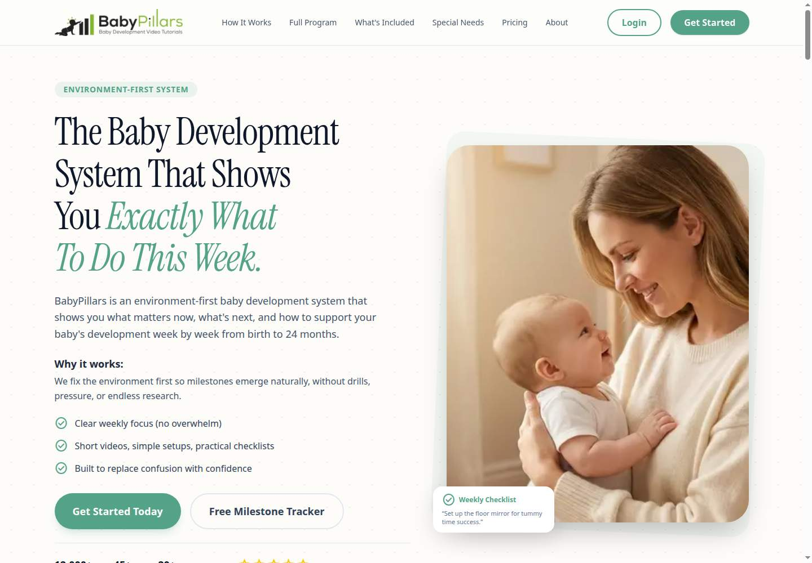
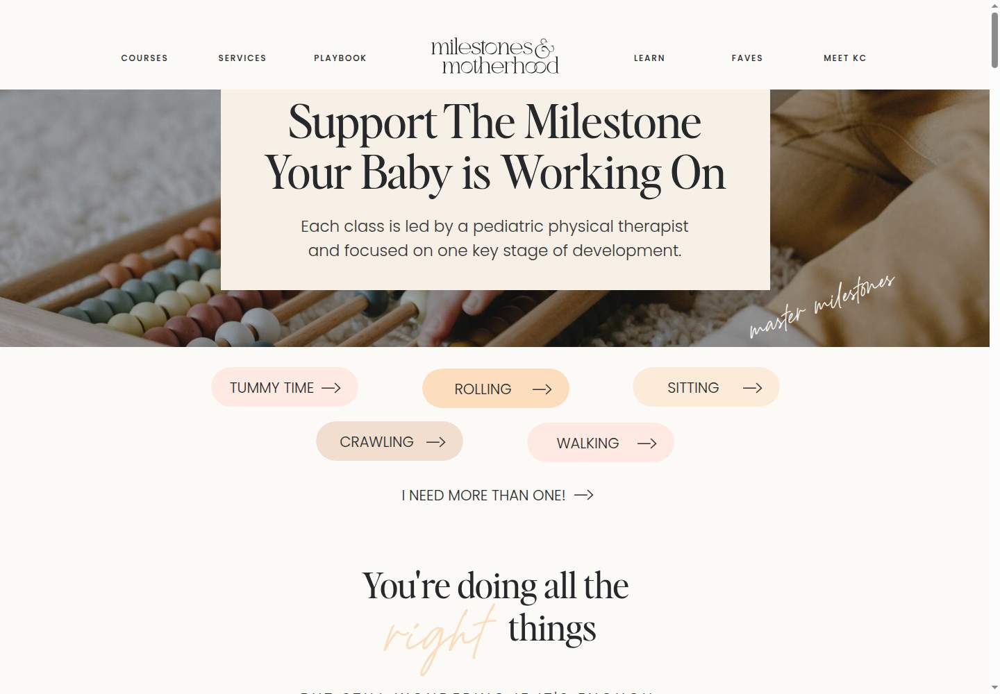
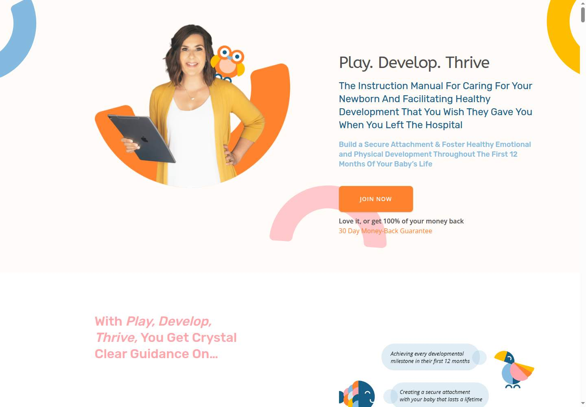
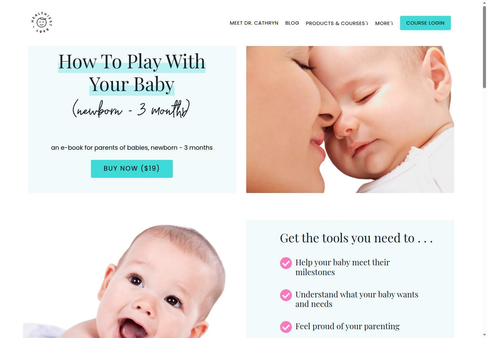

# MamiVio visual references

Captured 5 November 2026. These four current pages were rendered and inspected at **1440 × 1000**, with typography and colors checked through computed browser styles. Screenshots show the first viewport, not the full sales page. These four captures are supporting illustrations, not the full comparative sample. The governing findings (`mamiVio.com/mamivio.com-dev/design-reference/landing-page-design-2026-11-05/DESIGN-FINDINGS.md`), [visual audit A](CORRECTIVE-VISUAL-AUDIT-A.md), [visual audit B](CORRECTIVE-VISUAL-AUDIT-B.md) and [historical recovery](HISTORICAL-DESIGN-EVIDENCE.md) provide the broader comparison.

The captures illustrate two directions within this selected sample: warm editorial presentation and brighter course-sales presentation. Four pages cannot establish a dominant palette across the whole niche, and appearance does not establish conversion performance.

## BabyPillars

[Source page](https://www.babypillars.com/) · [Desktop screenshot](raw/screenshots/babypillars-desktop.jpg)

- Pale paper background `#FDFCF9`, green action/accent `#54A388`, white cards and dark text.
- Instrument Serif display headings with sans-serif body and controls; large headline on the left, parent/baby photograph on the right.
- Rounded actions, a small checklist overlay and a secondary free-resource action.
- Useful reference: a warm, practical system presented through a clear benefit. MamiVio should give the actual day-plan preview more space and use a single paid-offer route.

## Milestones and Motherhood

[Current course page](https://milestonesandmotherhood.com/courses) · [Desktop screenshot](raw/screenshots/milestones-courses-desktop.jpg)

- Observed surfaces include cream `#F6F0E6`, near-white `#FBFAF7` and peach `#FDEBDA`; dark text includes `#26292B`.
- Editors Notes display typography with Poppins supporting text; very prominent serif title, centered panel over home photography and pale stage-selection pills.
- Useful reference: warmth, stage relevance and editorial hierarchy. Keep MamiVio's essential content in readable text, reduce decorative script and make the purchase action more explicit.

## Brightest Beginning

[Play Develop Thrive page](https://brightestbeginning.com/courses/play-develop-thrive/) · [Desktop screenshot](raw/screenshots/brightest-desktop.jpg)

- Deep blue `#175E87`, orange actions `#FF822E`, pink accents and pale blue/beige surfaces.
- Rubik, ABeeZee and Open Sans appear in the computed type styles. The first screen pairs the instructor portrait and playful shapes with explanatory copy, an enrollment button and refund reassurance.
- Useful reference: specific human authorship and purchase reassurance near the action. Its bright graphic energy is a viable alternative mood, but the long course framing and multiple type families would add complexity to a compact quiz entry.

## Healthiest Baby

[How To Play With Your Baby page](https://www.healthiest-baby.com/how-to-play-with-your-baby) · [Desktop screenshot](raw/screenshots/healthiest-desktop.jpg)

- White and pale blue `#F1FAFB`, turquoise actions `#3DDAD7`, dark text `#161E2A` and pink detail accents.
- Playfair Display headings, Poppins body and controls; the first screen uses equal text and baby-photo panels, explicit age/format, and the price inside the purchase action.
- Useful reference: a straightforward small digital product with warm reassurance. Its sample age is newborn–3 months, so it supplies no guidance about MamiVio's 4–18-month content.

## Contrast checks for the recommended direction

The governing recommendation uses light white/pale-blue information surfaces, dark navy type and an orange action. These are calculated sRGB contrast ratios for that proposed palette; they are not competitor conversion measurements.

| Foreground and background | Contrast ratio |
| --- | --- |
| White `#FFFFFF` on orange action `#BC4D1C` | 4.98:1 |
| Navy `#233B59` on white `#FFFFFF` | 11.40:1 |
| Secondary text `#526070` on white `#FFFFFF` | 6.43:1 |
| Navy `#233B59` on pale blue `#F2F7FB` | 10.58:1 |

Check interactive states, focus outlines, image overlays, errors and final sizing in any implementation. The original green wireframes remain structural references only; their palette is superseded by the current written brief (`mamiVio.com/mamivio.com-dev/design-reference/landing-page-design-2026-11-05/DESIGN-BRIEF.md`).
